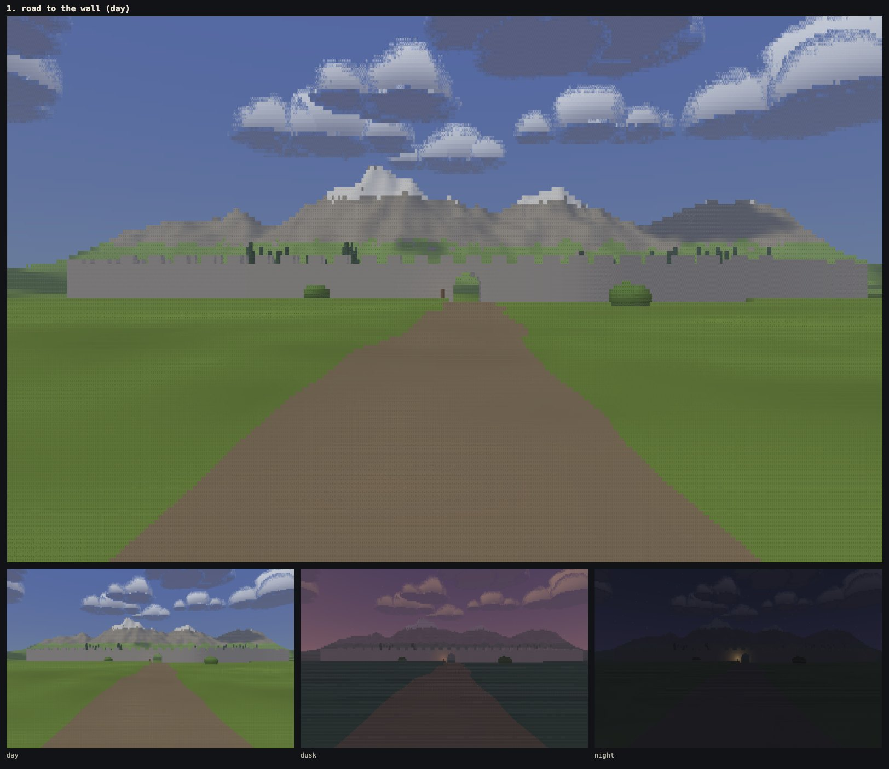
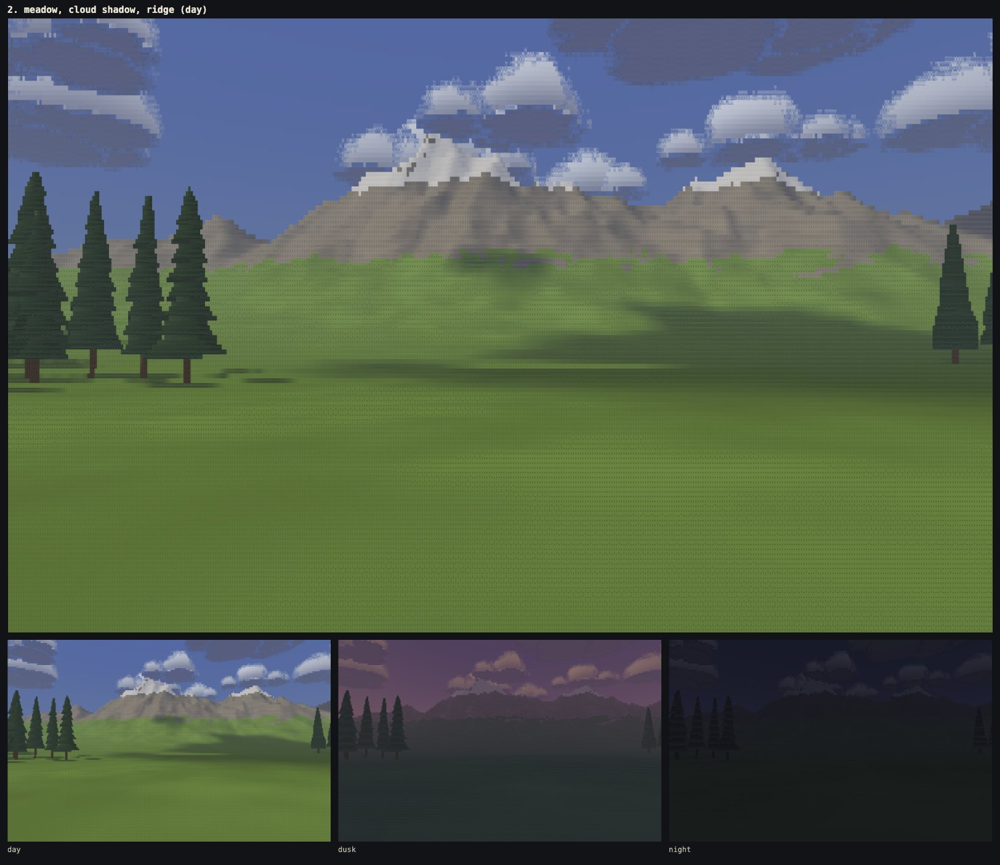
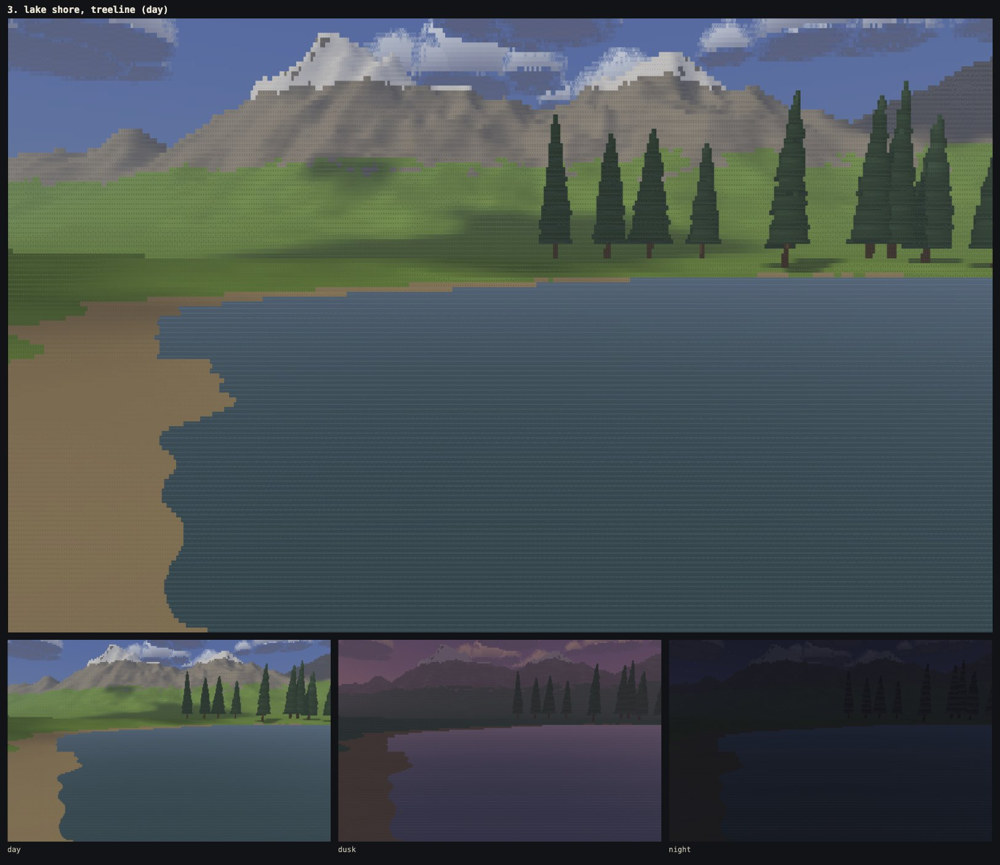
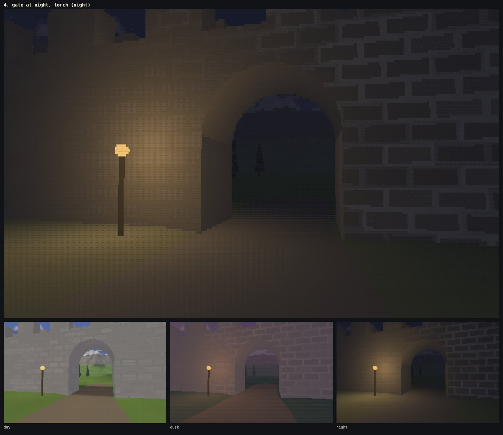
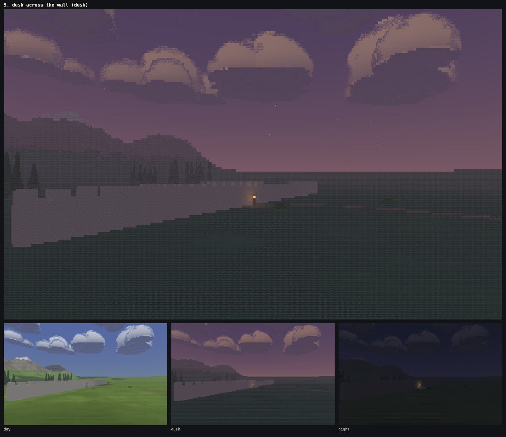
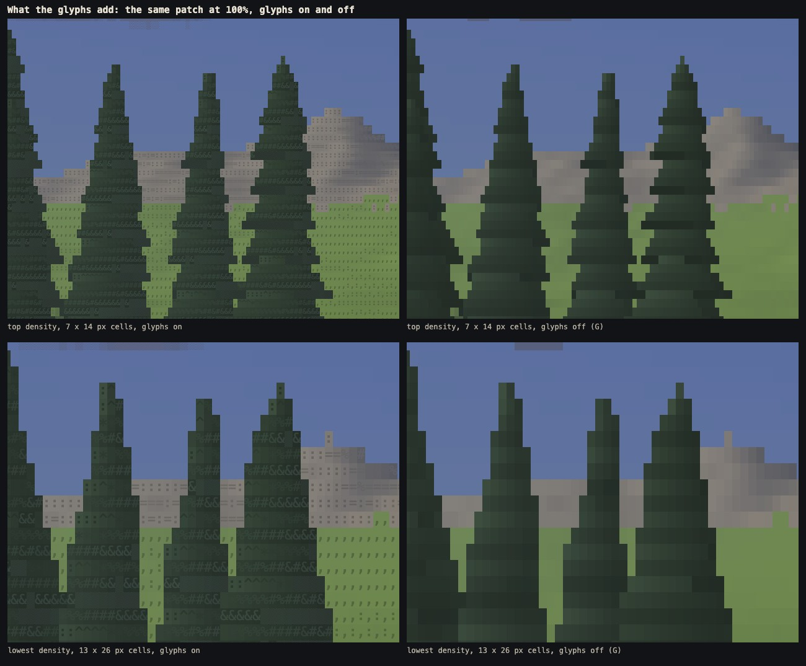

# Phase 0a: the Look Lab

Written 10 Oct 2026. Land of Ascii v3 starts with one small, fixed scene drawn entirely as coloured text, built to prove the look before any world exists. This document records:
- what was built and how it is put together;
- how each of the five cameras compares with its reference frame, and what still differs;
- the frame times at each density in Chromium, Firefox and WebKit.

**Live:** https://oddslice.github.io/land-of-ascii-v3/ (the built `index.html`). Locally: `npm run dev` (http://localhost:5190/), or open `index.html` straight from the folder.

| Key | What it does |
|---|---|
| W A S D, Shift | walk at 4.5 m/s, run at 8 |
| click, drag, arrows | look around (pointer lock after a click; drag and the arrows where the lock is refused) |
| 1 2 3 | day (14:00), dusk (17:51), night (23:00) |
| T | let time run (one game hour per real minute) |
| C | the next of the five fixed cameras (each brings its own time of day) |
| G | glyphs off and on (flat colour against text) |
| R | the matching reference frame beside the picture (only in a local copy: see below) |
| − + | four densities, about 15,000 to 52,000 cells at 1440 × 900 |
| H | hide the HUD |

---

## 1. How it is built

### Three layers, one contract

```
scene backend  ──HitBuffer──▶  resolve  ──CellBuffer──▶  presenter
(what each cell's ray hit)     (glyph + 2 colours)        (WebGL2, one draw call)
```

`src/contract.js` fixes both buffers. They are plain `Uint8Array`s, 8 bytes a cell, so they move between threads without conversion and a GPU backend could read one back from two RGBA8 render targets.

- **HitBuffer**, per cell:
  - material id;
  - direct light from the sun or moon (from the surface normal, before shadows);
  - cast shadow;
  - cloud shadow;
  - torchlight;
  - material detail ("tone");
  - distance in decimetres.

  Sky, cloud, star and water cells reuse some fields, documented in the file.
- **CellBuffer**, per cell: background colour, glyph index, foreground colour.

The next phase's GPU backend only has to fill a HitBuffer. Resolve and the presenter do not change.

| Layer | Files | What it does |
|---|---|---|
| Scene backend A (CPU) | `src/scene/cpu/` | `view.js` rays and planes, `march.js` the column march, `objects.js` trees/bushes/torch, `sky.js` sky/clouds/sun/moon/stars, `light.js` shadows and cloud shadows, `backend.js` wires them |
| Resolve | `src/resolve.js` | HitBuffer → CellBuffer, reading only `src/look.js` |
| Presenter | `src/present/` | `atlas.js` builds the glyph atlas once, `gl.js` draws every cell in one full-screen draw call with integer `texelFetch` only |
| The look | `src/look.js` | every colour, glyph family, ladder, ink rule, light level and haze, for day, dusk and night |
| The scene | `src/world/` | `layout.js` the hand-placed plan, `terrain.js`, `spans.js` (the wall), `objects.js`, `sky.js` (sun, moon, clouds) |
| The page | `src/main.js`, `src/app/` | loop, input, walking, HUD, cameras, workers, the R panel, `window.lab` |

No source file is longer than 380 lines. `npm run build` (esbuild, the only dependency besides Playwright for the tools) bundles everything into the one `index.html` at the root, 91 KB, with the worker's code inline.

### The march (scene backend A)

It follows the technique the target game's developer describes.

**One march per vertical plane, front to back.**
- Looking level, each screen column is one plane.
- Looking up or down, the cells that share an azimuth lie on a slanted line through the vertical vanishing point. The planes are spaced so every cell finds one within half a column of its own azimuth, and each cell is marched in its nearest plane.
- That gives **true perspective with no shear**: verticals converge when you look up at the wall.
- The pitch is limited to ±55°, where the vanishing point would enter the picture.

**The ground is sampled where the ray crosses the lines of the height grid**, never at fixed distances from the eye:
- between crossings the ground is a straight ramp, and each cell's ray is intersected with it exactly, so hillsides are continuous and samples are fixed to the land;
- far away the march steps over coarser levels (2, 4, 8 m, tent-filtered), each blended into the next before it takes over, so nothing pops.

**Buildings are vertical spans per grid cell.**
- The wall is 3 m thick and 6 m high, with 2 m merlons on both parapets.
- The gate's cells start at an arch curve, so the gate can be walked through and the wall's top walked along.
- Spans are walked on the fine grid wherever a plane crosses the wall, with front faces, tops and undersides.
- Each plane keeps a "next unfilled cell" table instead of one horizon, so what is seen through the gate is still found.

**Trees, bushes and the torch have their own depth-tested pass.**
- Each object's screen box comes from projecting its bounds.
- A conifer is a trunk under a stack of overlapping cone tiers (a sawtooth outline) with a ragged edge.

**No part gets thinner than about two cells:**
- radii have a floor that grows with distance;
- conifer tiers melt into a smooth cone once a tier is only a couple of rows tall;
- merlons sink into the walkway before they would be thinner than about two cells;
- masonry joints fade out before they are thinner than two cells.

**Light:**
- cast shadows come from one sweep over the grid toward the light (terrain, wall spans, tree crowns and bushes), recomputed when the sun has moved by 15 s of game time;
- cloud shadows are a large, soft, drifting field, cast along the sun;
- the torch is a point light with a slight flicker.

**Workers.** The picture is split into vertical stripes of columns, one per worker (8 on the M1 Max). A stripe marches only the planes its own cells need and writes only its own columns. `?threads=0` runs the same code on the main thread.

`tools/identity.mjs` renders 8 views (the five cameras, looking up at the wall, looking down, among the trees) with 0, 1, 3, 5 and 8 workers. **Every cell buffer is identical to the byte**, from the sources and from the built file.

A worker that fails to load or throws stops the page with a red panel naming the worker and the error. Nothing falls back silently: this was tested by injecting a failure.

### The look rules, and where they live

All of these are in `src/look.js`:
- **The background carries the surface's lit colour:** between its `shade` and `lit` colours, at light^curve. Then come the material's detail, torchlight and haze.
- **Glyph families** run from light to heavy (grass `,:;"+*%#`, rock `:=%#▒▓`, stone `:=#▒▓█`, and so on).
- **Light picks the rung:** brighter surface, lighter mark. The material's detail nudges the rung, so neighbouring cells do not all wear one glyph. Because that detail is fixed to the land, it does not crawl.
- **Glyphs are chosen from what the ray hit, never from the finished colour.** Emissive things (stars, the flame) run the ladder the other way.
- **Ink:**
  - on lit ground the glyph is a darker tint of the background;
  - in shadow and at night it is lighter, with a floor, so the glyphs carry what light there is;
  - glyph contrast fades with haze, so distance reads as grain.
- **Clamps:** every colour is clamped (no channel under 10 or over 236, saturation capped at 0.62), so nothing is pure black or fully saturated.
- **Edges:** cloud edges dissolve into the sky with the shade blocks ░ ▒ ▓ (sky behind, cloud in front).
- **Three keyframes** (day, dusk, night) are blended by the sun's height, so T runs smoothly between them.

### The atlas and the cells

- **The atlas** is built once at load: every glyph is rasterised from `"Cascadia Mono", Menlo, Consolas, monospace` into an offscreen canvas, at the exact device-pixel size of each density's cell.
- **Shade blocks:** the font's ░ ▒ ▓ █ are checked against the intended dot patterns. On this Mac (Menlo; Cascadia Mono is not installed) all four failed at every size, so they are drawn by hand. At 4 × 8 the font's ▒ is 81% grey smear; at 7 × 14, ░ and ▒ are blurred and █ does not fill the cell. `node tools/atlas.mjs` prints the check and saves the atlases.
- **Cells:**
  - twice as tall as wide, in whole device pixels (devicePixelRatio is respected);
  - the canvas is also kept at a whole number of CSS pixels, because WebKit drops to 3 fps compositing a canvas 1,438.5 CSS pixels wide;
  - `image-rendering: pixelated`;
  - one cell size per preset, so nothing is ever resampled.

| Density | Cell (device px, Retina) | Grid at 1440 × 900 | Cells |
|---|---|---|---|
| 1 | 13 × 26 | 220 × 69 | 15,180 |
| 2 | 10 × 20 | 288 × 90 | 25,920 |
| 3 | 8 × 16 | 360 × 112 | 40,320 |
| 4 | 7 × 14 | 410 × 128 | 52,480 |

The top density is about 52,000 cells, not 60,000, because cells must be whole device pixels. On a Retina screen the choice at the top is 7 px (52,480 cells) or 6 px (72,000); 7 is the closer to 60,000. On a 1× screen the same presets give 3 × 6 cells and about 72,000.

### The scene

`src/world/layout.js` places, on a 512 × 512 grid of 1 m cells, from one constant seed:
- a meadow at 11 m with long shallow rises to low rims on the west, south and east;
- a low rounded hill (13 m);
- a lake (water at 9 m) with a sand shore;
- the dirt road from the start to the gate;
- the wall, 120 m long, with its arched gate 4 m wide;
- 40 conifers in two loose stands (one west of the meadow, one along the lake's far shore);
- 8 bushes;
- one torch south of the gate;
- along the north edge, a massif rising to 119 m with snow above about 85 m.

The sky:
- a vertical gradient with a glow round the sun;
- a sun disc, and a moon disc that is below the horizon at dusk;
- 900 fixed stars, projected so they never blink;
- 20 cumulus clusters that drift east on the wind.

---

## 2. The five cameras against the reference

The side-by-side sheets put each reference thumbnail next to the same view (cropped to the reference's portrait shape, and whole), with day, dusk and night below. **They contain the reference footage, so they stay private:** they are in `shots/sheet-1…5-*.png` in Martin's local copy (made by `node tools/shoot.mjs`), and git ignores them like `reference/`.

What is published here is our side only.



**1. Road to the wall** (reference: ASCII Fort 0:03, road)
- *Close:* the road from the bottom of the frame to the horizon; the horizon just under the middle; a big sky with large cumulus; muted green and dust-brown.
- *Differs:* the reference road runs into open country with a few trees; ours ends at the wall, with the massif behind it, because this camera is also the start view toward the gate.



**2. Meadow, cloud shadow, ridge** (reference: ASCII Fort 0:57, mountains)
- *Close:*
  - the conifer stand on the left;
  - the snowy massif in the middle distance, with haze;
  - soft cloud shadows lying on the meadow;
  - lit grass at about `#6f8a3f` against the reference's `#6c8742`.
- *Differs:*
  - the reference's mountain is one big rock face with a deep shadow side; ours is a wider massif lit more evenly, because the 14:00 sun is behind the camera's left shoulder;
  - the reference's foreground lies in a darker, more dramatic cloud shadow.



**3. Lake shore, treeline** (reference: ASCII Fort 1:07, lake)
- *Close:* the sand shore down one side, the water across the middle, the treeline on the far bank.
- *Differs:*
  - **no reflections** (a later phase, by the brief): the reference's strongest feature is the treeline mirrored in the water, and ours is a flat Fresnel blend toward the sky;
  - the reference's forest is denser and fills the sky behind it, where ours shows the massif;
  - the shore is mirrored left for right.



**4. Gate at night, torch** (reference: day & night 0:11, gate and torch)
- *Close:* the closest of the five, and the mood is the same:
  - big dark stone blocks around an opening;
  - the warm olive pool of the torch on the ground;
  - the night through the arch.
- *Differs:*
  - the reference is seen from inside a deep passage; our wall is 3 m thick, so we stand outside it, and the torch itself is in view;
  - the reference's NPC with a torch is out of scope.



**5. Dusk across the wall** (reference: ray collision 0:36, dusk wall)
- *Close:*
  - the wall receding from the left;
  - dark green meadow (`#29322d` in the reference against our `#3c4636` lit, `#20272a` shaded);
  - a purple sky;
  - large clouds lit pink-orange above with grey-purple undersides.
- *Differs:*
  - the reference's wall has a taller end tower and sits against a dense treeline; ours sits against the massif;
  - the reference's clouds are flatter, broken bands; ours are rounder puffs.



**What the text adds.**
- At the top density the glyphs are grain: at a normal distance from the screen they read as texture and a faint scanline.
- At the lowest density they read as text.
- With G they switch off, and the same picture goes flat and smooth.

### What still differs overall, and why

1. **Water does not reflect.** The brief keeps reflections for a later phase. This is the biggest difference in the lake view.
2. **Trees are cleaner and lighter than the reference's.** Ours are solids of revolution with a tiered outline; the reference's read as darker, rougher clumps and grow denser. The conifer colours and the tier ragging are in `look.js` and `objects.js`.
3. **The meadow is smoother.** The reference's grass has more painterly mottling. Our detail is a world-fixed noise, kept low in contrast so it never crawls when you walk.
4. **Clouds are puffs, not banks.** They are clusters of flattened spheres with dissolving edges. The reference's clouds are more irregular and wispier.
5. **Cloud shadows are not cast by the clouds you see.** They come from a drifting field, cast along the sun, so they always fall where the cameras can see them. The visible clouds are kilometres away and could not shade the valley at a believable size.
6. **The light is 14:00 for "day", not noon** (see Decisions).
7. **Composition is matched on the reference's portrait frame.** Our picture is landscape, so the whole frame shows more to either side. The crops on the private sheets are like for like.

---

## 3. Frame times

**Machine:** M1 Max, 10 cores. Browsers from Playwright, run in visible windows, 1440 × 900 at devicePixelRatio 2, from the built `index.html`.

**Method:** the camera is fixed through `window.lab`, every clock is frozen, and the mouse is never moved. Each row is the median of 300 frames after 60 frames of warm-up. `node tools/bench.mjs` repeats it.

**Machine state:** before timing, the copy of the game in the Claude app's browser pane was closed and no other copy of the game was running.

- **fps** is the median interval between frames on screen.
- **march** and **resolve** are the slowest worker's time for its stripe.
- **draw** is the main thread's upload and draw call.
- Chromium and Firefox ran at the display's 120 Hz (ProMotion); WebKit caps animation frames at 60 Hz.
- Firefox and WebKit round `performance.now()` to whole milliseconds without cross-origin isolation, so their stage times are whole numbers.

Cameras 1, 2 and 3 (road, meadow, lake). Where the three differ, the values are listed in that order.

| Browser | Density | Cells | fps (median) | Worst p95 frame, ms | march, ms | resolve, ms | draw, ms |
|---|---|---|---|---|---|---|---|
| Chromium | 1 | 15,180 | 120.5 | 9.3 | 2.0 / 2.3 / 2.4 | 0.2 | 0.1 |
| Chromium | 2 | 25,920 | 120.5 | 9.3 | 2.5 / 2.8 / 2.8 | 0.3 | 0.1 |
| Chromium | 3 | 40,320 | 120.5 | 9.3 | 3.0 / 3.4 / 3.5 | 0.4 | 0.1 |
| **Chromium** | **4** | **52,480** | **120.5** | **9.3** | **3.4 / 4.0 / 4.0** | **0.5** | **0.1** |
| Firefox | 1 | 15,180 | 125 | 9 | 3 | 1 | 0 |
| Firefox | 2 | 25,920 | 125 | 10 | 4 | 1 | 0 |
| Firefox | 3 | 40,320 | 125 | 9 | 5 / 6 / 6 | 1 | 0 |
| Firefox | 4 | 52,480 | 125 / 111 / 125 | 17 | 6 / 7 / 7 | 1 | 0 |
| WebKit\* | 1 | 15,180 | 58.8 | 18 | 2 | 1 | 0 |
| WebKit\* | 2 | 25,920 | 58.8 | 17 | 3 / 3 / 2 | 1 | 0 |
| WebKit\* | 3 | 40,320 | 58.8 | 17 | 3 | 1 | 0 |
| WebKit\* | 4 | 52,480 | 58.8 | 18 | 3 / 4 / 4 | 1 | 0 |

\* **WebKit was measured headless, and its numbers are its 60 Hz cap.**
- In a visible window, Playwright's WebKit test browser on macOS 27 runs at 60 fps for about 50 seconds, then drops to 1.4 fps and stays there.
- It does the same with no workers at all (`?threads=0`). Headless, it holds 58.8 fps past 7,000 frames.
- So it is the operating system throttling that test app's window after a minute without input, not the game.
- Real Safari was not measured.

**Machine state for the Chromium and Firefox runs:** the Claude app and Martin's Google Chrome were open, at about 20–26% CPU each when the run started. The WebKit run started on an otherwise idle machine.

**Earlier runs** (sources rather than the built file, while a hidden copy of the game was still open in the Claude app's browser pane):
- Firefox ran its window at 60 Hz and gave 59 fps at density 4, with 7–10 ms of march.
- Chromium gave the same 120 fps.

The numbers move by a millisecond or two between runs. They do not move enough to change the conclusion.

**The target is met.**
- Chromium holds the display's full 120 Hz at every density, including the top one (52,480 cells).
- At the top density the slowest worker needs 3.4–4 ms for its stripe and the main thread 0.1 ms to draw. A 60 fps frame has 16.7 ms.
- Firefox also holds 120 Hz, dipping to 111 fps on the meadow at the top density.
- WebKit holds its 60 Hz cap everywhere.

### Steadiness

`node tools/flicker.mjs` counts cells that blink (change, then change back on the next frame) while the camera walks at 4.5 m/s or turns, with every clock frozen.

- **Walking** (cameras 1–3): 0.012–0.023% of cells change glyph and back per frame, and at most 0.001% blink by a visible colour step (more than 6 levels). The rest of the 0.3–0.6% that blink at all are 1–2-level colour wobbles nobody can see.
- **Turning at 18° a second:** 0.27% of cells blink a glyph and 0.05% a visible colour. That is detail sliding across cells (crawl), at cloud edges and rung boundaries.

---

## 4. Decisions to confirm

1. **"Day" is 14:00.** With the sun straight behind the start camera at noon, the hills and the ridge went flat. At 14:00 the light comes over the left shoulder. One number in `look.js` (`hours.day`) changes it.
2. **The top density is about 52,000 cells.** At devicePixelRatio 2, whole-pixel cells give 52,480 or 72,000; 52,480 is the closer to 60,000.
3. **The side-by-side sheets are not published.** The brief asks for them in this document and in git, and also says the reference footage must never be published. The repository is public, so the sheets stay local (`shots/sheet-*.png`, ignored by git) and this page shows our frames only.
4. **Dimensions the brief left open:** the wall is 3 m thick (room to walk the gate passage and along the top); merlons are 2 m wide and 1.5 m high, so they stay at least about two cells from the start view; pitch is limited to ±55°.
5. **C also sets the time of day** of the reference it was framed on (the gate camera is at night, the wall camera at dusk). 1, 2 and 3 still change it afterwards.
6. **The HUD has one line listing the keys.**

---

## 5. Tools

| Command | What it does |
|---|---|
| `npm run dev` | serves the sources at http://localhost:5190/ |
| `npm run build` | writes the single-file `index.html` |
| `node tools/shoot.mjs [--built]` | five cameras × day, dusk, night with the clocks frozen → `shots/`, plus the private side-by-side sheets (`--cams`, `--times`, `--density`, `--threads`, `--browser`, `--cam x,z,yaw,pitch`) |
| `node tools/lookbook.mjs` | the public sheets in `shots/phase0a/` |
| `node tools/bench.mjs [--built]` | frame times per browser, density and camera |
| `node tools/identity.mjs [--built]` | byte-identical cell buffers across worker counts and `?threads=0` |
| `node tools/flicker.mjs` | blinking cells while walking or turning |
| `node tools/atlas.mjs` | the glyph atlases and the shade-block check |
| `node tools/refs.mjs` | cuts the reference thumbnails out of the contact sheets (private, `reference/thumbs/`) |

`window.lab` is the debug handle the tools use:
- `camera(i)`, `setCamera({ x, z, y, yaw, pitch })`;
- `freeze(hour, t)`, `unfreeze()`, `setHour(h)`;
- `setDensity(i)`, `setGlyphs()`, `setHud()`, `setRef()`;
- `whenIdle()`, `timings(n)`, `cellHash()`, `cells()`, `walk(keys, seconds)`, `atlasReport()`, `state()`.

**R and the reference frames:** R shows `reference/thumbs/<frame>.png` beside the picture. The images are never bundled. So R works in a local copy (the dev server, or `index.html` opened from the folder), and on the published site it says the frames are private.
