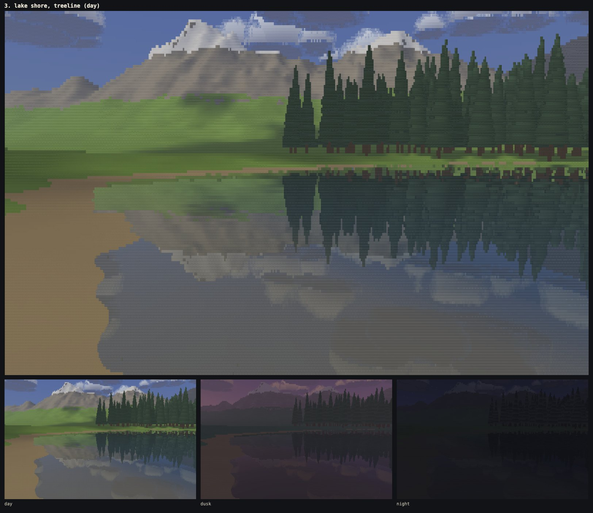
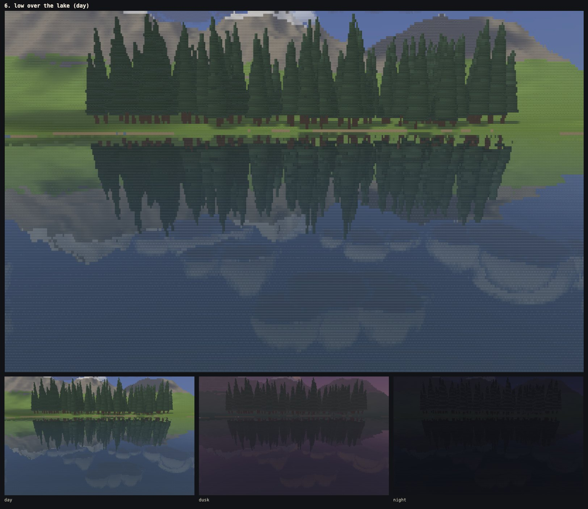
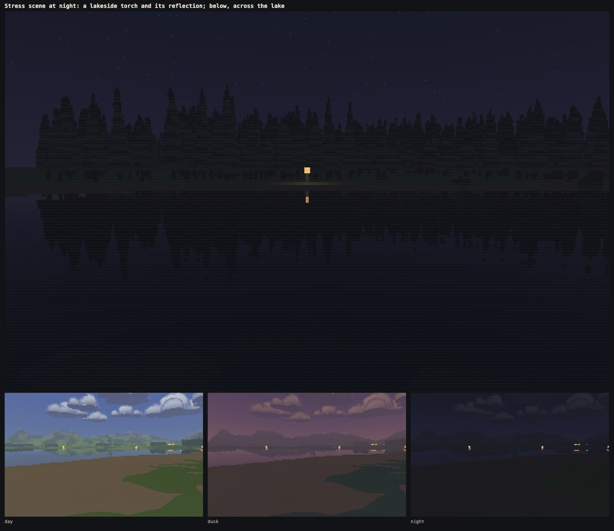
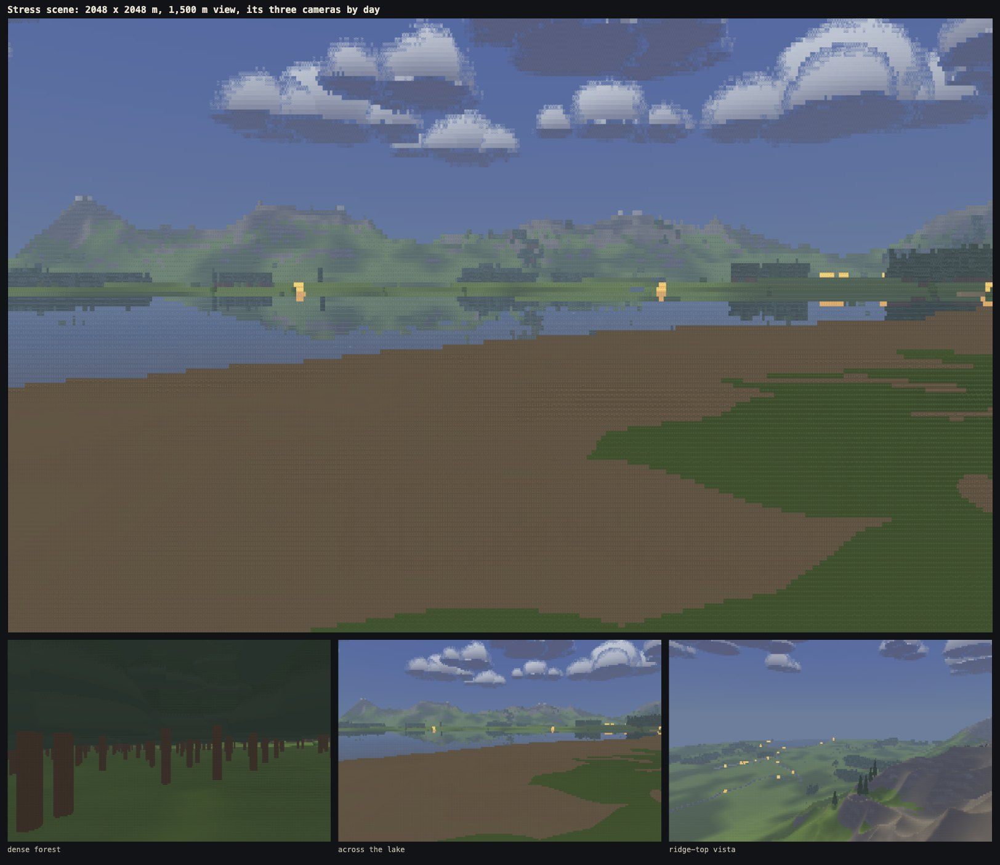

# Phase 0b: water, and the stress test

Written 10 Oct 2026. Phase 0b adds two things to the Look Lab:
- **water** that reflects and refracts: mirrored and refracted rays, ripples and a glitter path, drawn in the same HitBuffer → resolve → presenter pipeline;
- **a stress scene** the size of the real game, which measures whether the CPU column march can carry it.

This document records how both work, our frames of the lake, how they compare with the reference, frame times in three browsers, steadiness figures, and the verdict.

**Live:** https://oddslice.github.io/land-of-ascii-v3/. The stress scene is at [`?stress=1`](https://oddslice.github.io/land-of-ascii-v3/?stress=1), or press **X** (it reloads into the other scene). In the stress scene, C cycles its three cameras.

## The verdict

**The CPU backend is locked in, with density 3 as the default.**

The rule, fixed in the brief: on the M1 Max, at the top density (52,480 cells) with 8 workers, add the slowest worker's march + resolve to the main thread's draw for each stress camera. Results in Chromium and Firefox:

| Stress camera | Chromium, ms | Firefox, ms |
|---|---|---|
| 1 dense forest | 6.3 | 8.0 |
| 2 across the lake | 6.8 | **10.8** |
| 3 ridge-top vista | 6.1 | 9.8 |

- Chromium is well under 10 ms everywhere.
- Firefox is under 10 ms on two cameras and **10.8 ms across the lake**.
- That lands in the 10–14 ms band, so the CPU backend stays and the default density is 3.

The page now opens at density 3 (40,320 cells); −/+ or `?density=4` still give the top density. At density 3 every stress camera is at or under 8.6 ms in both browsers (the tables in section 4).

Two notes that do not change the band:
- With time running, big-map shadow updates add about 0.5–1 ms a frame in Chromium and 1.5 ms in Firefox (section 2), which takes the Firefox lake to about 12 ms.
- The machine was not fully idle (section 4). A remote-desktop host and the window server were using about one core between them. Firefox was 0.8 ms over the line, so a quieter run might dip under 10. I have not re-run it to chase that.

---

## 1. Water

### What a water cell holds

The HitBuffer grew from 8 to 24 bytes a cell: three records of the same 8 fields, documented in `src/contract.js`.

| Record | Bytes | What it holds |
|---|---|---|
| R0 | 0–7 | what the cell's own ray hit. For water, `tone` is the Fresnel share of the mirror, and shadow, cloud shadow and torchlight are those of the surface point. |
| R1 | 8–15 | for a water cell, what the reflected ray hit: terrain, wall, tree, bush, torch, sky, cloud, sun, moon or star. `dist` is the second leg, from the water to the hit. `255` (empty) elsewhere. |
| R2 | 16–23 | for a water cell, what the refracted ray hit on the bed. `dist` is the path length through the water. Empty elsewhere. |

A GPU backend can fill the three records from six RGBA8 render targets. A backend that leaves R1 and R2 empty gets a flat water colour from resolve.

Resolve still picks every glyph from hits. Water has its own family (`. : - =`) and the bed has its own (`. , : ;`). All the new colours and the ripple strengths live in `src/look.js`, in the `water` section and in each time of day's `water` and `bed` entries.

### The reflected ray

A ray reflected off level water stays in its vertical plane, so it can reuse that plane's march.

- Each water cell leaves a **mirrored row**: a ray from the eye mirrored in the water (at height 2W − eye), with the reflected slope, starting at its own water point.
- Rows of one water level form a group. As the march passes a row's water point, the row joins a min-heap ordered by slope. It leaves the heap when it hits something, so each grid crossing only touches rows that could be filled there.
- The rows walk the plane's cached ground crossings and wall cells, the same per-plane tables the direct rays use, and extend the march only where needed. The march stops at 1,200 m (or the view distance) and once nothing left can reach any height there is.
- Trees, bushes and torches get a second, mirrored pass, with their boxes reflected in the water levels the stripe sees. It uses the same two-cell floors as the direct pass.
- Mirrored rays that meet nothing see the sky gradient, clouds, sun or moon disc and stars, each at the reflected direction.
- Every reflected hit is shaded by the same code as a direct one: sun or moon light, cast shadow, cloud shadow, torchlight, and haze over both legs.
- **Glitter:** a mirrored ray that sees open sky within 2.4° across and 20° up or down of the sun (or moon) may show the disc instead. A sparkle fixed to the water position and a clock that ticks 4 times a second decides which cells do. That gives a broken path under a low sun.

The water level that groups mirrored rows is rounded to the centimetre. Without that, a row's mirrored eye depended on which rows a stripe held, and two views differed at a stripe edge. That was the only identity failure found this phase.

### The refracted ray and the bed

- Snell's law with index 1.33, using the ripple-tilted normal.
- The refracted ray marches down to the bed in 0.5 m vertical steps, at most 32. It is skipped where the mirror takes 85% or more of the colour.
- The bed is lit like any surface: sun, its shadow, cloud shadow and torchlight. It is drawn as sand at the shore and silt (`BED`) below.
- **Depth colour:** the bed is tinted toward a warm shallow colour, then toward the deep colour by 1 − e^(−path / 1.1 m). Even the shallowest water keeps at least 40% of the deep colour. So the shallows are lighter and warmer and deep water is dark.
- Fresnel (Schlick): 0.1 at normal incidence, power 4, capped at 0.9.

### Ripples

Ripples never draw anything. They tilt the surface normal, which tilts both rays.
- The ripple slope is a **pure function of world position and time**: five travelling waves with their phases bent by value noise. With the clocks frozen the picture repeats exactly, and turning the camera does not make reflections swim.
- Four waves are short (1.1–5.7 m). They fade out as a cell's footprint on the water grows past them, so distant water lies calm instead of sparkling.
- The fifth is a **36 m swell**. It outlasts that fade and moves distant reflections by about a row, which breaks up the band under the far shore (see the comparison below).
- Only the slope along the ray's plane is used. It moves reflections up and down per column, which is what breaks a mirrored treeline into strips.

### The scene changes

- **The far-shore stand has 90 conifers** (was 20), so the lab scene has 110.
- **A sixth camera, "low over the lake"**, sits just above the water looking at the treeline. It is framed on reference 04 at 0:35.
- **Torch flames are at least two rows tall** at any distance (they were two columns wide, which is one row). A distant flame could fall between rows: at 64 m it vanished from the direct view and from its reflection. This changes the default scene only where the torch is far off.

### Against the reference

The side-by-side sheets are private, because the reference is other people's footage: `shots/sheet-3-lake-shore-treeline.png` (against 04 at 1:07) and `shots/sheet-6-low-over-the-lake.png` (against 04 at 0:35). Both are made by `node tools/shoot.mjs --cams 2,5` and ignored by git. Colours sampled from both:

| | Reference | Ours |
|---|---|---|
| Open water reflecting sky (04 0:35 / camera 6) | #404a5c, #394966 | #3d4a5a, #39485e |
| Mirrored treeline (04 1:07 / camera 3) | #2f3a30 to #3c4a46 | #2f3d3e |
| Water by the near shore (04 1:07 / camera 3) | #4a5d78 | #565656 |

**What reads like the reference:**
- The mirrored treeline: its colour, its contrast against the water, and its tips pointing down into open water.
- The mirrored ridge and clouds.
- The open water of the low camera.

**Ripple break-up.** Tuning was done by shooting and comparing:
1. With only short waves, the band under the far shore was a crisp mirror. There, each cell's footprint is about 24 m along the water, so every short wave had faded.
2. Stronger, longer-lasting short waves changed nothing visible.
3. The 36 m swell gives the reference's broken band of short dashes under the far shore and a slight waver in the mirrored tips. It does so without shredding near reflections, which an earlier, stronger setting did.

**What still differs:**
- **The shallows.** The brief asks for shallows lighter and warmer than deep water, with the bed showing. The reference shows no bed at all: its near water is an even blue. Ours is a warm grey near the beach. `water.tint` and the shallow colours in `look.js` move it toward the reference if wanted.
- **Cloud reflections.** Our clouds show in near water as pale shapes. The reference frames happen to have few clouds over the water.
- **Softness.** The reference's reflections are slightly soft. Ours keep hard cell edges, as everything in the lab does.

### Our frames

All of these are ours, published in `shots/phase0b/` (`node tools/lookbook.mjs --phase 0b --density 4`).

The night frame above shows the torch reflected: its post and flame are mirrored below the shore and its light falls on the water. Distant torches show as small two-row flames with their reflections in the three small frames.

---

## 2. The stress scene

`?stress=1` (or X) replaces the lab's scene with `src/world/stress.js`. Adding it changed nothing in the default scene: its cell buffers were byte-identical before and after (checked on 13 views).

**What it holds**, from a constant seed:
- 2048 × 2048 cells of 1 m: rolling terrain, with a mountain range along the north and east edges (peaks to 287 m, snow on top).
- One large lake (about 660 × 430 m).
- A river from a spring high in the range down to the lake. It follows the steepest way down and, through any hollow, the lowest way toward the lake. It is carved as a channel with sloped banks, its water in whole-metre steps that only go down.
- **5,984 conifers** in close stands on a jittered 5 m lattice, **414 bushes** at the stands' edges, and **20 torches**: 2 at the gate, 4 along the wall, 8 round the lake and 6 down the river.
- A 240 m wall with a gate.
- A **1,500 m view distance**.

**Building it.** Each worker builds its own copy, in steps that report progress; a progress line shows while it builds. The page builds only what walking needs (47 MB), unless it also renders with `?threads=0`.
- Build time with 8 workers building at once: about 1.8 s in Chromium, 2.6 s in WebKit and 4.9 s in Firefox. On the main thread alone: 1.4 s, 1.9 s and 4.4 s.
- Memory: about 155 MB of arrays per worker (1.2 GB with 8 workers). A lab-scene worker needs about 13 MB.

**Shadows.**
- The first full shadow sweep over the 2049² grid takes 130 ms (Chromium, WebKit) to 170 ms (Firefox) in each of 8 workers, and 66–114 ms on the main thread alone. The HUD shows the build and sweep times.
- After that, sweeps are spread over frames: 64K grid nodes a frame, about 86 frames for a whole sweep with its coarser levels. Each frame reports whether shadows have caught up, and `lab.whenIdle()` waits for that, so frozen shots and the identity test only ever see finished shadows.
- **What I changed after measuring.** The first version swept 256K nodes a frame, every 15 game seconds as in the lab. Measured in the browser with time running, that added 5.5 ms a frame in Chromium and 9 ms in Firefox, because all 8 workers sweep the same grid at once and run 2–3 times slower than one thread alone.
- The big map now starts a sweep every 2 game minutes (half a degree of sun, every 2 real seconds) and spreads it thinner. It adds 0.5–1 ms a frame in Chromium and 1.5 ms in Firefox. A sweep under way when the light moves finishes first, then the next starts from the light as it is then.

**The three cameras** are found from the scene, not placed by hand:
- the densest stand on a 32 m grid, at the spot farthest from any trunk, looking along the trunks;
- the lake's south shore, looking north across it at the range;
- the highest point in the north-east, looking south-west over the land.

### Object culling

Culling came first, before any measuring. It is exact: it only drops objects that could not change a cell. So the picture is the same with or without it, in any stripe.
- Objects sit in 64 m buckets. A bucket beyond the view distance, behind the eye or off the stripe is skipped whole.
- Each remaining object is culled by distance and by its projected screen box. A box that reaches behind the eye is cut at a plane just in front of it rather than widened to the whole stripe.
- The survivors are sorted front to back.
- A coarse depth buffer of 4 × 4-cell tiles holds the farthest thing drawn in each tile. An object whose nearest point is beyond every tile its box covers is dropped. Tiles are updated as objects are drawn.
- Within an object, a cell already covered by something nearer than the object's nearest point is skipped. The mirrored pass only visits the rows of each column that hold water.

In the forest camera, 783 of the 6,418 objects survive bucket and box culling, the tiles drop 539 of those, and 244 are drawn. In the open lake and vista views about 2,700–3,200 survive and nearly all are drawn, because they stand against sky or distant ground.

---

## 3. The optimisation pass

The first measurement, after culling, gave 17–18 ms of march on the forest camera and 15 ms across the lake (Chromium headless, 8 workers, density 4). Profiling showed the object pass at 80% of the forest frame. Every change below gives byte-identical cell buffers, checked on 22 views in both scenes.

| Change | What it does |
|---|---|
| Conifers worked out once per plane | The ragged-edge angle and the per-tier radii depend only on the ray's vertical plane, not its row, so they are computed once per plane, not once per cell. Beyond about 128 m, where the tiers have melted into a smooth cone, once per tree. |
| Per-cell early-out | A cell already covered by something nearer than the object's nearest point is skipped before any intersection. |
| True object bounds | A conifer's ragged tiers reach up to 18% past its radius; the culling bounds now include that. (This was a latent stripe-dependence: tiles could have dropped a tree whose tier still reached a cell.) |
| Near-plane box clipping | A tree beside the eye no longer covers the whole stripe. |
| Torch grid | Torchlight looks up the torches that can reach each 16 m square instead of testing all 20 at every hit. |
| Bushes | A ray passing wide of a bush is rejected before any trigonometry. |
| Mirrored rows | The mirrored object pass visits only each column's water rows, and a conifer's tier loop stops once the ray is under it. |
| Balanced stripes | Stripe edges move after each frame toward an equal share of the work, from the last frame's time per column. Water and forest no longer leave one worker with most of the frame. Nothing in a cell depends on where the edges fall. |

**Results (single thread, full 410 × 128 frame, before → after):**
- forest: 106 → 31 ms (its object pass 83 → 12 ms);
- lake: 59 → 39 ms;
- vista: 47 → 37 ms.

With 8 workers (Chromium headless), the slowest worker's march went 18.4 → 7.3 ms (forest), 15.5 → 8.8 ms (lake) and 8.5 → 6.1 ms (vista).

What is left is spread out: the terrain march and its sampling (about a third), object intersections, clouds and resolve. Nothing stands out for a further pass on the CPU.

---

## 4. Frame times

`node tools/bench.mjs --built` measured the built `index.html`: the stress rows at commit 60e53fa, the lab rows at 9ed5259, after the far-shore stand grew to 90 trees. The run covered:
- the six lab cameras and the three stress cameras;
- densities 3 and 4;
- 8 and 4 workers;
- 240 frames each after a 60-frame warm-up, with every clock frozen.

The page was served cross-origin isolated (COOP/COEP headers on the tool server), so Firefox and WebKit timers were fine-grained. Every run reported isolation on and 52,480 cells at density 4.

How to read the tables:
- **march** and **resolve** are each the slowest stripe's.
- **slowest worker** is the slowest stripe's march + resolve in the same frame.
- **draw** is the main thread's upload and draw call.
- **worker + draw** is the per-frame sum, which is the verdict's measure. All values are medians.
- Chromium and Firefox ran in visible windows on the display's 120 Hz. A frame that misses 8.3 ms shows as 60 fps.
- \* WebKit ran headless, as in phase 0a: its visible test window is throttled after about a minute. It is capped at 60 fps.

The later change to big-map shadow sweeps (section 2) only affects frames with time running, so these frozen-clock numbers stand. The first Chromium re-run of the lab rows was disturbed: unchanged views such as the road dropped from 120 to 30 fps, while Firefox in the same run matched its earlier numbers. It was repeated, and the table shows the repeat. Raw rows are in `shots/bench/` (private).

**Machine state:** M1 Max (8 performance and 2 efficiency cores), 32 GB. Before the run, the Chrome Remote Desktop host (~50% of a core), the window server (~50%) and the Claude app (~45% + 30%) were busy. The app's browser pane was closed and no other copy of the game was open.

### Stress scene

| Browser | Workers | Density | Cells | Camera | fps | p95 frame ms | march | resolve | slowest worker (march + resolve) | draw | worker + draw |
|---|---|---|---|---|---|---|---|---|---|---|---|
| Chromium | 8 | 3 | 40,320 | 1 dense forest | 120.0 | 10.0 | 4.9 | 0.4 | 5.2 | 0.1 | 5.3 |
| Chromium | 8 | 3 | 40,320 | 2 across the lake | 119.9 | 16.8 | 6.3 | 0.5 | 6.7 | 0.1 | 6.8 |
| Chromium | 8 | 3 | 40,320 | 3 ridge-top vista | 120.1 | 10.0 | 5.6 | 0.5 | 5.9 | 0.1 | 6.0 |
| Chromium | 8 | 4 | 52,480 | 1 dense forest | 120.0 | 16.7 | 5.7 | 0.5 | 6.2 | 0.1 | **6.3** |
| Chromium | 8 | 4 | 52,480 | 2 across the lake | 119.9 | 16.7 | 6.2 | 0.6 | 6.7 | 0.1 | **6.8** |
| Chromium | 8 | 4 | 52,480 | 3 ridge-top vista | 120.0 | 10.0 | 5.6 | 0.6 | 6.0 | 0.1 | **6.1** |
| Chromium | 4 | 3 | 40,320 | 1 dense forest | 119.9 | 16.7 | 6.0 | 0.7 | 6.7 | 0.1 | 6.8 |
| Chromium | 4 | 3 | 40,320 | 2 across the lake | 60.0 | 18.3 | 8.4 | 0.9 | 9.2 | 0.1 | 9.3 |
| Chromium | 4 | 3 | 40,320 | 3 ridge-top vista | 119.7 | 16.9 | 7.2 | 0.8 | 7.8 | 0.1 | 7.9 |
| Chromium | 4 | 4 | 52,480 | 1 dense forest | 60.0 | 18.4 | 7.6 | 1.0 | 8.5 | 0.1 | 8.6 |
| Chromium | 4 | 4 | 52,480 | 2 across the lake | 60.0 | 18.7 | 9.7 | 1.1 | 10.6 | 0.1 | 10.7 |
| Chromium | 4 | 4 | 52,480 | 3 ridge-top vista | 60.0 | 16.8 | 8.8 | 1.0 | 9.6 | 0.1 | 9.7 |
| Firefox | 8 | 3 | 40,320 | 1 dense forest | 119.9 | 16.5 | 6.0 | 0.5 | 6.4 | 0.2 | 6.6 |
| Firefox | 8 | 3 | 40,320 | 2 across the lake | 60.0 | 16.9 | 7.9 | 0.7 | 8.4 | 0.2 | 8.6 |
| Firefox | 8 | 3 | 40,320 | 3 ridge-top vista | 60.2 | 16.8 | 7.5 | 0.7 | 8.1 | 0.2 | 8.3 |
| Firefox | 8 | 4 | 52,480 | 1 dense forest | 117.4 | 16.8 | 7.1 | 0.8 | 7.8 | 0.2 | **8.0** |
| Firefox | 8 | 4 | 52,480 | 2 across the lake | 60.0 | 18.2 | 9.8 | 0.9 | 10.5 | 0.2 | **10.8** |
| Firefox | 8 | 4 | 52,480 | 3 ridge-top vista | 60.0 | 17.7 | 8.9 | 1.0 | 9.6 | 0.2 | **9.8** |
| Firefox | 4 | 3 | 40,320 | 1 dense forest | 60.0 | 16.9 | 8.8 | 1.2 | 9.9 | 0.2 | 10.1 |
| Firefox | 4 | 3 | 40,320 | 2 across the lake | 60.0 | 18.0 | 13.3 | 1.2 | 14.4 | 0.1 | 14.5 |
| Firefox | 4 | 3 | 40,320 | 3 ridge-top vista | 60.0 | 17.8 | 11.8 | 1.2 | 12.8 | 0.1 | 13.0 |
| Firefox | 4 | 4 | 52,480 | 1 dense forest | 60.0 | 16.8 | 10.8 | 1.5 | 12.2 | 0.2 | 12.4 |
| Firefox | 4 | 4 | 52,480 | 2 across the lake | 40.0 | 25.1 | 15.8 | 1.6 | 17.3 | 0.2 | 17.5 |
| Firefox | 4 | 4 | 52,480 | 3 ridge-top vista | 60.0 | 24.3 | 14.2 | 1.6 | 15.4 | 0.2 | 15.7 |
| WebKit\* | 8 | 3 | 40,320 | 1 dense forest | 60.0 | 18.0 | 4.0 | 0.5 | 4.4 | 0.2 | 4.7 |
| WebKit\* | 8 | 3 | 40,320 | 2 across the lake | 60.0 | 18.3 | 5.5 | 0.5 | 5.9 | 0.2 | 6.0 |
| WebKit\* | 8 | 3 | 40,320 | 3 ridge-top vista | 60.0 | 18.3 | 4.9 | 0.5 | 5.3 | 0.2 | 5.5 |
| WebKit\* | 8 | 4 | 52,480 | 1 dense forest | 60.0 | 18.3 | 4.8 | 0.6 | 5.3 | 0.2 | **5.5** |
| WebKit\* | 8 | 4 | 52,480 | 2 across the lake | 60.0 | 17.2 | 6.1 | 0.6 | 6.5 | 0.2 | **6.7** |
| WebKit\* | 8 | 4 | 52,480 | 3 ridge-top vista | 60.0 | 17.7 | 5.6 | 0.6 | 6.0 | 0.2 | **6.2** |
| WebKit\* | 4 | 3 | 40,320 | 1 dense forest | 60.0 | 17.6 | 6.1 | 0.8 | 6.8 | 0.2 | 7.0 |
| WebKit\* | 4 | 3 | 40,320 | 2 across the lake | 60.0 | 17.6 | 8.4 | 0.8 | 9.1 | 0.2 | 9.2 |
| WebKit\* | 4 | 3 | 40,320 | 3 ridge-top vista | 60.0 | 17.6 | 7.4 | 0.8 | 8.1 | 0.2 | 8.2 |
| WebKit\* | 4 | 4 | 52,480 | 1 dense forest | 60.0 | 17.6 | 7.3 | 1.0 | 8.3 | 0.2 | 8.4 |
| WebKit\* | 4 | 4 | 52,480 | 2 across the lake | 60.0 | 17.6 | 9.9 | 1.0 | 10.8 | 0.2 | 11.0 |
| WebKit\* | 4 | 4 | 52,480 | 3 ridge-top vista | 60.0 | 17.6 | 8.8 | 1.1 | 9.6 | 0.2 | 9.8 |

### Lab scene

| Browser | Workers | Density | Cells | Camera | fps | p95 frame ms | march | resolve | slowest worker (march + resolve) | draw | worker + draw |
|---|---|---|---|---|---|---|---|---|---|---|---|
| Chromium | 8 | 3 | 40,320 | 1 road to the wall | 120.0 | 9.3 | 3.3 | 0.4 | 3.7 | 0.1 | 3.8 |
| Chromium | 8 | 3 | 40,320 | 2 meadow, cloud shadow, ridge | 120.1 | 9.3 | 3.7 | 0.4 | 4.0 | 0.1 | 4.2 |
| Chromium | 8 | 3 | 40,320 | 3 lake shore, treeline | 119.8 | 16.8 | 6.6 | 0.7 | 7.2 | 0.1 | 7.3 |
| Chromium | 8 | 3 | 40,320 | 4 gate at night, torch | 120.1 | 9.3 | 2.7 | 0.5 | 3.1 | 0.1 | 3.2 |
| Chromium | 8 | 3 | 40,320 | 5 dusk across the wall | 120.0 | 9.3 | 3.4 | 0.4 | 3.8 | 0.1 | 3.9 |
| Chromium | 8 | 3 | 40,320 | 6 low over the lake | 60.0 | 17.1 | 7.5 | 0.8 | 8.2 | 0.1 | 8.3 |
| Chromium | 8 | 4 | 52,480 | 1 road to the wall | 120.0 | 8.9 | 4.0 | 0.5 | 4.4 | 0.1 | 4.6 |
| Chromium | 8 | 4 | 52,480 | 2 meadow, cloud shadow, ridge | 120.1 | 9.3 | 4.4 | 0.5 | 4.8 | 0.1 | 5.0 |
| Chromium | 8 | 4 | 52,480 | 3 lake shore, treeline | 60.1 | 17.1 | 7.7 | 0.9 | 8.6 | 0.1 | 8.7 |
| Chromium | 8 | 4 | 52,480 | 4 gate at night, torch | 120.0 | 9.3 | 3.1 | 0.6 | 3.5 | 0.1 | 3.7 |
| Chromium | 8 | 4 | 52,480 | 5 dusk across the wall | 120.0 | 9.3 | 4.0 | 0.5 | 4.4 | 0.1 | 4.5 |
| Chromium | 8 | 4 | 52,480 | 6 low over the lake | 60.0 | 17.5 | 9.4 | 1.4 | 10.2 | 0.1 | 10.3 |
| Chromium | 4 | 3 | 40,320 | 1 road to the wall | 120.1 | 9.3 | 4.0 | 0.7 | 4.6 | 0.1 | 4.7 |
| Chromium | 4 | 3 | 40,320 | 2 meadow, cloud shadow, ridge | 120.1 | 9.3 | 4.3 | 0.7 | 5.0 | 0.1 | 5.1 |
| Chromium | 4 | 3 | 40,320 | 3 lake shore, treeline | 60.0 | 17.6 | 9.4 | 1.3 | 10.5 | 0.1 | 10.5 |
| Chromium | 4 | 3 | 40,320 | 4 gate at night, torch | 120.1 | 8.7 | 3.1 | 0.9 | 3.7 | 0.1 | 3.8 |
| Chromium | 4 | 3 | 40,320 | 5 dusk across the wall | 120.1 | 9.3 | 4.0 | 0.7 | 4.7 | 0.1 | 4.8 |
| Chromium | 4 | 3 | 40,320 | 6 low over the lake | 60.0 | 17.6 | 11.3 | 1.4 | 12.7 | 0.1 | 12.8 |
| Chromium | 4 | 4 | 52,480 | 1 road to the wall | 120.1 | 9.3 | 4.9 | 0.9 | 5.8 | 0.1 | 5.9 |
| Chromium | 4 | 4 | 52,480 | 2 meadow, cloud shadow, ridge | 120.0 | 9.3 | 5.7 | 0.9 | 6.6 | 0.1 | 6.7 |
| Chromium | 4 | 4 | 52,480 | 3 lake shore, treeline | 60.0 | 17.6 | 12.0 | 1.7 | 13.5 | 0.1 | 13.6 |
| Chromium | 4 | 4 | 52,480 | 4 gate at night, torch | 120.1 | 9.3 | 3.6 | 1.1 | 4.4 | 0.1 | 4.5 |
| Chromium | 4 | 4 | 52,480 | 5 dusk across the wall | 119.8 | 17.4 | 5.4 | 1.0 | 6.3 | 0.1 | 6.5 |
| Chromium | 4 | 4 | 52,480 | 6 low over the lake | 60.0 | 24.1 | 13.9 | 1.8 | 15.7 | 0.1 | 15.8 |
| Firefox | 8 | 3 | 40,320 | 1 road to the wall | 120.2 | 8.5 | 4.9 | 0.6 | 5.4 | 0.2 | 5.6 |
| Firefox | 8 | 3 | 40,320 | 2 meadow, cloud shadow, ridge | 119.9 | 8.5 | 5.0 | 0.6 | 5.5 | 0.2 | 5.7 |
| Firefox | 8 | 3 | 40,320 | 3 lake shore, treeline | 60.0 | 17.6 | 9.3 | 1.1 | 10.1 | 0.2 | 10.3 |
| Firefox | 8 | 3 | 40,320 | 4 gate at night, torch | 119.9 | 8.6 | 3.0 | 0.8 | 3.5 | 0.2 | 3.7 |
| Firefox | 8 | 3 | 40,320 | 5 dusk across the wall | 119.9 | 8.5 | 4.0 | 0.6 | 4.5 | 0.2 | 4.7 |
| Firefox | 8 | 3 | 40,320 | 6 low over the lake | 60.0 | 17.3 | 11.1 | 1.0 | 12.0 | 0.2 | 12.1 |
| Firefox | 8 | 4 | 52,480 | 1 road to the wall | 119.9 | 16.6 | 6.2 | 0.7 | 6.8 | 0.2 | 7.1 |
| Firefox | 8 | 4 | 52,480 | 2 meadow, cloud shadow, ridge | 119.6 | 16.7 | 6.5 | 0.8 | 7.2 | 0.2 | 7.4 |
| Firefox | 8 | 4 | 52,480 | 3 lake shore, treeline | 60.0 | 25.0 | 11.9 | 1.3 | 13.0 | 0.2 | 13.2 |
| Firefox | 8 | 4 | 52,480 | 4 gate at night, torch | 119.9 | 9.3 | 3.3 | 1.0 | 3.9 | 0.2 | 4.2 |
| Firefox | 8 | 4 | 52,480 | 5 dusk across the wall | 119.6 | 16.7 | 5.7 | 0.8 | 6.4 | 0.2 | 6.6 |
| Firefox | 8 | 4 | 52,480 | 6 low over the lake | 59.9 | 25.1 | 13.6 | 1.3 | 14.8 | 0.2 | 15.0 |
| Firefox | 4 | 3 | 40,320 | 1 road to the wall | 60.2 | 16.9 | 7.2 | 1.2 | 8.3 | 0.2 | 8.5 |
| Firefox | 4 | 3 | 40,320 | 2 meadow, cloud shadow, ridge | 60.2 | 16.9 | 7.3 | 1.1 | 8.3 | 0.2 | 8.5 |
| Firefox | 4 | 3 | 40,320 | 3 lake shore, treeline | 60.0 | 25.0 | 14.0 | 1.8 | 15.5 | 0.2 | 15.7 |
| Firefox | 4 | 3 | 40,320 | 4 gate at night, torch | 120.2 | 9.3 | 4.1 | 1.4 | 4.9 | 0.2 | 5.1 |
| Firefox | 4 | 3 | 40,320 | 5 dusk across the wall | 118.8 | 16.8 | 6.7 | 1.1 | 7.8 | 0.2 | 8.0 |
| Firefox | 4 | 3 | 40,320 | 6 low over the lake | 40.0 | 25.6 | 16.7 | 1.9 | 18.6 | 0.2 | 18.7 |
| Firefox | 4 | 4 | 52,480 | 1 road to the wall | 60.0 | 17.6 | 8.7 | 1.4 | 10.0 | 0.2 | 10.3 |
| Firefox | 4 | 4 | 52,480 | 2 meadow, cloud shadow, ridge | 60.0 | 17.5 | 8.9 | 1.5 | 10.2 | 0.2 | 10.4 |
| Firefox | 4 | 4 | 52,480 | 3 lake shore, treeline | 40.0 | 25.9 | 17.6 | 2.4 | 19.6 | 0.2 | 19.8 |
| Firefox | 4 | 4 | 52,480 | 4 gate at night, torch | 119.9 | 9.1 | 4.8 | 1.8 | 5.9 | 0.2 | 6.1 |
| Firefox | 4 | 4 | 52,480 | 5 dusk across the wall | 60.0 | 17.3 | 8.4 | 1.4 | 9.7 | 0.2 | 9.9 |
| Firefox | 4 | 4 | 52,480 | 6 low over the lake | 40.0 | 33.3 | 20.7 | 2.4 | 23.1 | 0.2 | 23.3 |
| WebKit\* | 8 | 3 | 40,320 | 1 road to the wall | 60.0 | 16.8 | 2.9 | 0.4 | 3.3 | 0.2 | 3.5 |
| WebKit\* | 8 | 3 | 40,320 | 2 meadow, cloud shadow, ridge | 60.0 | 17.5 | 3.2 | 0.5 | 3.7 | 0.2 | 3.9 |
| WebKit\* | 8 | 3 | 40,320 | 3 lake shore, treeline | 60.0 | 17.5 | 5.3 | 0.7 | 5.9 | 0.2 | 6.1 |
| WebKit\* | 8 | 3 | 40,320 | 4 gate at night, torch | 60.0 | 17.5 | 2.6 | 0.6 | 3.0 | 0.2 | 3.2 |
| WebKit\* | 8 | 3 | 40,320 | 5 dusk across the wall | 60.0 | 17.0 | 3.1 | 0.5 | 3.5 | 0.2 | 3.7 |
| WebKit\* | 8 | 3 | 40,320 | 6 low over the lake | 60.0 | 17.6 | 6.4 | 0.6 | 6.9 | 0.2 | 7.1 |
| WebKit\* | 8 | 4 | 52,480 | 1 road to the wall | 60.0 | 17.6 | 3.5 | 0.6 | 4.0 | 0.2 | 4.2 |
| WebKit\* | 8 | 4 | 52,480 | 2 meadow, cloud shadow, ridge | 60.0 | 17.6 | 3.9 | 0.6 | 4.4 | 0.2 | 4.6 |
| WebKit\* | 8 | 4 | 52,480 | 3 lake shore, treeline | 60.0 | 17.5 | 7.1 | 0.8 | 7.8 | 0.2 | 8.0 |
| WebKit\* | 8 | 4 | 52,480 | 4 gate at night, torch | 60.0 | 17.6 | 2.6 | 0.7 | 3.1 | 0.3 | 3.3 |
| WebKit\* | 8 | 4 | 52,480 | 5 dusk across the wall | 60.0 | 17.6 | 3.6 | 0.6 | 4.1 | 0.3 | 4.4 |
| WebKit\* | 8 | 4 | 52,480 | 6 low over the lake | 60.0 | 17.6 | 7.9 | 0.8 | 8.7 | 0.2 | 8.9 |
| WebKit\* | 4 | 3 | 40,320 | 1 road to the wall | 60.0 | 17.6 | 4.3 | 0.8 | 5.0 | 0.2 | 5.2 |
| WebKit\* | 4 | 3 | 40,320 | 2 meadow, cloud shadow, ridge | 60.0 | 17.6 | 4.4 | 0.8 | 5.2 | 0.2 | 5.3 |
| WebKit\* | 4 | 3 | 40,320 | 3 lake shore, treeline | 60.0 | 17.6 | 8.8 | 2.2 | 10.1 | 0.2 | 10.3 |
| WebKit\* | 4 | 3 | 40,320 | 4 gate at night, torch | 60.0 | 17.6 | 3.2 | 1.1 | 3.9 | 0.2 | 4.0 |
| WebKit\* | 4 | 3 | 40,320 | 5 dusk across the wall | 60.0 | 17.0 | 4.1 | 0.8 | 4.8 | 0.2 | 4.9 |
| WebKit\* | 4 | 3 | 40,320 | 6 low over the lake | 60.0 | 17.3 | 10.4 | 1.1 | 11.5 | 0.2 | 11.6 |
| WebKit\* | 4 | 4 | 52,480 | 1 road to the wall | 60.0 | 17.6 | 5.0 | 0.9 | 6.0 | 0.2 | 6.1 |
| WebKit\* | 4 | 4 | 52,480 | 2 meadow, cloud shadow, ridge | 60.0 | 17.6 | 5.2 | 1.0 | 6.1 | 0.2 | 6.3 |
| WebKit\* | 4 | 4 | 52,480 | 3 lake shore, treeline | 60.0 | 17.6 | 10.6 | 1.5 | 11.7 | 0.2 | 11.9 |
| WebKit\* | 4 | 4 | 52,480 | 4 gate at night, torch | 60.0 | 16.8 | 3.7 | 1.4 | 4.6 | 0.2 | 4.8 |
| WebKit\* | 4 | 4 | 52,480 | 5 dusk across the wall | 60.0 | 17.5 | 5.1 | 1.0 | 6.0 | 0.2 | 6.1 |
| WebKit\* | 4 | 4 | 52,480 | 6 low over the lake | 60.0 | 17.6 | 12.7 | 1.5 | 14.2 | 0.2 | 14.4 |

**What the tables say:**
- With 8 workers, the stress scene costs Chromium about 6–7 ms a frame and Firefox 8–11 ms at the top density. At density 3 both are at or under 8.6 ms.
- **The heaviest view of all is in the lab:** camera 6, low over the lake. Near water mirrors the whole 90-tree stand, with ripples, so it reaches 10.3 ms (Chromium) and 15.0 ms (Firefox) at the top density, and 8.3 and 12.1 ms at density 3. It is not one of the verdict's cameras, but it shows where water costs most.
- Dry lab views are close to where phase 0a left them: 3.7–5 ms (Chromium) and 4–7.5 ms (Firefox) at the top density.
- With 4 workers everything is roughly 1.5 times slower. Firefox's lake and vista go over 14 ms at the top density, so 4-core machines want density 3 or lower.

---

## 5. Steadiness

`node tools/flicker.mjs --density 4` counts cells that blink (change, then change back on the next frame) while the camera walks or turns with every clock frozen. The water set walks sideways along a shore at 4.5 m/s and turns across the lake at 18° a second, with a dry view moved the same way for comparison. Measured at density 4 in Chromium.

| Run | Blinking cells per frame | Glyph blinks | Colour blinks (more than 6 levels) | Cells changing at all |
|---|---|---|---|---|
| lab, meadow (no water): walking sideways | 0.574% | 0.020% | 0.000% | 20.6% |
| lab, meadow (no water): turning | 1.098% | 0.292% | 0.072% | 36.3% |
| lab, lake shore: walking along the shore | 1.154% | 0.040% | 0.017% | 37.4% |
| lab, lake shore: turning across the lake | 1.801% | 0.341% | 0.181% | 57.0% |
| lab, low over the lake: walking along the shore | 1.141% | 0.049% | 0.025% | 34.4% |
| lab, low over the lake: turning across the lake | 1.267% | 0.222% | 0.131% | 50.2% |
| stress, across the lake: walking along the shore | 0.223% | 0.023% | 0.008% | 10.7% |
| stress, across the lake: turning across the lake | 0.802% | 0.402% | 0.131% | 25.6% |

- **Walking:** water adds about 0.02–0.03% glyph blinks and 0.02% visible colour blinks, about 10–14 cells of 52,480. A map of where they happen shows them spread along tree edges and their reflections, not concentrated on the water.
- **Turning:** glyph blinks are about the dry view's (0.22–0.40% against 0.29%), but visible colour blinks are about twice as common (0.13–0.18% against 0.07%). That is crawl at reflected cloud edges and at the mirrored treeline.
- Fading the short waves out earlier made no measurable difference, so the ripple field is not what blinks.

---

## 6. Walks

`node tools/walk.mjs` records a 20 s scripted walk as video, with time running, for:
- the lab's lake shore (strafing along the shore, then looking left and right across the water);
- each stress camera: walking through the forest, strafing along the big lake's shore, walking off the ridge.

The videos go to `shots/walks/` (about 9 MB each) and are kept out of git. Chromium (headless, 8 workers, density 4) presented 58–59 frames a second in all four.

---

## 7. Notes and decisions to confirm

1. **Density 3 is now the default**, as the verdict rule says. This changes the page's opening density from 4 to 3. Tools given no `--density` now use density 3 too. The frames and figures in this document were taken at density 4.
2. **The shallows are lighter and warmer** as the brief asks. That is the one place our water differs clearly from the reference, whose near water shows no bed (section 1).
3. **Big-map shadows update every 2 game minutes.** That is a new sweep every 2 real seconds with the clock running, and it takes about 1.5 s to come through. Shadows lag the sun by under a degree, which I could not see.
4. **Stress memory is about 1.2 GB with 8 workers.** Each worker builds its own world, because sharing memory between workers needs cross-origin isolation, which GitHub Pages cannot serve.
5. **X reloads the page** with `stress=1` toggled, rather than swapping scenes in place, so the lab scene never holds the big world's memory.
6. **Bugs found and fixed on the way:**
   - the stress river carved itself into a canyon thousands of metres deep: it read ground it had already carved;
   - `lab.setCamera` with a height let the eye fall before a shot;
   - distant flames could fall between rows;
   - a conifer's culling bounds were too small;
   - `lab.whenIdle` would have waited forever for shadows with the clock running on the big map.
7. **`index.html` is 143 KB** (was 91 KB after phase 0a), still one file with the worker inline. The largest source file is `src/scene/cpu/objects.js` at 487 lines.

---

## 8. Tools

| Command | What it does |
|---|---|
| `node tools/bench.mjs [--built]` | frame times for both scenes, densities 3 and 4, 8 and 4 workers; Chromium and Firefox in a window, WebKit headless; raw rows to `shots/bench/` (`--browser`, `--threads`, `--density`, `--scene lab|stress|both`, `--frames`) |
| `node tools/identity.mjs [--built]` | byte-identical cell buffers across 0, 1, 3, 5 and 8 workers, in both scenes (`--scene`, `--threads`) |
| `node tools/flicker.mjs` | the water steadiness set above (or `--cam N [--stress] --step --dir --turn`) |
| `node tools/walk.mjs [--density 4]` | the four 20 s walk videos → `shots/walks/` (private) |
| `node tools/shoot.mjs --cams 2,5` | the lake cameras at day, dusk and night, and the private side-by-side sheets |
| `node tools/lookbook.mjs --phase 0b [--density 4]` | the public frames in `shots/phase0b/` |

New in `window.lab`:
- `stress`, and `world` (kind, size, counts, build and sweep times);
- `state().settled` (cast shadows caught up) and `state().isolated`;
- each entry of `timings(n)` now includes `worker`;
- `setCamera` with `y` holds the eye there until a walk key is pressed.
