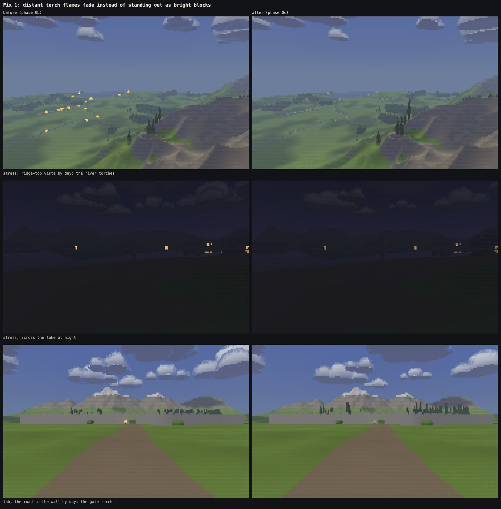
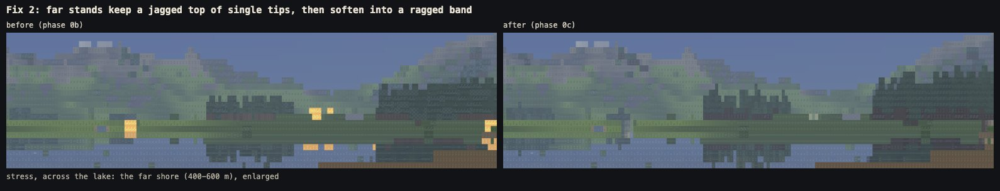
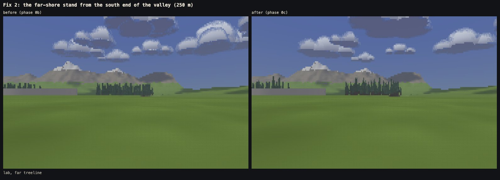
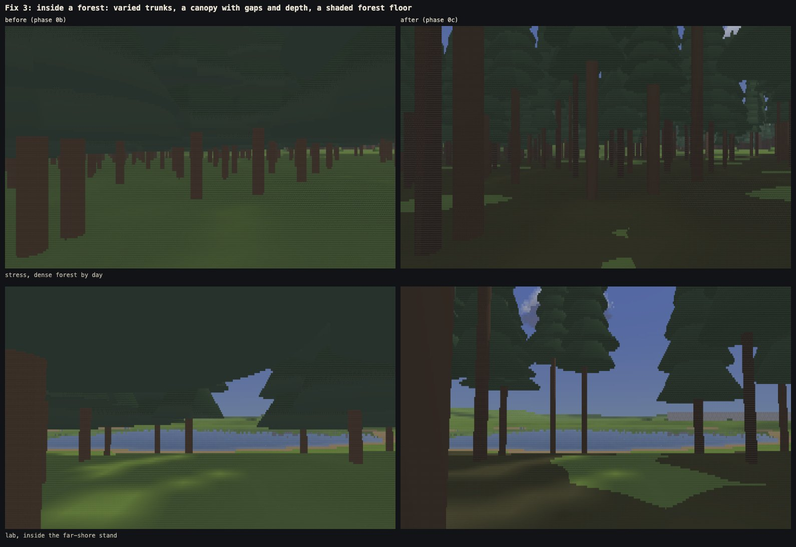
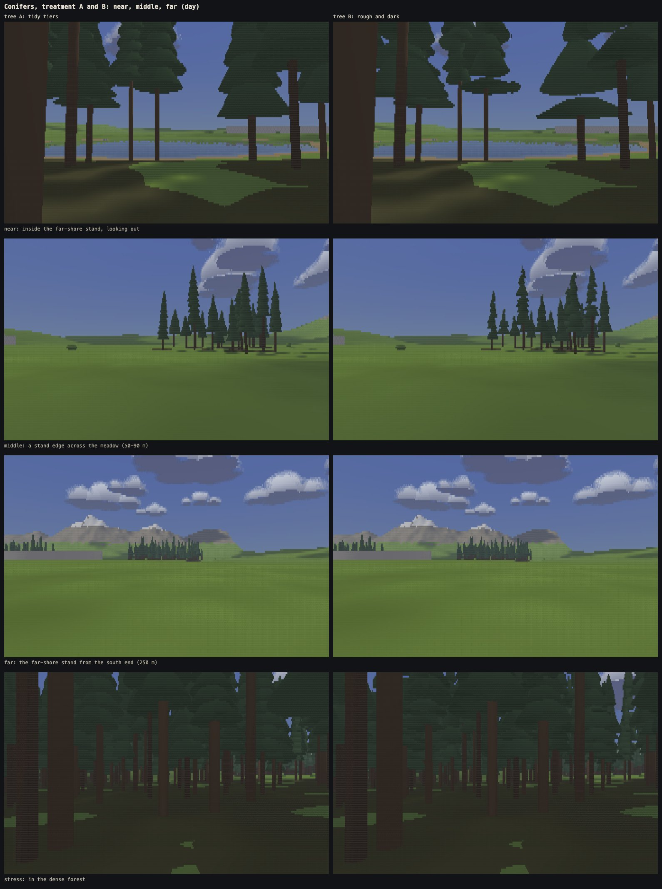
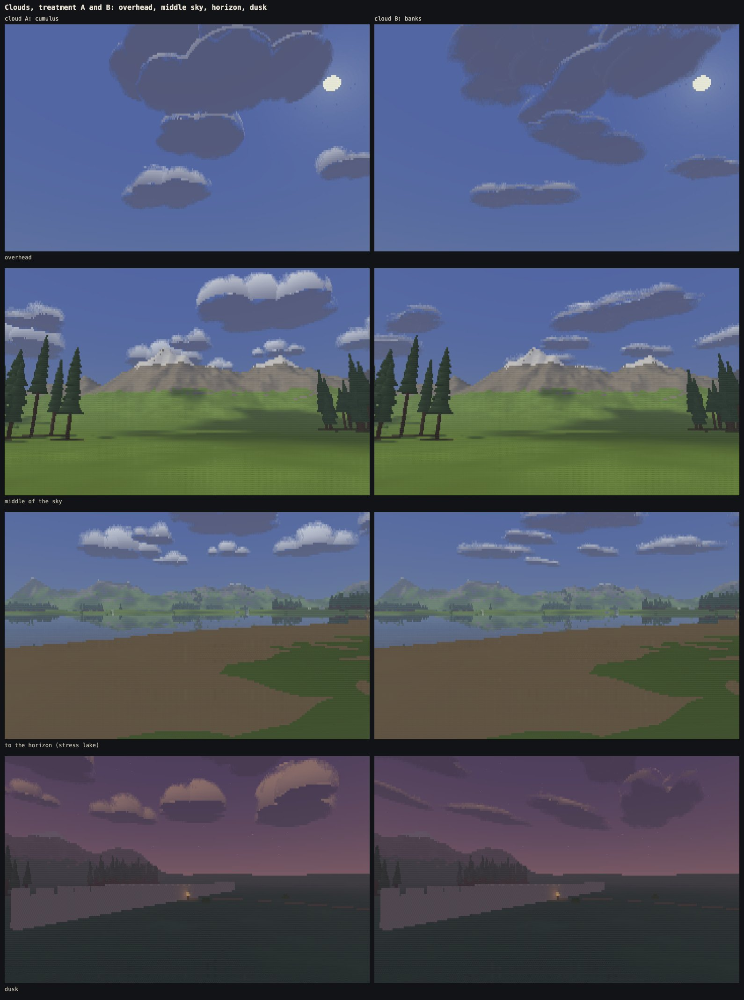
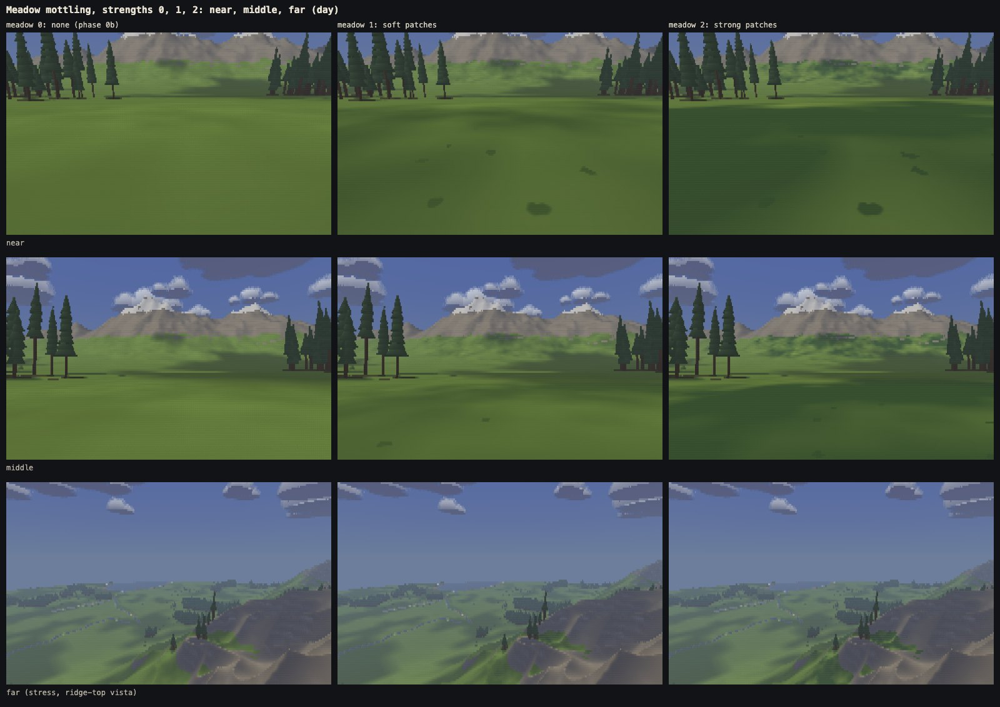
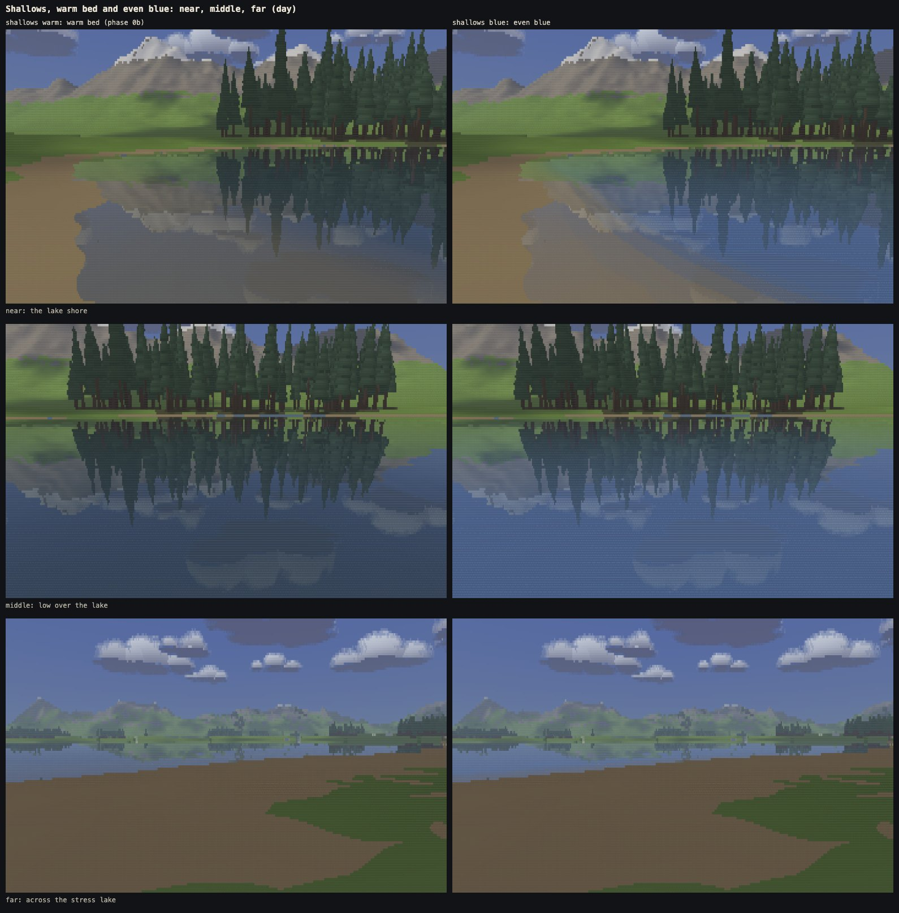

# Phase 0c: the look pass

Written 10 Oct 2026. Phase 0c does four things:
- fixes three visible faults left by phase 0b;
- builds candidate treatments for what still looked too clean next to the reference: conifers, clouds, the meadow and the shallows;
- lets you switch between them live and choose by eye;
- writes the first draft of the art bible (`docs/art-bible.md`), which every later phase has to obey.

Nothing else changed: no renderer architecture, no new kinds of object, no world generation for the real game, no movement, camera or hosting changes.

**Live:** https://oddslice.github.io/land-of-ascii-v3/. The stress scene is at `?stress=1`, or press X.

**The look panel: press L.**

| Key | Choice | Options |
|---|---|---|
| 7 | conifers | A tidy tiers · B rough and dark |
| 8 | clouds | A cumulus · B banks |
| 9 | meadow | 0 none · 1 soft patches · 2 strong patches |
| 0 | shallows | warm bed · even blue |

- The panel works on the live site and in both scenes.
- The same choices work by URL (`?tree=B&cloud=B&meadow=2&shallows=blue`) and through `window.lab.setLook({...})`.
- The defaults are A, A, 0, warm: phase 0b's look with the three fixes.

**Recommended combination: conifers B, clouds B, meadow 2, shallows blue.**
- Lab scene: https://oddslice.github.io/land-of-ascii-v3/?tree=B&cloud=B&meadow=2&shallows=blue
- Stress scene: https://oddslice.github.io/land-of-ascii-v3/?stress=1&tree=B&cloud=B&meadow=2&shallows=blue

Three new fixed cameras (C cycles them) cover trees at every distance:
- 7: a forest edge across the meadow;
- 8: inside a stand, looking out;
- 9: a far treeline on the horizon.

---

## 1. The three fixes

They apply under every option. All of them are pure functions of world position or an object's identity, never of the screen or the clock.

### Fix 1: distant torch flames

**The fault:** phase 0b held a flame at two rows at any distance, at full size and full brightness. So distant torches showed as large yellow blocks, even by day.

**The fix:**
- The flame keeps its two-row minimum, so it never blinks.
- The backend records how much of the drawn flame is really flame. The core stays bright and the rim fades.
- Resolve fades each flame cell toward what is behind it: the next cell up its own column that is not flame, or down for a reflection.
- By day the flame is a small pale light (`#f0dfba`, strength 0.6). At night a floor keeps a far torch a small warm point of light (`flameFloor` 0.5).
- Under a third of a flame, the cell keeps the glyph of what is behind it.
- All of it is set in `look.js`: `flameFade`, `flameMark`, and per keyframe `flame`, `flameStrength`, `flameFloor`.

It works like the merlons sinking into the wall before they go thin.

### Fix 2: far treelines

**The fault:** far stands melted into flat dark bars with a straight top edge.

**The fix:**
- **Tips taper to one cell.** Below the tip, a crown still has the two-cell floor, but the tier's floor shrinks toward one cell as it nears the top. So each tree ends in a single-cell tip, and a far stand keeps a jagged top of individual tips.
- **Emergent trees.** About one tree in seven stands a third taller (`emergent`), so a stand's top line is uneven.
- **A far trunk darkens** toward a quarter of its light when it is held wider than it really is. Bare trunks under a far stand no longer read as a solid fence.
- **The ragged edge fades by the size of a crown sector in cells,** not by tier height, so it lasts as long as it can be drawn.
- **Below the tip, crowns swell by up to a cell.** A gap between two crowns closes before it is thin enough to blink, so a far stand becomes a ragged band, never a rectangle.

### Fix 3: the forest interior

**The fault:** identical brown pillars under a flat green ceiling, standing on bright meadow grass.

**The fix:**
- **Trunks vary** in width (0.15–0.32 m), height (bare trunk 18–42% of the tree) and bark tone, from each tree's identity. They are a darker, less red brown.
- **The canopy has gaps and depth:**
  - trees vary in height and crown width, and lean a little;
  - deep in a close stand, crowns grow narrower, so the sky shows between them. This is a function of the stand's density at the tree's position;
  - the canopy sits at varied heights.
- **The ground under a stand is forest floor**, a new material (`FLOOR`) with its own darker, browner ladder:
  - it lies under and just round each crown;
  - it is shaded by the same shadow sweep as everything else (the crowns are already occluders), so it agrees between workers and with the clock frozen.

---

## 2. The candidates

Each is a setting in `look.js` (`choices`, `trees`, `clouds`, `meadow`, `water.blueDepth` and the keyframes' `grassDry`, `grassLush`, `cloudFlat`, `cloudStretch`, `water.blue`).

Each was shot against the reference and tuned until it was a serious contender, not a strawman. The tuning is described under each.

### Conifers

**Shared by both treatments:**
- every tree's height, crown width, bare-trunk share, trunk width, bark tone, lean, tier count and foliage tone come from its identity;
- both treatments' shapes are built per tree, so the panel switches them live.

**A, tidy tiers:** phase 0b's tiered shape with that variation. Foliage tone is the tree's own and the height in its tier.

**B, rough and dark:**
- tiers shifted off the axis (24% of the crown radius);
- a third of the tiers cut short, so sky or trunk shows above them;
- some tiers notched;
- a deeper ragged outline in 13 sectors;
- foliage tone in clumps (5 patches round each tier);
- 28% less light.

As B gets smaller on screen, its roughness closes up before it can blink:
- a cut-short tier closes once the gap is under about 2.5 rows;
- a notch closes under about two cells;
- the ragged edge and the clumps fade once a crown sector is under about three cells across.

The reflected trees in the lake use the same floors and were measured separately (section 5).

**Tuning:**
- B first had shelves: tiers much wider than the one above. Their top radii were evened out.
- Clumps over 13 sectors made too many tone boundaries, and B blinked twice as much as phase 0b walking. Five larger clumps, and conifer tone moving the glyph rung less (`toneRung` 0.12 for conifers), brought walking back to phase 0b's level.

### Clouds

**A, cumulus:** phase 0b's rounded clusters, with more varied sizes (main puff 150–320 m, 4–6 side puffs) and softer undersides, lighter at the rim than in the middle.

**B, banks:**
- long, broken bands of 7–13 stretched puffs (ellipsoids) turned to the band's angle, with the odd break;
- the edge breaks into streaks along the band, from noise fixed to the cloud;
- at dusk the banks flatten to 72% and stretch to 130%, as in the reference's dusk frame.

**Shared by both:**
- clouds still only drift: shapes are fixed to each cloud, edges do not boil;
- a puff's dissolving edge in front of the same cloud's body is not a hole, which removed bright seams inside clouds;
- cloud shadows on the ground are unchanged: the same soft drifting field as before, for both treatments.

**Tuning:** the first banks were long thin streaks that read as aircraft trails at dusk. Shorter, chunkier bands with more puffs read as banks.

### Meadow

Large-scale mottling: soft patches of slightly different green, several metres across. Tone moves the grass toward a drier or a lusher green (`grassDry`, `grassLush`), more so in the light. Near the eye there are sparse small dark tufts.

| Strength | Patches | Tufts |
|---|---|---|
| 0 | none: what existed before | none |
| 1 | soft (`patch` 0.45, `hue` 0.45) | in 20% of 1.2 m squares |
| 2 | strong (0.85, 0.8) | 34% |

Patches fade as a cell's footprint along the view grows past them, and tufts fade within a few metres, so neither turns into noise at density 3.

**Tuning:** the first tufts were half-metre discs, light and dark. In the walk videos they read as flat ellipses at your feet, the first build's "flat blob at the lens". They are now small dark clumps (0.13–0.25 m) with an uneven outline.

### Shallows

**Warm** is phase 0b's water: the bed shows through the shallows, tinted toward warm and darkened with depth.

**Even blue** is the reference's water: an even blue (`#44597a` by day), with the bed showing only in the last half metre (`blueDepth`). The reflections and the Fresnel mix are unchanged.

---

## 3. Against the reference

The side-by-side sheets are private, because the reference is other people's footage. They are made by `tools/shoot.mjs` and ignored by git:
- `shots/0c-default/sheet-*.png`: the default look, all nine cameras;
- `shots/0c-recommended/sheet-*.png`: the recommended combination (tree B, cloud B, meadow 2, blue shallows).

The new cameras are framed on:
- camera 7: reference 03 at 0:25 (conifers across the meadow);
- camera 8: 02 at 1:03 (inside a forest);
- camera 9: 04 at 0:24 (a far treeline).

**What now reads like the reference:**
- **Conifers.** Treatment B's dark, rough, uneven crowns and the far stands' jagged tops of single tips. A still looks drawn next to them.
- **The forest interior.** Tall bare trunks of varied width, a canopy high overhead with sky between, and dark ground (02 1:03). Ours is lighter than the reference's night-dark forest, which was shot at a darker hour.
- **Clouds.** B's banks and broken bands, flattened and stretched at dusk (03 0:36), against A's round puffs.
- **The meadow.** Strength 2's large soft patches, close to 04 0:57 and 03 0:51.
- **The water.** The blue shallows match 04 1:07, which shows no bed.

**What still differs:**
- The reference's conifers are narrower and more columnar than ours, even in treatment B. Narrowing them everywhere would change the scenes; only close-grown stands narrow today.
- The reference's clouds have stippled, dithered bodies. Ours are smooth inside and dissolve only at the edge.
- Small bushes and dirt patches in the reference's meadow are content, not look, and out of scope.

---

## 4. The recommendation

**Conifers B, clouds B, meadow 2, shallows blue.** The art bible's open-choices section gives the reasons in short.

- **Conifers B.** It is the treatment that looks like the reference's trees. Walking, it blinks no more than phase 0b; turning inside a forest, both treatments crawl more than phase 0b (section 5). It costs about 3% more than A.
- **Clouds B.** Banks are what the reference's skies have. B blinks no more than A or phase 0b and costs the same.
- **Meadow 2.** It is the one that shows the reference's mottling at density 3; strength 1 is barely visible there. It blinks least of the three and holds still in the walk videos.
- **Shallows blue.** It matches the reference, and costs nothing.

**What to look at first:**
1. Camera 8 (inside the stand) with tree A, then B (press 7): the clearest difference.
2. The stress scene's dense forest (press X, then C), walking in: the forest floor and the canopy.
3. Camera 5 at dusk with cloud A, then B (press 8).
4. Camera 2 with meadow 0, 1, then 2 (press 9), then turn slowly.

---

## 5. Measurements

### Identity

`node tools/identity.mjs --looks all` checks every combination of the look candidates (2 × 2 × 3 × 2 = 24). It covers 14 lab views (the nine cameras plus five free views: up at the wall, down at the ground, among the trees, into the shallows, the lake at night) and 7 stress views (the three cameras plus the lake at dusk and night, down into the lake, the forest at night), each at 0, 1, 3, 5 and 8 workers.

**504 of 504 view-and-look combinations are byte-identical across 0, 1, 3, 5 and 8 workers.**

### Flicker

`node tools/flicker.mjs --density 3 --ref <phase 0b sources>` runs each option on the views where it shows, and the same views on the phase 0b build. Settings:
- density 3, Chromium, every clock frozen, 60 frames;
- walking at 4.5 m/s, turning at 18° a second.

"Blinking" counts cells that change and change back on the next frame. Most of them are 1–2-level colour wobbles nobody can see. The two columns that matter are:
- **glyph blinks**: the glyph changes and back;
- **colour blinks**: a step of more than 6 levels and back.

Cloud and meadow runs use views with no trees in them, because tree crawl would otherwise be counted too.

| view and motion | option | blinking cells | glyph blinks | colour blinks (>6 levels) | reference build: blinking / glyph / colour |
|---|---|---|---|---|---|
| forest edge across the meadow, walking sideways | tree A | 0.651% | 0.065% | 0.000% | 0.648% / 0.065% / 0.001% |
| forest edge across the meadow, walking sideways | tree B | 0.668% | 0.066% | 0.000% | 0.648% / 0.065% / 0.001% |
| forest edge across the meadow, turning | tree A | 1.319% | 0.156% | 0.045% | 1.396% / 0.226% / 0.045% |
| forest edge across the meadow, turning | tree B | 1.355% | 0.160% | 0.044% | 1.396% / 0.226% / 0.045% |
| inside the stand, walking out | tree A | 0.284% | 0.020% | 0.005% | 0.337% / 0.022% / 0.002% |
| inside the stand, walking out | tree B | 0.332% | 0.022% | 0.005% | 0.337% / 0.022% / 0.002% |
| inside the stand, turning | tree A | 0.492% | 0.061% | 0.028% | 0.409% / 0.032% / 0.018% |
| inside the stand, turning | tree B | 0.630% | 0.056% | 0.026% | 0.409% / 0.032% / 0.018% |
| trees in the lake, walking along the shore | tree A | 0.978% | 0.043% | 0.024% | 1.112% / 0.049% / 0.024% |
| trees in the lake, walking along the shore | tree B | 1.033% | 0.045% | 0.021% | 1.112% / 0.049% / 0.024% |
| far treeline, walking sideways | tree A | 0.296% | 0.009% | 0.000% | 0.298% / 0.009% / 0.000% |
| far treeline, walking sideways | tree B | 0.296% | 0.008% | 0.000% | 0.298% / 0.009% / 0.000% |
| open sky, turning | cloud A | 0.345% | 0.074% | 0.032% | 0.374% / 0.110% / 0.031% |
| open sky, turning | cloud B | 0.392% | 0.091% | 0.037% | 0.374% / 0.110% / 0.031% |
| open sky, walking sideways | cloud A | 0.052% | 0.003% | 0.000% | 0.052% / 0.003% / 0.000% |
| open sky, walking sideways | cloud B | 0.052% | 0.003% | 0.000% | 0.052% / 0.003% / 0.000% |
| open meadow, walking | meadow 0 | 0.327% | 0.007% | 0.000% | 0.327% / 0.007% / 0.000% |
| open meadow, walking | meadow 1 | 0.315% | 0.019% | 0.007% | 0.327% / 0.007% / 0.000% |
| open meadow, walking | meadow 2 | 0.140% | 0.009% | 0.003% | 0.327% / 0.007% / 0.000% |
| open meadow, turning | meadow 0 | 0.266% | 0.009% | 0.000% | 0.266% / 0.009% / 0.000% |
| open meadow, turning | meadow 1 | 0.262% | 0.011% | 0.000% | 0.266% / 0.009% / 0.000% |
| open meadow, turning | meadow 2 | 0.228% | 0.009% | 0.000% | 0.266% / 0.009% / 0.000% |
| stress forest, walking in | tree A | 0.348% | 0.030% | 0.005% | 0.263% / 0.017% / 0.004% |
| stress forest, walking in | tree B | 0.428% | 0.032% | 0.005% | 0.263% / 0.017% / 0.004% |
| stress forest, turning | tree A | 0.469% | 0.070% | 0.020% | 0.407% / 0.035% / 0.015% |
| stress forest, turning | tree B | 0.636% | 0.089% | 0.023% | 0.407% / 0.035% / 0.015% |
| stress sky over the lake, turning | cloud A | 0.524% | 0.303% | 0.103% | 0.611% / 0.391% / 0.101% |
| stress sky over the lake, turning | cloud B | 0.586% | 0.301% | 0.111% | 0.611% / 0.391% / 0.101% |
| stress vista, turning | meadow 0 | 1.161% | 0.260% | 0.099% | 1.182% / 0.324% / 0.071% |
| stress vista, turning | meadow 1 | 1.164% | 0.260% | 0.098% | 1.182% / 0.324% / 0.071% |
| stress vista, turning | meadow 2 | 1.152% | 0.259% | 0.098% | 1.182% / 0.324% / 0.071% |

**What it shows:**
- **Clouds, both treatments:** within phase 0b's numbers, except colour blinks turning under banks: 0.037% against 0.031% in the lab, 0.111% against 0.101% in the stress scene. That is 2–4 more cells of 40,320, at the dissolving edges.
- **Meadow:**
  - strengths 0 and 2 blink no more than phase 0b, and strength 2 blinks least of all, because its large patches calm the grass;
  - strength 1 walking has a few more glyph blinks (0.019% against 0.007%, about 5 cells), from the tufts;
  - none of them shimmer when turning.
- **Trees, walking:** both treatments are at or within a few cells of phase 0b everywhere: the forest edge, the stand, the lake's reflections and the far treeline. The stress forest walking in is 0.030–0.032% glyph against 0.017%, about 6 cells.
- **Trees, turning inside a forest:** **both A and B have about twice phase 0b's glyph blinks** (0.056–0.089% against 0.032–0.035%, 10–22 more cells) and a few more colour blinks. This is the one result that does not meet the brief's bar.
  - The cause is fix 3. Phase 0b's forest had a closed, flat, dark ceiling with almost no edges. The canopy now has gaps and crowns against the sky, and every crown edge crawls a little as you turn, because cells snap to the nearest vertical plane.
  - The same trees from outside the forest (the forest edge turning) blink less than phase 0b: 0.156–0.160% glyph against 0.226%.
  - Treatment B first had more than twice A's crawl. Larger clumps and conifer tone moving the glyph rung less brought it down to A's level. Closing the canopy again would bring the numbers back down, but it would undo fix 3.
- **Stress vista, turning:** colour blinks are 0.098% against 0.071% under every meadow strength, so the meadow is not the cause. They sit at the far stands' new jagged tops and at the edges of the new forest floor seen far off, about 11 cells; glyph blinks there are lower than phase 0b's.

### Frame times

`node tools/bench.mjs --built --scene stress --threads 8 --density 3,4` measured the built page at commit 3c23d01 against the phase 0b build (`--root`, its own `index.html`):
- **0B:** the phase 0b build;
- **default look:** the fixes with A, A, 0, warm;
- **heaviest look:** tree B, cloud B, meadow 2, shallows blue. It is also the recommended one, since meadow 1 and 2 cost the same, and blue costs no more than warm.

How it was run:
- three rounds, interleaved 0B / default / heaviest;
- each value is the best of the three rounds' medians of the slowest worker's march + resolve plus the main thread's draw, over 240 frames after a 60-frame warm-up, every clock frozen;
- Chromium and Firefox headed on the 120 Hz display, \*WebKit headless (60 fps cap);
- the page cross-origin isolated, so timers are fine-grained.

Run-to-run noise is about ±10% in Chromium at density 3 (default measured 4.7 ms in one run and 4.2 ms in another), which is why the rounds are interleaved and the best taken.

**Machine state:** M1 Max, 32 GB. Before and after the runs, the window server used about 50% of a core and the Claude app 15–20%. No remote-desktop session was running (phase 0b's was) and the app's browser pane was closed.

| Browser | Density | Camera | 0B: worker + draw ms | default look | heaviest look | heaviest vs 0B | fps 0B / heaviest |
|---|---|---|---|---|---|---|---|
| Chromium | 3 | 1 dense forest | 4.3 | 4.2 | 4.3 | +1% | 120.0 / 120.0 |
| Chromium | 3 | 2 across the lake | 5.3 | 5.6 | 5.5 | +5% | 120.0 / 120.0 |
| Chromium | 3 | 3 ridge-top vista | 4.8 | 5.0 | 5.2 | +8% | 120.0 / 120.0 |
| Chromium | 4 | 1 dense forest | 5.0 | 5.2 | 5.5 | +11% | 120.0 / 120.0 |
| Chromium | 4 | 2 across the lake | 6.2 | 6.4 | 6.8 | +10% | 120.0 / 120.0 |
| Chromium | 4 | 3 ridge-top vista | 5.7 | 5.8 | 6.2 | +9% | 120.0 / 120.0 |
| Firefox | 3 | 1 dense forest | 6.5 | 6.3 | 6.7 | +4% | 60.5 / 119.9 |
| Firefox | 3 | 2 across the lake | 8.5 | 8.3 | 8.6 | +2% | 60.5 / 60.5 |
| Firefox | 3 | 3 ridge-top vista | 7.8 | 7.8 | 8.1 | +3% | 60.3 / 60.4 |
| Firefox | 4 | 1 dense forest | 7.5 | 7.6 | 7.6 | +2% | 60.4 / 60.4 |
| Firefox | 4 | 2 across the lake | 9.8 | 9.7 | 10.1 | +3% | 60.5 / 60.5 |
| Firefox | 4 | 3 ridge-top vista | 9.1 | 9.0 | 9.4 | +4% | 60.5 / 60.4 |
| WebKit\* | 3 | 1 dense forest | 4.6 | 4.5 | 4.9 | +6% | 60.0 / 60.0 |
| WebKit\* | 3 | 2 across the lake | 5.9 | 5.9 | 6.0 | +1% | 60.0 / 60.0 |
| WebKit\* | 3 | 3 ridge-top vista | 5.3 | 5.6 | 5.5 | +3% | 60.0 / 60.0 |
| WebKit\* | 4 | 1 dense forest | 5.4 | 5.4 | 5.6 | +3% | 60.0 / 60.0 |
| WebKit\* | 4 | 2 across the lake | 6.6 | 6.6 | 6.7 | +2% | 60.0 / 60.0 |
| WebKit\* | 4 | 3 ridge-top vista | 6.2 | 6.1 | 6.2 | +1% | 60.0 / 60.0 |

**Cost of the candidates:**
- **At density 3** (the default), the heaviest combination is within 10% of phase 0b in every browser: Chromium +1% to +8%, Firefox +2% to +4%, WebKit +1% to +6%.
- **At density 4,** Firefox and WebKit are within 4%. **Chromium is +9% to +11%:**
  - the dense forest is +11% (5.0 → 5.5 ms) and the lake +10% (6.2 → 6.8 ms);
  - this is the one place the heaviest look goes over the limit, by 1 point, within the run-to-run noise.
- **Treatment B for trees meets the limit and was not simplified to get there:**
  - its gaps let rays through to the trees behind (18% more ray tests in the forest);
  - one honest optimisation made up most of it: a per-plane bound on the heights a ray can meet a tree at. It rejects rays that pass above or below before any tier is tested, gives byte-identical pixels, and helps both treatments;
  - B now costs about 3% more than A in the forest.
- **The 0B verdict rule still holds:**
  - at density 3 with 8 workers, the slowest stress camera under the heaviest look is 8.6 ms in Firefox and 5.5 ms in Chromium, under 10 ms, so the CPU backend stays and density 3 stays the default;
  - at density 4, Firefox's lake is 10.1 ms, in the same 10–14 ms band as phase 0b's 10.8 ms.

### Walks

`node tools/walk.mjs --look tree=B,cloud=B,meadow=2,shallows=blue --suffix 0c` recorded 20-second walks under the recommended combination, with time running:
- `shots/walks/forest-0c.webm`: the stress scene's dense forest;
- `shots/walks/lake-0c.webm`: the lab's lake shore;
- `shots/walks/stress-lake-0c.webm`: the stress scene's lake.

They are private and kept out of git. Chromium (headless, 8 workers, density 3) presented 59.0–59.6 frames a second. In them the meadow's patches hold still and slide with the land, the banks only drift, and the forest floor and canopy stay steady.

The first lake walk showed the tufts as flat ellipses at your feet, which led to the smaller dark tufts described in section 2.

### The regression lookbook

`node tools/lookbook.mjs --regress` shoots the twelve fixed cameras (nine in the lab, three in the stress scene) at day, dusk and night with the clocks frozen and the default look, at density 3 with 8 workers. It compares them cell for cell with the saved set in `tools/regress/`, 36 frames in 1.2 MB, and reports the share of cells that changed in each frame, and the share that changed visibly.

- `--save` replaces the set.
- The set was saved at the end of this phase; run again straight away, every frame reports 0.00%.
- A later phase that changes the look on purpose saves it again and says why.

### Size

- `index.html` is 162.5 KB (143.4 KB after phase 0b), still one file with the worker inline.
- The largest source file is `src/scene/cpu/objects.js` at 608 lines.

---

## 6. Notes and decisions to confirm

1. **The defaults stay A, A, 0, warm** until you lock a combination. Then the losing options are removed and the regression set is saved again.
2. **Two small additions to the contract,** both documented in `src/contract.js` the way phase 0b added the bed:
   - a new material id, `FLOOR` (18), for the forest floor;
   - the frame description's `look` (the candidates in use). A flame's tone now carries how much of it is really flame.
3. **The stress scene's close-grown trees have narrower crowns** (up to 30% narrower deep in a stand). That changes the stress scene, not the lab or a real-game world, and it is a function of each tree's position.
4. **Turning inside a forest crawls about twice as much as phase 0b**, under both treatments (section 5). This is the open cost of fix 3's canopy gaps. Say if you would rather have fewer gaps.
5. **Chromium at density 4** is 1 point over the 10% cost limit on the dense forest under the heaviest look. Density 3, the default, is within it everywhere.
6. **The art bible is a draft** (`docs/art-bible.md`). Its open-choices section carries the recommendation above.

---

## 6b. After phase 0c: turning no longer skips

Martin reported that turning sometimes felt as if the camera skipped.

**The cause was frame pacing, not the camera.**
- A frame shows the camera as it was when the frame was asked for.
- The workers' time varies from frame to frame while you turn, because the view sweeps across water and trees. In the lab's lake view their slowest stripe took 4 ms usually and 7–9 ms one frame in ten.
- At 120 Hz, a frame that missed the 8.3 ms refresh reached the screen one refresh later than the others. The view then stalled for a refresh and jumped to catch up, several times a second.
- Firefox, whose workers are slower, did it more. Running the clock made it worse, because the lab's shadows were also recomputed in one go four times a second.

**The fix** (`src/app/pace.js`, the pool and the main loop):
- **Same delay:** every frame is shown the same number of refreshes after it was asked for (`lag`): two on a fast display, one on a 60 Hz one.
- **Overlap:** up to that many frames may be in flight, so the workers start the next frame while the page waits for the rest of this one.
- **Steady rate:** frames are asked for every refresh while the workers keep up on average, and every second refresh where they cannot. That gives a steady 120 or a steady 60, never a mix.
- **Hysteresis:** the rate slows when the workers' average stops fitting with 0.7 ms to spare, and speeds up again only once it fits with 1.8 ms to spare.
- **Single spikes ignored:** a rare slow frame, such as a garbage collection, costs one late frame and does not change the pacing.
- **Lab shadows:** recomputed over four frames, as the big map's already were.
- **What it leaves alone:** pacing changes only when frames are shown, never what they show. Identity is unchanged across 0, 1, 3, 5 and 8 workers, and the regression lookbook reports 0.00% change.
- **HUD:** it says "(every 2nd refresh)" when the rate is halved.

**Measured** with the new `node tools/smooth.mjs`. The right arrow is held for 6 s (a steady 1.7 radians a second) in a visible window, three seconds after loading. A "jump" is a frame where the view moved on more than 1.4 times the time it was on screen; a "stall" is one where it moved less than 0.65 times. The table compares the build before the fix with the build after:

| Browser | View | Before: fps, jumps, stalls | After: fps, jumps, stalls |
|---|---|---|---|
| Chromium | lab, road to the wall | 118, 1.3%, 1.0% | 119, 0.3%, 0.3% |
| Chromium | lab, lake shore | 109, 3.6%, 3.1% | 89, 0%, 0% |
| Chromium | lab, lake shore, clock running | 105, 5.3%, 4.7% | 82, 0%, 0% |
| Chromium | stress, across the lake | 116, 2.1%, 1.9% | 98, 0.1%, 0% |
| Firefox | lab, road to the wall | 115, 2.4%, 1.8% | 109, 0.4%, 0.3% |
| Firefox | lab, lake shore | 85, 5.7%, 5.3% | 62, 1.1%, 0.4% |
| Firefox | lab, lake shore, clock running | 84, 7.1%, 6.0% | 59, 1.0%, 0.6% |
| Firefox | stress, across the lake | 85, 9.6%, 9.3% | 60, 2.6%, 0.8% |

**What it costs:**
- **Frame rate:** where the workers cannot keep up with 120, the view now runs at a steady 60 instead of an uneven 85–110. In Chromium that happens only as the view sweeps past the heaviest direction, the lake with its treeline. In Firefox it holds 60 in the lake views.
- **Latency:** a frame now reaches the screen 16.7 ms after it was asked for on a 120 Hz display, up to 33 ms in Firefox's heaviest views.

**Not ruled out:** some browsers occasionally report a wrong, very large mouse movement under pointer lock, which also reads as a skip. Nothing in these measurements needed it, and nothing guards against it yet; it is the next thing to look at if skips remain with the mouse.

---

## 7. Tools

| Command | What it does |
|---|---|
| `node tools/lookbook.mjs --phase 0c --ref DIR` | the candidates side by side and the fixes before and after → `shots/phase0c/` (DIR: a copy of phase 0b's build) |
| `node tools/lookbook.mjs --regress [--save]` | the regression lookbook: 36 frames compared cell for cell with `tools/regress/` |
| `node tools/identity.mjs --looks all` | byte-identical across worker counts for every look combination (or `--look tree=B,...`) |
| `node tools/flicker.mjs --ref DIR` | the look set, each option beside a reference build (`--set water` for phase 0b's set; `--only` to filter; `--at x,z,yaw,pitch` for one view) |
| `node tools/bench.mjs --look ... --root DIR` | frame times under a look, or of another build |
| `node tools/shoot.mjs --look ... --out DIR` | the fixed cameras and the private side-by-side sheets under a look |
| `node tools/walk.mjs --look ... --suffix NAME` | the walk videos under a look |
| `node tools/smooth.mjs [--root DIR]` | how evenly the view advances while turning: frames that jump or stall (section 6b) |

New in `window.lab`:
- `setLook({ tree, cloud, meadow, shallows })`, `resetLook()`, `look()`, `setLookPanel(on)`;
- `setPace(every, lag)` to hold the frame pacing (`setPace()` for adaptive again);
- `state().look`, `state().pace` and `state().lag`;
- each `timings(n)` entry carries `at` (when the frame was shown), `yaw` (the camera it was drawn from), `trip`, `every`, `lag` and `dropped`.

