# Phase 1: the world

Written 11 Oct 2026. Phase 1 replaces the lab with a real world. The page now opens on a land 2 km on a side, generated from a seed: lowland with lakes, rivers, forest stands and roads, mountains closing the north and east, and the sea closing the south and west. The phase also locks the look chosen in phase 0c and moves the game to Vercel, where the workers share one copy of the world.

Nothing else is in the world: no buildings beyond the 0A wall and gate, no villages (only their sites), no people or animals, no inventory, goals, new plants or weather.

**Live:**
- **Vercel (main address, shared memory):** ⟨VERCEL⟩
- **GitHub Pages (no shared memory, the fallback):** https://oddslice.github.io/land-of-ascii-v3/
- The lab: `?lab=1`. The stress scene: `?stress=1`. Both are unchanged, and X still switches between them.
- A seed: `?seed=N`. **The default seed is 3.**

**Keys in the world:**

| Key | Does |
|---|---|
| WASD, Shift | walk, run |
| F | fly at 50 m/s (Space climbs); F again lands you |
| M | the overhead map |
| R | a new world from a new seed |
| click or drag | look |
| 1 2 3, T, C | day, dusk, night; time runs; the eight world cameras |
| G, − +, L, H | glyphs, density, the look panel, the HUD |

The HUD shows the seed, how long the world took to build, and which mode the workers run in.

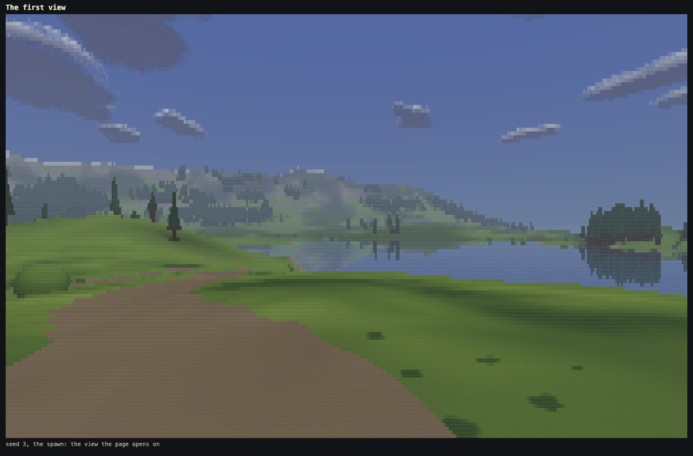

---

## 1. The look, locked

- **The defaults are now conifers B, clouds B, meadow 2 and blue shallows** (`src/look.js`, `choices`).
- The look panel (L) and the URL still show the other options, for comparison.
- Also accepted, as Martin asked: the forest-floor material, narrower crowns in dense stands, the extra blinking when turning inside a forest, the CPU backend, and density 3.
- **The art bible is settled** (`docs/art-bible.md`). Its open choices are now rules (section 9, "Settled choices"), and it gained the rules the world needed:
  - the world's materials;
  - why there is no marsh: it would need a new material and colour, which the brief did not name;
  - the sea runs to the horizon;
  - clouds spread over the whole world's sky;
  - the overhead map's glyphs and colours;
  - never-do 19: never judge terrain from the overhead map.

### The regression set was saved again, on purpose

The regression lookbook was saved again, with the new defaults and the world's cameras:
- `node tools/lookbook.mjs --regress --save` saved 60 frames (2.0 MB) to `tools/regress/`.
- **Why:** the defaults changed from A, A, 0, warm to B, B, 2, blue, so every lab and stress frame changes by design.
- **Before saving,** the lab and the stress scene were compared with the phase 0c set under the old look (`--look tree=A,cloud=A,meadow=0,shallows=warm`): every frame 0.00% changed. Nothing in phase 1 changed how the lab or the stress scene draw.
- **Run again straight after saving,** every frame reports 0.00%.

---

## 2. How the world is made

All of it is in `src/world/gen/`. The scale it is built to (eye height, speeds, tree heights, road width, wall, slopes, view distance, time to cross) is in [docs/scale.md](scale.md) and `src/world/scale.js`.

The build runs in its own worker, in stages, and the page shows a progress line naming each one.

### The land (`land.js`)

Research sections 4 and 5 drove this. The old build failed on steep terrain, no horizon and crowded landmarks, so the land is shaped around three distances rather than from noise alone:
- how far inland a point is from the shore (south and west);
- how far past the range front it is (north and east);
- its share of the way from one to the other.

From those:
- **The lowland** is a gentle trend down to the sea, with long low swells, a few knolls, and basins for lakes (levelled, with a rising rim).
- **The range** is ridged noise that rises past the front to about 300 m at the north and east edges, with snow from 235 m. It stays well away from the sea.
- **The coast** has beaches, with low cliffs along some stretches.

The land is computed on a 4 m grid, then smoothed up to 1 m with fine relief added. The main lake's basin sits on the main river, found in a quick first pass. Two "rises", low knolls beside the main lake, give the spawn and the fort high ground to stand on.

### Water (`water.js`)

- **How water runs:** rain runs down the steepest descent (a priority flood from every edge, then flow accumulation, with more rain on the mountains).
- **Lakes** are the hollows that fill, if at least 1,500 m² and 0.7 m deep.
- **Rivers:** the main stems of the largest catchments that reach the sea and start in the mountains, two or three of them, 3 to 14 m wide.
- **River beds** are carved against the land as it was before carving, so they run in shallow channels, not canyons. A river's water never rises on its way down.
- **The sea** floods everything below sea level from the edges.

### Forest (`plants.js`)

- A forest field from noise, thicker on north-facing slopes, valley sides and the range's flanks below the treeline, and thinner in the open lowland.
- A threshold is chosen to give about 12,000 trees on a jittered 5 m lattice, so stands have clear edges and wide meadow between.
- Single trees stand beyond the edges, and bushes along stand edges and water.

### Sites (`sites.js`)

Chosen in this order, each loosening its rules a step at a time rather than failing:
1. **The spawn:** on a low rise near the main lake, facing it, with forest to one side and the range behind. Candidates are scored on how much of the lake the first view shows, how wide it is, the range behind it, forest beside it, and its mirror image. The spawn must also have a way out by road.
2. **The fort site:** on a rise near the main lake. The 0A wall and gate stand there, the ground levelled round them, the gate facing the roads.
3. **Three village sites:** on flat ground near fresh water, spread apart.
4. **Four viewpoints:** high ground with long views.

### Roads (`roads.js`)

- **The search:** a slope-penalised path search on the 4 m grid joins the spawn to the fort and the villages. It refuses 4 m steps steeper than 7.5% and loosens only where a site cannot be reached otherwise.
- **Water:** rivers are crossed only at fords no deeper than 0.6 m, away from steps in the river's level. Lakes and the sea are never crossed.
- **Laying the road:** the path is smoothed, then graded to at most 9.6% (the 12% limit with a margin) by lowering only, never cut or banked more than 1.5 m. It is pressed flat across its 4 m width, and junctions are eased.
- **At fords** the bed is raised to wading depth across the road.

### Ground (`ground.js`)

Meadow by default, forest floor under the stands, sand on beaches and shores, rock on steep faces, snow on the tops, dirt on roads, and the beds of lakes and rivers.

### The overhead map (M)

The map is drawn in the game's own glyph cells and day palette:
- terrain, water, forest and roads;
- the sites: # fort, o villages, * viewpoints, + spawn;
- you, as @ with your heading.

Thin rivers and roads are kept whole when the map shrinks the land.

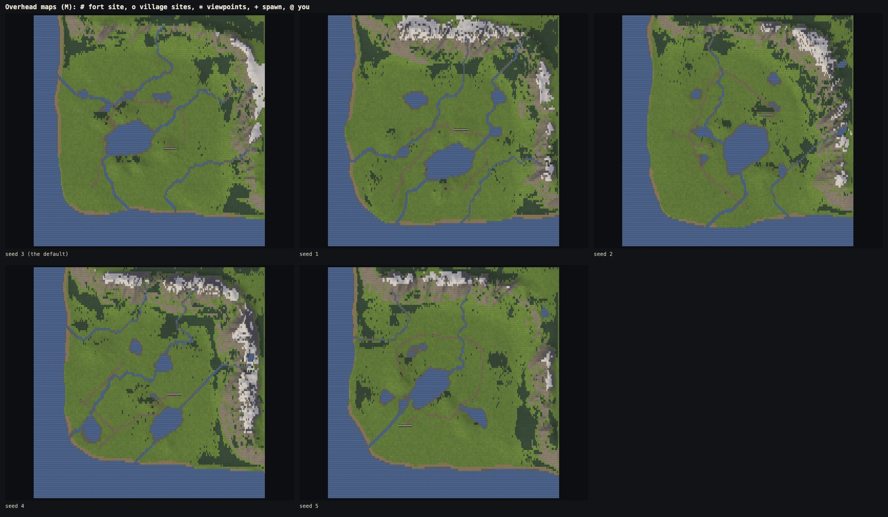

The full-size maps are `shots/phase1/map-seed-3.jpg` (the default) and `map-seed-1.jpg`, `-2`, `-4`, `-5`.

### Choosing the default seed

I looked at seeds 1 to 5, and at the spawn candidates of seeds 9, 17 and 25. **Seed 3** has the best first view:
- the lake fills the middle distance, with a forest island reflected in it;
- the road curves away along the shore to the left;
- the range closes the view behind.

It also passes the sky test with the widest margin of the five (section 5).

---

## 3. The engine

### Building the world

- The world is built in its own worker, so the page stays responsive and the progress line updates.
- It comes back as plain arrays plus a little JSON (`src/world/pack.js`).
- With `?threads=0` it is built on the page instead. The bytes are the same either way (`lab.worldHash`, checked by `identity.mjs`).

### Shared memory

On Vercel the page is cross-origin isolated (`vercel.json` sends the two headers), so:
- every world array lives in shared memory, and the render workers all read one copy;
- one shadow worker sweeps the cast shadows into two shared stores, double-buffered, and each frame names the store it reads, so a frame never sees a half-swept store;
- if a worker receives a copy where it expected shared memory, the page stops with the red panel. This was tested by swapping the arrays for copies on their way to the workers on an isolated page: the page stopped with "render worker 3: the world was sent as shared memory but arrived as a copy".

### Without shared memory (GitHub Pages, file://)

- At most 4 workers (unless `?threads` says otherwise). Each worker holds its own copy of the world and sweeps its own shadows.
- The HUD says which mode is running, for example "no shared memory (page not cross-origin isolated): each worker holds its own copy".
- Both modes give byte-identical frames (section 5).
- The single `index.html` still opens from disk. Opened as a file in Chromium and Firefox, it built seed 3 (2.5 s and 5.5 s), drew it with 4 workers, and showed the no-shared-memory line, with no errors.

### The open edge

- The world does not wrap. The march carries on past the map's edge to the full 1,500 m.
- The sea is drawn as a plane beyond the view distance, so it runs to the horizon.
- The shadow sweep, the reflections and the level-of-detail steps were all checked at the edges (`identity.mjs` includes views of the open sea from a cliff and of the map's edge from outside it).

### Level of detail added for the world (it changes the picture, world only)

Two rules make the world's frames cheaper or steadier. Neither touches the lab or the stress scene:
1. **Far reflections.**
   - Objects are mirrored only in water nearer than 700 m, and only objects nearer than 1,000 m.
   - Mirror passes are split by water level, at most three, so a far mountain tarn does not stretch every mirrored box.
   - Without it, a far tarn stretched every mirrored box between it and the lake, making the lake view much slower for reflections a few cells high.
2. **Thin features fade with distance.** Rivers, roads and sand use filtered weights at the coarser march levels, so a 3 m river 800 m away fades into the land instead of breaking into dashes.

### Movement

- Walking speed is measured along the slope.
- Ground steeper than 45° cannot be walked up, and ground steeper than 50° slides you down.
- You wade, slowing, to chest depth (1.3 m), then swim slowly with the eye just above the surface.
- Falling does no harm.
- F flies at 50 m/s.

---

## 4. The eight world cameras

Found from each world's data by `src/world/gen/cameras.js`, never placed by hand, so the same code works on any seed:

| # | Camera | How it is found | Seed 3 |
|---|---|---|---|
| 1 | spawn view | the spawn | 624, 1088, facing 101° |
| 2 | main lake shore | a few metres back from the water, looking the longest way across it, toward the range if that is a close second | 663, 797 |
| 3 | inside a forest stand | the densest stand, at the spot farthest from any trunk, looking the way the stand runs on longest | 321, 1790 |
| 4 | forest edge across meadow | a stand's edge seen from open, dry, gentle meadow 80–120 m away | 464, 1664 |
| 5 | river valley | on a bank where the river runs straight between rising ground, looking downstream | 1820, 782 |
| 6 | the coast | on a beach close to the sea, looking along the shore toward where it rises highest | 808, 328 |
| 7 | ridge-top vista | the viewpoint that sees the main lake best, looking at it | 624, 1952 |
| 8 | road approaching the fort | 140 m back along the road that ends at the gate, looking at the gate | 1317, 900 |

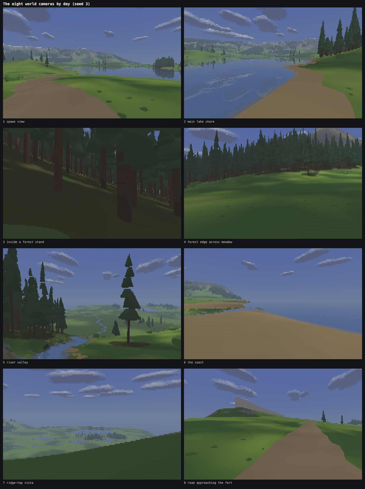

Each camera at day (14:00), dusk (17:51) and night (23:00):

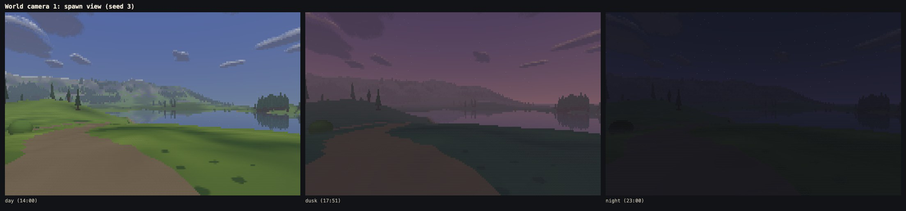
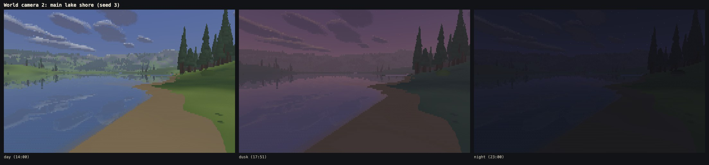
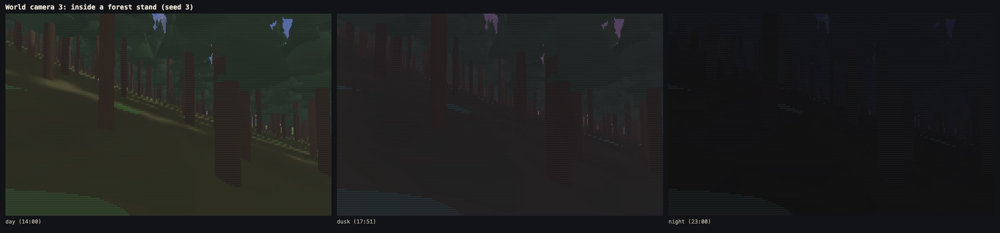
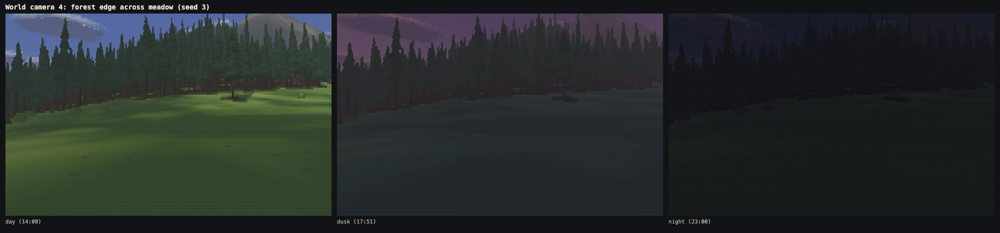
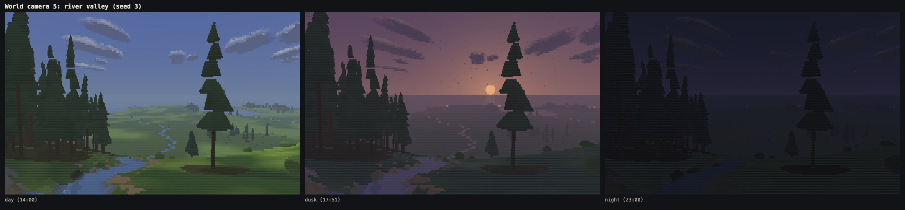
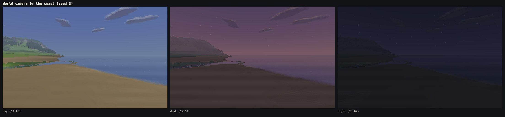
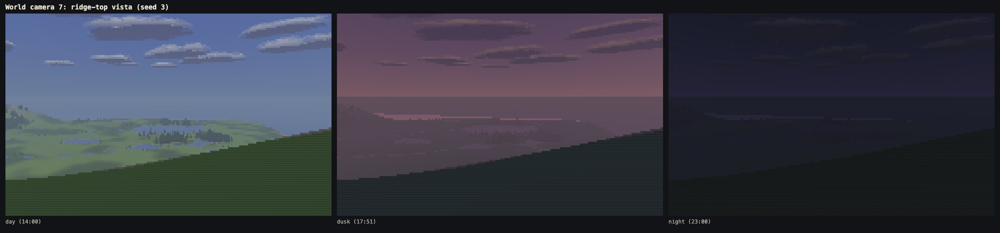
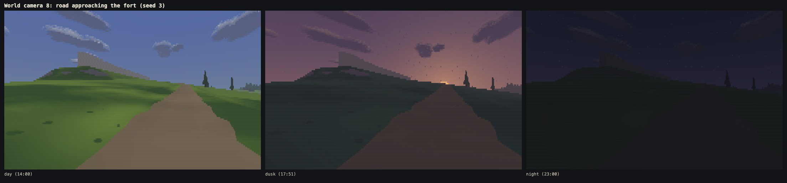

---

## 5. Measurements

Machine: M1 Max, 32 GB. Before the runs the app's browser pane was closed and no other copy of the game was open. The window server used about half a core and the Claude app 10–30% of one; nothing else was over 15%.

### The world check

`node tools/world-check.mjs --seeds 3,1,2,4,5` runs in Node, with no browser. For each seed it checks:
- the same seed gives byte-identical arrays when built twice;
- every site can be reached on foot from the spawn;
- no road is steeper than 12%, measured along it over 4 m, nor runs through water deeper than a ford;
- every river runs downhill to a lake or the sea;
- no tree stands in water or on a road;
- **the sky test:** 300 random walkable lowland points and 50 road points, at eye level, looking level in four directions (1,400 views). The median share of sky must be at least 35%, with fewer than 10% of views under 15%.

The frames are rendered by the real CPU backend at density 3 (360 × 112), 60° vertical field of view, 14:00, with the settled look.

| seed | same twice | sites reached | steepest road | deepest ford | rivers downhill to lake/sea | trees in water / on roads | sky median | views under 15% | 10th percentile | result |
|---|---|---|---|---|---|---|---|---|---|---|
| **3** | yes | 8 of 8 | 11.2% | 0.42 m | 3 of 3 | 0 / 0 | 42.0% | 3.4% | 24.8% | pass |
| 1 | yes | 8 of 8 | 11.4% | 0.42 m | 3 of 3 | 0 / 0 | 41.1% | 4.4% | 21.9% | pass |
| 2 | yes | 8 of 8 | 10.9% | 0.42 m | 2 of 2 | 0 / 0 | 42.0% | 4.5% | 21.2% | pass |
| 4 | yes | 8 of 8 | 11.6% | 0.42 m | 3 of 3 | 0 / 0 | 39.8% | 8.1% | 17.6% | pass |
| 5 | yes | 8 of 8 | 11.5% | 0.42 m | 2 of 2 | 0 / 0 | 39.3% | 8.9% | 16.6% | pass |

**How the terrain rules got there.** No seed was picked for passing. Each failure was fixed in the rules and checked on all five:
- Early builds failed on two counts. Some seeds had up to 14% of views under 15% sky (the limit is 10%), and on all five some roads ran at 12–25%.
- The roads were fixed in the search and the grading: a lower step limit with stepwise loosening, fords away from steps in the river, lowering-only grading capped at 1.5 m of cut, and eased junctions. The world check then measured gradient along each road, not cell by cell.
- Raising the range to about 300 m made seeds 4 and 5 fail the sky test again: forest on the range's lower flanks closed the views toward it. The treeline was raised and the lowland's forest penalty pushed further from the front.

**Robustness.** 60 random seeds all build, each with 3 villages, 4 viewpoints, a main lake and 2–3 rivers. One seed (237635) once failed to find a spawn; the spawn chooser now loosens its rules a step at a time, like the other site choosers.

### Identity

`node tools/identity.mjs --scene all --threads 0,1,3,5,8 --built`:

**51 of 51 views are byte-identical across 0, 1, 3, 5 and 8 workers:**
- 14 lab views and 7 stress views;
- 15 world views with shared memory, and the same 15 without it. The world views are its eight cameras plus night, the open sea from a cliff (it must run to the horizon), the map's edge from outside, down into a river, and up at the gate.

The shared and fallback frames are also identical to each other, view for view.

**Every page built the same world, byte for byte:** hash `d36a721f` at 0 workers (built on the page) and at 1, 3, 5 and 8 (built in the builder worker), with and without shared memory.

### Flicker

`node tools/flicker.mjs --set world` walks through the default world from its own cameras:
- density 3, Chromium, every clock frozen, 60 frames;
- walking at 4.5 m/s, turning at 18° a second.

Phase 0c's closest runs are given beside each one: their views are in the lab and the stress scene, so the comparison is like for like in kind, not in place.

| run | blinking | glyph blinks | colour blinks (>6 levels) | phase 0c's closest: blinking / glyph / colour |
|---|---|---|---|---|
| open meadow, walking | 0.117% | 0.006% | 0.001% | open meadow (meadow 2): 0.140% / 0.009% / 0.003% |
| forest edge across the meadow, walking sideways | 0.514% | 0.029% | 0.002% | same (tree B): 0.668% / 0.066% / 0.000% |
| inside a forest stand, walking | 0.430% | 0.026% | 0.005% | stress forest walking in (tree B): 0.428% / 0.032% / 0.005% |
| main lake shore, walking along the shore | 1.004% | 0.042% | 0.013% | trees in the lake (tree B): 1.033% / 0.045% / 0.021% |
| open meadow, turning | 0.584% | 0.248% | 0.117% | stress vista turning (meadow 2): 1.152% / 0.259% / 0.098% |
| inside a forest stand, turning | 0.432% | 0.072% | 0.028% | stress forest turning (tree B): 0.636% / 0.089% / 0.023% |
| main lake shore, turning | 1.279% | 0.454% | 0.219% | phase 0b's stress lake turning: 0.802% / 0.402% / 0.131% |

**What it shows:**
- **Walking through meadow, forest and along the lake is no worse than phase 0c,** and mostly better: fewer glyph blinks on all four walks, and colour blinks within a cell or two.
- **Turning in the open meadow** is close to the stress vista: the far skyline crawls a little as the planes turn. The lab's own meadow turning view (0.009% glyph) looks down at grass and has no skyline, so it is not a fair comparison.
- **Turning at the lake shore** has about 20 more glyph blinks and 35 more colour blinks per frame than phase 0b's stress lake (of 40,320 cells). They sit on the far skyline and its mirror image. See section 6.

### Frame times

`node tools/bench.mjs --scene world --browser chromium,firefox,webkit --threads 8 --density 3 --built`, the phase 0b rule:
- the slowest worker's march + resolve plus the main thread's draw;
- the median over 240 frames after a 60-frame warm-up, every clock frozen;
- Chromium and Firefox headed on the 120 Hz display, \*WebKit headless (60 fps cap);
- the page cross-origin isolated, so the workers share the world.

| Camera | Chromium ms | Firefox ms | WebKit\* ms |
|---|---|---|---|
| 1 spawn view | 4.97 | 8.74 | 5.56 |
| 2 main lake shore | 7.06 | **11.68** | 7.12 |
| 3 inside a forest stand | 4.21 | 7.30 | 4.74 |
| 4 forest edge across meadow | 4.44 | 6.28 | 4.68 |
| 5 river valley | 5.69 | 7.60 | 5.70 |
| 6 the coast | 4.69 | 6.76 | 5.00 |
| 7 ridge-top vista | 5.24 | 7.42 | 5.36 |
| 8 road approaching the fort | 3.33 | 4.72 | 3.94 |

- **Chromium and WebKit are under 10 ms on every camera.**
- **Firefox is under 10 ms on seven cameras and 11.7 ms at the main lake shore.** That is the one result over the rule.
- Firefox is about 1.6 times slower than Chromium on every camera, as in phases 0b and 0c (stress lake: 8.6 against 5.5 ms).
- The lake view is the most expensive by design: water over half the frame, mirrored trees, and mirrored sky with clouds.
  - Its frame splits as: march and terrain reflections 54%, objects 19%, clouds 15% (most of that is rays that really hit cloud).
  - An exact test that skips puffs a ray cannot reach made no difference, so it was not kept.
- What it would take is in section 6.

### Build time and memory

| | Chromium | Firefox | WebKit\* |
|---|---|---|---|
| World built (in its worker, until the arrays are back on the page) | 2.4 s | 5.5 s | 2.2 s |
| First frame (page load included) | 2.9 s | 6.3 s | 3.1 s |

- **Chromium builds the default world in 2.4 s, under the 4 s limit.**
- The stages in Chromium, in ms: quick pass 198, land 308, water 86, carving 62, forest field 210, sites 223, roads 84, plants 95, ground 905, finishing 100.
- Firefox's ground stage takes 2.7 s of its 5.5.

**Memory,** each in a fresh Chromium, headed, at density 3, after the first frame settled:

| | the browser's measure: page and workers | renderer process, resident |
|---|---|---|
| **world, shared memory, 8 workers** | **261 MB** (134 MB of it the shared world and shadows) | 1,174 MB |
| world, no shared memory, 4 workers | (needs isolation to measure) | 1,415 MB |
| stress scene, 8 workers | 1,394 MB | 2,296 MB |
| lab, 8 workers | 155 MB | 878 MB |

- **The world is under the 300 MB target by the browser's own measure,** against 1.4 GB for the stress scene, which copies its world into every worker.
- Chromium's `measureUserAgentSpecificMemory` counts a shared buffer again for every thread that holds it, so it reports 1,467 MB. The page, eight render workers, the builder and the shadow worker each hold the 134 MB. Counted once, that is 261 MB.
- The resident figures include what every page pays, whatever its world: a JavaScript engine per thread, the GPU's buffers and the browser itself. The lab, with a world of under 1 MB, is already 878 MB. The generated world adds about 300 MB to that; the stress scene adds 1.4 GB.

### The walk

`node tools/walk.mjs --only world-road --density 3` recorded `shots/walks/world-road.webm`:
- 120 s from the spawn along the road toward village 1, with time running;
- W held, the arrows steering toward the road 15 m ahead, as a player would;
- 57.9 frames a second presented (headless Chromium, 8 workers);
- 54 MB, private and kept out of git.

It ends 0.5 m from the road, about 450 m from where it started.

### The regression lookbook

`node tools/lookbook.mjs --regress` now covers:
- the lab's nine cameras and the stress scene's three;
- **the default world's eight cameras**;
- each at day, dusk and night, with the settled look.

- 60 frames in 2.0 MB, saved in this phase (section 1).
- Run again straight after saving, every frame reports 0.00%.

### Size

- `index.html` is 269.7 KB (the worker 116.3 KB of it), still one file with the worker inline (162.5 KB after phase 0c).
- Phase 1 added about 3,500 lines; the largest source file is still `src/scene/cpu/objects.js` at 635 lines.

---

## 6. What looks wrong or thin, and fixes

From the camera sheets, the walk and the measurements, worst first.

1. **The ridge-top vista is the weakest frame.**
   - Its own hillside fills the lower half of the frame, and the land below is washed out by haze, so the lake that chose the view barely shows.
   - Fix, in two parts:
     - the camera: stand at the viewpoint's brow, where the ground falls away in the direction it looks;
     - the haze: thinner when looking down from height, since much of a downward view's path is in clearer air. That is an art-bible change.
2. **The mountains read as hazy hills, not a range.**
   - From the lowland, 1–1.5 km away, the range is mostly haze and a skyline. The snow shows in patches, and the rock bands and gullies that make the reference's mountains read are lost. At the spawn the backdrop looks like green hills.
   - Fix: a far-terrain rule in the art bible, so snow and rock keep more contrast through the haze. Check it from the spawn and the vista.
3. **Nights are almost black.**
   - At 23:00 the land is barely visible: stars, a faint lake, a darker skyline. The world has no torches (the brief named only the wall and gate), so nothing lights it.
   - Fix: lights come with the fort and the villages. Until then, a little more moonlight on open ground and water, under an art-bible rule.
4. **The beaches are flat plains of plain sand.**
   - The coast camera stands on a wide, even beach with no texture. The sea meets it with no wet edge or foam line.
   - Fix: a darker wet band and a broken foam line at the water's edge, and narrower beaches on gentle coasts.
5. **The wall stands alone, a grey slab on its rise.** From the road it reads as a fence. Fix: the fort's buildings, when that phase comes.
6. **Turning, the far skyline crawls,** most at the lake, where its mirror image crawls too (section 5).
   - Fix: phase 0c's far-treeline taper, applied to the range's skyline as well: a top cell that fades rather than snaps between rows. Measure with the flicker world set.
7. **Firefox's lake view is over the 10 ms rule (11.7 ms).**
   - Neither fix below has been tried, because both change the picture:
     - mirrored clouds only within a few hundred metres of the shore (they are about 8% of that frame);
     - mirrored objects to 500 m instead of 700 m.
   - Or accept it, as phase 0b accepted 10.8 ms. Firefox shows 60 frames a second on every camera either way.
8. **R reloads the page** to build a new world.
   - It works, and the seed goes into the URL, but the screen goes blank during the build.
   - Fix: build the new world while the old one is still drawn, then hand it over.
9. **The lowland is thin between the stands.**
   - It is meadow, stands and roads: no rocks in the open, no fallen trees, no paths.
   - These are content, which the brief ruled out, so they are listed for later rather than fixed.

### Notes

- **A seed is the same world in every browser to the last bit, almost.** Node, Chromium and Firefox build the same seed's land, water, ground, roads, tree positions and tree shapes byte for byte. Two fields differ in the last bit, from engines' sin, cos and atan2: each tree's lean (by at most 7×10⁻¹⁸ m) and a few numbers in the JSON (one camera's angle, two site scores). So `worldHash` differs between engines, while each engine agrees with itself in every mode. Nothing visible depends on it.
- **The contract did not change.** One addition in `src/glyphs.js`: the map's glyphs, after the existing ones, so no index moved.
- **Firefox builds the world in 5.5 s,** half of it in the ground stage (materials and detail noise for 4 million cells). It is not under the brief's 4 s, which names Chromium. That stage is the place to start if it matters.

---

## 7. Tools

| Tool | What it does |
|---|---|
| `node tools/world-check.mjs [--seeds 3,1,2,4,5]` | The world check (section 5), in Node. |
| `node tools/identity.mjs --scene world` | The world at 0, 1, 3, 5, 8 workers, shared and not, and the world hash on every page. |
| `node tools/bench.mjs --scene world` | The eight cameras, plus build time, first frame and memory. |
| `node tools/flicker.mjs --set world` | Walks and turns through the world. |
| `node tools/walk.mjs --scene world` | A 120 s walk from the spawn along the road (video, private). |
| `node tools/lookbook.mjs --phase 1` | The maps and the camera sheets in `shots/phase1/`. |
| `node tools/lookbook.mjs --regress` | The regression set, now including the world. |
| `npm run dev` | The dev server sends the isolation headers; `NOISO=1 npm run dev` runs without them. |
