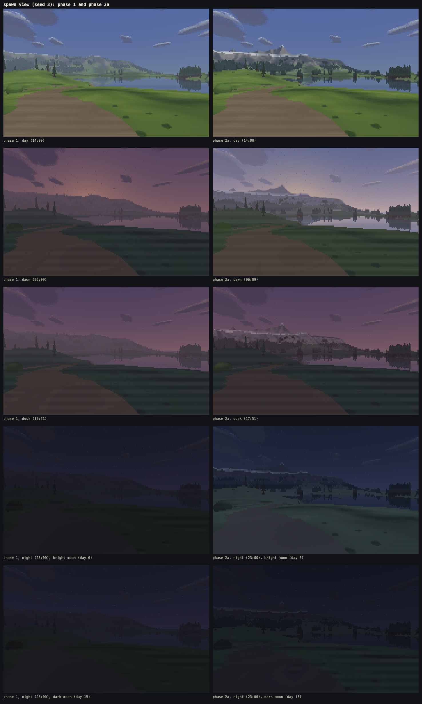
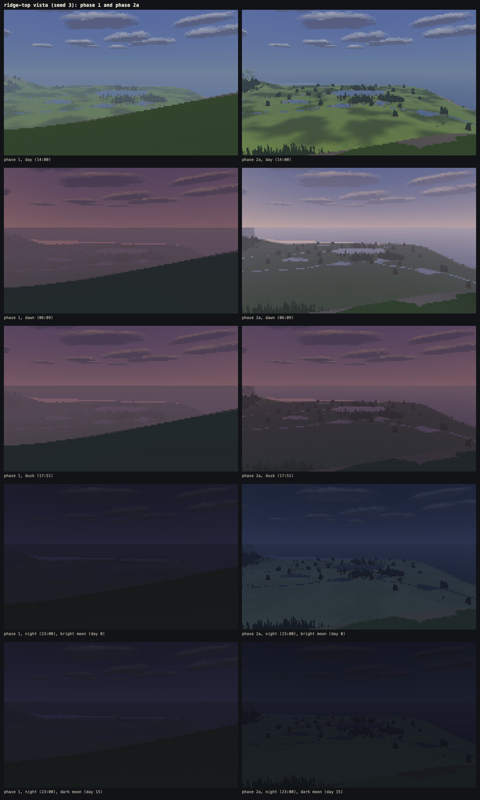
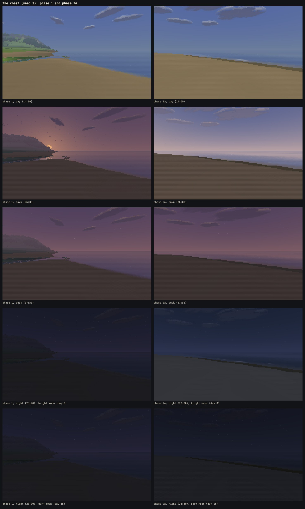
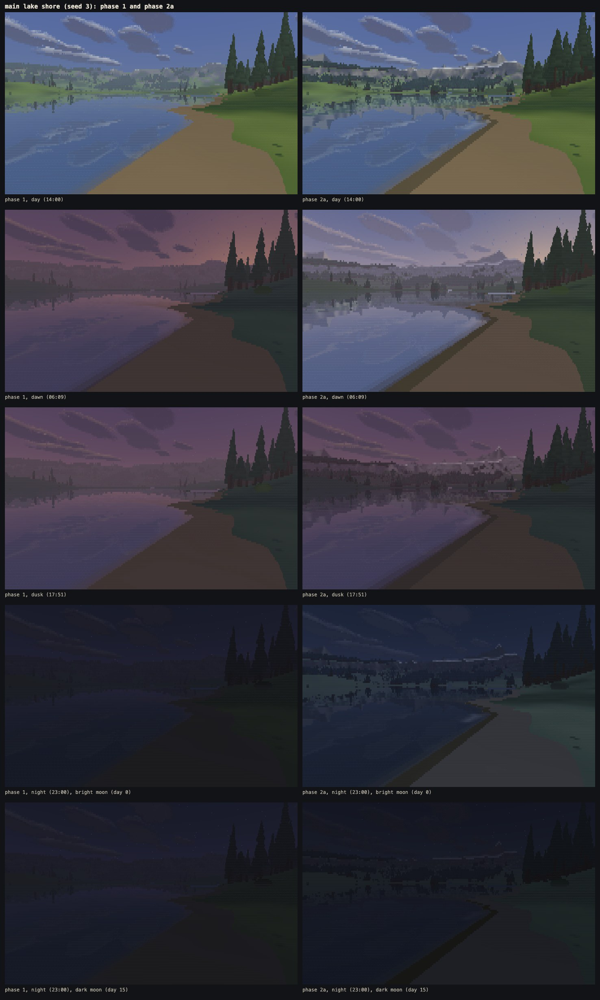
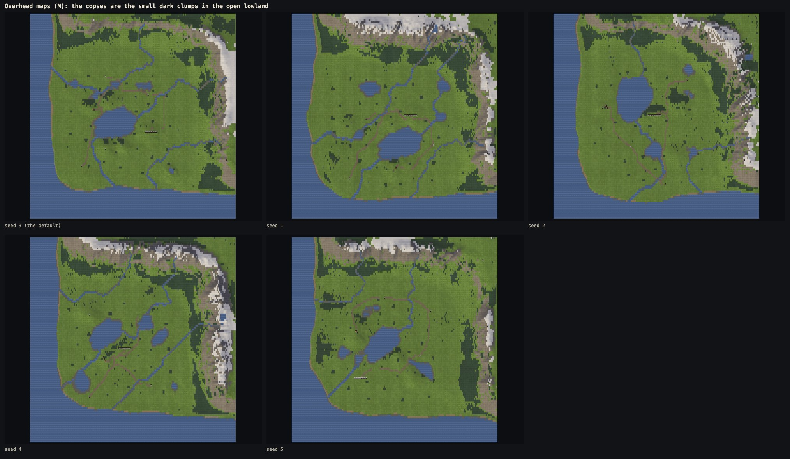

# Phase 2a: air and far land

Written 11 Oct 2026. Phase 2a makes distance readable instead of washed out, gives the world mountains that look like mountains, makes night and dawn worth walking in, and finishes the coast. Nothing else changed: no weather, buildings, people, animals, inventory or goals, no new plants or ground content, no change to movement.

**Live:** https://land-of-ascii-v3.vercel.app/ (GitHub Pages runs the no-shared-memory fallback: https://oddslice.github.io/land-of-ascii-v3/). The default seed is still 3.

| Key or option | Does |
|---|---|
| 4 | dawn (06:09); 1, 2 and 3 are still day, dusk and night |
| `?day=N` | the day count, which the moon's phase follows: day 0 a bright moon, about day 15 a dark one. The clock moves it on past midnight. |
| L, then 5 | distance: aerial perspective, far land and the backdrop, or phase 1's haze, for comparison |
| L, then 6 | night: the moon's phases, moonlight, starlight and dawn, or phase 1's night |

The HUD shows the day and how much of the moon is lit.

---

## 1. What changed

### Aerial perspective (replaces phase 1's distance haze)

- **The problem:** phase 1 mixed everything toward the horizon colour by distance alone, up to 72% by day. At 1–1.5 km the range, the far shore and the vista's valley all went most of the way to the sky's colour, taking light and dark with them.
- **Air now thins with height.** A ray's haze is the air it actually passes through, in closed form from the eye's height, the ray's elevation and the distance, with a thin share the same at every height. Looking down from a viewpoint cuts through far less of it than looking along the valley floor, and a mountain's upper slopes stand clearer than its foot.
- **Haze has two shares, not one:**
  - colour shifts toward the cool horizon tone by up to 62% by day;
  - light and dark close up by at most 40%.
  So lit and shaded sides, snow, rock, forest and water stay apart out to the full view distance, while far colours still cool and converge on the horizon tone.
- The sea still meets the sky softly, since sea-level air is the thickest.
- Each reflection is hazed over its own leg up from the water.
- The rule is in `docs/art-bible.md`, section 5.

### Far land (new)

- **Large forms gain contrast as fine detail fades.** From 300 m (full by 900 m) the light a surface catches is pushed away from the flat ground's light, so a far mountain has a clear lit face and a dark shadow side.
- **Rock shows broad strata and gullies.**
  - Gullies are found from where rain gathers on the range, widened to 10–20 m.
  - Strata run along the height every 38 m and fade before they are finer than a couple of rows.
- **Snow lines and rock bands end in a clean line** far away, decided from the coarser levels' filtered weights.
- **A skyline's top cell fades instead of snapping:**
  - the cell just above where the land meets the sky blends the two by how much of it the land covers;
  - the march carries on just far enough to know the skyline exactly within that cell, so it is the same whatever the stripe.
- The rule is in `docs/art-bible.md`, section 5b.

### The backdrop (new)

**What it is.** The range goes on past the north and east edges as three receding ridgelines, 450 m, 1.4 km and 3.2 km outside the edges. Their peaks are 600 to 980 m at the far one, with snow capping the taller peaks, rock with strata and gullies, and wooded lower slopes. Each ridgeline faces the map, leaning back, and turns along its line with its peaks and saddles. Smoothing that turn more widely further down each face makes crests spread into broad flanks; without it the faces looked like a pleated curtain.

**How it is drawn:**
- It is built once per world, in about 2 ms, as height profiles along three lines; it is never part of the height grid and never walkable.
- The sky pass tests each ray against three heights worked out once per column.
- It is ordered against clouds by distance, so the nearer one wins.
- It is reflected in water.

**Where it stands:**
- Only where the map's own edge is mountainous; it dies away where the edge is coast.
- Where the first ridgeline stands above the map's edge, the march stops at it. Where it is lower, the edge runs on and hides it. At the meeting both are the same height, so there is no gap and no step.

Sizes are in `docs/scale.md`.

### The range, bigger only as far as the sky test allows

- The map's own peaks now climb between 70 and 390 m past the range front, steeper toward the back. They reach 252 m above the sea on seed 3 (244 in phase 1) and 291–326 m on the other seeds (284–314).
- A bolder version failed the sky test:
  - with the top raised to 370 m and the shoulder at the edge raised 35 m, seeds 4 and 5 had 13.8% and 15.2% of views under 15% sky;
  - a middle setting failed seed 5 at 10.7%.
- The sky test's low views were mostly at the foot of the range, looking straight at it. Two rule changes paid for the height:
  - the climb starts a little further back;
  - the band of lowland just in front of the range is kept open of forest, so from there the mountains are seen over meadow.
- With these, every seed passes, and seeds 4 and 5 have more sky than in phase 1 (section 3).
- Most of the extra mountain is the backdrop.

### Night and dawn (replaces phase 1's single night)

- **The moon has a phase** that follows the day count, and its place in the sky follows the phase: a new moon rides with the sun and is down all night; a full moon is opposite it and up all night. The disc is drawn as bright as its lit share; its glitter on water is as strong.
- **Under a bright moon** (keyframe `moonlit`) open ground, water and snow carry enough cool light to walk by, with soft moon shadows. They come through the same shadow sweep and worker-shared arrays as sunlight.
- **Under a dark moon** (keyframe `starlit`) there is a faint floor, so the land is never a black screen, and the stars are brighter.
- **The change from sun to moon never flashes.** Sunlight fades out as the sun sets; moonlight fades in only as the twilight deepens and the moon rises. At the moment the shadow-casting light changes from one to the other, both are dark.
- **Dawn has its own keyframe:** cooler blue above and rosier at the horizon than dusk, with a pale lilac mist.
- **The low sun rakes across the meadow at both ends of the day:** less ambient light and more direct than phase 1's dusk.

### The coast (new)

- **Wet band:** where sand meets the sea, a darker band 2.2 m wide, drawn in the bed's colours; 0.4 m at a lake.
- **Foam line:** a broken foam line runs up toward the shore and back over 9 s (6 s, and fainter, at a lake). It covers a cell by the share of its footprint the line covers, so thin foam fades with distance instead of breaking into dashes.
- **Swell:** a gentle swell runs onshore on the open sea.
- **Beaches** are narrower: about 16 m, against 34 m.
- All of it is a pure function of position and time, so a frozen clock repeats exactly.

### Copses and viewpoints (world changes)

- **Copses:** about 32 small clumps of 5 to 30 conifers in the open lowland, at least 140 m apart and clear of the stands, so the middle of the map has things to walk toward. The stands give up the same number of trees, so the total stays about 11,700–11,950.
- **Viewpoint brows:** each viewpoint, and the ridge-top vista camera, now stands at the brow of its hill. That is the spot within 90 m, no more than 18 m lower, where the ground falls away soonest in the direction it looks, so its own slope no longer fills the frame.
- **The coast camera** now looks 42° from the sea, not 60°, so the waterline runs across the frame now the beaches are narrower.

### Additions to the contract

Each is additive and documented in `src/contract.js`. A backend that ignores them behaves exactly as before.

1. **`day` in the frame description:** the day count, for the moon's phase. Missing means day 0.
2. **R1 of a cell that is not water** may hold what lies behind a skyline that covers the cell only in part, with the covered share in its fifth byte. It was MAT_NONE for every non-water cell before. Whatever overwrites a water cell with something else now clears its mirror and bed records, so no stale record can be mistaken for this.
3. **A `FOAM` material (19)**, only ever in R2 of a water cell: foam at the waterline, its tone the share it covers, its distance the path to the bed as before.

---

## 2. Before and after

Phase 1's build (on the left of each pair) against phase 2a's, from each build's own cameras, at day, dawn, dusk, and night under a bright and a dark moon. Phase 1 had no dawn and no moon's phases: its frames at those times show what it drew then. Its vista camera stood where its own slope filled half the frame; phase 2a's stands at the brow.

The overhead maps of the five check seeds; the copses are the small dark clumps in the open lowland:

**Side-by-side sheets against the reference.** `node tools/shoot.mjs --world` made sheets against the reference's mountain frame (ASCII Fort 0:57) and its dusk frames (mountains video 0:36 and 0:47). They are in `shots/ref-2a/`, which is private and kept out of git and off the site. What they show is in section 4.

---

## 3. Measurements

Machine: M1 Max, 32 GB. During every timed run the window server used about half a core and the Claude app 10–30% of one. No other copy of the game was open, the app's browser pane was closed, and nothing else was over 15%.

### The world check

`node tools/world-check.mjs --seeds N`, run for each seed, now includes a far-readability check:
- from the spawn and from each of the four viewpoints, looking their way at 14:00, the main lake, a river, a forest (conifers over 150 m away) and a road that are in view must each differ from the cells round them by a visible step: a mean resolved colour more than 6 levels apart in some channel, the flicker tool's threshold;
- from the spawn, the range's lit and shaded faces must differ by one too (within one material, the quarter of its cells most lit against the quarter least lit).

| seed | same twice | sites reached | steepest road | deepest ford | rivers downhill to lake/sea | trees in water / on roads | sky median | views under 15% | far readability: weakest step | result |
|---|---|---|---|---|---|---|---|---|---|---|
| **3** | yes | 8 of 8 | 11.2% | 0.42 m | 3 of 3 | 0 / 0 | 39.2% | 3.5% | pass, 12.9 (a river from the spawn) | pass |
| 1 | yes | 8 of 8 | 11.4% | 0.42 m | 3 of 3 | 0 / 0 | 38.9% | 4.2% | pass, 11.8 (a road) | pass |
| 2 | yes | 8 of 8 | 10.8% | 0.42 m | 2 of 2 | 0 / 0 | 39.8% | 5.8% | pass, 16.0 | pass |
| 4 | yes | 8 of 8 | 11.3% | 0.42 m | 3 of 3 | 0 / 0 | 38.2% | 6.3% | pass, 23.7 | pass |
| 5 | yes | 8 of 8 | 11.5% | 0.42 m | 2 of 2 | 0 / 0 | 36.8% | 8.6% | pass, 17.7 | pass |

- Phase 1's sky test, for comparison: medians 39.3–42.0%, and 3.4–8.9% of views under 15%.
- Phase 2a is about 2 points lower in the median, from the backdrop, the copses and the taller range. Seeds 4 and 5 have fewer views under 15% than in phase 1 (6.3% and 8.6%, against 8.1% and 8.9%), from the open foot of the range.
- Every feature in view passed from every spot on every seed.

**Far readability, phase 1 against phase 2a.** The same measure on phase 1's build (seed 3), in steps of colour levels:

| From | main lake | river | forest | road | range lit/shaded |
|---|---|---|---|---|---|
| spawn, phase 1 | 56 | **5** (would fail) | 26 | 17 | 12 |
| spawn, phase 2a | 54 | 13 | 36 | 17 | **44** |
| viewpoints, phase 1 | 24–43 | 31–39 | 24–41 | – | |
| viewpoints, phase 2a | 27–66 | 51–55 | 29–49 | 32 | |

One of phase 1's viewpoints saw nothing but its own hillside.

### Identity

`node tools/identity.mjs --scene all --threads 0,1,3,5,8 --built` now includes:
- dawn, the night under a dark moon and the vista at night;
- the waterline from the beach both ways, one of them out to sea;
- the backdrop and its reflection, in the lake camera.

**61 of 61 views are byte-identical across 0, 1, 3, 5 and 8 workers:**
- 14 lab views and 7 stress views;
- 20 world views with shared memory, and the same 20 without it.

The shared and fallback frames match each other too. Every page built the same world, byte for byte: hash `0bed1c8a` at 0 workers (built on the page) and at 1, 3, 5 and 8 (built in the builder worker), with and without shared memory.

### Flicker

**The far skyline, turning.** `node tools/flicker.mjs --skyline --ref <phase 1>` runs in Node so each blink can be sorted by what it sits on. A skyline blink is a cell going between sky and land, or a fading top cell. Turning at 18° a second from the world's own cameras toward the range, density 3, 60 frames:

| view | skyline glyph blinks | skyline colour blinks | all glyph blinks | all colour blinks |
|---|---|---|---|---|
| spawn, phase 1 | 0.081% | 0.076% | 0.417% | 0.212% |
| **spawn, phase 2a** | **0.069%** | **0.068%** | 0.394% | 0.218% |
| main lake shore, phase 1 | 0.085% | 0.078% | 0.455% | 0.219% |
| **main lake shore, phase 2a** | **0.074%** | **0.073%** | 0.383% | 0.188% |

- **The far skyline crawls less than in phase 1** (12–15% fewer glyph blinks), though it is now a much busier line of peaks.
- Most of what is left is conifer tips against the sky. They keep phase 0c's single-cell tips and have no fade of their own.

**The world set.** `node tools/flicker.mjs --set world`: density 3, Chromium, every clock frozen, 60 frames, walking at 4.5 m/s, turning at 18° a second:

| run | blinking | glyph blinks | colour blinks (>6 levels) | phase 1 |
|---|---|---|---|---|
| open meadow, walking | 0.117% | 0.006% | 0.001% | 0.117% / 0.006% / 0.001% |
| forest edge across the meadow, walking sideways | 0.522% | 0.029% | 0.002% | 0.514% / 0.029% / 0.002% |
| inside a forest stand, walking | 0.331% | 0.030% | 0.009% | 0.430% / 0.026% / 0.005% |
| main lake shore, walking along the shore | 1.015% | 0.039% | 0.013% | 1.004% / 0.042% / 0.013% |
| open meadow, turning | 0.569% | 0.246% | 0.116% | 0.584% / 0.248% / 0.117% |
| inside a forest stand, turning | 0.343% | 0.063% | 0.031% | 0.432% / 0.072% / 0.028% |
| main lake shore, turning | 1.166% | 0.383% | 0.188% | 1.279% / 0.454% / 0.219% |
| **the coast, walking along the beach** (foam line and swell in view) | 0.273% | 0.011% | 0.000% | (new) |
| **the coast, turning across the sea** | 0.385% | 0.088% | 0.017% | (new) |

- **The foam line and the swell add no blinking beyond the lake's level.** Walking the beach gives 0.011% glyph and 0.000% colour blinks, against 0.039% and 0.013% walking the lake shore. Turning across the sea gives 0.088% / 0.017%, against 0.383% / 0.188% turning at the lake.
- The phase 1 runs are as before. The stand's camera moved a little (the copses changed the stands), so its walk is not quite the same view.

### Frame times

`node tools/bench.mjs --scene world --browser chromium,firefox,webkit --threads 8 --density 3 --built`. The value is the slowest worker's march + resolve plus the draw, the median of 240 frames after a 60-frame warm-up, every clock frozen. Chromium and Firefox ran headed on the 120 Hz display; \*WebKit ran headless (60 fps cap).

Phase 1's build was benchmarked again in the same session (`--root`, its own `index.html`) to control for the machine. Each figure is the best of two rounds.

| Camera | Chromium 2a | Firefox 2a | Firefox phase 1, same session | change | Firefox phase 1 as recorded | WebKit\* 2a |
|---|---|---|---|---|---|---|
| 1 spawn view | 5.59 | 7.94 | 7.40 | +7.3% | 8.74 | 6.02 |
| 2 main lake shore | 7.70 | 11.40 | 10.36 | **+10.0%** | 11.68 | 7.66 |
| 3 inside a forest stand | 4.66 | 6.88 | 6.40 | +7.5% | 7.30 | 5.02 |
| 4 forest edge across meadow | 4.59 | 6.88 | 6.50 | +5.8% | 6.28 | 5.08 |
| 5 river valley | 5.46 | 7.96 | 7.68 | +3.6% | 7.60 | 5.94 |
| 6 the coast | 4.47 | 6.92 | 6.86 | +0.9% | 6.76 | 5.20 |
| 7 ridge-top vista (moved to the brow) | 5.68 | 8.14 | 7.42 | +9.7% | 7.42 | 6.10 |
| 8 road approaching the fort | 3.61 | 5.06 | 4.72 | +7.2% | 4.72 | 4.38 |

- **Chromium stays under 10 ms** on every camera (3.6–7.7 ms).
- **Firefox is within 10% of its phase 1 figures** on every camera:
  - against the figures recorded in phase 1, the largest rise is the vista at +9.7%;
  - against phase 1 re-measured in the same session, the main lake is right at the limit, +10.0% (11.40 against 10.36 ms).
- **Getting there took four exact speed-ups.** Each was checked to leave every frame byte-identical:
  1. far away, 8 m squares where every filtered weight is nothing (about half the map) skip straight to meadow or forest floor;
  2. squares far from any shore skip the foam test;
  3. the skyline march stops at the higher of the skyline found so far and the open row's lower neighbour;
  4. the backdrop's per-column values are worked out once per column.

  Aerial perspective's shares and the air's density are also read from tables, which changes colours by under a level.

  The first full benchmark, before these, had Firefox up to +20% at the vista and +13% at the lake.
- **What phase 2a still costs:**
  - in Node, one thread: resolve about 15–20% more than phase 1 (aerial perspective), the march 1–2 ms more a frame (the taller range keeps more rows open further, plus the skyline and coast work), the objects about 1 ms more on the spawn (copses), the sky about 0.4 ms more (the backdrop);
  - per worker that is 0.2–0.5 ms in Firefox.

**Build time and memory:**

| | Chromium | Firefox | WebKit\* |
|---|---|---|---|
| World built (in its worker) | **2.36 s** (phase 1, same session: 2.73 s) | 5.58 s (5.38 s) | 2.39 s |
| First frame (page load included) | 2.82 s | 6.41 s | 3.19 s |

- **Build time:** the world still builds in well under 4 s in Chromium.
  - The new stages are the gullies, the waterline distances, the copses and two more filtered weights.
  - A faster level filter more than paid for them: the mapped copy it used cost 105 ms an array.
- **Memory:** by the browser's own measure, with shared memory counted once, the page and its workers hold **273 MB** (141 MB of it shared), against 261 MB in phase 1.
  - The new world data is the waterline distances (4 MB), the filtered snow and rock levels (3 MB), the gullies and the two 8 m tables (under 0.5 MB).
  - The backdrop is built per thread and is tiny.

### The regression lookbook

The look changed on purpose, so the baseline was saved again, after showing that nothing else moved:
1. **With the new haze and night rules switched off** (`--look air=p1,night=p1`), every lab and stress frame matched phase 1's saved set exactly: 36 of 36 at 0.00%. In Node the same held for the lab's 27 views at day, dusk and night.
2. **With the rules on,** lab and stress frames change:
   - by day, 1–10% of cells visibly (the stress vista 46%, as its far mountains now keep their contrast);
   - at dusk, 15–40% (raking light);
   - at night, 92–100% (the new night).
3. `node tools/lookbook.mjs --regress --built --save` saved 60 frames (2.2 MB) to `tools/regress/`: the lab's nine cameras, the stress scene's three and the world's eight, at day, dusk and night.
4. Run again straight after saving, every frame reports 0.00%.

### Walks

Both are private and kept out of git.

- **`shots/walks/world-dusk.webm`:** 120 s from the spawn along the road, from 17:33 to 19:33 (the clock running a game hour a minute), dusk into a moonlit night; 58.3 frames a second presented, 51 MB.
- **`shots/walks/world-pan.webm`:** 60 s, a slow 150° pan from the ridge-top vista at the brow of its hill, at 14:00; 59.9 frames a second presented, 27 MB.

### Size

- `index.html` is 313.7 KB (the worker 138.2 KB of it), still one file with the worker inline (phase 1: 269.7 KB).
- It still opens from disk. In Chromium and Firefox it built seed 3 in 2.3 s and 5.8 s and ran the no-shared-memory fallback with 4 workers, with no errors.

---

## 4. What still looks wrong

1. **The far range is smaller in the frame than the reference's mountain.**
   - The reference's mountain stands close and fills a quarter of the frame's height. Ours stands 2–5 km off and fills a sixth to a tenth.
   - Going bigger inside the map fails the sky test (section 1). A larger backdrop would take sky from views at the foot of the range.
   - Fix: lower the lowland's skyline elsewhere to buy the sky back, so the backdrop can stand taller.
2. **The far rock is cooler and greyer than the reference's warm tan.** The air's colour share (62% by day) pulls far rock toward the blue horizon tone. Fix: a lower colour share for high, lit surfaces, or a warmer far-rock colour; to be tried by eye in the look panel.
3. **At dusk the range catches the low sun.** Looking east at dusk, its faces toward the setting sun are lit pink-grey, lighter than the reference's dark dusk silhouette. This is plausible (alpenglow), but darker than the reference would need the dusk keyframe's far light lowered.
4. **A thin snow line still runs along some crests.** Snow caps the peaks by their height over the line, but where a long crest sits just above it, a white strip follows the crest. Fix: cap by the peak's prominence over its neighbours, not its height.
5. **Specks in the dawn and dusk sky.** Distant cloud fragments, flattened at dawn and dusk, dissolve into single shade-block cells that read as specks. Phase 1's dusk had them too. Fix: give a cloud's dissolving edge a minimum size, like everything else.
6. **The coast camera stands inside the beach,** so plain sand still fills the lower half of the coast frame. Fix: score candidate spots by how much sea and land the frame shows, not only by the rise of the coast.
7. **Firefox's lake view is right at its limit** (+10.0% against phase 1 in the same session), so any further work on water or reflections needs its own saving.
8. **Conifer tips still crawl when turning.** They are most of what is left of the skyline's crawl. A fading top cell, like the range's, would need the conifer pass to know a tip's cover.
9. **The lake's wet band** is a thin dark line along every sandy lake shore, also where the shore is steep and a band would not form. Fix: make its width depend on the beach's slope.

---

## 5. Tools

| Tool | What it does |
|---|---|
| `node tools/world-check.mjs` | adds the far-readability check (section 3) |
| `node tools/flicker.mjs --skyline [--ref DIR]` | the far skyline's crawl when turning, in Node, against another build |
| `node tools/flicker.mjs --set world` | adds the coast's walk and turn |
| `node tools/walk.mjs --only world-dusk,world-pan` | the dusk-into-night walk and the vista pan |
| `node tools/lookbook.mjs --phase 2a --ref DIR` | the before-and-after sheets and the maps (`shots/phase2a/`) |
| `node tools/shoot.mjs --world` | the private sheets against the reference (`shots/ref-2a/`) |
| `node tools/identity.mjs` | adds dawn, the dark moon, the waterline and the backdrop |
