# Phase 2b: weather and the menu

Written 11 Oct 2026. Phase 2b adds weather to the world; a menu on Escape that explains every control and holds every option, replacing the key hints on screen; and five look fixes. Nothing else changed: no buildings, people, animals, inventory or goals, no new plants or ground content, no sound, no change to movement or to the terrain's shape.

**Live:** https://land-of-ascii-v3.vercel.app/ (GitHub Pages runs the no-shared-memory fallback: https://oddslice.github.io/land-of-ascii-v3/). The default seed is still 3, and a plain visit opens on day 0 at 14:00 in fair weather, as before.

| Key or option | Does |
|---|---|
| Esc | the menu: every key explained, the Display options, the World (seed, time, weather) and, collapsed, the Advanced tools of earlier phases. Esc again, Resume, or a click beside it closes it. |
| H | full statistics on or off (by default the screen shows none) |
| everything else | as before: WASD, Shift, F, Space, arrows, 1 2 3 4, T, C, G, R, M, L with 5 to 0, X, − +, and `?seed`, `?day`, `?density`, `?threads`, `?lab`, `?stress` |

---

## 1. Weather

### The model

- **A pure function of the seed, the day count and the hour**, never simulated state, so any moment can be reproduced with the clock frozen (`src/weather.js`). The page works it out and sends it in the frame as how much of each kind applies, how wet the ground is and how far the clouds have drifted. Every layer blends the kinds' numbers by that mix, so all workers draw the same picture.
- **Five kinds**, each a set of numbers in `src/look.js` (`LOOK.weather.kinds`) that the existing systems already understand: the cloud amount and kind (how many of the world's clouds are up, how big, how flat, how long, how low), how much direct sun or moon gets through and how much of the rest returns as soft light from the whole sky, how strong cast shadows and cloud shadows stay, how far sky, air and clouds turn to an overcast grey, the air's density and height profile, the mist, the wind, the rain, how dark and how reflective wet ground is, how bright the night is, how many stars show.
- **Fair is exactly the look before weather.** With the weather held at fair the regression lookbook reported no change at all against the phase 2a set (section 4).
- **The forecast:** each day is fair or clear (35% clear); 40% of dawns are misty; 22% of the days without rain have an overcast spell of 3 to 7 hours; about one day in four rains for one to two hours, with cloud building for one to two and a half hours before and an hour of overcast after. One kind turns into the next over 20 game minutes. Over 400 days of seeds 3, 1 and 2: rain on 23–24% of days, an overcast spell (without rain) on 18–19%, misty dawns on 36–43%, clear days 34–35%.
- **Day 0 opens fair, with mist at dawn,** so a plain visit opens on the settled look.
- **Nothing pops.** Stepping through five days in steps of 10 game seconds, the mix changes by at most 1.25% a step, the ground's wetness by at most 1.1%, the clouds' drift by at most half a metre.
- The wind drives the clouds' drift (on top of the animation clock's own, summed over game time, so a running clock moves them at the weather's wind), the rain's slant and the sea swell's height.

### The kinds

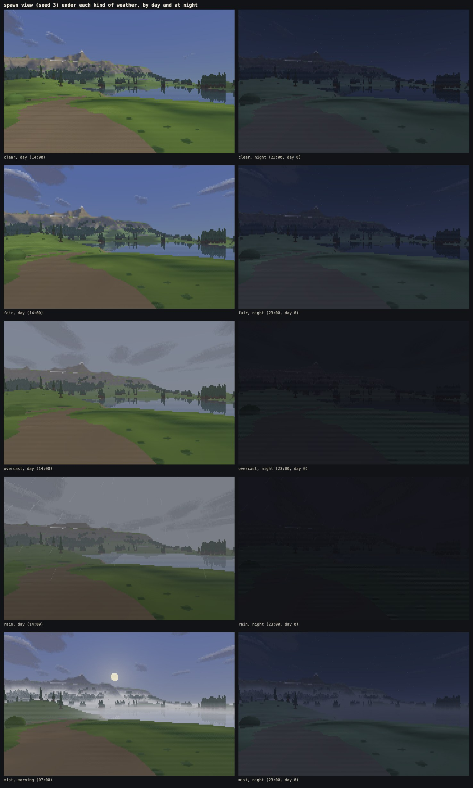

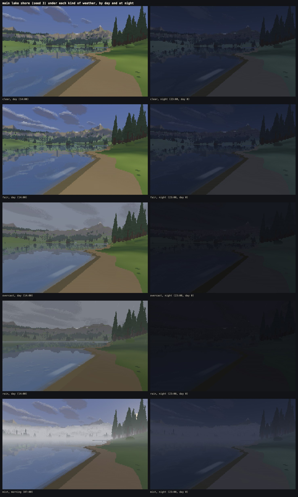

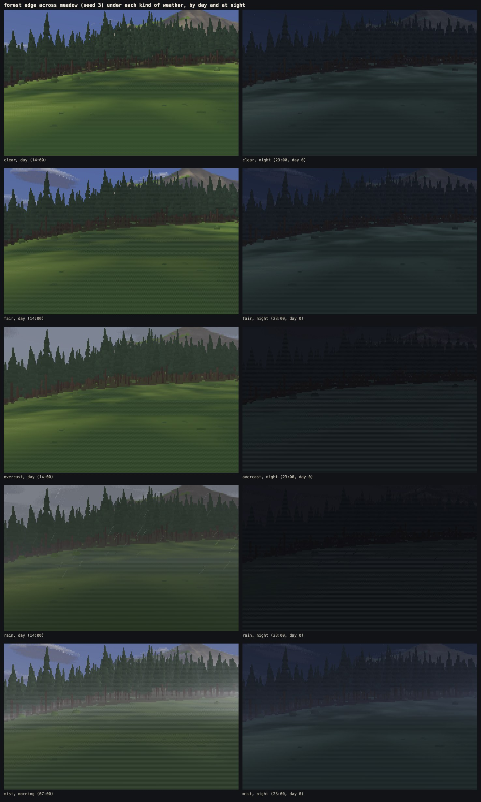

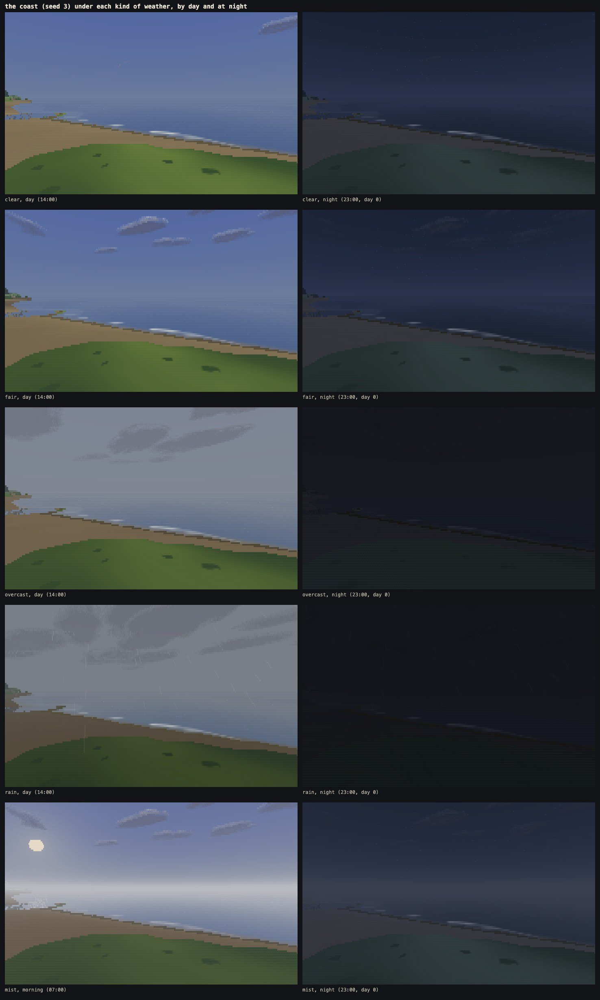

(Mist lies only round dawn, so its day frame is at 07:00.)

- **Clear:** under half of fair's clouds, clearer air, a lighter wind.
- **Overcast:** fair's clouds, bigger and flatter, on a grey sky; 12% of the direct light gets through, the rest partly returns as soft light from the whole sky; cast shadows nearly gone, cloud shadows gone; thicker air; the sun and moon discs fade into the sky and the stars go.
- **Rain:** overcast, darker and lower, with thick grey air, a stronger wind and a rougher sea, rain streaks, rings on water and wet ground.
- **Mist:** fair's light and sky (a misty morning is a sunny one above the mist) with the mist layer, a little grey and thicker air.
- **Nights** under overcast and rain are darker than a clear dark-moon night but never black. Mean background brightness of the spawn view at 23:00 on day 15 (a dark moon): clear 26.5, overcast 25.4, rain 21.1, against the floor of 10 (the lake, the forest edge and the coast fall in the same order). On day 0 (a bright moon) clear is 43.

### One day of the forecast

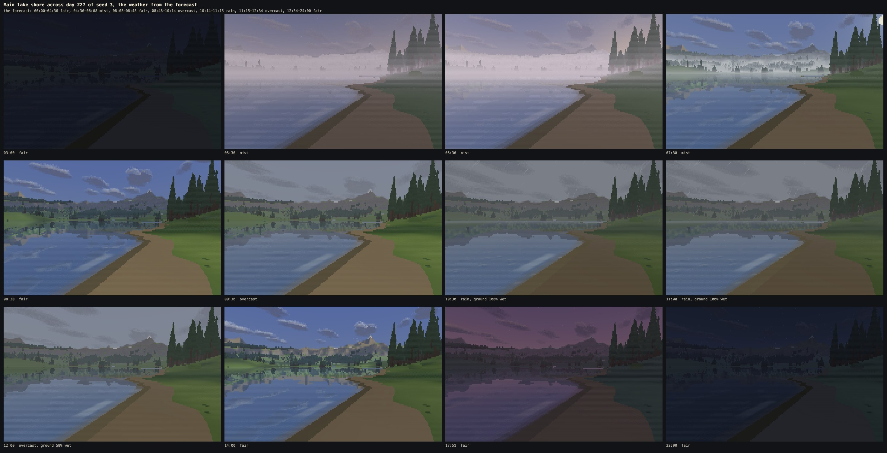

Day 227 of seed 3: a fair night, mist from 04:36 that burns off at 08:08, a fair spell, cloud building from 08:48, rain from 10:14 to 11:15, overcast until 12:34 while the ground dries, then fair into the evening.

### Mist

- **The same air model as the aerial perspective:** a density by height, integrated in closed form along each ray from the eye to what it hits, so the two never disagree.
- **It follows the land.** Its floor is the ground smoothed over 160 m, sinking on high ground. Where the ground lies below that floor (a hollow, a valley floor, a lake) the mist lies deep; where it stands above (a knoll, a ridge, the treetops) it thins away. So it pools in hollows, along rivers and over lakes, and trees and hills rise out of it.
- **It thins as the sun climbs,** from 5 to 24 degrees, and veils a lake's mirror too.
- **It never touches fair or clear weather,** so it cannot flatten the far range into the sky, and the sky test and the far-readability test (both run in fair weather) are unchanged.
- **Contract:** resolve now reads one thing from the world besides the frame, the mist's floor (a 257 × 257 grid built in each worker the first time there is mist, about 260 KB). It is world data, not the backend's: another backend still needs only fill a HitBuffer.

### Rain

- **Streaks:** thin glyphs (`| / \`) in the near air, out to 26 m, sparse, slanting with the wind and fading into the rain's grey air with distance. They are fixed to the world round the eye (columns 2.4 m apart, a drop every 15 m of height falling at 8.5 m/s), wrap as you move, and are a pure function of position and time, so turning never makes them swim. A streak shows only in front of what its cell's ray hit. They are drawn in resolve, like the air, from the frame alone.
- **Water:** the long ripple dies down, and near the eye the surface is tilted by many small spreading rings, faded like the ripples by a cell's footprint. They draw nothing themselves (art bible rule 5): they change how much of the surface is mirror, which shows them as light rings where they catch the sky, and they tilt the mirrored and refracted rays a little (at most 0.03). The identity check found that a steeper tilt let a ray reach a mirrored tree the culling had already passed over, so the picture depended on how many workers drew it; bounded, it does not. Far reflections dull toward the air's colour.
- **Reflections show less under rain,** as the brief allowed for Firefox's lake: clouds in them only within 600 m, the land in them followed half as far, trees mirrored only in water within 40% of the usual distance, all easing back as the rain eases. At the lake the difference is hard to see; in a single-thread measurement it took rain's extra cost there from 11.5% over fair to 4.8%.
- **Wet ground** darkens within about a quarter of an hour of rain and dries over the hour or so after it, and mirrors a little of the horizon's colour at low angles. The wetness is worked out from the forecast of the hours before, so it too is a pure function of the moment.

The rules are in `docs/art-bible.md`, section 5c.

---

## 2. The menu

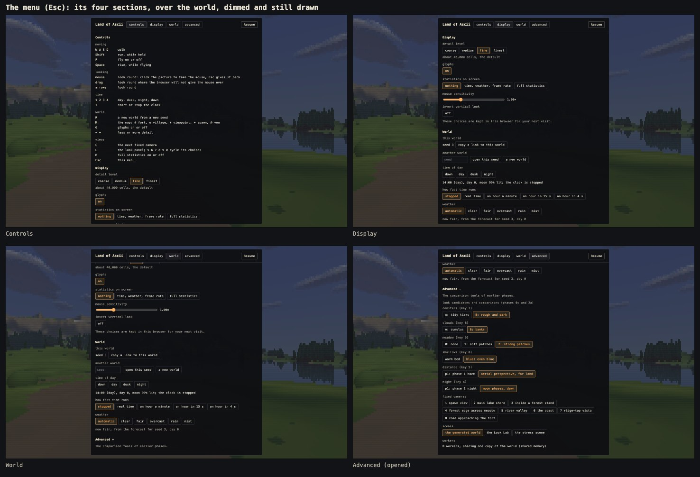

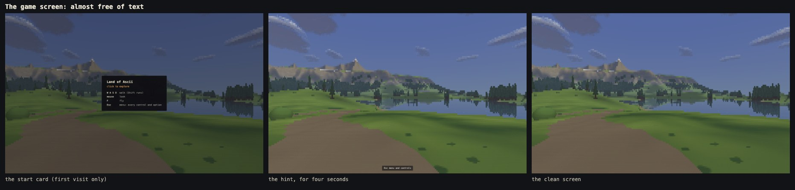

**Behaviour:**
- **Escape opens it;** Escape again, Resume, or a click beside the panel closes it. While the mouse is captured, the browser takes the first Escape to free it, so the menu also opens whenever the capture ends without the game asking (the tab being left, too): one press always works. Resume captures the mouse again; a click beside the menu or Escape does not, so nothing is left captured.
- **The clock and movement stand still while it is open;** the world stays drawn behind it, dimmed. Closing it in any way lets them run again.
- **It never takes keys while closed,** and the game takes none while it is open (typing a seed moves nothing).
- **It never opens over the start card or the red error panel.**

**Four sections:**
- **Controls:** every key, grouped by purpose (moving, looking, time, world, views), with a few plain words each. The only place the full key list appears.
- **Display:** detail level (coarse, medium, fine or finest, each described in plain words), glyphs on or off, statistics on screen (nothing, minimal, full), mouse sensitivity, invert vertical look. Kept in `localStorage` (guarded: without it the game runs the same), never the seed, the time or the weather.
- **World:** the seed with a button that copies a link to this exact world, a field to open any seed and a new-world button; dawn, day, dusk, night, how fast time runs (stopped, real time, an hour a minute, an hour in 15 s, an hour in 4 s); the day and the moon; the weather, automatic or held on one kind, with what it is now.
- **Advanced** (collapsed until opened): the look candidates and the comparison switches of phases 0c and 2a, the eight fixed cameras, the Look Lab and the stress scene, and a line saying how many workers there are and whether they share one copy of the world.

**Built** as plain HTML over the canvas, vanilla JavaScript and CSS (`src/app/menu.js`, `src/app/settings.js`), in the game's monospace with the art bible's colours (the map's cream for headings, the torch orange for what is chosen and for the focus ring). Every control works by mouse and by keyboard alone; Tab stays inside the menu; every control has a visible focus, a pointer cursor and hover feedback; transitions run 150 to 300 ms. It fits 1024 × 640 without scrolling sideways.

**The screen is almost free of text.** By default no statistics show, only a small hint that Escape opens the menu, fading after four seconds. Full statistics show when chosen in Display or with H. The first visit shows a start card: the title, "click to explore", and four keys.

**For the tools:** `lab.menu` opens, closes and reads the menu; `lab.setQuiet` suppresses the menu, the hint and the start card, and `tools/lib/serve.mjs` (and the walk recorder) set that before the page starts, so no tool's picture or measurement changes because of them.

---

## 3. The five look fixes

All look only. Before (phase 2b before the fixes) and after:

1. **The far range at dusk is a dark silhouette** against the sky, not a pale lit face. At dusk far land keeps 8% of the direct light (each keyframe's `light.far`), faded in from 300 to 900 m, and dusk's air tone is darker.

   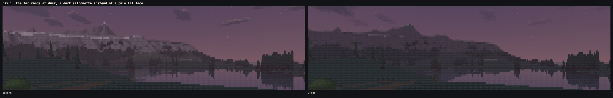

2. **Far lit rock stays warm tan.** The air's colour shift is cut by up to 75% on lit ground high up (by its light, over 60 to 260 m above the sea), so far rock keeps its colour while low ground still cools.

   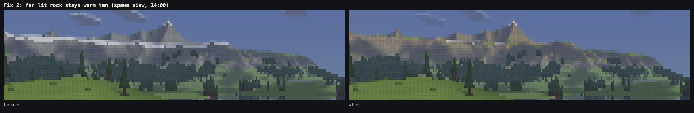

3. **No thin line of snow along the crests.** Snow is now placed by how far a point stands above the ground within 160 m round it as well as by its height, so crests just over the snow line stay bare and snow lingers in the hollows. The line came from the band where the peaks fall into the flat shoulder along the map's east edge, about 1.4 km from the spawn. Seed 3 now has 1.25% snow (2.6% before); seed 4 lost 12% of its snow.

   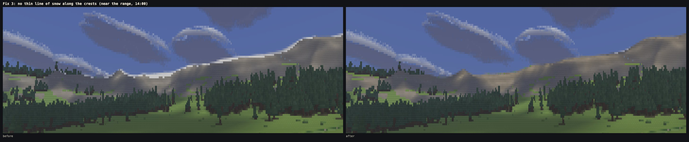

4. **No specks in the dawn and dusk sky.** Probing what the specks were showed they were not cloud fragments but stars. A star's record overwrote the sky's closeness to the sun, so its cell lost the glow round the low sun and showed as a blue speck even when the star itself was too faint to draw. A star now keeps that closeness (in its record's fourth byte, the way a cloud does), so its cell matches the sky beside it. As the brief asked, a cloud's dissolving edge also has a minimum depth now (2.5 rows across a puff's smallest radius), and a puff too small for it fades as a whole: that tidies the few real far fragments (one to seven single cells a frame at dawn and dusk).

   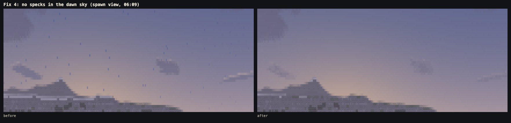

5. **The lake's wet band follows its shore,** and **the coast camera stands back from the beach.**
   - The band is now the ground up to 5 cm above the water, so its width scales with how gently the shore slopes: 0.5 m at most on a gentle shore (the width accepted in phase 2a), 0.33 m on a slope of 0.1–0.2, 0.18 m on 0.2–0.35, and it vanishes on steep banks.
   - The coast camera is chosen by how much sea and land it sees: from the land just behind the beach or its upper edge, the spot and turn whose view below the horizon comes closest to 42% sea, 38% other land and 20% sand.

   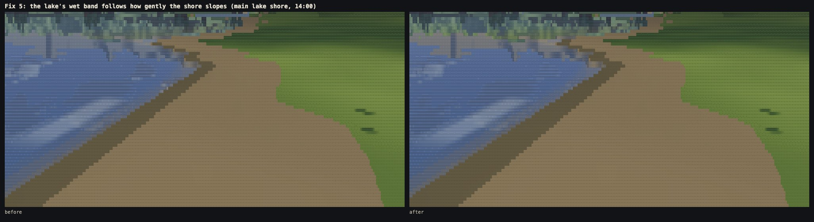

   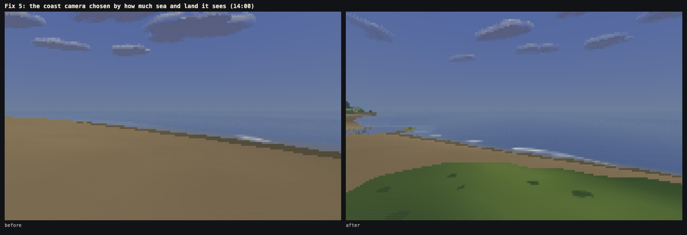

---

## 4. In the order the brief set

1. **Weather, held at fair:** the regression lookbook reported **0.00% of cells changed in all 60 frames** against the phase 2a set (lab 27, stress 9, world 24).
2. **The menu, suppressed:** again **0.00% in all 60 frames**.
3. **The five fixes:** they changed the frames as intended (the dusk frames most, since dusk's air tone is darker; the coast camera has moved), and then **the regression set was saved again, deliberately, with the weather held at fair** (`tools/regress/`, 60 frames). The sky pass was made faster after that, and the lookbook again reported 0.00% against the new set.

---

## 5. Measurements

All on the final build, on this Mac (the window server takes about half a core and the Claude app 10–30%; nothing else ran during the benchmarks).

### The world check (`tools/world-check.mjs`, in fair weather)

| seed | same twice | sites reached | steepest road | rivers downhill | trees in water / on roads | sky median | views under 15% sky | far readability: weakest step | result |
|---|---|---|---|---|---|---|---|---|---|
| 3 | yes | 8 of 8 | 11.2% | 3 of 3 | 0 / 0 | 39.2% | 3.5% | 12.9 | pass |
| 1 | yes | 8 of 8 | 11.4% | 3 of 3 | 0 / 0 | 38.9% | 4.2% | 11.8 | pass |
| 2 | yes | 8 of 8 | 10.8% | 2 of 2 | 0 / 0 | 39.8% | 5.8% | 16.0 | pass |
| 4 | yes | 8 of 8 | 11.3% | 3 of 3 | 0 / 0 | 38.2% | 6.3% | 18.8 | pass |
| 5 | yes | 8 of 8 | 11.5% | 2 of 2 | 0 / 0 | 36.8% | 8.6% | 17.7 | pass |

The sky test is unchanged from phase 2a on every seed. The weakest far-readability step must be over 6. Seed 4's fell from 23.7 to 18.8: its weakest is the range's lit against shaded rock, which the warmer far rock (fix 2) brings a little closer.

### Identity (`tools/identity.mjs --scene all --weather all`)

**325 of 325** combinations byte-identical across 0, 1, 3, 5 and 8 workers: every view of the Look Lab (14), the stress scene (7) and the generated world (22, served both with shared memory and without), under each of the five kinds of weather held, every clock frozen. The world was built byte-identical on every page (3bae098c), in a worker or on the page, shared or not. The stripe edges move with each frame's timing, so a single run does not try every split. The rain views were also checked in Node against 25 random splits each, all identical.

The first runs under every weather found two places where rain made the picture depend on how many workers drew it. Both are fixed:
- **Rain's rings** tilted mirrored rays further than the culling of mirrored trees allowed for. The rays now take a ring's tilt only up to 0.03, and the culling allows for that and for the sea swell. The swell's own tilt was never allowed for in phase 2a, and rain makes it 1.8 times steeper.
- **Mirrored land under rain is followed only half as far,** so a row whose mirrored line surfaces beyond that reach must never be marched. When it was alone in its group (its stripe began at its column) it got one step and hit the sea surface, which it never did in a larger group. Such rows are now never marched, in any group.

Neither fix changed any fair-weather frame: the regression set is still 0.00%.

### Flicker (`tools/flicker.mjs --set world --weather ...`)

The world set (walking and turning from the world's cameras, every clock frozen, 60 frames) under each kind of weather held. The tool's own "blinking cells" count any cell whose bytes change and change back, by however little. Its "glyph blinks" count a glyph's change only where the whole cell comes back exactly, so flatter colours inflate it: wet ground changes no glyph at all, yet scored more. So two counts were added that measure what blinks visibly:
- **glyph flips:** a glyph that changes and changes back, whatever its colour does;
- **colour flips:** a background that jumps more than 6 levels and comes back to within a quarter of the jump.

Glyph flips / colour flips per frame, by day (14:00). (Fair, overcast and wet ground were measured on the build just before the last rain-only changes, which touch nothing but rain; the rain column is the final build's.)

| run | fair | overcast | wet ground | rain (meant to move) |
|---|---|---|---|---|
| open meadow: walking | 0.010% / 0.002% | 0.005% / 0.001% | 0.010% / 0.001% | 0.257% / 0.001% |
| forest edge across the meadow: walking sideways | 0.160% / 0.023% | 0.089% / 0.016% | 0.160% / 0.017% | 0.539% / 0.011% |
| inside a forest stand: walking | 0.133% / 0.056% | 0.077% / 0.025% | 0.133% / 0.040% | 0.134% / 0.016% |
| main lake shore: walking along the shore | 0.184% / 0.056% | 0.137% / 0.042% | 0.184% / 0.051% | 0.379% / 0.027% |
| open meadow: turning | 0.698% / 0.296% | 0.549% / 0.256% | 0.698% / 0.272% | 0.953% / 0.230% |
| inside a forest stand: turning | 0.921% / 0.463% | 0.552% / 0.239% | 0.921% / 0.368% | 0.634% / 0.213% |
| main lake shore: turning | 2.251% / 0.989% | 1.911% / 0.805% | 2.251% / 0.851% | 1.814% / 0.610% |
| the coast: walking along the beach | 0.074% / 0.027% | 0.057% / 0.026% | 0.074% / 0.026% | 0.227% / 0.022% |
| the coast: turning across the sea | 0.259% / 0.036% | 0.256% / 0.034% | 0.259% / 0.037% | 0.936% / 0.043% |

At dawn (06:36), where the mist lies:

| run, at 06:36 | fair | mist |
|---|---|---|
| open meadow: walking | 0.003% / 0.001% | 0.003% / 0.000% |
| forest edge across the meadow: walking sideways | 0.104% / 0.012% | 0.104% / 0.012% |
| inside a forest stand: walking | 0.078% / 0.013% | 0.078% / 0.007% |
| main lake shore: walking along the shore | 0.127% / 0.043% | 0.127% / 0.020% |
| open meadow: turning | 0.567% / 0.250% | 0.567% / 0.197% |
| inside a forest stand: turning | 0.536% / 0.224% | 0.536% / 0.043% |
| main lake shore: turning | 1.995% / 0.763% | 1.995% / 0.451% |
| the coast: walking along the beach | 0.060% / 0.059% | 0.060% / 0.026% |
| the coast: turning across the sea | 0.244% / 0.050% | 0.244% / 0.032% |

- **Overcast** is at or below fair on both counts in every run.
- **Mist:** glyph flips identical to fair in every run, and colour flips at or below fair in every run.
- **Wet ground** changes no glyph: rendering the same frames in fair weather and on wet ground, not one glyph in 1.45 million cells differs, while 80% of the backgrounds do. So its glyph flips equal fair's exactly. Its colour flips are at or below fair's in every run but one: turning across the sea at the coast, 0.037% against 0.036%, 0.4 of a cell a frame.
- **Rain** is meant to move and is reported separately: its streaks add glyph flips where open ground or sky is in view (0.26% against 0.01% walking across the meadow, 0.94% against 0.26% turning across the sea), and its colour flips are at or below fair's in every run but turning across the sea (0.043% against 0.036%).

The tool's "blinking cells" column, for comparison:

| run | fair | overcast | wet ground | rain |
|---|---|---|---|---|
| open meadow: walking | 0.117% | 0.075% | 0.082% | 0.289% |
| forest edge across the meadow: walking sideways | 0.522% | 0.370% | 0.393% | 0.630% |
| inside a forest stand: walking | 0.331% | 0.419% | 0.276% | 0.287% |
| main lake shore: walking along the shore | 1.033% | 0.431% | 1.006% | 0.548% |
| open meadow: turning | 0.471% | 0.376% | 0.465% | 0.871% |
| inside a forest stand: turning | 0.344% | 0.483% | 0.354% | 0.444% |
| main lake shore: turning | 1.181% | 1.237% | 1.203% | 1.458% |
| the coast: walking along the beach | 0.917% | 0.224% | 0.767% | 0.319% |
| the coast: turning across the sea | 0.774% | 0.539% | 0.709% | 0.912% |

| run, at 06:36 | fair | mist |
|---|---|---|
| open meadow: walking | 0.050% | 0.131% |
| forest edge across the meadow: walking sideways | 0.248% | 0.792% |
| inside a forest stand: walking | 0.194% | 0.538% |
| main lake shore: walking along the shore | 0.325% | 0.598% |
| open meadow: turning | 0.374% | 0.555% |
| inside a forest stand: turning | 0.304% | 0.532% |
| main lake shore: turning | 1.362% | 1.517% |
| the coast: walking along the beach | 0.583% | 0.853% |
| the coast: turning across the sea | 0.733% | 0.674% |

Mist and wet ground raise or lower it by small colour changes that come back exactly. Measured walking sideways at the forest edge at 06:36: mist's extra blinks are changes of one or two levels (0.757% of cells a frame against fair's 0.217%), too small to see; changes of 3 to 6 levels are as rare as in fair weather (0.002%), there are none over 6, and its glyph blinks are fewer (0.009% against 0.012%).

### Frame times (`tools/bench.mjs --scene world --threads 8 --density 3`)

The eight world cameras, worker plus draw per frame (ms), under rain (the heaviest weather; best of two rounds) and in fair weather, measured while the Mac was quiet. Chromium and Firefox in visible windows, WebKit headless. These are from the builds just before the last two fixes (the fair rows from the build before the rain-only changes): those fixes only take work away, and back to back with the build before them, the final build was no more than 0.05 ms slower on any camera (Firefox, under rain).

| browser | weather | spawn | lake | stand | edge | river | coast | vista | road |
|---|---|---|---|---|---|---|---|---|---|
| Chromium | fair | 5.75 | 7.85 | 4.90 | 4.83 | 5.53 | 4.94 | 5.76 | 3.75 |
| Chromium | rain | 6.26 | 7.86 | 4.94 | 5.11 | 6.10 | 5.82 | 6.21 | 4.05 |
| Firefox | fair | 8.04 | 11.42 | 6.94 | 6.96 | 7.92 | 7.48 | 8.10 | 5.18 |
| Firefox | rain | 8.92 | **11.90** | 6.98 | 7.24 | 8.82 | 8.56 | 9.00 | 6.16 |
| WebKit | fair | 5.98 | 7.76 | 5.08 | 5.08 | 6.06 | 5.56 | 6.20 | 4.04 |
| WebKit | rain | 6.44 | 8.44 | 5.22 | 5.34 | 6.92 | 6.30 | 6.46 | 4.90 |

- **Chromium under rain:** at most 7.86 ms (the lake), against the limit of 10.
- **Firefox's lake under rain:** 11.90 ms (11.98 in the other round), against the limit of 12.5. In its first measurement it was 12.74, so reflections now show less under rain (section 1). Fair weather there is 11.42 (11.40 in phase 2a).
- **Mist at dawn costs about as much as rain,** and less where it matters. At 06:36 Chromium's lake is 8.19 ms with mist (7.63 in fair weather at that hour). Firefox's lake is 11.80 with mist (12.26 in fair weather at that hour).
- **The sky pass got faster.** Under overcast and rain all the world's clouds were tested by every sky ray. Each plane's clouds are now sorted by how near they can be, and a cloud is passed over once a ray has met a nearer one, or when the ray is still under its flat base at its far side. Both change no picture (the regression set is still 0.00%) and help fair weather too.
- **Late in the session the Mac grew about 12% slower:** macOS's photo analysis (`mediaanalysisd`) took about half a core, on top of the window server and the Claude app, and for a while the user's own Chrome was busy; no thermal throttling was recorded. Then even fair weather put Firefox's lake at 12.84 ms (11.42 earlier). Rain put it at 13.30. Rain's share stayed the same, about 4% over fair at the lake (11.90 against 11.42 in the quiet session). So the limit holds on a quiet machine, the condition the brief sets for benchmarking.
- **World build:** 2.56 s in Chromium, 5.80 s in Firefox, 2.53 s in WebKit; memory 275 MB counted once (141 MB of it shared), as in phase 2a.

### The menu check (`tools/menu-check.mjs`)

26 of 26 passed:
- the start card shows on a first visit, and Escape on it closes it without opening the menu;
- the hint shows, then fades after four seconds;
- Escape opens the menu, and Tab reaches all 35 controls (59 with Advanced opened from the keyboard) and comes back round, never leaving the menu;
- each Display option, changed from the keyboard, takes effect: the grid, the glyphs, the statistics (full and minimal), the mouse;
- while open, the clock stands still and game keys do nothing; once closed, the clock runs and the game has its keys back;
- a click beside the menu closes it without taking the mouse;
- after a reload the Display choices come back, while the seed, the time and the weather do not;
- at 1024 × 640 nothing scrolls sideways;
- with `localStorage` throwing on every call, the game and the menu still work.

Mouse capture cannot be granted to an automated browser, so the release path was checked by standing in for the browser's own events. When the capture ends without the game asking (the browser's Escape, leaving the tab), the menu opens. The same Escape arriving a moment later does not close it again. Resume asks for the mouse back. The map (M) with the mouse captured does not open the menu.

### The walk (`tools/walk.mjs --only world-weather`)

Three minutes along the road on day 227 of seed 3, from 06:12, with the clock running an hour every 27 seconds. It passes through the dawn mist, a fair spell, the cloud building, an hour of rain and the clearing after it, to 12:52. 57.1 frames a second presented. The video is `shots/walks/world-weather.webm` (72 MB), kept out of git.

### Size

`index.html` is 363 KB (314 KB in phase 2a).

---

## 6. For Martin to decide

Choices made within the brief that Martin may want to change; each is a number in `src/look.js` or `src/world/scale.js` unless said otherwise.

- **The forecast's shares** (`LOOK.weather.forecast`): 35% clear days, 40% misty dawns, 22% overcast spells, 25% rain days, 20-minute blends. Day 0 always opens fair with dawn mist, so a plain visit looks as it did before weather.
- **How thick the mist is** (`LOOK.weather.mist`): before sunrise on a lake shore the far shore is hidden; by 07:30 it shows through, by 08:30 the mist has gone. Thinner or later is one number each.
- **A misty morning keeps fair's light and clouds,** and overcast keeps fair's sea swell (only rain roughens it). A dimmer, softer light for mist and a rougher sea under overcast both made the flicker set count more glyph flips than fair weather, which the brief rules out; the mist layer alone does not.
- **How much rain shows** (`LOOK.weather.rain`): sparse streaks, out to 26 m. Denser rain is `spacing` and `period`.
- **Overcast** keeps fair's clouds, bigger and flatter on a grey sky, and **rain** brings up 1.7 times as many. More clouds under overcast made more cloud edges flip as you turn than in fair weather (measured at the coast), which the brief rules out; the grey sky does the overcast work. (Rain at 2.0 times, with longer banks, looked much the same but cost the lake view 25% more than fair in a single-thread measurement, against 11% with the banks as they are and 4.8% once reflections show less under rain.)
- **Snow** (`SCALE.range.snowRelief`, [160 m, 1.2]): seed 3 has half the snow it had, all of it on the highest ground and in the hollows. A smaller window (60 m) left the crest line in place.
- **The specks in the dawn sky** were stars, not cloud fragments (section 3, fix 4). Both are handled.
- **The lake's wet band** is capped at the 0.5 m accepted in phase 2a, so it narrows on steeper shores but never widens past what was accepted.
- **The menu:** a click beside it closes it without taking the mouse (so it is never left captured); leaving the tab while the mouse is captured opens it and pauses the game; Escape closes it but cannot take the mouse back (browsers refuse that on Escape), so Resume does. The time speeds offered are stopped, real time, an hour a minute (as T), an hour in 15 s and an hour in 4 s. Mouse sensitivity runs from 0.25× to 3×.
- **The clouds' drift on the weather's wind** counts game time, a game hour as a real minute (the clock's own pace), so with the clock running at that pace they move at the weather's wind; with the clock stopped they drift at fair's speed.
