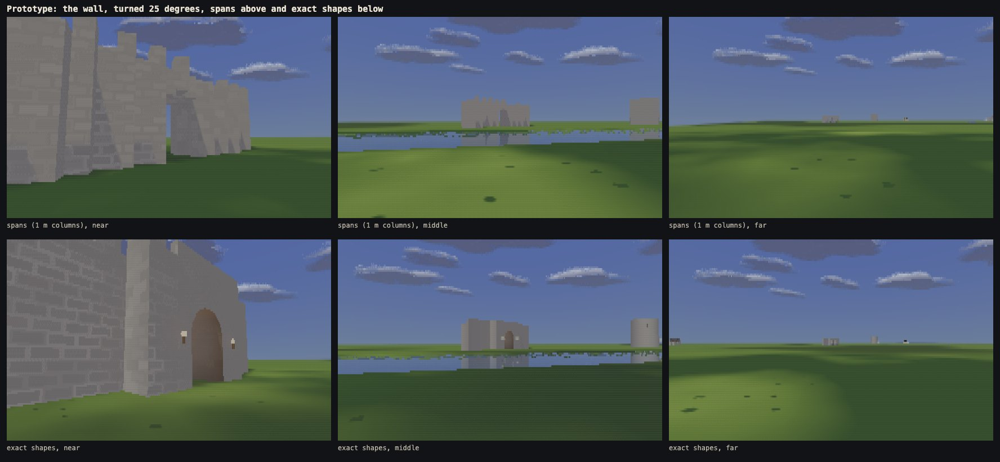
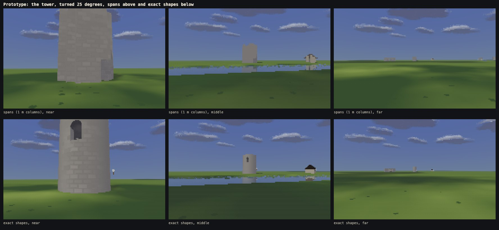
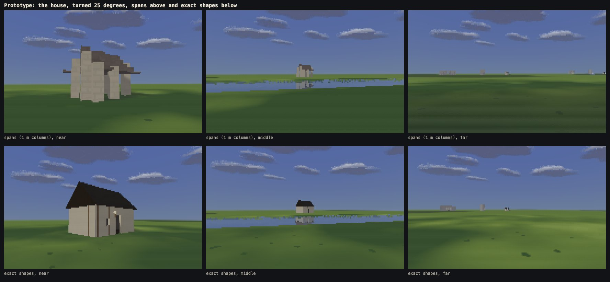
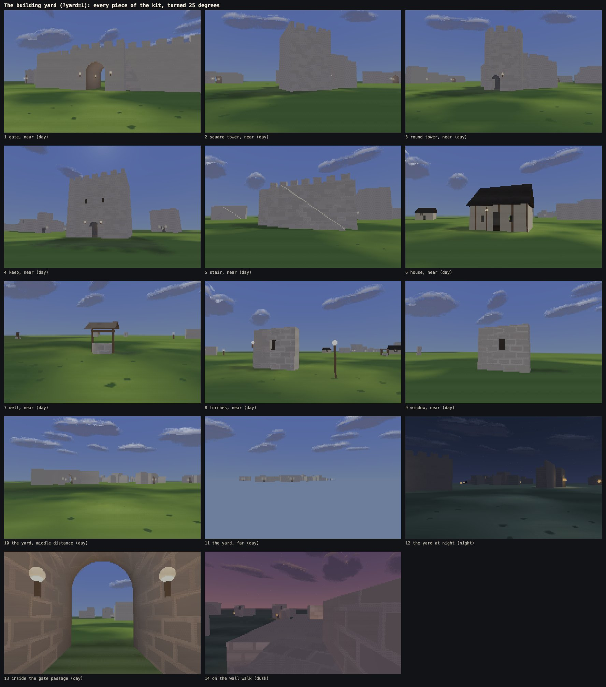
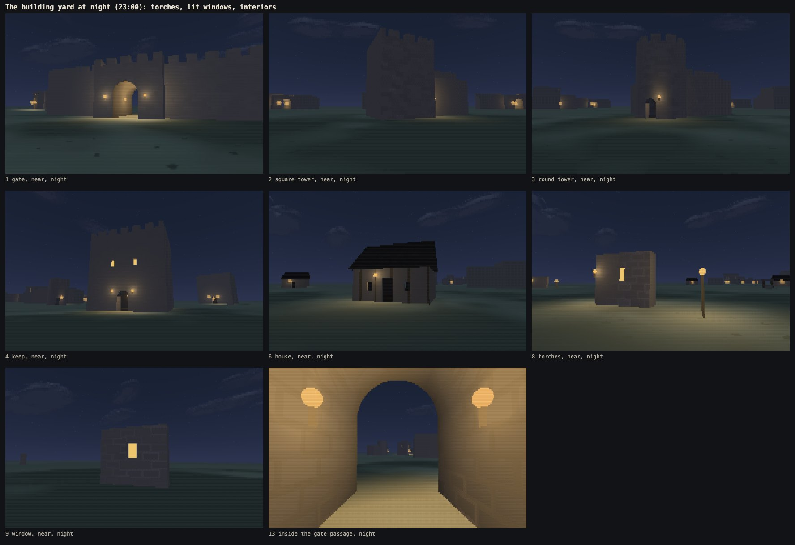
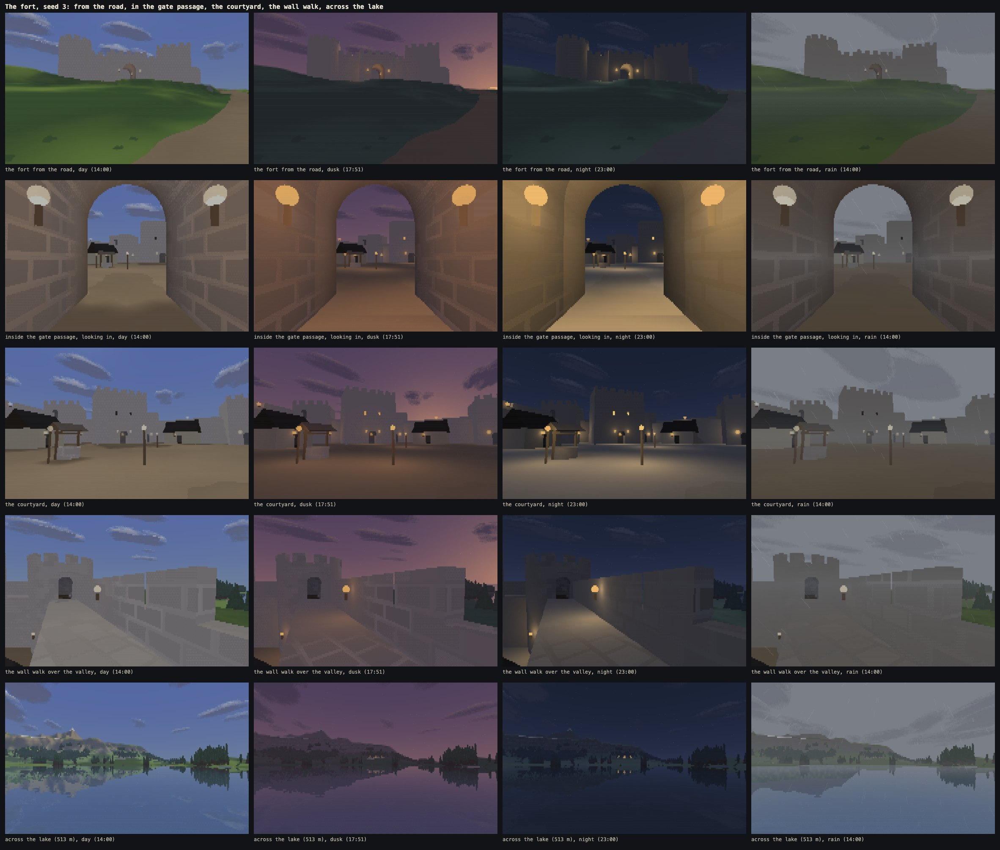
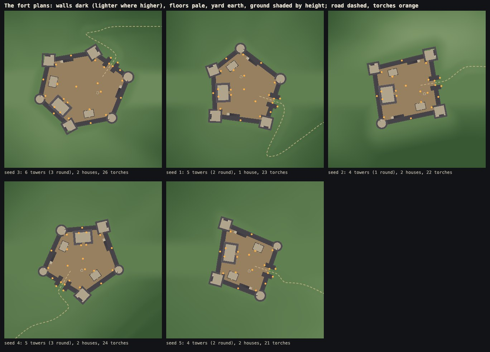

# Phase 3a: the building kit and the fort

Written 12 Oct 2026. Phase 3a gives the world its first real place:
- **a kit of building pieces** that every later structure will be made from, as data;
- **a fort built from it** on every seed, replacing the placeholder wall at the fort site. You can walk up to it, through its gate, round its courtyard, up onto its walls, into its towers and its keep.

Nothing else changed: no villages, bridges, people, animals, inventory or goals; no doors that open; no furniture beyond the pieces named in the brief; no new plants or ground content; no change to weather, the terrain's rules or the menu beyond its new cameras and scene.

**Live:** https://land-of-ascii-v3.vercel.app/ (GitHub Pages runs the no-shared-memory fallback: https://oddslice.github.io/land-of-ascii-v3/). The default seed is still 3.

| Key or option | Does |
|---|---|
| C | cycles the world's twelve cameras: phase 1's eight, then four new ones from the fort's data: **the fort from the road**, **inside the gate passage, looking in**, **the courtyard**, **the wall walk over the valley** |
| `?yard=1` | the building yard: every piece of the kit standing alone, turned 25 degrees, with fourteen cameras (C); also in the menu, Advanced → Scene |
| `?yard=1&proto=1` | the two prototypes the kit was chosen by (section 1) |
| everything else | as before: WASD, Shift, F, Space, arrows, 1 2 3 4, T, G, R, M, L with 5 to 0, X, H, Esc, − +, and `?seed`, `?day`, `?density`, `?threads`, `?lab`, `?stress` |

---

## 1. Spans or exact shapes

The brief asked for a prototype of a crenellated wall with a gate arch, a round tower and a timber house, both as **spans** (the phase 0 wall's way: stacks of vertical intervals on the 1 m grid) and as **exact shapes** (boxes, cylinders, gable prisms, stairs, each turned by its own angle, with openings cut through them), judged side by side, then one picked.

Both prototypes stand in the building yard behind `?yard=1&proto=1`, each piece twice: turned 25 degrees, and square to the grid. Each was looked at near, at middle distance (50 m) and far (200 m), by day, at night and over a pond for reflections.

Square to the grid the two look much alike ([wall](../shots/phase3a/proto-wall-square.jpg), [tower](../shots/phase3a/proto-tower-square.jpg), [house](../shots/phase3a/proto-house-square.jpg)). Turned, spans step:
- a wall turned 25 degrees becomes a staircase of 1 m columns, and its steps crawl as you walk past;
- the round tower is a stack of squares;
- the house's roof is a flight of steps.

### Cost

Worker plus draw per frame (ms), Chromium, 8 workers, density 3 (40,320 cells), the median of 240 frames with every clock frozen (`tools/bench.mjs --scene yard --proto`):

| piece | spans: near / middle / far | exact shapes: near / middle / far |
|---|---|---|
| wall, turned | 3.11 / 3.77 / 3.64 | 3.85 / 3.92 / 3.68 |
| round tower, turned | 3.20 / 3.74 / 3.71 | 3.81 / 3.82 / 3.75 |
| timber house, turned | 3.31 / 3.83 / 3.75 | 3.63 / 3.82 / 3.72 |
| wall, square | 3.11 / 3.71 / 3.50 | 3.96 / 3.85 / 3.61 |
| tower, square | 3.21 / 3.73 / 3.66 | 3.75 / 3.84 / 3.63 |
| house, square | 3.22 / 3.79 / 3.69 | 3.48 / 3.71 / 3.58 |

Exact shapes cost 0.2 ms a frame more on average (3.75 against 3.54), at most 3.96. Both are far inside the 10 ms limit.

### Steadiness

Walking at 4.5 m/s or turning at 18 degrees a second, every clock frozen, 60 frames (`tools/flicker.mjs --set proto`). Glyph flips / colour flips (more than 6 levels) per frame, with the final rules (section 3):

| run | spans | exact shapes |
|---|---|---|
| wall: walking sideways, middle distance | 0.063% / 0.040% | 0.041% / 0.023% |
| wall: walking toward it, near | 0.167% / 0.060% | 0.160% / 0.055% |
| wall: turning, near | 0.289% / 0.084% | 0.309% / 0.068% |
| tower: walking sideways, middle distance | 0.106% / 0.034% | 0.040% / 0.028% |
| tower: walking toward it, near | 0.055% / 0.018% | 0.053% / 0.015% |
| tower: turning, near | 0.381% / 0.132% | 0.307% / 0.060% |
| house: walking sideways, middle distance | 0.063% / 0.027% | 0.079% / 0.042% |
| house: walking toward it, near | 0.015% / 0.004% | 0.025% / 0.010% |
| house: turning, near | 0.369% / 0.152% | 0.305% / 0.054% |

When first measured, the shapes blinked more up close: walking toward the wall, 0.209% glyph flips against 0.167%. The minimum-size and fade rules (section 3) brought that down to the figures above. They are now level with spans or better in most runs. The house walking sideways stays a little higher, from its timber framing.

### The decision: exact shapes

- **Any angle.** A building can stand at any angle and keep its outline. Spans lock it to the grid or make it a staircase, and the staircase crawls.
- **Round and pitched shapes, near and far.** A round tower is round and a roof is a slope. With spans both are steps of a metre.
- **Collision is exact.** Walking, shadows and drawing read the same shapes, so a doorway is as wide as it looks. A stair is its steps, and you can never stand in a wall or see through one. With spans, collision is the 1 m grid: a door narrower than a cell cannot exist, and a round tower's wall is a jagged ring of squares to slide along.
- **Inside and on top.** Rooms, stairs inside towers, floors at the walk's height, a deep arched passage: openings are cut where they are needed. Spans could hold floors and arches only one column at a time.
- **Shadows and reflections:** both cast into the same shadow grid (shapes rasterize their tops into it) and both show in the water the same way.
- **Cost:** 0.2 ms a frame more, about 6%.

So the kit is exact shapes (`src/world/kit.js`, `src/world/kit-pieces.js`, drawn by `src/scene/cpu/build.js`). The lab's 0A wall stays spans.

---

## 2. The kit

Every structure is a list of pieces, as data: kind, position, angle and a few sizes. `src/world/kit-pieces.js` turns each piece into shapes, and `compileKit` packs the shapes of a world into flat tables. The renderer, the shadows, the walker and the tools all read those tables. The same description compiles to the same tables in any thread.

**The pieces** (sizes in `docs/scale.md`):
- **curtain wall** with its walk and outer crenellations;
- **gate** with a deep arched passage;
- **towers**, square and round, each with a doorway at its base, a stair inside to a floor at the walk's height with doors onto both walks, and a hatch to its open top;
- **keep** with one hall;
- **stone stair** up to the walk;
- **timber house** with a pitched shingle roof;
- **well**;
- **torch** on a bracket or a post;
- **lit window**.

**The materials** (`look.js`; the art bible's buildings section lists their colours and glyphs):
- stone in blocks;
- timber;
- plaster;
- shingle roof;
- packed-earth yard;
- the lit window.

Each has a colour for every keyframe (day, dusk, phase 1's night, dawn, a moonlit and a starlit night), a glyph family, and a rule for how its detail gives way with distance.

Every piece in the yard, by day (each piece's own camera, turned 25 degrees):

At night (23:00): torches, lit windows, interiors lit by their openings and torches.

**Inside.** A surface inside a room or the gate's passage takes the sky's soft light only by the share its doorways, windows and open tops let in. Where none reaches, it darkens toward 0.42 of itself. A torch there lights it at strength 0.32 at least, by day too. So a tower's ground floor is dark but readable by its door and its open top far above, and the keep's hall by its door and its two torches. Torchlight reaches only surfaces sharing its zone (outside, the yard, or one room), so it never lights through a wall. A torch's cost depends only on the shapes near it.

---

## 3. The fort

`src/world/gen/fort.js`, run after the road search, so everything the world built before it is unchanged.

**The plan.** A rough polygon of 4 to 6 corners round the fort site, each corner a tower (square and round mixed, at least one of each). Its gate is in the side facing where the road reaches the fort's surroundings. The keep stands against the far wall. One or two timber houses and a well stand in the yard, and stairs go up to the walk in at least two places. Each choice comes from the seed.

**The site:**
- The platform is levelled to the median ground under the fort, with banks of 1 in 2.4 out to the land. Water within its footprint is filled.
- Trees and bushes are cleared from the fort and 24 m beyond its walls.
- The road's last stretch is replaced: it now runs from the nearest point of the old road, clear of the walls, to the gate's mouth and straight on through the passage into the yard, graded evenly to 8% or gentler, on banks of 1 in 2.6. Roads that joined the stretch it replaced are joined to it again, clear of the fort.
- Where no point of the old road allows 8%, the platform moves toward the road's height by up to 2.5 m (seed 3's is 2.1 m below the ground's median: it stands on a rise 12 m above its surroundings).

**Seen from the spawn.** The fort site must now be seen from the spawn, over the land and the forest: the keep's top or a tower's. Phase 1 chose the site without that rule, and on seed 5 the old site was hidden behind a brow 50 m in front of the spawn. If no site qualifies, the rule is dropped. Of 65 seeds checked (the five check seeds and the 60-seed sweep), 14 moved their fort for it. Seed 3, the default, did not.

**Square towers** turn square to their walls as nearly as the corner allows, so each wall leaves through the middle of a face, where its walk door is. The yard sees the corner between those two faces, so the ground door is in one of them, on the yard's side of the wall. That needs square towers of 4.4 to 4.9 m half width (4.0 to 4.6 at first). The stair runs along an outer face, its open well at the end away from every door. Before this, a curtain wall met a tower turned toward the yard at its corner. Its walk door was clamped off the walk, half into the parapet, over the open stairwell: on one seed of the 60 a whole wall walk could not be reached.

**At night** the fort's torches (21 to 26 of them) and lit windows (8 to 10) are small warm points from the spawn and the viewpoints, held at two rows and faded by how much of that they really are. Near, they light the stone and the ground round them and show in the lake.

### On five seeds

From the road, inside the gate passage, the courtyard, the wall walk and across the lake, at day, dusk, night and in rain:

[Seed 1](../shots/phase3a/fort-seed-1.jpg) · [Seed 2](../shots/phase3a/fort-seed-2.jpg) · [Seed 4](../shots/phase3a/fort-seed-4.jpg) · [Seed 5](../shots/phase3a/fort-seed-5.jpg)

### The plans

Each seed's fort cut through 1.4 m above its yard, north up, 110 m across. Walls and towers are dark (lighter the higher they rise), floors pale, the yard earth, and the ground shaded by height. The road is dashed and the torches are orange:

| seed | towers (round) | stairs | houses | well | torches | lit windows | shapes | across | yard | platform / ground median | road cut in at |
|---|---|---|---|---|---|---|---|---|---|---|---|
| 3 | 6 (3) | 2 | 2 | yes | 26 | 10 | 294 | 63.6 m | 1,984 m² | 53.4 / 55.5 m | 40 m |
| 1 | 5 (2) | 2 | 1 | yes | 23 | 9 | 240 | 54.9 m | 1,486 m² | 40.6 / 40.6 m | 50 m |
| 2 | 4 (1) | 2 | 2 | yes | 22 | 8 | 192 | 58.9 m | 1,367 m² | 46.7 / 46.7 m | 47 m |
| 4 | 5 (3) | 2 | 2 | yes | 24 | 9 | 255 | 52.7 m | 1,416 m² | 48.6 / 48.6 m | 36 m |
| 5 | 4 (2) | 2 | 2 | yes | 21 | 8 | 206 | 55.7 m | 1,113 m² | 43.0 / 43.0 m | 33 m |

### Distance and steadiness rules

Kept from the start, and from the art bible:
- a thin shape (a wall end on, a post, a bracket) is held two cells across;
- an opening narrower than about two cells closes;
- a stair's steps melt into a slope under three rows a step;
- a lit window is held at two rows and faded;
- masonry, framing, shingles, boards and paving fade with a cell's footprint.

Added after the flicker set (section 6) found what still blinked, each from a cause found in the frames:
- **No two shapes share a face.** The gate's side parapets ran on to its front, and the square tops' four parapets all ran to their corners. Where two shapes shared a face, a ray met one or the other by rounding, and their stone courses blinked. Each now ends where the next begins.
- **An opening seen far aside closes.** A door through a 1.15 m wall, seen at a slant, shows only a sliver of the dark room beyond. Once less than about two cells of it show past the depth of its wall, it is drawn closed.
- **A reveal takes its wall's light while it is thin.** A doorway's or window's side, or a merlon's side, seen nearly edge on is lit like the face it is cut into until it is about two and a half cells wide. A doorway's sides are lit as outside, not as the room beyond.
- **Crenels:** merlons sink before the gaps between them, not only the merlons, get thinner than two cells. A sinking merlon keeps two rows or goes. Seen along a straight parapet, where the gaps hide behind the merlons' depth, it is drawn as a whole band at the merlons' height.
- **Timber framing** is drawn only while a post is two columns wide and a rail two rows tall.

---

## 4. In the order the brief set

1. **Prototype and decision:** section 1.
2. **The kit as data,** the materials with their ladders and distance rules, the art bible's buildings section and never-do items 22–27, the building sizes in `docs/scale.md`, the yard scene behind `?yard=1` and in the menu: section 2.
3. **The fort generator:** section 3.
4. **Outputs:** the live site, this document, the four fixed cameras from data, the private side-by-side sheets (section 5).
5. **Checks:** section 6.

---

## 5. Pictures against the reference (private)

`node tools/shoot.mjs --fort` puts the fort's cameras beside the reference's wall and gate frames:
- the road to the wall by day;
- the gate and torch at night;
- the dusk wall.

The sheets are in `shots/ref-3a/`, which is not in git: the reference is other people's footage, for private study only.

---

## 6. Measurements

On the final build, on this Mac (the window server takes about half a core and the Claude app 10–30%).

### The fort's checks (`tools/world-check.mjs --fort-only`)

On every seed:
- **The fort is placed.**
- **The road** runs through the gate's passage and ends in the yard, nowhere steeper than 12% over 4 m and with no rise over 0.2 m in a metre.
- **No trees** stand in the fort or its margin.
- **The walker** (states on a 0.5 m lattice, with the player's own collision) gets from outside through the gate to the yard, the top of every stair, the wall walk every 4 m, inside and on top of every tower and into the keep's hall, each with a way back out.
- **A thousand random walks** (3 s each, from places in and round the fort, turning now and then) never pass through a wall, get stuck, or end with the body inside stone.

**The five check seeds** (part of the full world check now):

| seed | towers | road: steepest near the gate over 4 m / biggest rise in a metre | trees in the fort or margin | places reached and back out (walker states) | random walks: through a wall / stuck / inside stone |
|---|---|---|---|---|---|
| 3 | 6 | 11.2% / 0.12 m | 0 | 47 of 47 (51,702) | 0 / 0 / 0 of 1,000 |
| 1 | 5 | 8.8% / 0.10 m | 0 | 43 of 43 (44,487) | 0 / 0 / 0 of 1,000 |
| 2 | 4 | 7.5% / 0.10 m | 0 | 44 of 44 (48,466) | 0 / 0 / 0 of 1,000 |
| 4 | 5 | 3.9% / 0.05 m | 0 | 43 of 43 (43,004) | 0 / 0 / 0 of 1,000 |
| 5 | 4 | 4.8% / 0.06 m | 0 | 40 of 40 (42,050) | 0 / 0 / 0 of 1,000 |

Seed 3's 11.2% is where the new road joins the old one beyond its cut; the old road's own grade there (its limit is 12%).

**The 60-seed sweep** (`--fort-only --sweep 60`, run in four slices of 15 at once): **60 of 60 seeds pass.** 2,788 of 2,788 places reached, each with a way back out; 60,000 random walks, none through a wall, stuck, or ending inside stone. Every seed placed its fort, and its road entered the gate.

What the sweep found, and what was fixed:
- **steep approaches** (12.7% and 14.7%): the new road was cut in farther out, where the old road had already fallen at its limit; it is now cut in at the nearest point that allows 8%, and the platform moves where none does;
- **a trench** across one yard: a village's road had been rejoined straight through the fort;
- **round towers' doors squeezed** by the walls running into them;
- **a whole wall walk unreachable** (the square towers, section 3);
- **four random walks that ended a few centimetres inside stone:**
  - a doorway's corner came between the 12 points round the body that are tested (now 24);
  - a walker on a stair's edge fell past a slab, because stepping up onto it was blocked overhead (it now keeps what is under it at its own height);
  - two shapes' sharp corners, from doors cut along a wall's line at 45 degrees (doors are now square cut);
  - a walker stepped from a tower's stair onto the edge of a landing it had no headroom to rise onto, with nothing under it at its own height, and fell with the landing inside it (such a step is now refused).

### The world check (`tools/world-check.mjs`, five seeds)

| seed | same twice | sites reached | steepest road | rivers downhill | trees in water / on roads | sky median | views under 15% sky | far readability: weakest step | the fort from the spawn | result |
|---|---|---|---|---|---|---|---|---|---|---|
| 3 | yes | 8 of 8 | 11.2% | 3 of 3 | 0 / 0 | 39.2% | 4.0% | 12.9 | 21.3 | pass |
| 1 | yes | 8 of 8 | 11.1% | 3 of 3 | 0 / 0 | 38.7% | 4.6% | 11.8 | 37.0 | pass |
| 2 | yes | 8 of 8 | 11.5% | 2 of 2 | 0 / 0 | 39.8% | 5.4% | 16.0 | 31.0 | pass |
| 4 | yes | 8 of 8 | 11.3% | 3 of 3 | 0 / 0 | 38.2% | 6.4% | 18.8 | 27.1 | pass |
| 5 | yes | 8 of 8 | 11.1% | 2 of 2 | 0 / 0 | 37.0% | 8.2% | 17.8 | 40.5 | pass |

The sky test still passes on every seed (median at least 35%, under one view in ten below 15%). Seed 3's views under 15% sky rose from 3.5% to 4.0%: the fort now stands in some of them. Seeds 1, 2 and 5 moved their forts (section 3), so their roads changed too.

Far readability now counts the fort: from the spawn, turned toward it, its stone, timber, plaster, roofs and windows must differ from the cells round them by a visible step, and it must be in view. The world check's default seeds were "3,2,3,4,5" since phase 1 made 3 the default seed (seed 3 twice, seed 1 never), and are now 3, 1, 2, 4, 5.

### Identity (`tools/identity.mjs`)

**75 of 75** byte-identical across 0, 1, 3, 5 and 8 workers:
- **the building yard:** 19 views (`--scene yard`): each piece's camera at its own time, the gate, the keep, the torches, the window and the passage at night;
- **the generated world:** 28 views, each served both with shared memory and without (`--scene world`), so 56 combinations: phase 2b's 20 views in fair weather, and the four fort cameras by day, the passage and the courtyard at night, the wall walk at dusk and the fort from the road at night.

The world was built byte-identical on every page (85e7f4ab), in a worker or on the page, shared or not.

The first run found the passage camera differing with the number of workers: it stood at the platform's height, but the road is pressed a few centimetres into the passage's floor, so the eye fell for a few frames, by an amount that depended on the frame rate. The fort's cameras now stand on what is under them at once (`stand` in the camera's data).

### Flicker

The brief: walking the road to the gate, walking the wall walk, turning in the courtyard; no worse than the lab's wall and gate figures. The lab's runs are the same moves at the 0A wall: walking its road toward the gate from 14 m out (the fort's starts 14 m from the gate's mouth, so the masonry is the same size on screen), walking along its walk, and turning just outside its gate.

**On the buildings' own cells** (the fair comparison, since the views hold different amounts of sky and land). `tools/flicker.mjs --buildings`, in Node, 360 × 112 cells, 60 frames at 14:00, glyph flips / colour flips per frame:

| run | lab's wall | the fort |
|---|---|---|
| walking the road to the gate | 0.242% / 0.045% | 0.092% / 0.009% |
| walking the wall walk | 0.504% / 0.383% | 0.335% / 0.142% |
| turning (lab: by its gate; fort: in its courtyard) | 0.512% / 0.117% | 0.260% / 0.090% |

**The whole frame,** in the page (`tools/flicker.mjs --set fort`, density 3, Chromium):

| run | blinking cells | glyph blinks | colour blinks | glyph flips | colour flips |
|---|---|---|---|---|---|
| lab wall: walking the road to the gate | 0.826% | 0.039% | 0.005% | 0.147% | 0.021% |
| fort: walking the road to the gate | 0.584% | 0.020% | 0.001% | 0.081% | 0.007% |
| lab wall: walking the wall walk | 0.196% | 0.080% | 0.070% | 0.234% | 0.178% |
| fort: walking the wall walk | 0.403% | 0.031% | 0.020% | 0.245% | 0.103% |
| lab wall: turning by the gate | 1.140% | 0.127% | 0.026% | 0.455% | 0.087% |
| fort: turning in the courtyard | 0.733% | 0.190% | 0.047% | 0.376% | 0.091% |

- **On the buildings, the fort blinks less than the lab's wall in every run,** by both counts.
- **Over the whole frame** it is lower in most counts. Higher:
  - walking the wall walk: glyph flips 0.245% against 0.234%;
  - turning in the courtyard: colour flips 0.091% against 0.087%, and glyph and colour blinks.

  The courtyard view is mostly sky and cloud, whose crawl dominates those counts (the lab's view is half wall). Its blinking cells overall are lower: 0.733% against 1.140%.
- **The first measurement** put the fort well behind the lab's wall: on its buildings, 0.151% glyph flips on the road and 0.506% colour flips turning in the courtyard. Section 3's added rules (shapes sharing a face, slanted openings, reveals, crenels, framing) brought it to the figures above.

### Frame times (`tools/bench.mjs --scene world --threads 8 --density 3`)

The twelve world cameras, worker plus draw per frame (ms), in fair weather and under rain (the heaviest weather), on the built `index.html`, the median of 240 frames after a warm-up with every clock frozen. Chromium and Firefox in visible windows on the 120 Hz display, WebKit headless. The Mac was otherwise quiet (the window server about half a core, the Claude app 10–40%). The load average during the runs, 6.9–7.5, is the benchmark's own browsers.

| browser | weather | spawn | lake | stand | edge | river | coast | vista | road | fort from the road | gate passage | courtyard | wall walk |
|---|---|---|---|---|---|---|---|---|---|---|---|---|---|
| Chromium | fair | 6.13 | 8.45 | 5.25 | 5.23 | 6.04 | 5.30 | 6.52 | 4.03 | 4.31 | 4.45 | 4.38 | 4.41 |
| Chromium | rain | 6.84 | 8.58 | 5.39 | 5.43 | 6.78 | 6.34 | 6.81 | 4.63 | 4.66 | 4.62 | 4.90 | 4.80 |
| Firefox | fair | 8.36 | **12.12** | 7.06 | 7.08 | 8.24 | 7.52 | 8.44 | 5.64 | 5.46 | 5.56 | 5.62 | 5.72 |
| Firefox | rain | 9.32 | **12.06** | 7.42 | 7.78 | 9.14 | 8.92 | 9.22 | 6.66 | 6.58 | 6.12 | 6.70 | 6.58 |
| WebKit | fair | 6.20 | 8.22 | 5.20 | 5.18 | 6.24 | 5.76 | 6.38 | 4.26 | 4.38 | 4.72 | 4.56 | 4.40 |
| WebKit | rain | 7.62 | 8.80 | 5.94 | 6.02 | 6.80 | 6.58 | 7.02 | 5.02 | 4.84 | 5.32 | 5.36 | 4.84 |

- **Chromium:** at most 8.58 ms (the lake, under rain), against the limit of 10.
- **Firefox:** at most 12.12 ms (the lake, fair weather), against the limit of 12.5. Phase 2b's lake was 11.42 in fair weather and 11.90 under rain. The fort covers only about 37 cells of that view. The margin is now 0.4 ms, the thinnest of any limit.
- **The fort's own cameras are among the cheapest:** 4.3 to 6.7 ms. A building's walls hide the land behind them, and land not drawn costs nothing.
- **Run to run, this Mac varied more than the fort costs.** Back to back with phase 2b's build in Chromium later in the evening, the views that cannot see the fort (the forest stand, the forest edge) cost 0.17–0.26 ms more. The kit's shapes are culled with the trees in every view. Other views came out faster or slower than in either session by up to 1.9 ms. All twelve stayed inside the limits in both sessions.
- **World build:** 2.6 s in Chromium, 5.9 s in Firefox, 2.5–2.7 s in WebKit (phase 2b: 2.56, 5.80, 2.53). Memory: 290 MB counted once (147 MB of it shared), against 275 MB in phase 2b.

### The regression set (`tools/lookbook.mjs --regress --why`)

Before saving the set again, the final build was compared cell for cell with phase 2b's saved set (the default seed, every clock frozen, fair weather, density 3). `--why` then traced every changed cell of the world's frames in Node. Was the fort, its banks or its new road in the cell's line of sight? Did the point the cell meets lie in the fort's shadow? Did the cell meet water mirroring either?

- **The Look Lab and the stress scene:** all 36 frames unchanged, 0.00% of cells.
- **The world's cameras that cannot see the fort** (inside a forest stand, the forest edge across the meadow, the coast): unchanged at day, dusk and night, 0.00%.
- **The cameras that see it:** every changed cell is explained, none unexplained:

| world frame | cells changed | the fort or its surroundings in view | in its shadow | in water mirroring either |
|---|---|---|---|---|
| spawn view (day / dusk / night) | 96 / 81 / 87 | 57 / 47 / 52 | 0 | 39 / 34 / 35 |
| main lake shore | 37 each | 32 | 0 | 5 |
| river valley (day / dusk / night) | 49 / 564 / 46 | 49 / 36 / 46 | 0 / 528 / 0 | 0 |
| ridge-top vista | 40 / 40 / 37 | 40 / 33 / 37 | 0 / 7 / 0 | 0 |
| road approaching the fort | 29,048 / 36,537 / 27,825 (72%, 91%, 69%) | all | | |

The road camera looked at the placeholder wall; it now looks at the fort. At dusk the river valley sees the fort's long shadow across the valley floor.

**Then the set was saved again,** deliberately, with the world's four new cameras and the building yard's fourteen added: 38 cameras at day, dusk and night, 114 frames (`tools/lookbook.mjs --regress --save`).

### The walk (`tools/walk.mjs --only world-fort`)

3 min 27 s on seed 3, from 17:30, the clock running an hour every four minutes, so dusk falls on the way:
- from the spawn, running along the roads to the fort (1.4 km by road), walking its last 40 m;
- in through the gate's passage, across the courtyard, up a stair to the wall walk, along it;
- then a slow turn to look out over the parapet.

59.9 frames a second presented; it ends at 18:21 on the walk with the torches lit. The video is `shots/walks/world-fort.webm` (90 MB), kept out of git. The brief asked for 3 minutes. The road from the spawn to the gate is long enough that the walk runs about half a minute over, and was not cut.

The first take ran 6½ minutes. Running at 8 m/s, the walker swung wide on the sharp bend into the gate and pressed into the tower beside it, until that leg timed out. Inside, it skipped ahead to the wall walk's points, which sit near the yard path seen from above, and never climbed the stair. The script now walks the last stretch, keeps to its route in order and steps from the stair's top onto the walk's middle line. It was checked first in a Node simulation with the player's own physics.

### Size

`index.html` is 497.7 KB (363 KB in phase 2b): the kit, the fort generator, the building renderer, the yard and the prototypes.

---

## 7. What looks wrong or thin

Seen in the pictures above and in the walk, plainly:
- **From the road the fort is a flat grey silhouette.** Masonry joints fade by about 25 m (the lab wall's rule, kept so the two compare), and block-to-block tone by about 50 m. At 75 m the walls carry no texture at all: only their outline, the dark gate and the torches.
- **The gate passage at night is lit hot and orange.** Its two torches are within 2 m of the walls, on top of the interior's minimum torchlight. It reads as a torch-lit tunnel, but brighter and more saturated than anything else at night.
- **The wall-walk camera sees mostly parapet.** Looking out at an angle along the wall, the valley shows only past its end. The near parapet is drawn as a solid band (seen along its length, its gaps would show as one-cell slivers), so the merlons beside you are not drawn as merlons.
- **Crenels on far walls seen at a slant are drawn as whole bands** for the same reason, so a far curtain wall can look uncrenellated beside crenellated towers.
- **Doorways seen at a slant are drawn closed** until about two cells of them show past the wall's depth.
- **The houses' timber framing is gone beyond about 15–20 m;** from across the courtyard they read as plaster boxes with dark roofs.
- **The keep is a plain box:** no buttresses, no stepped roofline, one empty hall. The towers' rooms are empty too (furniture was out of the brief).
- **The yard is one flat plane of packed earth,** an even ground colour with no wear, puddles or paths.
- **Square towers present a corner to the yard.** Their ground door sits in the corner beside a curtain wall, which is right for a tower squared to its walls but looks squeezed from some angles.
- **The road into the gate is a straight, even ramp** on banks, and kinks where it meets the old road.
- **On seed 3 the road's edge grazes the plinth of the square tower beside the gate,** by about half a metre, where the curve swings in from the side. Its centre keeps clear, so walking it is fine, but a tower's foot standing on the road's edge looks wrong. A clearance from every tower pushed seed 3's road out to a 160 m straight cut-in with its platform lowered 2.5 m, a larger change to the land. A proper fix is a winding approach (section 8).
- **Seed 3's platform is cut 2.1 m into its rise.** The banks round it show as a terrace in the plan, though from the road the fort still stands on its hill.
- **Across the lake (500 m)** the fort by day is a few grey cells against the far land. At night its torches and windows read as warm points and show in the water.
- **Every fort is built from the same kit,** so the variety is in the plan (the corners, the tower mix, the houses) more than in the pieces.
- **The walk video runs 3 min 27 s, not three minutes:** seed 3's road from the spawn to the gate is 1.4 km.

---

## 8. For Martin to decide

Each is a number in `src/look.js`, `src/world/scale.js` or a short rule in the code.
- **The fort must be seen from the spawn** (`chooseFort`, the keep's top or a tower's over land and forest). This moved the fort on 14 of 65 seeds checked, including seeds 1, 2 and 5. Without it seed 5's fort is hidden behind a brow.
- **The platform moves up to 2.5 m toward the road** where the road could not otherwise come in at 8%. The other way, a winding approach road that climbs along the slope, is not built. It would also keep the road clear of the towers beside the gate (section 7).
- **Interior darkness** (`LOOK.interior`): 0.42 of a surface's light where no opening lets light in, and torchlight at least 0.32 inside.
- **The steadiness rules of section 3** trade a little detail for no blinking: parapets seen along their length drawn whole, slanted doorways closed, framing held back. Each is a threshold that can be loosened if a little more blinking is acceptable.
- **The square towers' size** went up to 4.4–4.9 m half width to fit the ground door beside a wall.
- **The prototypes stay in the build** behind `?yard=1&proto=1` (about 10 KB), for comparison; a later phase can remove them.

---

## 9. After phase 3a (12 Oct 2026)

Martin's notes after playing it on Windows 11 in Chromium, and what changed:

| He asked | Done |
|---|---|
| Make the castle a more distinctive colour, or the gaps between the stones darker, so the blocks stand out from a distance | The fort's stone is its own material, `masonry`: a paler limestone (`#b8ae9c` lit by day) than the lab wall's grey and the tan rock. Its course joints darken it by up to 42% (stone's tone was 18%), drawn at least about a row wide and by how much of each cell they cover, so they read while a course is two and a half rows tall (about 22 m at fine detail on a 16:9 screen) and fade by one and a half (about 37 m); further off the wall keeps their average darkness. The joints between blocks are darker near (85% of a course joint) but still fade by about 15 m. |
| Let me drop off the wall | Any edge can be stepped off: a step down is now refused only if the body would come to rest inside something, judged where it really comes to rest (on whatever is under any part of the body), not at the ground under its middle. Walking off the walk's open side drops into the yard. |
| Add jumping | Space jumps about 1.1 m (not while swimming; a press up to 0.15 s before landing still counts; the head stops a rise under a ceiling). From the walk you can jump onto the breastwork in a crenel and drop outside. |
| Slinging the mouse makes the camera skip (Chromium) | Chromium is asked for the mouse's raw movement (pointer lock with `unadjustedMovement`), and a lone movement over 150 px and six times the largest in the last 80 ms is dropped: Chromium on Windows is known to report such jumps now and then with pointer acceleration on. A real flick builds up over several movements and passes. Where raw movement is refused the plain lock is taken. |
| The frame rate drops a little walking up the castle's stairs | It was the walking, not the drawing: each step's riser was taken as a near-vertical slope, cutting every step into many tiny ones, each testing the body against every nearby shape at every stair step's height, with fresh arrays each time; the garbage set off collections of up to 7 ms. Now a building's steps are walked at walking speed, the tests skip shapes that cannot touch the body and allocate nothing, and the eye glides over each step instead of jumping 20 cm. |
| The well should be a black hole | Its shaft is a new near-black material (`shaft`), drawn 20 cm under the rim. |
| Real time by default | The clock runs from the start at real time (one game hour an hour); 1 2 3 4 set the hour and leave it running; T still stops and starts it. |
| Conifers tidy only | The rough, dark treatment B is gone (from the look, the look panel, the URL and the tools); every conifer is the tidy tiers. `?tree=` is ignored. |

**Measured** (seed 3 unless said):

| Check | Result |
|---|---|
| Blinking on the buildings' own cells (`tools/flicker.mjs --buildings`), glyph / colour flips | road to the gate 0.140% / 0.041%, wall walk 0.326% / 0.215%, turning in the courtyard 0.179% / 0.098%; the lab's wall 0.242% / 0.045%, 0.504% / 0.383%, 0.512% / 0.117%. Every figure under the lab's wall. The first try (joints between blocks drawn to a distance and per-block tones) blinked up to five times as much, which is why those stay near. |
| Walking up the fort's two stairs, the player's update per frame (Node, after warm-up) | median 0.024 / 0.019 ms, p95 0.08 / 0.07 ms (before: p95 8.5 / 9.3 ms, spikes to 11 ms); the eye moves at most 8 cm a frame on a stair (before 20 cm) |
| The fort's checks, 60 seeds (`--fort-only --sweep 60`) | 60 of 60 pass; 2,788 of 2,788 places reached and back out; 60,000 random walks, which now step off the walk and fall into the yard: none through a wall, stuck or inside stone. The walker steps down by the same rule as the player. |
| Step off the walk / jump out through a crenel (Node test, seed 3, every side) | on the four sides tested (seed 3's other two are the gate's and the keep's), walking off the walk's open side drops into the yard, and a jump into a crenel and on out lands outside (from about one place in three along a side: where a crenel is) |
| The world check, seeds 3, 1, 2, 4, 5 | all pass; the fort from the spawn 17.5, 34, 27.3, 19.1, 34.9 (phase 3a: 21.3, 37, 31, 27.1, 40.5; a visible step is 6): the paler stone stands a little closer to the far haze, while near it stands out more |
| Identity | 96 of 96 views byte-identical across 0, 1, 3, 5 and 8 workers, shared and fallback |
| Menu check (built file) | 29 of 29 |
| The regression set | changed only where the fort or conifers are in view (the lab wall's own frames by 0.1–1%, its treeline); saved again, 114 frames |
| Frame cost, old against new, alternating on one thread (Node, 384 × 108) | lake shore 27.8 → 21.4 ms (the tidy conifers are cheaper), the fort's four views within ±15% either way; rain the same |
| Frame times, Chromium, 8 workers, density 3 | fair: slowest worker at most 8.83 ms (the gate passage). Rain measured up to 13 ms, but a Chrome tab on this Mac took nearly three cores throughout, and every view without the fort was slower than phase 3a by the same share; the alternating comparison above shows no new cost. To measure again on a quiet machine. |

**Still open:** the joints between blocks fade by about 15 m (drawn further, walking forward sweeps them sideways across the cells and they blink); the raw mouse movement turns off Windows' pointer acceleration in the game, so the sensitivity may want adjusting (Esc → Display); the Controls tab sits close to scrolling at 1440 × 900, and below that its list scrolls.
