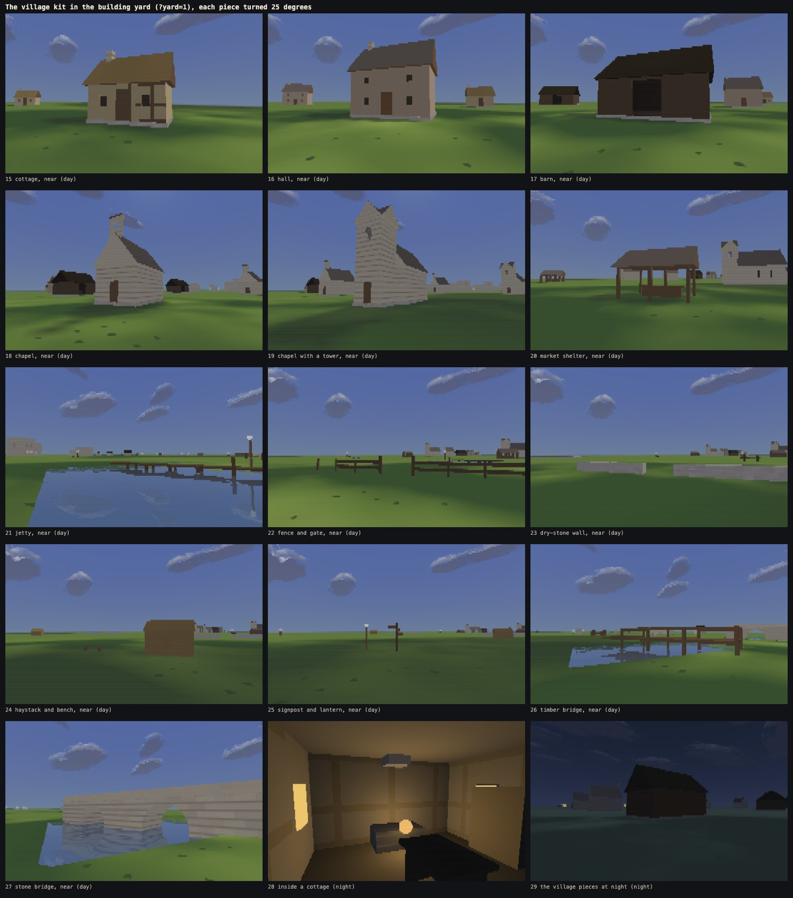
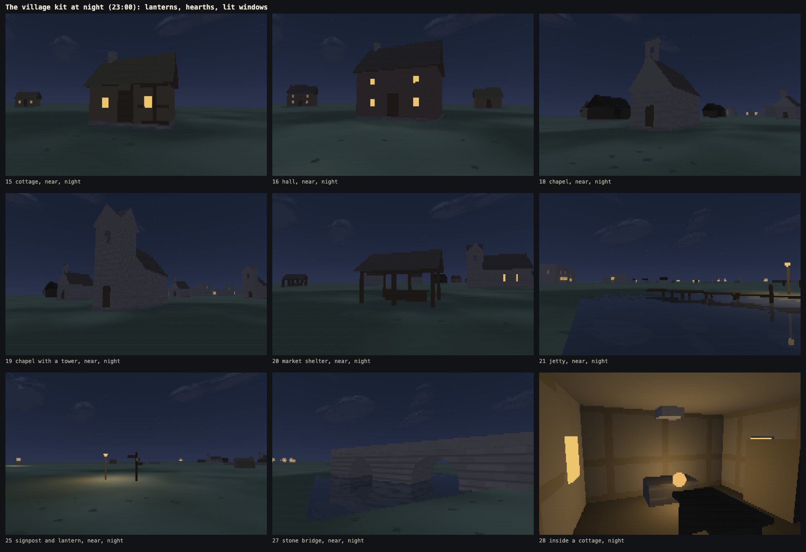
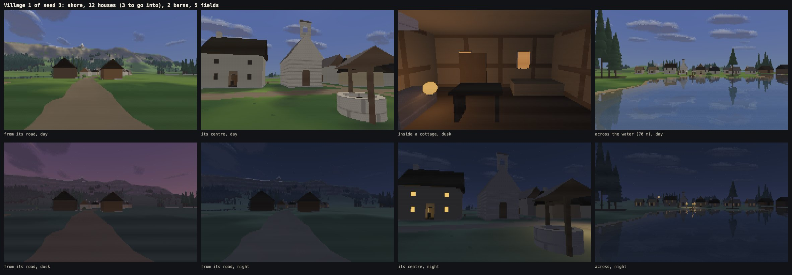
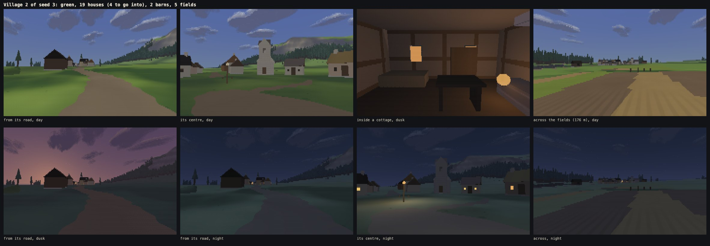
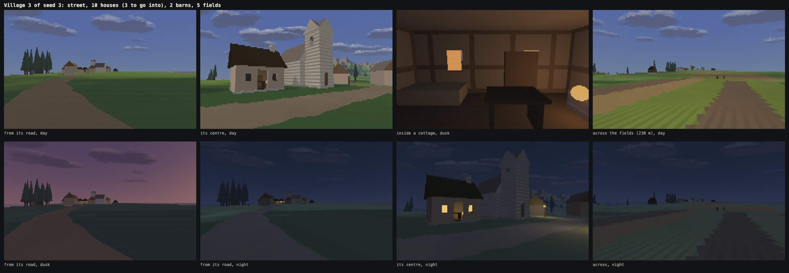
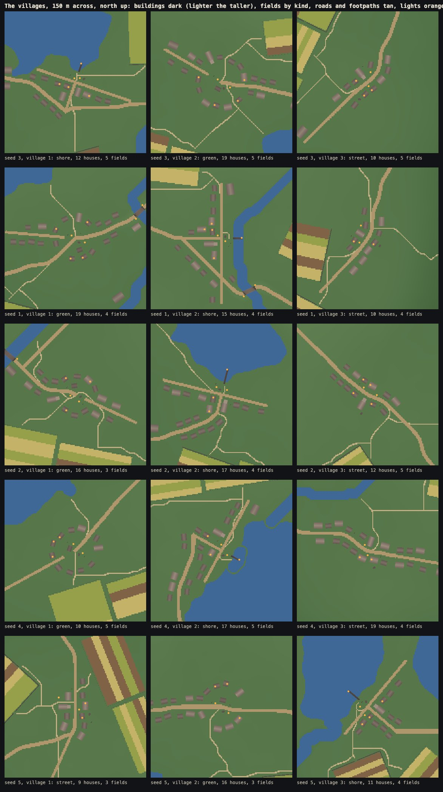
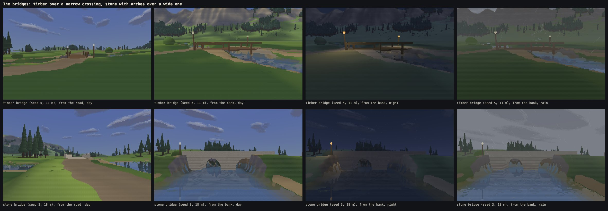
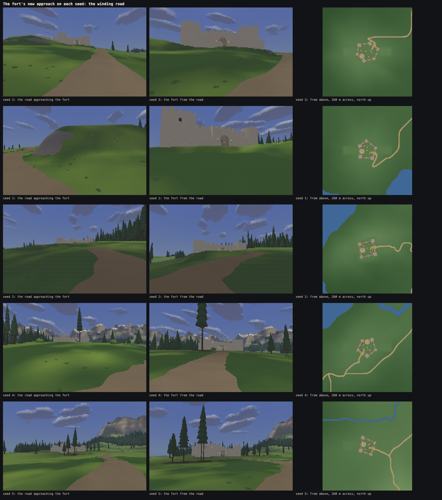

# Phase 3b: villages, bridges and fields

Written 13 Oct 2026. Phase 3b fills the world's three village sites, carries the main roads over the rivers and lays fields round the settlements:
- **three villages on every seed,** each composed from the land and never stamped: one strung along its road, one round a green, one on the shore;
- **bridges** where the main roads cross rivers: timber over narrow crossings, stone with arches over wide ones;
- **fields, fences, dry-stone walls and footpaths** round the villages;
- **the 3A fixes the brief listed:** a winding fort road, dimmer passage torches, a worn path across the fort yard, furniture in the keep's hall and one tower room, the prototypes removed, the menu's Controls fitting at 1280 × 720;
- **a benchmark in the menu** (Advanced).

Nothing else changed: no people, animals, inventory, goals or doors that open; no new plants; no change to the weather, the terrain's rules or the look.

**Live:** https://land-of-ascii-v3.vercel.app/ (GitHub Pages runs the no-shared-memory fallback: https://oddslice.github.io/land-of-ascii-v3/). The default seed is still 3.

| Key or option | Does |
|---|---|
| C | cycles the world's twenty cameras. The eight new ones come from the villages' data: each village's **road in** and **centre**, **inside a house, by the hearth**, and **the stone bridge from its bank** |
| `?yard=1` | the building yard, now with the village kit in its own rows: 29 cameras (C) |
| Esc → Advanced → benchmark | runs every fixed camera in fair weather and then rain, at the detail level in use, with the clock frozen, and shows a table with a button to copy it as text. Cancelling it, or closing the menu, puts the clock, the weather and the camera back |
| everything else | as before. `?yard=1&proto=1` now shows the yard without the prototypes, which the brief removed |

---

## 1. In the order the brief set

1. **Housekeeping:** the clean bench before any village work (section 6), and the menu's benchmark (`src/app/benchrun.js`, checked by `tools/menu-check.mjs`).
2. **Kit pieces:** section 2. All of them are in `look.js` and the art bible (section 7, "Villages and bridges", and never-do items 28–31), and their sizes are in `docs/scale.md`.
3. **The village generator:** section 3.
4. **Land round the villages:** fields, footpaths and bridges, section 4.
5. **The 3A fixes:** section 5.
6. **Outputs:** the live site, this document, the new cameras from data, the lookbook (`node tools/lookbook.mjs --phase 3b`, pictures in `shots/phase3b/`).
7. **Checks:** section 6. What looks wrong: section 7; for you to decide: section 8.

---

## 2. The kit

The village pieces are described as data and built from the same exact shapes as the fort (`src/world/kit-village.js`, sizes in `SCALE.kit`):
- **Houses:**
  - a **cottage** of one room;
  - a **larger house** with an upper storey (two rows of windows);
  - a **barn** with a wide doorway;
  - a **chapel** with a bellcote, or a short tower whose belfry is open.
- **Shelters and water:** an open **market shelter** on posts, and a **jetty** on posts over the water.
- **Bounds:** a **fence** of posts and rails, a low **dry-stone wall**, and **gate gaps** with posts.
- **Small pieces:** a **chimney**, a **haystack**, a **signpost** with an arm for each way, a **bench**, and a **lantern** on a post.
- **Bridges:** **timber** and **stone**.
- **Inside a house one can enter:** a **hearth** (its fire glows and lights the room at night), a **table**, a **bed** and a **shelf**.
- **Materials:** **thatch**, two more **plaster** tints and two more **timber** tints, all shifts of colours already in the palette. Houses sit on **rubble footings**.

**Distance rules** (the art bible has them in full):
- Thin parts (fence rails and posts, signpost arms, chimneys) are held at two cells while they are at least 0.35 of that, and are not drawn below it.
- Surface detail that walking or turning sweeps across the cells faster than it is wide is left out: the joints between dressed blocks and between slabs, the gaps between boards, and posts narrower than four columns. Coarser detail, such as courses, a board's or a tile's tone, or thatch streaks, is drawn only while it is several columns wide. Section 6's flicker measurements show why.
- The fort keeps its own textures, unchanged.

---

## 3. The villages

`src/world/gen/village.js` composes each village from the ground it is given.
- **Patterns:** the three sites are given one pattern each. The shore pattern goes to the site nearest open water (a lake, the sea or a river wide enough for a jetty), the green to the flattest of the others, and the road pattern to the last:
  - **along its road:** houses on both sides, turned to face it;
  - **round a green:** a green 12–17 m across with the well and the market shelter on it, houses round it facing in;
  - **on the shore:** houses 14 m back from the water facing it, and a jetty slid along the shore until it is clear.
- **Variety by seed:** 8 to 20 houses (seed 3: 12, 19 and 10). Their kind (cottage or larger house), angle, setback (2.5–6 m), roof (thatch or shingle) and plaster and timber tints vary. Two to four houses in each village can be entered.
- **On the ground:**
  - every house stands on a rubble footing that takes the slope;
  - a house is moved, or left out, rather than forced: it is placed only where the ground falls at most 1.2 m across it and its door's ground is within half a metre below its floor;
  - houses keep 3.2 m apart, so there is room to walk between and sky to see;
  - trees are kept wherever nothing else stands, and two to four are planted inside each village.
- **Each village has:** a chapel, a well, one or two barns at its edge, two lanterns at its centre (and one at its jetty), lit windows in about 80% of houses, and a signpost where its road meets the main road.

**Seed 3's villages** (from the road in, the centre, inside a house at dusk, across the water or the fields, and at dusk and night):

**The plans on five seeds**, 150 m across, north up:
- buildings dark, lighter the taller;
- fields by kind: crop green, stubble straw, fallow brown;
- roads and footpaths tan, lights orange.

---

## 4. Fields, footpaths and bridges

- **Fields** are a ground material, not objects:
  - 3 to 5 blocks round each village, 22–40 by 16–28 m;
  - on ground no steeper than 10%, turned to follow the lie of the land;
  - each split into strips 6–11 m wide of crop, stubble or fallow, with furrows that fade as rows do;
  - a strip shows its own material while it is at least three cells across; further off the field shows its main kind.
  - Fences and dry-stone walls bound them here and there, with gate gaps.
- **Footpaths** lead from each village to its fields, to the water and to the nearest viewpoint:
  - found on a 2 m grid round the buildings, fields, fences, the fort and deep water;
  - drawn as worn earth 1.4 m wide, near only;
  - they ford rivers where the water is shallow, as before.
- **Bridges** stand wherever a main road crosses water (a river, or a lake it clips):
  - **timber** for up to 8 m of water: a plank deck 1 m over the water on posts, with rails;
  - **stone** for wider crossings: one body from the bed, with 1–3 arches over the water and parapets, and a level road;
  - the road is straightened over each bridge, lifted to it, and meets each end without a step;
  - the ground under the deck where the road comes onto it is pressed well down, so the deck and the road do not cut each other in a ragged line (never-do 31);
  - the water under a bridge or a jetty gets no rain rings;
  - lanterns stand at both ends.

---

## 5. The fort's fixes

- **The road winds up to the gate.** A direction-aware search on a 3 m grid, with a cost on turning, finds a road from the old road to the gate:
  - it leaves the old road only where the road's length covers the climb at a gentle grade;
  - it clears the towers, refuses hairpins, and meets the old road without a kink;
  - a road that used to run through where the fort stands now goes round it.
- **The passage torches** give 0.45 of their glow, so the passage at night is no brighter than the courtyard.
- **A worn path** of earth crosses the yard from the gate to the keep's door and to the foot of each stair, bending a little as feet wear it.
- **Furniture:** a hearth, a table, a bed and a shelf in the keep's hall, and a table and a shelf in the first square tower's room, away from its door.
- **The prototypes are gone** (`src/world/proto.js` deleted).
- **The menu's Controls fit without scrolling** at 1280 × 720 (and down to 600 high), with tighter rows on short screens.

---

## 6. Measurements

### The clean bench before any village work

Phase 3a's build, in Chromium on a quiet Mac (a Chrome tab using about three cores was closed first), all twelve cameras at density 3 with 8 workers. The figures are the slowest worker's time per frame, in ms:

| camera | fair | rain |
|---|---|---|
| spawn view | 6.51 | 7.04 |
| main lake shore | 9.08 | 9.17 |
| inside a forest stand | 5.55 | 5.56 |
| forest edge across meadow | 5.37 | 5.65 |
| river valley | 6.58 | 6.95 |
| the coast | 5.82 | 6.80 |
| ridge-top vista | 6.82 | 7.00 |
| the fort's five cameras | 3.98–4.53 | 4.53–5.07 |

Rain stayed under 10 ms, so the phase went ahead. The world built in 2.67 s.

### The world check (`tools/world-check.mjs`, seeds 3, 1, 2, 4, 5)

All five seeds pass every check of phases 1 to 3a, and the villages':

| seed | the villages | villages from a viewpoint (day step, lit cells at night) | the fort |
|---|---|---|---|
| 3 | shore, green, street: 12, 19 and 10 houses; walker 58 of 58 places and back out; random walks 0 bad | 30.2, 16; 15.1, 33; 45.8, 24 | 47 of 47 places, walks 0 bad |
| 1 | 19, 15, 10 houses; 58 of 58 | 30.9, 33; 17.0, 8; 29.6, 48 | 43 of 43 |
| 2 | 16, 17, 12; 59 of 59 | 17.2, 26; 12.4, 6; 28.7, 19 | 44 of 44 |
| 4 | 10, 17, 19; 57 of 57 | 22.0, 11; 25.8, 46; 22.5, 15 | 43 of 43 |
| 5 | 9, 16, 11; 48 of 48 | 39.1, 14; 10.1, 29; 18.9, 18 | 40 of 40 |

On every seed:
- **By road:** every road is walked end to end, across every bridge, with nothing blocked, and so is every footpath.
- **Placement:** no building, fence or field overlaps a road, water, the fort or another, and every door opens onto firm ground.
- **Sky and far readability:** the sky test still passes (seed 3: median 38.8% sky, 4.4% of views under 15%), and so does far readability (weakest step 12.7–19.0).
- **From a viewpoint:** each village reads from at least one, by day with a visible step and at night with its lights showing.

**The sweep of 60 random seeds** (`--fort-only`, which now runs the villages' checks too) gives 60 of 60 passing:
- every village placed, each seed with three patterns, 8 to 20 houses;
- 240 roads walked, 77 bridges crossed, 903 footpaths walked, no overlaps, no bad doors;
- 3,377 village places reached and walked back out of;
- 180,000 random walks in the villages and 60,000 at the forts, none through a wall, stuck or inside anything.

**Found and fixed on the way:**
- **A signpost on a footpath.** Its arms blocked the path, so footpaths now keep their distance from signposts.
- **A village with one lantern.** Its centre was crowded, so lanterns now look further out.
- **The walker's start.** It counted the start as unreached when it came back a few centimetres off, and now accepts the start's neighbourhood.
- **Two player-physics edge cases** in the game's own movement code:
  - following the ground down beside a footing exactly a step high left the body inside it;
  - the sides of an arch's haunch were sampled too sparsely.

  A last guard now stops any frame ending with the body inside something it was clear of.
- **A corner of dry ground at a stone bridge's end.** A walker could fall in there and not climb out. The arches now reach to half a metre from the water's edge.

### Identity (`tools/identity.mjs --scene all --threads 0,1,3,5,8`)

All 142 views are byte-identical with 0, 1, 3, 5 and 8 workers, shared and fallback. The views include the eight new world cameras (by day, the centres, the house and the bridge at night, and a road in at dusk) and the yard's fifteen village cameras. The world builds byte-identically on every page.

### Flicker (`tools/flicker.mjs --buildings`)

Blinks are counted on building cells only, in Node at 360 × 112, over 60 frames at 14:00. The limit is the fort's courtyard, turning: 0.177% glyph flips and 0.097% colour flips.

| run | seed 3: glyph | seed 3: colour | seed 1: glyph | seed 1: colour |
|---|---|---|---|---|
| walking into the shore village | 0.018% | 0.002% | 0.139% | 0.090% |
| walking into the green village | 0.014% | 0.011% | 0.044% | 0.019% |
| turning on the green | 0.170% | 0.043% | 0.174% | 0.062% |
| walking into the street village | 0.000% | 0.000% | 0.001% | 0.004% |
| walking its street | 0.090% | 0.045% | 0.133% | 0.074% |
| crossing the stone bridge | 0.098% | 0.052% | 0.103% | 0.048% |

The first measurements were far worse:
- 3.1% walking into the shore village, past two barns with boarded walls;
- 0.66% and 0.59% crossing the bridge;
- 0.45% turning on the green.

`--bymat` maps of the blinking cells showed the cause. A gap between boards, a joint between blocks or slabs, and a framing post narrower than four columns are each thinner than the 0.075 m a walk moves the wall each frame, or than the two columns a turn moves it. So they show in one frame and are gone in the next, however finely they are filtered. Drawing them by coverage made the bridge worse (2%).

The village, bridge and footing textures therefore leave that detail out or fade it, and keep the surface's average darkness (never-do 28). The bridge's parapets are plain dressed stone. The ground where the road comes onto a bridge is pressed under the deck, because the deck and the road had been cutting each other in a ragged, crawling line (never-do 31). The fort keeps its own textures, so its figures above are unchanged.

### Frame times (`tools/bench.mjs --scene world --threads 8 --density 3`)

All twenty world cameras were timed on the built `index.html`. The figures are worker plus draw per frame (ms), the median of 240 frames after a warm-up with every clock frozen.
- **Browsers:** Chromium and Firefox in visible windows on the 120 Hz display; WebKit headless.
- **Background load, logged every 10 s:**
  - the window server, about half a core, and the Claude app, 10–40%;
  - during the Firefox runs, macOS's own media analysis (160–176%), the Spotlight updater (up to 106%) and once duetexpertd (66%).
- **A first attempt was discarded:** Ollama's model server was using about 5.7 cores. It had stopped before the runs below.

Camera numbers: 1 spawn, 2 lake, 3 stand, 4 edge, 5 river, 6 coast, 7 vista, 8 road to the fort, 9 fort from the road, 10 gate passage, 11 courtyard, 12 wall walk, 13 village 1's road in, 14 its centre, 15 village 2's road in, 16 its centre, 17 village 3's road in, 18 its centre, 19 inside a house, 20 the stone bridge.

| browser | weather | 1 | 2 | 3 | 4 | 5 | 6 | 7 | 8 | 9 | 10 | 11 | 12 | 13 | 14 | 15 | 16 | 17 | 18 | 19 | 20 |
|---|---|---|---|---|---|---|---|---|---|---|---|---|---|---|---|---|---|---|---|---|---|
| Chromium | fair | 6.34 | 8.81 | 5.50 | 5.46 | 6.56 | 5.92 | 6.79 | 4.23 | 4.43 | 4.54 | 4.44 | 4.32 | 6.03 | 4.28 | 5.03 | 5.18 | 4.09 | 5.45 | 4.77 | 5.53 |
| Chromium | rain | 7.06 | 9.24 | 5.72 | 5.63 | 7.01 | 6.82 | 7.05 | 4.73 | 4.69 | 4.77 | 5.08 | 5.03 | 6.85 | 4.86 | 5.56 | 6.33 | 4.54 | 5.80 | 4.73 | 6.16 |
| Firefox | fair | 9.40 | **12.80** | 8.82 | 7.64 | 9.30 | 8.30 | 9.98 | 5.78 | 5.60 | 5.76 | 5.82 | 5.86 | 8.84 | 5.72 | 7.36 | 6.88 | 5.48 | 7.48 | 5.32 | 7.58 |
| Firefox | rain | 10.30 | **13.46** | 7.96 | 8.38 | 10.16 | 9.72 | 10.56 | 7.30 | 7.04 | 6.50 | 7.24 | 7.18 | 9.90 | 7.42 | 8.26 | 8.70 | 7.18 | 8.62 | 6.12 | 9.04 |
| WebKit | fair | 7.00 | 9.68 | 5.70 | 5.84 | 7.10 | 7.30 | 7.12 | 4.42 | 4.40 | 5.20 | 4.52 | 4.34 | 6.12 | 4.44 | 5.02 | 6.38 | 4.38 | 5.32 | 5.08 | 5.30 |
| WebKit | rain | 7.72 | 9.26 | 5.60 | 5.88 | 6.76 | 6.36 | 7.04 | 4.80 | 4.90 | 4.98 | 5.02 | 4.58 | 6.36 | 4.84 | 5.34 | 6.56 | 4.58 | 5.58 | 4.92 | 5.80 |

- **Chromium:** at most 9.24 ms (the lake, under rain), against the limit of 10. An earlier Chromium run that evening gave 9.69 for the same view. The village and bridge cameras are 4.1–6.9 ms.
- **WebKit (headless):** at most 9.68 ms.
- **Firefox is over its limit of 12.5 ms on one camera, the main lake shore:** 12.80 in fair weather and 13.46 under rain. Every other camera is within the limit, at most 10.56.
  - **The villages are not most of it.** Phase 3a's lake measured 12.12 and 12.06. Run back to back with these, the unchanged build from after phase 3a gives 12.62 and 13.14 for the same view, in the same Firefox build as in phase 3a.
  - **The machine is slower in Firefox tonight by about half a millisecond to a millisecond,** and phase 3b adds 0.2–0.3 ms to that view. The lake's own cost (reflections and the far shore) is the thing to cut. That is a separate optimisation pass and needs your call (section 8).
- **Fixed on the way:**
  - a fort-yard test that had started to run on every sample of the whole map, because the kit's bounds now span the map with the villages;
  - field, footpath and wear weights read on every mixed square, where they are now skipped if the square has none. The output is byte-identical.
- **World build:** 3.23–3.25 s in Chromium (limit 4; 2.67 s before the villages), 6.8–6.9 s in Firefox (5.9 for the build from after phase 3a), 3.3–3.5 s in WebKit. Memory: 381 MB counted once in Chromium (290 MB in phase 3a).
- **The menu's benchmark** times the same thing (the slowest worker's time, the median of 60 frames). `tools/menu-check.mjs` runs it on all 20 cameras (73 s) and checks it puts everything back.

### The regression set (`tools/lookbook.mjs --regress --why`)

Before saving the set again, the final build was compared cell for cell with the set saved after phase 3a. `--why` now also traces whether a changed cell's line of sight, shadow or reflection reaches a village (its radius and 20 m), its fields, footpaths and signpost, or a bridge and the 45 m of road at each end, each with the 16 m that the coarser terrain levels carry a change.

- **The Look Lab and the stress scene:** all 36 frames unchanged.
- **The world's cameras that cannot see the new work** (inside a forest stand, the coast): unchanged at day, dusk and night.
- **The others are explained cell for cell, with two exceptions:**
  - **The forest edge (77–81 cells):** one bush 66 m away changed shape. A bush's look follows its place in the list of bushes, and a road's new line near a bridge removed a bush earlier in the list. Bushes on the villages' cleared ground are now taken out after planting, as the fort's are, which removed most of this. A bush could take its look from its place on the land instead, but that would change every bush; it is not done (section 8).
  - **The main lake shore at dusk:** 4 water cells changed by one colour level each, at 13 m.
- **The fort's cameras changed as the brief asked:** the gate passage (82%: the dimmer torches), the courtyard (4.6%: the worn path) and the road views (0.1–0.7%: the winding road).

| world frame | changed | new work in view | in its shadow | in water mirroring it | unexplained |
|---|---|---|---|---|---|
| spawn view (day / dusk / night) | 461 / 466 / 461 | all | | | 0 |
| main lake shore | 114 / 1475 / 114 | 71 / 72 / 71 | 0 / 1353 / 0 | 43 / 46 / 43 | 0 / 4 / 0 |
| forest edge across meadow | 81 / 77 / 81 | | | | 81 / 77 / 81 (one bush) |
| river valley | 69 / 74 / 69 | 69 / 72 / 69 | 0 / 2 / 0 | | 0 |
| ridge-top vista | 673 / 740 / 659 | 671 / 730 / 658 | 2 / 10 / 1 | | 0 |

The building yard's fort cameras changed by the passage torches (82% inside the passage, up to 22% on the wall walk at night), the new rooms' furniture and the village rows standing behind them (0.1–1.8%).

**Then the set was saved again,** deliberately, with the world's eight new cameras and the yard's fifteen: 61 cameras at day, dusk and night, 183 frames.

### The walk (`tools/walk.mjs --only world-village`)

4 min 5 s on seed 3 from 17:40, the clock running an hour every four minutes:
- from the fort's gate down its new road, 639 m, to the shore village;
- through it, round its houses (a path found by the game's own collision) and out to the end of its jetty;
- then a slow look round over the water.

59.6 frames a second presented. It ends at 18:41 with the lanterns and windows lit. The video is `shots/walks/world-village.webm` (108 MB), kept out of git.

### The menu (`tools/menu-check.mjs`)

34 of 34 checks pass. The new ones:
- at 1280 × 720 the Controls fit without scrolling (620 of 620 px);
- the benchmark does not run until asked;
- cancelled part way, or with the menu closed during it, it puts back the clock, the weather and the camera;
- a full run covers every camera in fair weather and rain and puts everything back.

### Size

`index.html` is 619.9 KB (511 KB after phase 3a): the village kit and generator, the fields, footpaths and bridges, the benchmark.

---

## 7. What looks wrong or thin

1. **The banks beside a stone bridge.** The road's approach is banked up to the deck, but right beside the bridge the ground still drops to the river. That leaves a steep, rock-coloured slope at each end, seen from the bank (the bridges picture).
2. **The village stone reads as stripes up close.** Without the joints between blocks, a chapel's wall near you is courses only, more like clapboard than ashlar. The joints blinked; a coarser block pattern that walking cannot blink is the fix to try.
3. **Few lights from the road in at night.** Houses face their lanes and greens, so a road-in camera sees backs and gable ends. The lights read from the centres and from the viewpoints, where the check counts 6–48 lit cells.
4. **Fields can lie far out.** Village 3's farthest field on seed 3 is 230 m from its centre. Fences and dry-stone walls disappear beyond about 40 m, where they are no longer two cells tall.
5. **The green is not marked on the ground.** It is meadow like the rest; only the well and the shelter say where it is.
6. **Barns are very dark.** The dark timber reads as a black block at dusk.
7. **Interiors are dim and blocky.** The bed and table read as dark slabs, and the hearth's glow dominates.
8. **Footings show as a pale band** under every house; on a sloping site a tall footing reads as a plinth.
9. **A bush's look depends on its place in the list** (the regression above): any change that removes a bush reshapes the bushes after it.
10. **Seed 1's "road approaching the fort" camera** now looks at a hillside, because the winding road goes round a hill there. The cameras come from data and were not moved by hand.

---

## 8. For Martin to decide

1. **Firefox on the lake:** cut the lake view's cost by about a millisecond in an optimisation pass (reflections and the far shore), or accept Firefox at about 13 ms on that one view. Every other view is within limits in every browser.
2. **Bushes:** let each bush take its look from its place on the land, which makes the look stable for good but changes every bush's shape once.
3. **The village stone:** try a coarser block pattern near (blocks about 2 m long, joints drawn only while very near), or keep plain courses.
