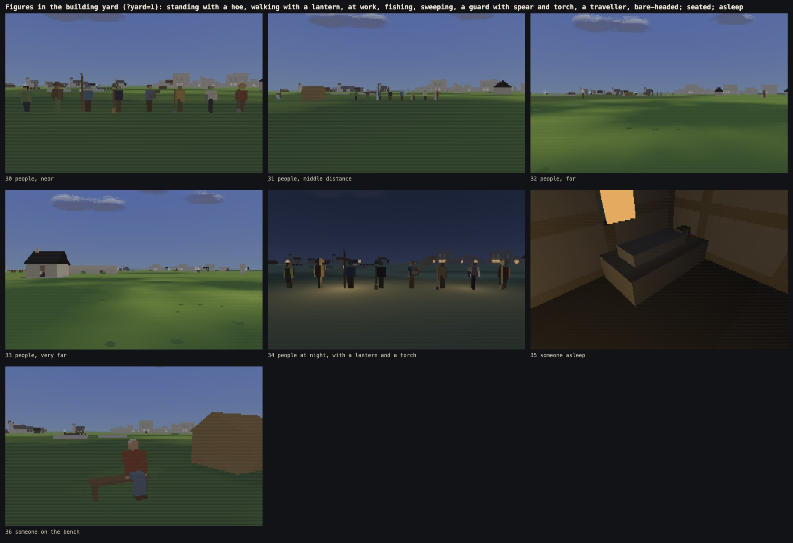
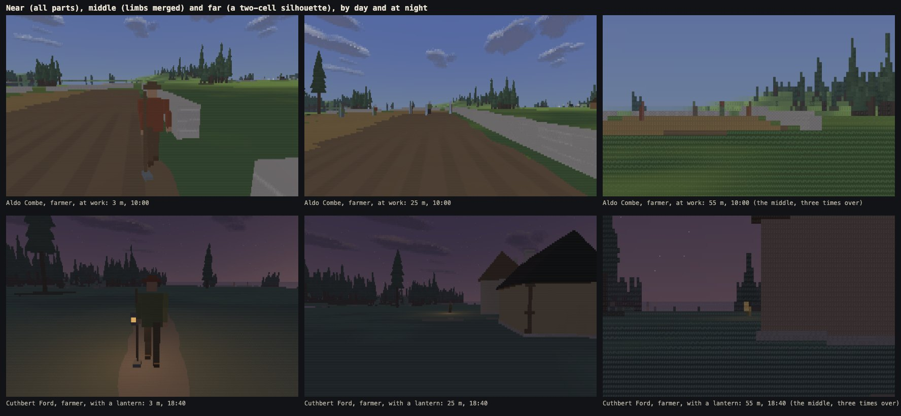
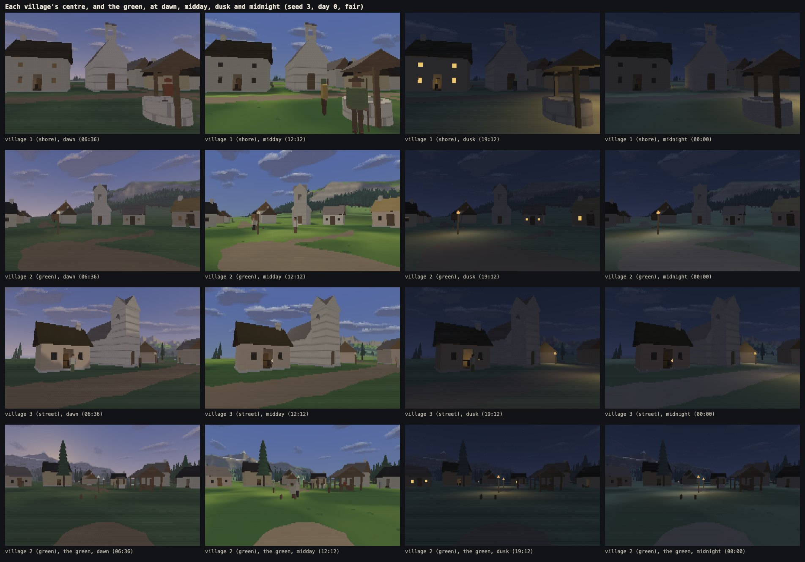
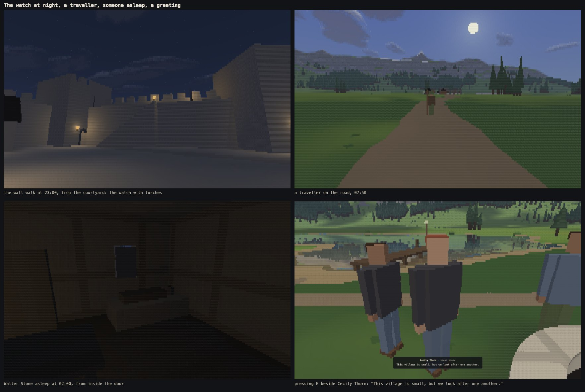

# Phase 4a: people

Written 13 Oct 2026. Phase 4a puts people in the world:
- **villagers:** 10 to 20 to a village, each with a home, a name and a role;
- **the fort's watch:** nine guards with bunks in the keep;
- **travellers** on the main roads.

They come out at dawn, work the fields, fish from the jetty, stand and talk on the green and walk between the settlements. At dusk they carry lanterns home. At night the watch paces the wall walk with torches, and the villages sleep behind lit and then dark windows. Press **E** beside someone facing you for one line that fits who they are, what they are doing, the hour and the weather.

The phase began with the three decisions from phase 3b (section 1).

Nothing else changed:
- no animals, trading, inventory, quests, conversations beyond the one line, combat or doors that open;
- no new buildings or ground content: the keep's bunks are the one new piece, the guards' barracks;
- no change to the terrain, the weather or the menu beyond what people need (a list of them in Advanced).

**Live:** https://land-of-ascii-v3.vercel.app/ (GitHub Pages runs the no-shared-memory fallback: https://oddslice.github.io/land-of-ascii-v3/). The default seed is still 3.

| Key or option | Does |
|---|---|
| E | greets whoever is within about 2.3 m, in front of you and facing you (their head turned to you counts): their name, their role and one line, for about five seconds |
| C | cycles the world's cameras, now 23. The three new ones come from the people's own data: **the green at midday**, **the wall walk at night, from the courtyard**, and **a traveller on the road** |
| Esc → Advanced → people | everyone in the world, with their role and what they are doing now; choosing one stands you beside them, looking at them |
| `?people=0` | the world without people: windows lit as they were in phase 3b, nobody in the way |
| `?yard=1` | the building yard, now with a line of figures in every pose, one on a bench and one asleep: 36 cameras (C), the last seven for the figures |
| everything else | as before |

---

## 1. The three decisions from phase 3b

### Decision 1: the lake shore in Firefox

Phase 3b left the main lake shore at 12.80 ms (fair) and 13.46 ms (rain) in Firefox, against a limit of 12.5. The brief asked for an exact optimisation pass first, to 11.5 ms or less in both, and for one far-reflections-only change to be proposed (not made) if that was not enough.

**What was done (every frame byte-identical before and after):**
- **Cloud shadows:** a lazy grid of cloud cover, its corners worked out only for the squares a frame touches, once a frame (`light.js`).
- **The clouds themselves:** noise is skipped where a cloud's cover is already decided, using bounds on its lumps and streaks (`sky.js`).
- **Value noise:** one fused hash instead of four (`noise.js`, the same values). This also cut the world's build in Firefox from 6.8 s to 4.8 s.
- **The column march:** the crossing test and the ramp step hoist their per-column constants and read the height field inline (`march.js`).
- **Tried and reverted:** culling cloud puffs by slope made the sky slower in Firefox.

**Back to back** in the same Firefox, the phase 3b build against this one, the lake camera at density 3 with 8 workers. The figures are worker plus draw, the median of 240 frames, in ms:

| run | 3b, fair | 4a, fair | 3b, rain | 4a, rain |
|---|---|---|---|---|
| 1 | 12.70 | 11.18 | 13.12 | 11.18 |
| 2 | 12.16 | 10.96 | 13.10 | 11.78 |
| 3 | | | 12.52 | 11.96 |
| 4 | | | 13.06 | 11.10 |

- **Fair weather is under the target:** 10.96 and 11.18.
- **Rain is at the target, not reliably under it.** The median of four runs is 11.48 ms, but two of the four were 11.78 and 11.96.
- The saving is about 1.5 ms in both. The lake is within the limit of 12.5 in every run, with people in the world.

**For you to decide:** the brief's far-reflections change, which I have not made:
- **The change:** under rain, mirror trees and buildings only in water within 60% of today's distance. Farther water would show the sky's reflection and the rain's rings, as it already does beyond today's limit.
- **What I'd bring:** if you want it, before and after frames and the share of cells it changes, before anything ships.

### Decision 2: each bush's shape from its place on the land

A bush's shape (its seed) now comes from its position on the land, not from its place in the list (`src/world/gen/plants.js`). Removing or adding a bush no longer reshapes the bushes after it. Every bush changed shape once. The regression set was saved again for that change alone, then checked: with the change made, every saved frame matched cell for cell.

### Decision 3: a coarser block pattern on village stone up close

The villages' and bridges' dressed stone (ashlar) now shows big blocks up close: courses 1.1 m tall, blocks 2.2 m long, set over by half a block from course to course. The joints between blocks are drawn only while a block is many cells across, and fade before they could blink. The blocks' tones fade a little later (`src/scene/cpu/build.js`). The brief's condition was that village flicker stays at or under the fort courtyard's. Glyph flips on the buildings' own cells (`tools/flicker.mjs --buildings`) were all under the courtyard's 0.177%, so **the pattern stays**:

| run | seed 3 | seed 1 |
|---|---|---|
| turning on the green | 0.169% | 0.167% |
| walking a street | 0.078% | 0.058% |
| crossing the bridge | 0.100% | 0.103% |
| walking in along the shore village's road | | 0.103% |
| the fort's courtyard, turning (the limit) | 0.177% | |

The regression set was then saved again for the stone change alone.

---

## 2. Who lives here

`src/world/people/people.js` builds everyone from the world's data: 31 ms on seed 3, on the page, once.

- **Villagers:** 10 to 20 in each village, 1.15 to a house.
  - Each has a home: one of the village's houses. A house you can go into has one sleeper (its one bed); the others take one or two.
  - Each has a name from a list of plain country names and bynames (`names.js`).
  - **Roles come from what the village has:**
    - about a third farmers, if it has fields;
    - two fishers, if it has a jetty;
    - a carter, and a keeper of the chapel;
    - someone who minds the green (or keeps the well, where there is no green);
    - the rest keep house.
  - **Cloth** comes from the palette's muted dyes: undyed linen, russet, ochre, moss, slate, umber, charcoal, with leather boots. Each person also has a hat, hood, cap or bare head, a skin tone and a height from 1.60 to 1.79 m.
- **Guards:** nine, in three watches changing at 06:00, 14:00 and 22:00, with slate or charcoal coats, iron helmets and spears.
  - The watch asleep has a bunk each in the keep's hall, the watches taking turns. These are the hall's bed and new bunks along its front wall.
  - Off watch, they stand in the hall or the yard.
- **Travellers:** three or four, with staffs, going round the towns (the three villages and the fort) by the main roads.
  - Two legs a day: in the morning to the next town, resting by its well through the middle of the day, in the afternoon on to the one after, where they spend the night on a bench.
  - So a traveller is round every town in two days.

On seed 3: 58 people (19 keep house, 16 farmers, 3 carters, 3 keepers, 2 fishers, 2 keep wells, 1 minds the green, 9 guards, 3 travellers).

---

## 3. What they do

**A day's plan** is made from the seed, the day and the forecast. It is a list of stays (a place, a pose, what they are doing) and walks between them. Where someone is, and how they stand, is a pure function of the plan and the clock: the same seed, day and hour always give the same positions and poses. Plans are made for the whole day at once (at the start), and for the next day a few people a frame in the evening, so midnight has no stall.

- **Villagers by role:**
  - Up between 05:30 and 06:24, a while at the hearth, then out.
  - Farmers work their own strip of a field. The farmers of a village take different strips, moving round them from day to day. They come home for the midday meal.
  - Fishers fish from the end and the middle of the jetty.
  - The carter loads at the door, walks the roads to another village or the fort, and comes back in the afternoon to unload.
  - The keeper sweeps the chapel step in the morning, talks on the green before midday, and keeps the chapel's door in the afternoon.
  - The one who minds the green (or keeps the well) stands there all day, and on some days sits on the bench at midday.
  - Householders stand at their doors, draw water, visit a neighbour, and talk on the green in the late morning or the afternoon.
  - Home at dusk, and to bed between 21:12 and 22:30.
- **The weather changes plans.**
  - Rain sends people to shelter: under the market shelter from the green, into a barn from the fields, or home.
  - Mist holds the fishers back until it lifts.
  - Travellers wait out heavy rain before setting off.
  - Each person's times are their own, so a village does not move as one at the same minute: two of a house leave a quarter of a minute apart.
- **The watch:**
  - Three posts per watch: the gate, and two beats along the wall walk.
  - The relief goes up a quarter of an hour early, so the gate and the wall walk are never empty.
  - On a beat, a guard walks to and fro at 0.8 m/s by the absolute clock.
- **Travellers:** as above.
- **Days vary:** every time and spot comes from a hash of the person, the day and the seed.

**Three people through day 0 on seed 3** (`shots/phase4a/day.md`, from their plans; a row wherever one of them starts something, in bold for whoever did):

| from | Aldo Combe, farmer | Edmund Hay, guard at the fort | Wynn Cobb, traveller |
|---|---|---|---|
| 00:00 | **asleep, in bed** | **off watch, in the keep's hall** | **resting, on a bench** |
| 03:00 | asleep, in bed | **walking to the yard** | resting, on a bench |
| 03:01 | asleep, in bed | **off watch, in the yard** | resting, on a bench |
| 05:45 | asleep, in bed | **walking to the gate** | resting, on a bench |
| 05:45 | asleep, in bed | **keeping the gate, at the gate** | resting, on a bench |
| 05:58 | **walking home** | keeping the gate, at the gate | resting, on a bench |
| 05:58 | **at home, at the hearth** | keeping the gate, at the gate | resting, on a bench |
| 06:29 | **walking to the field** | keeping the gate, at the gate | resting, on a bench |
| 06:30 | **working the field, on a strip of the field** | keeping the gate, at the gate | resting, on a bench |
| 07:47 | working the field, on a strip of the field | keeping the gate, at the gate | **walking to the well** |
| 07:53 | working the field, on a strip of the field | keeping the gate, at the gate | **resting, at the well** |
| 12:02 | **walking home** | keeping the gate, at the gate | resting, at the well |
| 12:03 | **at the midday meal, by the hearth, seated** | keeping the gate, at the gate | resting, at the well |
| 12:54 | at the midday meal, by the hearth, seated | keeping the gate, at the gate | **walking to the well** |
| 13:09 | at the midday meal, by the hearth, seated | keeping the gate, at the gate | **resting, at the well** |
| 13:17 | **walking to the field** | keeping the gate, at the gate | resting, at the well |
| 13:19 | **working the field, on a strip of the field** | keeping the gate, at the gate | resting, at the well |
| 14:03 | working the field, on a strip of the field | **walking to the keep's hall** | resting, at the well |
| 14:04 | working the field, on a strip of the field | **off watch, in the keep's hall** | resting, at the well |
| 14:30 | working the field, on a strip of the field | **walking to bed** | resting, at the well |
| 14:30 | working the field, on a strip of the field | **asleep in the barracks, in bed** | resting, at the well |
| 18:39 | **walking home** | asleep in the barracks, in bed | resting, at the well |
| 18:41 | **at home, by the hearth, seated** | asleep in the barracks, in bed | resting, at the well |
| 19:50 | at home, by the hearth, seated | asleep in the barracks, in bed | **walking to a bench** |
| 19:50 | at home, by the hearth, seated | asleep in the barracks, in bed | **resting, on a bench** |
| 21:23 | **walking to bed** | asleep in the barracks, in bed | resting, on a bench |
| 21:23 | **asleep, in bed** | asleep in the barracks, in bed | resting, on a bench |
| 22:00 | asleep, in bed | **walking to the keep's hall** | resting, on a bench |
| 22:00 | asleep, in bed | **off watch, in the keep's hall** | resting, on a bench |

**Routes** are found once per world, under the player's own rules (`src/world/people/walk.js`):
- **The network:** a network of the roads, lanes and paths, joined where they meet, and to each other across any gap.
- **Links:** a line from each place to its parent place (its doorstep, its field gate, its jetty foot) and on to the network, found by a search on a half-metre grid where a straight line cannot be walked.
- **Sampling:** each route is sampled every half metre by the player's move rule, with the feet's height at each sample. A stretch that cannot be walked is gone round by the same search.
- **Closed doors:** someone going home to a house you cannot enter walks in at its door's sill. They are hidden from the moment their body would touch the house.
- **The clock:** position along a route comes from the clock and the person's walking speed (1.15 to 1.45 m/s).

**Indoors:**
- In a house you can go into, its sleeper lies in its bed at night and sits on the bed's edge or stands at the hearth while awake at home.
- In the other houses, people are absent. The house's windows are lit while someone is awake inside after dark, and dark once they sleep.
- On seed 3, day 0: no window is lit at midnight or at 05:00, 17 houses at 06:36, 28 at 19:12, 41 at 21:00, 15 at 22:00 and none at 23:00.
- With people off, the windows are lit as in phase 3b.

**Meeting you and each other** (`meet.js`), worked out each frame from the moment alone, so nobody keeps an offset once its cause is gone, and nobody is left off their route:
- **People within 5 m turn their heads toward you,** up to about 60 degrees.
- **A walker coming at you** within 2.2 m steps round you if there is room, else waits a metre short along the route.
- **You cannot walk through anyone upright.** Someone in bed is a low body on the bed.
- **Two people closer than 0.75 m:** the later of the two (by id) steps aside, a walker to its right, someone standing away from the other. If there is no room, the other steps aside; if neither can, the walker waits behind.
  - In a crowd (six at a well, or under the shelter in rain), this runs for up to four rounds, further aside each round.
  - Every candidate spot is tested where the state will hold it (in single precision), so rounding cannot put anyone in a wall.

**Greeting:**
- **Who answers:** pressing E within about 2.3 m of someone in front of you who faces you shows their name, their role and one line in the menu's quiet style, for about five seconds, never in the tools' pictures.
- **The lines** are data (`lines.js`): 13 to 16 for each role, 123 in all, in warm plain words.
- **How one is chosen:** each line carries tags for the hour, the weather, the place or what they are doing. A line is said only when all its tags fit, the best fitting first, and never the same line twice running.

---

## 4. How they look

The figure (`src/world/people/figure.js`) is a few exact shapes in the building kit's system (upright boxes, turned to face their way), worked out from the person's state each frame in each render worker:
- **The body:** legs and boots, a tunic, arms and hands, a head with hair, and a hat, hood, cap or helmet.
- **What the role carries:** a hoe, a rod held out over the water, a broom, a spear, a staff or a pack.
- **Lights:** a lantern, or a torch for the watch, out of doors after 18:24 and before 06:06.
- **Walking** swings the legs and arms by the distance walked (a cycle every 1.3 m), never by the clock.
- **Still poses:** standing (with a slow look about), working, fishing, sweeping, sitting on a real bench or a bed's edge, and lying in a real bed.

**Distance steps:**
- **Near (under 14 m):** every part.
  - The gap between the legs closes as it gets under two columns.
  - A hand under about a row and a half becomes the sleeve's end, and a boot the leg's.
- **Middle (14 to 40 m):** the legs as one box, the arms within the body.
- **Far (beyond 40 m):** a two-cell silhouette, the body in its clothes' colour and the head in its hat's or skin's. It is held at a column and a row each while its true size is at least that, then faded by how much of that it really is. Nothing is drawn beyond 420 m.
- **Thin parts** (a spear's shaft, a torch's stick, a brim) are held at two rows and two columns. Past 14 m they are faded by their true share.

**Light and weather:**
- **Shadows** fall on people as on everything else. Each part takes the sun's shadow once, at its middle, so a soft shadow's edge cannot cross a face and blink.
- **Slivers:** a part's side seen nearly edge on takes the light of the face beside it.
- **Even cloth:** people's clothes have no grain fixed to the world, which would cut across a body narrower than its squares.
- **Reflections:** people are in the water's reflections.
- **Rain** darkens their clothes (wetness 0.7, skin 0.3, iron 0.5).
- **Carried lights:** a lantern or torch is a moving point light. Only the stripes it reaches pay for it, it never starts the shadow sweep, and it adds to the fixed lights without changing them.

The colours are in the art bible (section 7, "People"), and the sizes and speeds in `docs/scale.md` ("People").

---

## 5. Measurements

### The world check (`tools/world-check.mjs`, seeds 3, 1, 2, 4, 5, and a sweep of 60 seeds)

Every check from earlier phases still passes on all five seeds. The new people checks:
- **Homes:** every person has a home whose door can be reached by the player's rules.
- **Plans:** a whole plan for each of 10 days, and every route in them walked again by the player's move rule.
- **Positions:** everyone sampled every ten minutes for three days, after the meetings. The check fails if anyone is:
  - inside a wall, a fence or any closed shape;
  - in water deeper than a ford;
  - off a bridge's or jetty's deck while on it;
  - within half a metre of another person.
- **The watch:** a guard at the gate and one on the wall walk every hour.
- **Windows:** lit exactly while someone is awake inside after dark.
- **Repeatable:** the same positions and poses, to the last bit, from a second, fresh build of everyone, for the same seed, day and hour.

| | the five seeds | the sweep of 60 seeds |
|---|---|---|
| people | 301 (58, 61, 64, 64, 54) | 3,594 |
| routes walked | 6,711, all passable | 80,224, all passable |
| positions sampled | 84,227 | 1,007,610 |
| inside a shape / in deep water / off a deck / on one spot | 0 / 0 / 0 / 0 | 0 / 0 / 0 / 0 |
| hours without a guard at the gate / on the wall | 0 / 0 | 0 / 0 |
| windows not matching who is awake | 0 | 0 |
| the same from a fresh start | 5 of 5 | 60 of 60 |

**The first sweep failed on 22 of 60 seeds.** Each fault was fixed where it arose; nothing was patched by hand:
- **Corner-cutting routes:** a straight line tested in one long step could pass over a post that half-metre steps would meet. Lines are now tested in the steps they are walked in, and a stretch that fails is tried again in half steps (a door's half-metre sill).
- **A hole in the body test:** the player's body test sampled its middle and its rim, so a post about 0.25 m thick between them was missed. That was the player's rule too. It now samples a ring at half the radius as well.
- **Crowds:** a crowd of five or six at one well or under a shelter could not separate in one round. Meetings now take up to four rounds.
- **Rounding:** a spot tested in double precision and stored in single could round into a wall.
- **Closed doors:** someone leaving a house you cannot enter was visible for a moment inside its wall. They are now hidden until their body is clear of the house.
- **A barn too high:** a barn whose floor stood 0.8 m above the ground at its doorway (higher than a step) was counted as shelter. Barns now count only if they can be walked into.
- **Places far from the roads:** a place whose nearest road points lay across a stream could not reach the network. The search now tries further points too.

### Identity (`tools/identity.mjs`, 0, 1, 3, 5 and 8 workers)

- **The building yard:** 44 of 44 views identical, the seven new figure cameras among them.
- **The world:** 102 of 102 in fair weather and 106 of 106 in rain, served with shared memory and without.
  - The new views full of people: the green at midday, at dawn and in the evening; the wall walk at night; a traveller; each village's centre at midday, and one in the evening.
- **One build:** the world built byte-identical on every page.
- **Frozen clock:** every view is taken with the clock frozen.

### Flicker (`tools/flicker.mjs --people`, seed 3, in Node, 360 × 112, 60 frames)

Blinks counted on the people's own cells (cells that show a person in any of the three frames), as a share of those cells. The camera walks (0.075 m a frame) or turns (0.15 to 0.3 degrees a frame) with the clock frozen:
- **Still figures:** those standing, sitting, working or asleep.
- **Walkers caught mid-stride:** counted separately.
- **Walkers walking:** the camera held still and the clock running in real time.

| run | still figures: share of the frame | still figures: glyph / colour flips | buildings in the same run: glyph / colour | walkers caught mid-stride, camera moving: share, glyph / colour | walkers walking, camera still: glyph / colour |
|---|---|---|---|---|---|
| village 2: turning on the green at midday (12 people on it) | 10.42% | 0.048% / 0.007% | 0.353% / 0.071% | none | 0.007% / 0.000% |
| village 3: walking its street at 11:30, past 7 people | 0.64% | 0.269% / 0.125% | 0.086% / 0.038% | none | 0.000% / 0.000% |
| the wall walk at 23:00, from the courtyard, turning | none | | 0.201% / 0.059% | 0.06%, 0.281% / 0.000% | 0.164% / 0.082% |
| *the fort's courtyard, turning (phase 3a's figure, the limit)* | | *0.177% / 0.097%* | | | |

- **The green:** still figures are far under the courtyard's figure.
- **The street is over it,** 0.269% against 0.177% (glyph) and 0.125% against 0.097% (colour). See section 6, item 1.
- **The wall walk:** its 0.281% is four flips on a guard 25 m off.
- **The fixes the flicker runs led to:**
  - the gap between the legs closes under two columns;
  - small hands and boots merge into the sleeve and the leg;
  - thin parts are held at two rows, and faded past 14 m;
  - a side seen edge on takes the light of the face beside it;
  - shadows are taken once a part;
  - hoods sit round the head instead of a sliver beside the face;
  - clothes have no world grain.
- **Tried and reverted:** lighting a part as if rounded made the green worse (a gradient on a big near body flips at its glyph thresholds).

### Frame times (`tools/bench.mjs --scene world --threads 8 --density 3 --built`)

Every world camera, the three new ones included, on the built `index.html`, with people. The figures are worker plus draw per frame (ms), the median of 240 frames with every clock frozen.
- **Browsers:** Chromium and Firefox in visible windows on the 120 Hz display; WebKit headless.
- **Background load, logged every 10 s:**
  - the window server, about half a core;
  - the Claude app, 15–20%;
  - Spotify, about 14%.
- **Not running:** Ollama, any other copy of the game, and the Claude app's browser pane.

Camera numbers: 1 spawn, 2 lake, 3 stand, 4 edge, 5 river, 6 coast, 7 vista, 8 road to the fort, 9 fort from the road, 10 gate passage, 11 courtyard, 12 wall walk, 13 village 1's road in, 14 its centre, 15 village 2's road in, 16 its centre, 17 village 3's road in, 18 its centre, 19 inside a house, 20 the stone bridge, **21 the green at midday, 22 the wall walk at night from the courtyard, 23 a traveller on the road**.

| browser | weather | 1 | 2 | 3 | 4 | 5 | 6 | 7 | 8 | 9 | 10 | 11 | 12 | 13 | 14 | 15 | 16 | 17 | 18 | 19 | 20 | 21 | 22 | 23 |
|---|---|---|---|---|---|---|---|---|---|---|---|---|---|---|---|---|---|---|---|---|---|---|---|---|
| Chromium | fair | 5.92 | 8.36 | 5.18 | 4.83 | 5.94 | 5.23 | 6.71 | 3.7 | 3.85 | 4.16 | 4.06 | 4.05 | 5.66 | 3.88 | 4.41 | 4.82 | 3.68 | 4.76 | 4.47 | 4.91 | 5.06 | 5.73 | 5.9 |
| Firefox | fair | 8.14 | 11.36 | 6.76 | 6.04 | 7.44 | 6.92 | 8.48 | 4.48 | 4.3 | 4.72 | 4.48 | 4.82 | 7.14 | 4.42 | 5.74 | 6.62 | 4.3 | 5.94 | 5.08 | 6.12 | 6.52 | 7.4 | 7.58 |
| WebKit | fair | 5.9 | 7.84 | 4.96 | 5.02 | 6.08 | 5.44 | 6.48 | 4.18 | 4.04 | 4.82 | 4.34 | 4.1 | 5.8 | 3.98 | 4.72 | 5.96 | 4.04 | 4.86 | 4.58 | 4.64 | 5.06 | 5.36 | 5.7 |
| Chromium | rain | 6.59 | 8.88 | 5.31 | 5.28 | 6.3 | 6.13 | 6.77 | 4.43 | 4.34 | 4.37 | 4.75 | 4.61 | 6.36 | 4.55 | 5.17 | 6.2 | 4.31 | 5.5 | 4.8 | 5.82 | 5.9 | 6.72 | 6.61 |
| Firefox | rain | 9.02 | 11.4 | 6.9 | 6.98 | 8.06 | 7.62 | 8.2 | 5.26 | 5.42 | 5.58 | 5.64 | 5.38 | 7.7 | 5.5 | 6.48 | 7.32 | 5.36 | 7.1 | 5.6 | 7 | 7.42 | 7.62 | 7.76 |
| WebKit | rain | 6.8 | 8.26 | 5.22 | 5.4 | 6.24 | 6 | 6.56 | 4.66 | 4.44 | 5.34 | 4.74 | 4.34 | 6.06 | 4.26 | 5.08 | 6.2 | 4.42 | 5.3 | 4.76 | 5.3 | 5.54 | 5.76 | 6.02 |

- **Chromium:** at most 8.88 ms (the lake, in rain), against a limit of 10. The busy green is 5.06 / 5.90 and the wall walk at night 5.73 / 6.72.
- **Firefox:** at most 11.40 ms (the lake, in rain), against a limit of 12.5, so every camera is within it. The lake back to back is in section 1.
- **WebKit (headless):** at most 8.26 ms.
- **The people update on the main thread** (everyone's state, the meetings, the bodies near you, the lit houses), with the clock running through a busy morning and then standing on the green at midday:

| browser | median | 95% of frames under | slowest frame |
|---|---|---|---|
| Chromium | 0.095 ms | 0.12 ms | 0.59 ms |
| Firefox | 0.16 ms | 0.20 ms | 0.56 ms |
| WebKit | 0.08 ms | 0.16 ms | 0.32 ms |

  - Every frame but one in Chromium and one in Firefox is under the brief's 0.5 ms; the median is a fifth of it or less.
  - Building everyone takes 34–42 ms once, at the start.
- **World build:** 3.4 s in Chromium (limit 4), 4.8 s in Firefox (6.8 s in phase 3b), 3.2 s in WebKit.
- **The menu's benchmark** times all 23 cameras. `tools/menu-check.mjs` passes 34 of 34, the people list in Advanced and the 1024 × 640 fit among them.

### The regression set (`tools/lookbook.mjs --regress`)

- **With people off (`--people off`),** against the set saved after the bush and stone changes: 180 of 183 frames are identical cell for cell. The other three are the yard keep's near view at day, dusk and night, two cells each. These are the guards' new bunks, seen through the keep's door; with the bunks taken out, the yard matched 87 of 87.
- **With people on:** the set was then saved again deliberately with people and the new cameras (213 frames), and checked: 213 of 213 identical.

### Size

`index.html` is 704.6 KB (619.9 KB after phase 3b): people and the lake optimisation add about 85 KB.

### Videos (kept out of git, `shots/walks/`)

Recorded with `tools/walk.mjs` (headless Chromium, 1440 × 900, the clock running, people on):
- **`world-green-day.webm`** (99 MB): five minutes from the green's own camera, from 04:30 to 21:30, the clock running 17 hours in five minutes, 59.9 frames a second presented. You see:
  - people coming out at dawn;
  - the morning's work and water drawing, and the talk on the green before midday;
  - the afternoon;
  - lanterns carried home at dusk;
  - windows lit, then going dark one by one.
- **`world-fort-night.webm`** (48 MB): two minutes (124.7 s) through the fort in real time from 23:00, 59.8 frames a second presented. The walk:
  - in at the gate past its guard and across the courtyard;
  - up a stair and along the wall walk past the watch with their torches;
  - back, and a slow look round the courtyard.

---

## 6. What looks wrong or thin

1. **Still figures flicker more than the courtyard when you walk past them in a street.**
   - On the people's own cells, glyph flips are 0.269% against the courtyard's 0.177%, and colour flips 0.125% against 0.097% (section 5).
   - What is left is spread thin: edges of faces, hoods and sleeves passing a wall for a frame, where the wall and the clothes happen to share a glyph.
   - Turning on the busy green, they flicker a quarter as much as the courtyard.
2. **Sleepers read as a dark slab.** In a dim room at night, the blanket and the bed are close in tone, and the face is a small block at the far end.
3. **Far people look like posts.** Past 40 m a person is a two-cell silhouette in their clothes' colour. Beside a fence or among tree trunks it reads like another post.
4. **The fishing rod** is held out level in four short steps, more like a pole than a rod with a line.
5. **Hands and boots vanish past about 7 m** (by design: the sleeve and the leg run down instead), so people further off have no hands.
6. **Evenings are quiet.** The walks home from the fields take a minute or two, so you see lanterns on the move only briefly after dusk. After that, the lights are the windows.
7. **The guards off watch stand in the yard in the small hours.** They are on the next morning's watch and have slept in the afternoon.
8. **Travellers spend most of the day resting by a well.** They are on the road for 30 to 40 minutes a day each, in two legs.
9. **People going into a house you cannot enter vanish at its sill.** The door does not open (out of scope); they are hidden from the moment their body would touch the house.
10. **Head turns are quick:** a head follows you while you are within 5 m, with no easing in or out. Up close, someone's head can snap round when you step past them.
