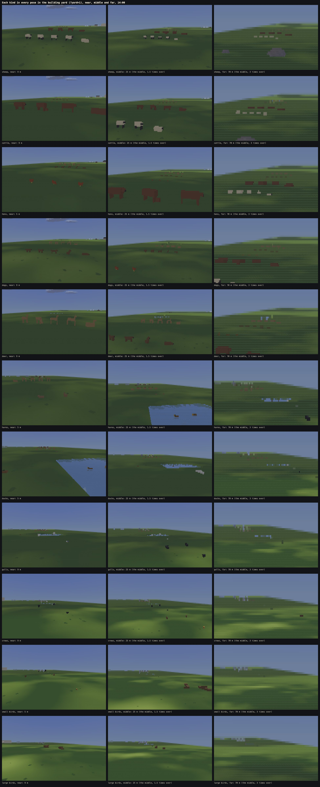
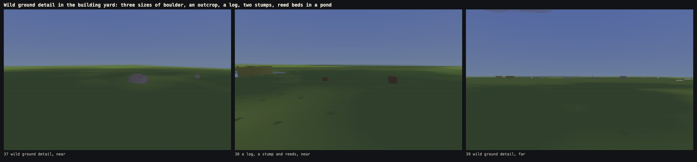
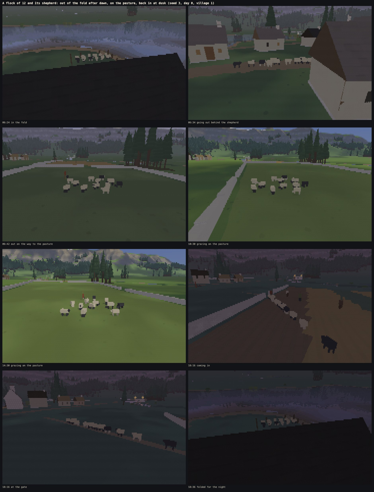
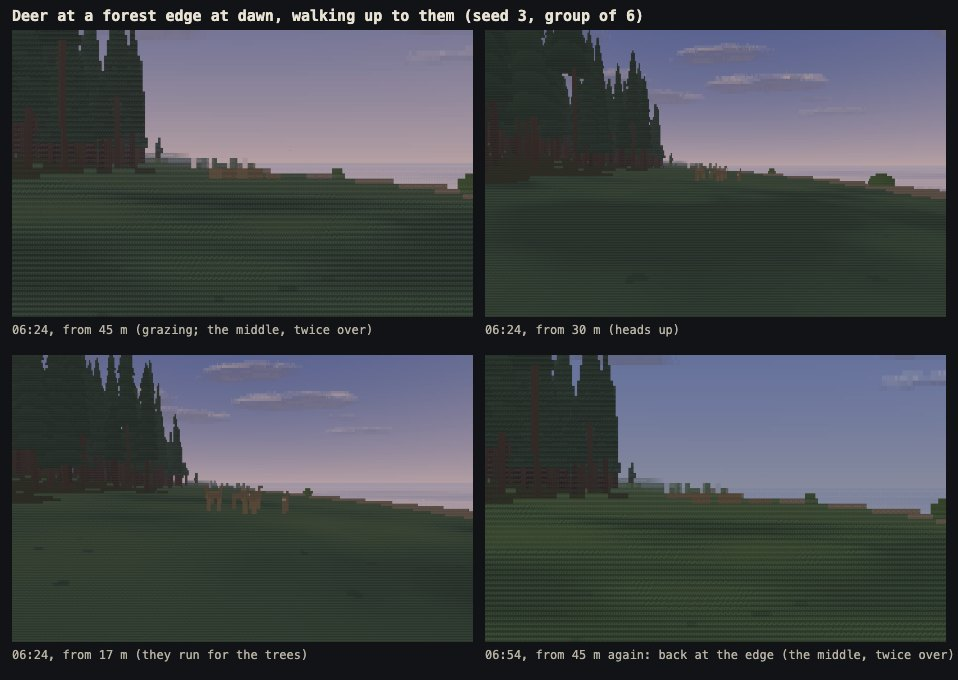
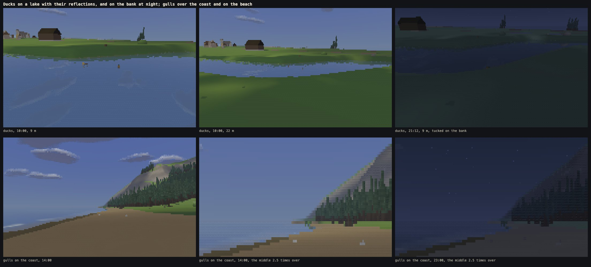
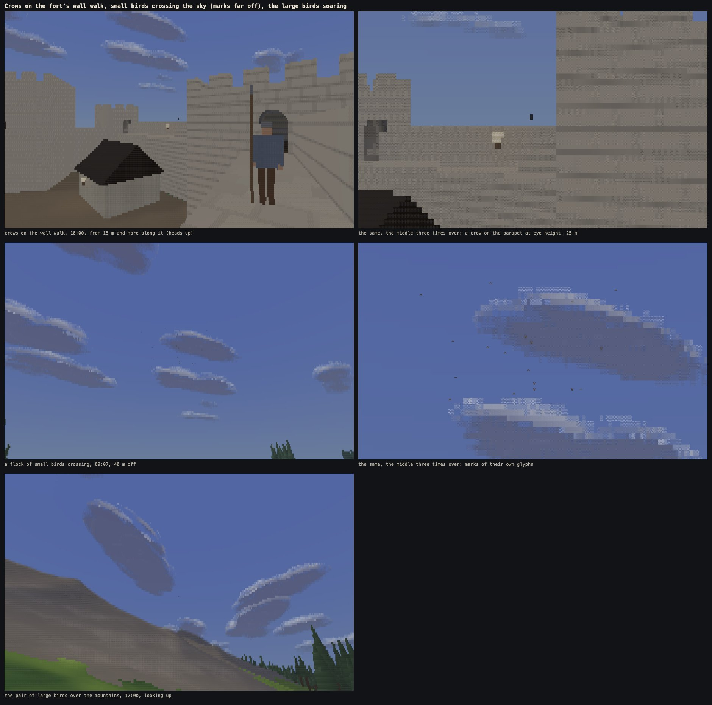
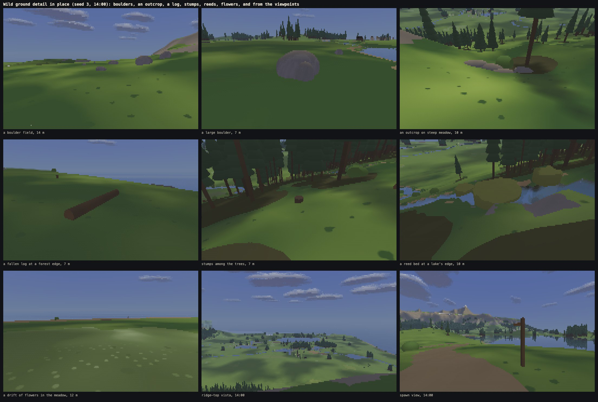
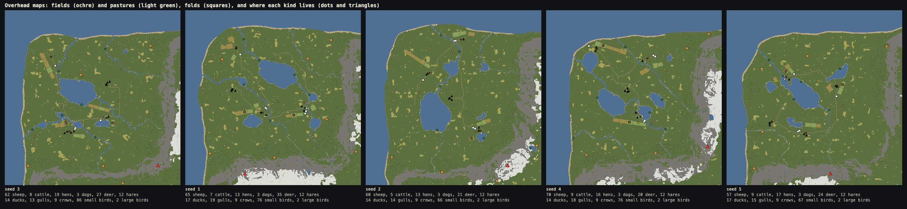

# Phase 4b: animals and wild ground detail

Written 13 Oct 2026. Phase 4b fills the land between the settlements:
- **farm animals:** flocks of sheep with their shepherds and folds, cattle in a field by the water, hens before the houses, a dog to each village;
- **wild animals:** deer at the forest edges, hares in the meadow, ducks on the lakes;
- **birds:** gulls over the coast, crows on the fort's merlons and the village roofs, flocks of small birds crossing between copses, a pair of large birds over the mountains;
- **wild ground detail:** boulders, outcrops, fallen logs, stumps, reed beds and drifts of flowers.

As with people, nothing is simulated. Where an animal is and what it is doing is a pure function of the seed, the day and the clock. A flock and a dog also follow their person's plan. The only reaction is a local, stateless response to how near a walker is (you, or a person out of doors). A frozen clock and a fixed position always give the same picture, and fast time simply works.

Nothing else changed:
- no riding, hunting, feeding or herding;
- no trading, inventory, quests or goals;
- no fish, insects or sound;
- no new buildings: the folds are made from the existing fence pieces;
- no change to the terrain rules, the weather or the menu beyond what animals need (a list in Advanced).

**Live:** https://land-of-ascii-v3.vercel.app/ (GitHub Pages runs the no-shared-memory fallback: https://oddslice.github.io/land-of-ascii-v3/). The default seed is still 3.

| Key or option | Does |
|---|---|
| C | cycles the world's cameras, now 27. The four new ones come from the animals' own data: **a pasture with its flock** (10:30), **deer at a forest edge, at dawn** (06:24), **gulls on the coast** (14:00) and **crows on the wall walk** (10:00) |
| Esc → Advanced → animals | how many of each kind there are, and buttons that take the camera to a flock, a herd, a deer group, a perch, ducks or gulls (each press goes to the next one, from far enough off that they stay as they are) |
| `?animals=0` | no animals, nor their pastures and folds |
| `?wild=0` | no wild ground detail (no boulders, outcrops, logs, stumps, reeds or flowers) |
| `?animals=0&wild=0` | phase 4a's world, byte for byte (the same world hash, `edd7cf3c` for seed 3) |
| `?yard=1` | the building yard now has a row of every kind of ground detail and a row for each kind of animal in every pose: 53 cameras (C), the last 17 for them |
| everything else | as before |

---

## 1. What lives where

Counts for the default seed (seed 3), with the other checked seeds in section 6:

| Kind | Seed 3 | Where and when |
|---|---|---|
| Sheep | 62 in 4 flocks | 1 or 2 flocks of 8 to 20 a village. One villager per flock is its **shepherd**: they lead the flock out of its fold after dawn (about 06:24, later after morning rain), stay with it on the pasture, and bring it in at about 18:00 (sooner when rain sets in after midday). Sheep lie down after 20:48. In rain they gather on the pasture's lee side (toward the nearest trees, or the village). |
| Cattle | 8 in 2 herds | 3 to 6 in a walled field by water, at the one or two villages nearest water. They graze slowly, and lie through the warm middle of the day and at night. |
| Hens | 19 | 4 to 7 before a house's door by day; in to roost before dark and out of the rain. |
| Dogs | 3 | One a village, belonging to the shepherd where there is one. It follows its person on their way, through doorways with them. It lies by their door while they are home, and waits outside houses you cannot go into. |
| Deer | 27 in 5 groups | 4 to 7 groups of 3 to 6. In the forest by day, out to graze its edge at dawn (05:24 to 08:06) and dusk (18:18 to 21:12), bedded in the trees at night. |
| Hares | 12 | Each sits in its form in open meadow, with a few hops to another of its spots every few minutes. |
| Ducks | 14 | Twos and threes on lakes. They paddle slow loops by day and are tucked on the bank at night; their bank is reached by water all the way. |
| Gulls | 13 | 3 to 6 at up to three beaches, and 3 on a shore village's jetty. By day they take turns circling over the water and standing on the beach; at night they all stand. |
| Crows | 9 | Four on the fort's merlons (placed from the kit's crenel data) and five on village ridges. Now and then each takes a turn round and comes back. |
| Small birds | 86 in 4 flocks | Each flock rests in a copse for a few minutes, then crosses to the next as a loose cloud. |
| Large birds | 2 | A pair soaring in wide circles near the mountains, 08:00 to 18:30. |

**Pastures and folds:**
- **Pastures** are some of each village's field blocks, given over to grazing. They have their own muted ground tone, between grass and stubble, and are walled on every side. The side toward the village holds their gate, and each other side has a gap at its middle, so two pastures side by side never close each other off.
- **A fold** stands beside each sheep pasture, near a barn: a 9 × 7 m pen of fence pieces with a 2.6 m gate. Its sheep stand 1.35 m apart inside.
- **A village with too few fields:** when a village has only one field block, the generator looks harder for one more, smaller block (on slightly steeper ground) to graze, so every village gets a flock.

**Reactions:**
- **Alert:** an animal lifts its head first, when a walker comes within its alert distance.
- **Flight:** closer in, it moves away along the clearest of nine directions (straight away, or up to 125 degrees to either side). The move grows over a band of distance, so standing at the edge of the band gives a steady picture, never a flip.
- **Return:** with the clock the band narrows by up to 30% and widens again (over about four game hours), so a group that fled comes back later if you stay just outside the narrower band. When you leave, it is back where it was.
- **The distances:**
  - deer: alert at 40 m, running at about 20 m;
  - hares: alert at 16 m, dashing at about 8 m;
  - crows: alert at 22 m, up off the perch at about 11 m;
  - gulls: alert at 18 m, taking off at about 10 m;
  - ducks: alert at 12 m, paddling away at about 8 m.

**Meetings:** where two animals, or an animal and a walker, come too close, one is moved aside by its overlap, from the moment alone, as people are.
- An animal's body for this is a capsule along its length.
- If no room can be found aside, it tries round the other at wider angles.
- One standing inside a shape, or in water (but a duck), steps out of it.
- This is done within 100 m of you; further off, an overlap is under two columns and cannot be seen.
- A sheep, a cow, a deer or a dog near you is a body you cannot walk through.

## 2. How they look

The art bible's new section, *Animals and wild ground detail (phase 4b)*, has the full rules and the palette. In short:
- **The figures:** each kind is a few exact boxes in the kit's own system: a body, a head and neck (up, or down to graze), legs, a tail, ears, a rump patch, a bill, and wings folded or spread.
  - Gait comes from distance travelled; a wingbeat or a dog's tail comes from the clock.
  - Every kind has a resting pose: lying, sitting, perched, or tucked on the bank.
- **Distance steps:**
  - within 8 m, all four legs;
  - within 14 m, every part;
  - to 40 m, the front and back legs as one thin part each;
  - beyond 40 m, a silhouette held at two columns wide and a row tall and faded by its true share. A far flock is a pale cluster that thins, never sparkle. Nothing is drawn under 5% of that, or past 320 m.
  - The thin parts (legs, ears, wings) are held at two columns and fade out by distance alone between 28 and 40 m, so turning on the spot cannot change them.
- **Birds far off:** a bird in the air narrower than two columns is one mark: `v` wings up, `-` level, `^` down, in its shaded colour, drawn over what is behind like a rain streak. A far flock keeps fewer marks with distance (its later birds go first, and the last one kept fades), so it thins by count.
- **Shadows:** each animal on the ground darkens the ground under it. The shadow is its footprint moved away from the light by its height and drawn out that way, soft at the edge, fading between 60 and 90 m. Animals show in reflections as people do.
- **Wild ground detail** is built from the kit's exact shapes (two new ones: an ellipsoid stone and a lying log; a reed bed is a third). It is held at two cells and faded beyond that, like everything else, and culled by distance and its 64 m bucket before any ray is cast.
  - **Reed beds:** they part round you. Their ragged top is a smooth wave round the bed, shown while a wave is a few columns across. Their stems are clumps with their own tones (no dark gaps), shown while a clump is five columns across.
  - **Flowers:** a ground material in three muted tones. Close up, sparse heads move toward their bloom colour. About 2% of the land.

## 3. A day with a flock

The first flock of seed 3, village 1, day 0, fair weather: in the fold at 06:24, out behind its shepherd, on the way, grazing at 10:30 and 14:30, coming in at 18:16, at the gate, and folded for the night. The flock's day in fast time is also a video (section 7).

## 4. Deer, ducks, gulls, crows and small birds

**Deer at a forest edge at dawn:**
- from 45 m they graze;
- from 30 m their heads are up;
- from 17 m they run for the trees;
- half an hour later, from 45 m, they are back at the edge.

**Ducks with their reflections, and gulls on the coast.** Ducks paddle at 10:00 and are tucked on the bank at 21:12. Gulls circle and stand on the beach by day and all stand at night.

**Crows, small birds and the large birds.**
- A crow on the parapet is small at 25 m (shown three times over). At 15 m it has its head up but stays.
- The small birds crossing are marks of their own glyphs (shown three times over).
- The pair of large birds is a speck over the mountains.

## 5. Ground detail in place

Each kind on seed 3 at 14:00: a boulder field, a large boulder, an outcrop on steep meadow, a fallen log at a forest edge, stumps among the trees, a reed bed at a lake's edge and a flower drift. Then the ridge-top vista and the spawn, as seen from the viewpoints.

**Overhead maps of five seeds:** fields in ochre, pastures in light green, folds as squares, and where each kind lives as dots and triangles. Boulders, logs and reeds are single pixels.

## 6. Measurements

### The world check (`tools/world-check.mjs`, seeds 3, 1, 2, 4, 5, and a sweep of 60 seeds)

Every check from earlier phases still passes on all five seeds, including the sky test (medians 36.7% to 39.0%; views under 15% at most 8.4%) and far readability. The new checks:
- **Every village** has its flocks (8 to 20 sheep each), a fold for each, a shepherd, hens and a dog.
- **Every world** has deer, hares, ducks, gulls, crows, small birds and large birds.
- **Every animal sampled every ten minutes for three days**, after the meetings. The check fails if any is:
  - inside a wall, a fence, a building, a boulder or any shape (a bird's body, in the air or perched);
  - too close to another (their capsules overlapping);
  - standing in water deeper than a puddle (all but ducks);
  - outside its pasture, fold or the shepherd's way (sheep), its field (cattle), its door's yard (hens), its forest edge and ways (deer), its spots (hares), its water and bank (ducks), its perches and air (birds).
- **Every flock in its fold** at every sample from 21:30 to 05:00.
- **A walker approaching each deer group, hare and crow** from 90 m in half-metre steps. It must see the animal lift its head at least 2 m before it moves, then move off (deer at least 8 m, hares 5 m, crows 3 m up). Once the walker is gone, the animal must be exactly back where it was.
- **Repeatable:** the same states, to the last bit, from a fresh build, for the same seed, day and hour.
- **Ground detail:** no boulder, outcrop, log or stump on a road or a footpath. Nothing within 1.5 m (plus its own size) of a door, the fort's gate, a fold's or pasture's gate, a bridge's end or a jetty's end. The people's routes are walked again (every place they visit stays reachable).

| | the five seeds | the sweep of 60 seeds |
|---|---|---|
| animals | 1,213 (255, 258, 219, 249, 232) | 14,360 |
| positions sampled | 507,168 | 5,989,251 |
| inside a shape / too close / in water / out of place | 0 / 0 / 0 / 0 | 0 / 0 / 0 / 0 |
| flocks out of the fold at night | 0 (of 42,390 sheep-samples) | 0 |
| walker: alert, then flight, then back | 130 of 130 | 1,565 of 1,565 |
| the same from a fresh start | 5 of 5 | 60 of 60 |
| villages missing a flock, fold, shepherd, hens or dog; worlds missing a kind | 0 | 0 |
| ground detail (boulders, outcrops, logs, stumps, reed beds) | 1,445, 112, 1,233, 1,922, 293; none in the way | none in the way |
| people's routes walked again | all passable | 89,068, all passable |

Every earlier check passed on the sweep too: the fort, the villages and the people (3,594 people, about a million positions, no faults).

**Earlier sweeps, stopped and run again as faults were fixed, failed on 15 different seeds.** The table is the last full run, on the final code. Each fault was fixed where it arose; nothing was patched by hand:
- **A pasture's gate shut in:** with pastures walled on every side, two pastures side by side closed each other's gate, so on five seeds a shepherd's way to their pasture could not be walked. Now a pasture's other sides have a gap at their middle, and its gate is the first of the footpath's end and its sides' middles from which the roads can be reached.
- **No flock in a village with one field:** a village with a single field block kept it as a field. The generator now looks harder for one more, smaller block to graze.
- **Deer in shallow water:** a deer group spreads about 4 m round its spot and walks the same way to and from it; on two seeds that reached a stream. Their spots and their ways must now be dry for 6 m round.
- **Crows inside a merlon:** the perch height was the wall's top, not the merlon's. Perches now take the height of the shapes' own top there, and each crow circles above everything under its circle.
- **Small birds into a building and a hill:** a flock flying low between copses met a rise, or a building beside a copse. In flight they now keep 4 m over the ground and 2 m over any shape, and only copses whose crowns are clear are used.
- **A duck walking ashore:** a duck's way to its bank went over a spit of land. Ducks now go back to the middle of their water first, then out along a way that is water all the way; their water is checked more finely.
- **A hare with nowhere to go:** hemmed in, it fled 4 m. Flight now tries up to 125 degrees either side of straight away.
- **Sheep touching in a gateway:** in single file they walked 0.7 m apart but are 0.95 m long. They now walk 1.1 m apart.
- **A hen and a dog inside a fence:** the meetings now step an animal out of any shape, however low, and out of water.

### Identity (`tools/identity.mjs`, 0, 1, 3, 5 and 8 workers, the clock frozen)

- **The world:** 112 of 112 views identical in fair weather and 116 of 116 in rain, served with shared memory and without. The new views full of animals are among them: a pasture with its flock at 10:30 and as it comes in at 18:18, deer at a forest edge at dawn, gulls on the coast and crows on the wall walk.
- **The building yard:** 61 of 61, the 17 new cameras for animals and ground detail among them.
- **One build:** the world built byte-identical on every page, in a worker or on the page.
- **Animals:** the main thread works out every animal's state once a frame and sends the same states to every worker, so the workers cannot disagree.

### Flicker (`tools/flicker.mjs --animals`, seed 3, in Node, 360 × 112, 60 frames)

Blinks are counted on the animals' own cells and on the ground detail's cells (within 120 m; past that the rock is the mountains'), as a share of those cells. A cell counts as a blink when it changes and changes back on the next frame. The limit is phase 3a's fort courtyard: 0.177% glyph flips and 0.097% colour flips.

| run | still animals: share of the frame / glyph / colour flips | ground detail: share / glyph / colour | whole frame: glyph / colour | moving animals, camera still: glyph / colour |
|---|---|---|---|---|
| beside a grazing flock, turning | 1.22% / **0.303%** / **0.175%** | 49.53% / 0.021% / 0.005% | 1.422% / 0.758% | 0.000% / 0.000% |
| walking toward a boulder field (12 boulders within 25 m) | none | 13.05% / **0.203%** / 0.015% | 0.049% / 0.010% | none |
| walking up to a reed bed, from 9 m off its edge | none | 21.46% / **0.445%** / **0.332%** | 0.312% / 0.273% | none |
| walking into a reed bed (it parts round you) | none | 32.94% / **0.399%** / **0.307%** | 0.432% / 0.337% | none |
| small birds crossing the sky (camera still, clock running) | | | 0.015% / 0.000% (the marks moving) | |

- **Over the limit:** the flock (legs), the boulder field (just over, on glyph flips) and the reed bed. See section 8.
- **The whole frame** beside the flock flips 1.42% with or without the animals. The conifers and clouds turning account for that, not the animals.
- **The fixes the flicker runs led to:**
  - **Legs:** an animal's thin parts are held at two columns and faded by distance alone. All four legs are apart only within 8 m; further out, each pair is one part. Legs a column apart opened and closed a gap as the view turned. This took the flock from 0.86% to 0.30%.
  - **Reed tops:** a reed bed's ragged top was a random height per 9 cm stem, sparkling at any distance. It is now one smooth wave round the bed, the same on its side and its top, shown while each wave is a few columns across.
  - **Reed stems:** the stems were dark gaps 9 cm apart, which a walking step swept past at half their spacing. They are now clumps 24 cm wide, each with its own tone, shown while a clump is five columns across (counting how much a glancing view stretches it), as the 3b boards are.
  - **Inside a reed bed:** from inside, below its top, you see the bed's far side past the parted stems, not a heightfield at eye level.
  - Together these took the reed bed from 15% to 0.45%.
- **Tried and kept out:**
  - holding every part of an animal at two cells (worse, 0.38%);
  - drawing the middle-distance legs as one block (worse, 0.67%);
  - sinking the legs into the ground (no change).

### Frame times (`tools/bench.mjs --scene world --threads 8 --density 3 --built`)

Every world camera, the four new ones included, on the built `index.html`, with people and animals. The figures are worker plus draw per frame (ms), the median of 240 frames with every clock frozen.
- **Browsers:** Chromium and Firefox in visible windows on the 120 Hz display; WebKit headless.
- **Background load,** logged every 10 s:
  - the Claude app, 10–25% in all;
  - the window server, about 20%.
- **Not running:** Ollama, any other copy of the game, or the Claude app's browser pane. A local dev server sat idle.

Camera numbers:
1. spawn
2. lake
3. stand
4. edge
5. river
6. coast
7. vista
8. road to the fort
9. fort from the road
10. gate passage
11. courtyard
12. wall walk
13. village 1's road in
14. its centre
15. village 2's road in
16. its centre
17. village 3's road in
18. its centre
19. inside a house
20. the stone bridge
21. the green at midday
22. the wall walk at night
23. a traveller
24. **a pasture with its flock**
25. **deer at a forest edge at dawn**
26. **gulls on the coast**
27. **crows on the wall walk**

| browser | weather | 1 | 2 | 3 | 4 | 5 | 6 | 7 | 8 | 9 | 10 | 11 | 12 | 13 | 14 | 15 | 16 | 17 | 18 | 19 | 20 | 21 | 22 | 23 | 24 | 25 | 26 | 27 |
|---|---|---|---|---|---|---|---|---|---|---|---|---|---|---|---|---|---|---|---|---|---|---|---|---|---|---|---|---|
| Chromium | fair | 6.13 | 8.67 | 5.36 | 4.8 | 6.03 | 5.11 | 6.61 | 3.8 | 3.87 | 4.21 | 4.06 | 4.17 | 5.69 | 3.89 | 4.52 | 4.93 | 3.65 | 4.9 | 4.61 | 4.82 | 5.06 | 5.75 | 5.59 | 5.44 | 4.82 | 5.3 | 4.05 |
| Firefox | fair | 7.26 | 10.96 | 6.36 | 6.22 | 7.36 | 6.52 | 7.82 | 4.54 | 4.5 | 4.9 | 5.04 | 5.14 | 6.9 | 4.9 | 5.58 | 5.98 | 4.38 | 5.92 | 5.2 | 6.04 | 6.32 | 6.7 | 6.74 | 6.6 | 6.24 | 6.76 | 5 |
| WebKit | fair | 6.38 | 8.1 | 5.06 | 5.24 | 6.24 | 5.44 | 6.84 | 4.32 | 4 | 8.94 | 4.6 | 4.58 | 5.86 | 4.48 | 4.56 | 6.7 | 3.88 | 5.2 | 5.06 | 4.72 | 5.2 | 5.72 | 5.76 | 5.28 | 4.98 | 5.3 | 3.9 |
| Chromium | rain | 6.53 | 8.76 | 5.46 | 5.2 | 6.88 | 6.14 | 6.93 | 4.28 | 4.29 | 4.36 | 4.62 | 4.56 | 6.25 | 4.53 | 5.14 | 6.11 | 4.36 | 5.52 | 4.68 | 5.7 | 5.81 | 6.66 | 6.4 | 5.9 | 5.37 | 6.28 | 4.66 |
| Firefox | rain | 7.7 | 11.14 | 6.52 | 6.44 | 7.82 | 7.22 | 8.34 | 5.44 | 5.24 | 5 | 5.48 | 5.58 | 7.54 | 5.32 | 6.34 | 7.22 | 5.12 | 6.54 | 5.58 | 6.6 | 7.06 | 7.5 | 7.54 | 6.92 | 6.62 | 7.42 | 5.4 |
| WebKit | rain | 7.26 | 8.56 | 5.18 | 5.1 | 7.08 | 6.68 | 7.62 | 4.54 | 4.42 | 5.16 | 5.32 | 5.04 | 6.62 | 4.46 | 5.12 | 7.66 | 4.26 | 5.44 | 5.06 | 5.54 | 5.88 | 6.22 | 6.12 | 6.18 | 6.28 | 6.16 | 4.64 |

- **Chromium:** at most 8.76 ms (the lake, in rain), against a limit of 10. The new cameras are 4.05 to 6.28 ms.
- **Firefox:** at most 11.14 ms (the lake, in rain), against a limit of 12.5, so every camera is within it. The new cameras are 5.00 to 7.42 ms.
- **WebKit (headless):** at most 8.94 ms.
- **Against phase 4a:** the lake is 8.67 / 8.76 ms in Chromium (8.36 / 8.88 in 4a) and 10.96 / 11.14 in Firefox (11.36 / 11.40). The flowers, boulders and animals in its view cost no more than the run-to-run spread.
- **World build:**
  - 3.6–3.7 s in Chromium (limit 4);
  - 5.1–5.3 s in Firefox (4.8 s in 4a);
  - 3.6 s in WebKit.
  - The wild detail and pastures add about 0.15–0.3 s.
  - Building the animals takes about 0.1 s on the page, once.

**The main-thread update of people and animals together** (`tools/mainthread.mjs --built`): everyone's state, the animals' states and meetings, the bodies near you and the far birds' marks. It was measured over 20 s each beside the first flock in the morning (the flock leaving its fold), at midday on its pasture, and at dusk (the flock coming in), with the clock running.

| browser | frames | median | 95% of frames under | slowest frame | frames at 1 ms or more |
|---|---|---|---|---|---|
| Chromium | 3,585 | 0.43 ms | 0.49 ms | 0.92 ms | 0 |
| Firefox | 4,214 | 0.64 ms | 0.84 ms | 4.90 ms | 35 (0.8%) |
| WebKit | 3,567 | 0.40 ms | 0.48 ms | 1.68 ms | 4 |

- The median and 95% are under the brief's 1 ms in every browser.
- **The slow frames:**
  - The Firefox ones are spread across the run with nothing special in them (most likely its collector).
  - In Node the slowest frames (2–3 ms) are the once-a-day planning of the next day and the first time a flock's way is joined.
- **What got it under:**
  - meetings are worked out only within 100 m of you;
  - an animal's body is checked against the walking rules once, at its middle, and against the shapes and water at both ends.
  - Before these, the morning in Node was 1.25 ms.

### The regression set (`tools/lookbook.mjs --regress`)

- **With animals and ground detail off** (`--gen off`, which opens `?wild=0&animals=0`): 213 of 213 frames are identical cell for cell to the 4a set. The world is byte-identical too (hash `edd7cf3c` for seed 3, the same as 4a's build).
- **With them on:** the set was then saved again on purpose, with animals, ground detail and the new cameras: 276 frames (the world's 27 cameras and the yard's 53, at day, dusk and night, with the lab and the stress scene). Checked against it afterwards: 276 of 276 identical.

### Size

`index.html` is 822 KB (705 KB in 4a), 325 KB of it the render worker.

## 7. Videos (kept out of git, `shots/walks/`)

- **`world-flock-day.webm`** (5 min, 118 MB, 59.6 frames a second presented): the first flock of seed 3 from 05:30 to 20:30, the clock running 15 hours in five minutes. The camera stays a little above the flock and 14 m off it: the fold, out behind the shepherd, the pasture through the day, back in at dusk.
- **`world-dawn-deer.webm`** (3 min, 82 MB, 59 frames a second): on foot from village 3's centre, out across the meadow, to a deer group's forest edge 393 m off (542 m of way round the fields' walls). The walk starts at 05:51, with the clock running an hour in the three minutes. It takes 136 s; the deer lift their heads, then run for the trees. Then a slow look along the edge.

## 8. What looks wrong or thin

1. **Sheep flicker more than the courtyard when you turn beside them.** On the animals' own cells, glyph flips are 0.30% against 0.177%, and colour flips 0.175% against 0.097%.
   - What is left is the legs and the dark heads: parts two or three columns wide that a turn sweeps over the cells.
   - Holding them wider made it worse.
   - The phase 4a street of people standing still was accepted at 0.27%. This is a little above that.
2. **Reed beds flicker when you walk up to them or through them:** 0.40–0.45% glyph and 0.31–0.33% colour on their cells, from 15% at first.
   - Most of it is where the ragged top meets the water and the sky as the eye moves.
   - The whole frame there flips 0.31–0.43%, mostly the water's.
3. **A boulder field is just over the limit when you walk toward it,** 0.203% glyph flips against 0.177% (colour 0.015%, far under). It is the stones' silhouettes against the grass.
4. **Reed beds still read as olive mounds from 10 m.** Since the flicker fix their top is smooth, so they look more like bushes than reeds until you are close.
5. **Small birds and crows are hard to see.**
   - The small birds' marks are thin, faint glyphs; at full size a crossing flock is easy to miss.
   - A crow at 25 m is a few cells.
   - Both read as birds once you look for them.
6. **Deer are small and dim at dawn from 45 m,** a few cells of muted fawn against the forest. Up close they read well.
7. **Backing away from fleeing deer** makes them slide back toward their spot facing away from you. Positions are a function of how near you are, so the return as you leave is a run backwards. If you stay put, they come back with the clock instead.
8. **The fold frames are half blocked by the barn** the fold is built beside, from most sides. The flock walking out and in reads well from the side.
9. **The flock's middle-distance legs** are two thin dark bars per sheep, so from 15–30 m some sheep look like small black-and-white cows.
10. **The large birds** are a speck at 110 m up; from the valley they are rarely noticed.
11. **The flower drifts** are pale spots near you and a slightly lighter green far off. They are quiet, perhaps too quiet to notice as flowers.

## 9. What the brief asked for and where it is

| Asked | Where |
|---|---|
| Flocks, folds, shepherds, cattle, hens, a dog | sections 1, 3; `src/world/animals/build.js`, `state.js`; `src/world/people/people.js` (shepherds) |
| Deer, hares, ducks, gulls, crows, small and large birds | sections 1, 4 |
| Boulders, outcrops, logs, stumps, reeds, flowers | sections 2, 5; `src/world/gen/wild.js`, `src/world/kit-wild.js`, `src/scene/cpu/wild.js` |
| Nothing simulated; reactions local and stateless | section 1; `src/world/animals/state.js` |
| Shapes, gait, rest pose, distance steps, marks, shadows, reflections, rain | section 2; `src/world/animals/shapes.js`, `src/scene/cpu/figures.js`, `src/resolve.js` |
| Every colour, glyph family and distance rule in `src/look.js` | `LOOK.animals`, `LOOK.wild`, `LOOK.flowers`, and the 14 new materials |
| Art bible and scale | `docs/art-bible.md` (Animals and wild ground detail), `docs/scale.md` (Animals and wild ground detail) |
| The yard | `?yard=1`, cameras 37–53 |
| Menu: counts and the camera to a flock, a herd, a deer group, a perch | Esc → Advanced → animals |
| world-check, identity, flicker, bench, main thread, regression | section 6 |
| Videos | section 7 |
