# Phase 5a: wayfaring

Written 13 Oct 2026. Phase 5a gives the player something to do. You start in a land you do not know, with someone already walking up the road to meet you with a favour. From there:
- the overhead map fills in as you go;
- a journal remembers every place you find, every person you greet and every view you sketch;
- villagers ask small favours that send you across the land to a named person or a described place;
- a return visit days later finds all of it remembered.

The rules are written down for the first time in `docs/design.md` (what you do, how a favour is chosen and done, how discovery and standing work, what is kept). The art bible has a new section, *Words and pages*.

The first build's retrospective (`~/claudecode/land-of-ascii/docs/retrospective.md`, section 11) names what this phase is for: "Most phases added scenery; the game loop never arrived." The research file's notes on Swaggerfall gave its shape:
- every action earns something: a walk, the map; a greeting, a person known; a view, a sketch; a favour, standing;
- the work comes from the people of a settlement: here any of a dozen villagers, not one innkeeper;
- a view is a skill and a keepsake: the sketches and the notable views.

Nothing else changed:
- no combat, hunger or health, money, inventory grid, crafting, doors that open, new buildings, animals or plants, multiplayer or sound;
- no change to the simulation of people and animals, which stays a pure function of the seed and the clock. The player's progress is the only state this phase adds.
- the renderer reads the progress only to light the lantern and draw the carried thing (and a lost thing where it lies, so it can be found);
- the world generator is untouched: no file of it has changed since phase 4b.

**Live:** https://land-of-ascii-v3.vercel.app/ (GitHub Pages runs the no-shared-memory fallback: https://oddslice.github.io/land-of-ascii-v3/). The default seed is still 3.

| Key or option | Does |
|---|---|
| E | greets someone close and facing you. With a favour to ask, or something you bring them, it is an exchange of a few lines: E goes on, or says yes; Escape, or walking away, is another time |
| J | the journal: places, people, sketches, favours (Escape or J closes it; the world stands still while it is open) |
| K | sketches the view in front of you |
| L | lights your lantern or puts it away, once you have one (in the world; Shift L is now the look panel there, and L still is everywhere else) |
| M | the map, now only what you have seen |
| Esc → World | the save line, copy a backup as text, paste a backup to restore it, and clear progress (asked first) |
| everything else | as before |

---

## 1. The loop

**The first session (seed 3):**
1. The start card says only "Someone is waiting for you on the road."
2. Rose Cobb, who keeps house in Elmswick (the village nearest the spawn by road), is already walking up the spawn's road, reaches its edge 26 m from where you stand a minute after the start, and waits there until about four.
3. Greeted, Rose Cobb asks the first favour: carry a mended cloak to Juliana Rush, a guard at the fort. The journal's words say where and when: "The fort lies south-east of the rise where you met, by the road. Juliana Rush is usually at the gate of the fort, from two in the afternoon until ten at night."
4. It is five minutes' walk.
5. Juliana takes the cloak and gives you a lantern for the road, then asks a favour of their own: take word to a shepherd in Dunholme and bring back the answer.
6. The shepherd answers, and asks their own: find a bucket lost on the lake's shore.

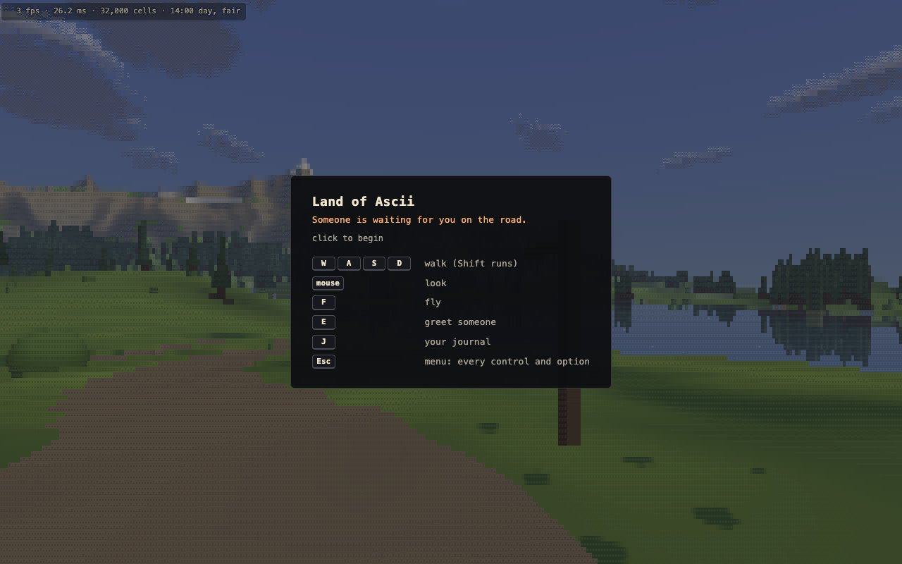

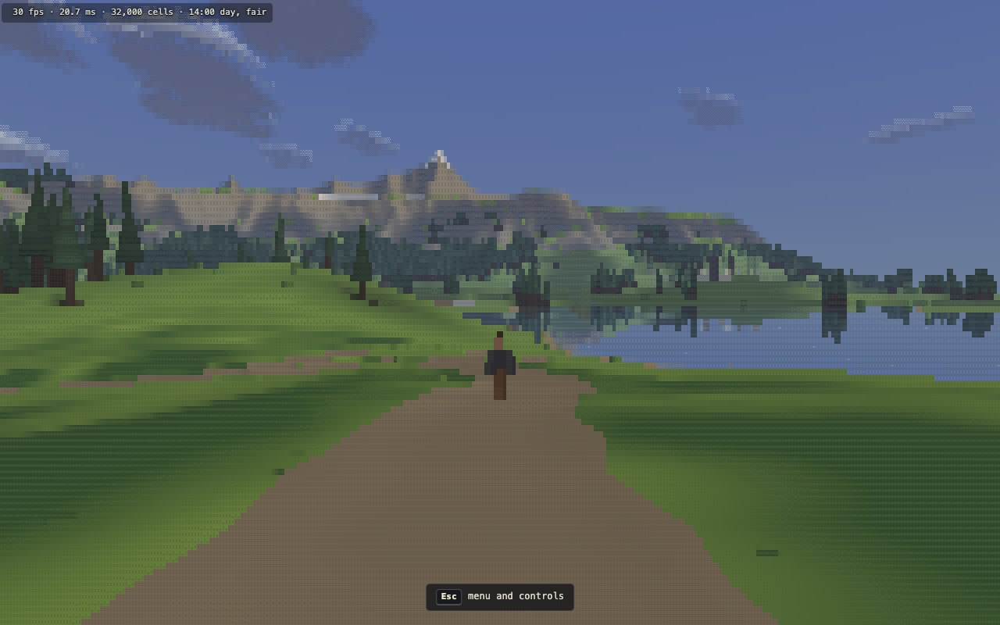

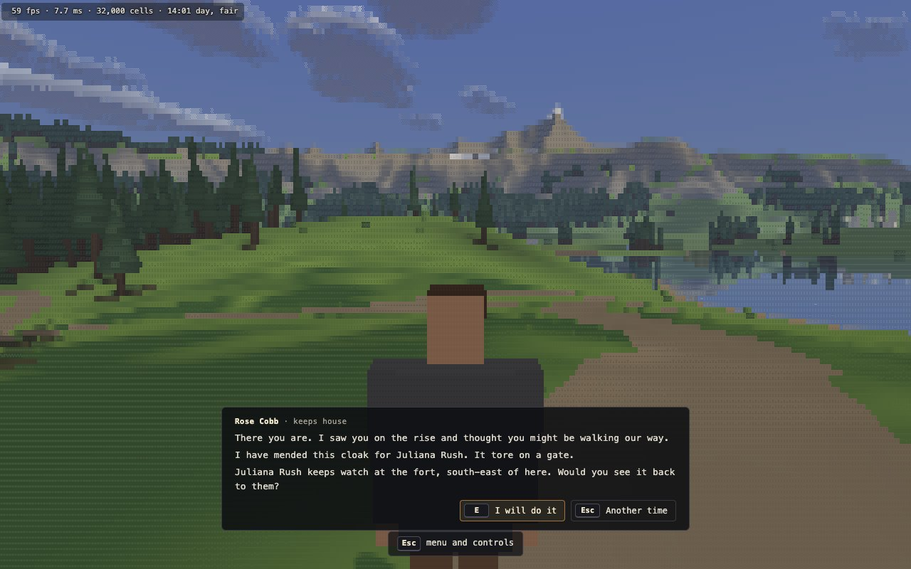

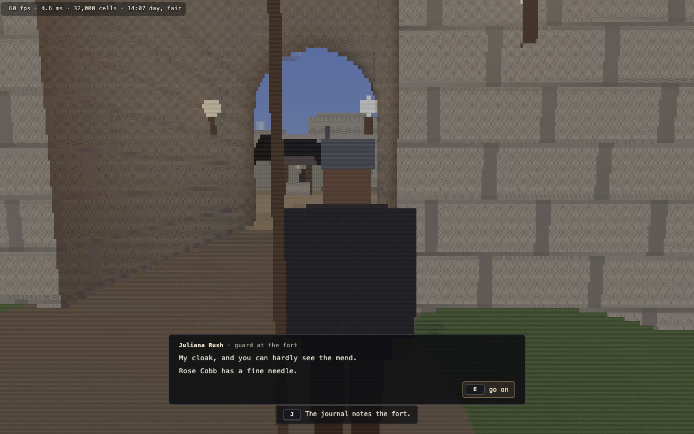

**One complete chain**, from the first greeting to the reward, as the picture tool played it (`tools/pictures5a.mjs`, every line as it was said):

| step | when | where | walking | who | what is said | the journal | then |
|---|---|---|---|---|---|---|---|
| the first meeting | day 0, 14:01 | the spawn's road, 26 m from where you start |  | Rose Cobb, keeps house | There you are. I saw you on the rise and thought you might be walking our way. I have mended this cloak for Juliana Rush. It tore on a gate. Juliana Rush keeps watch at the fort, south-east of here. Would you see it back to them? / Thank you. Mind how you go. | Take the mended cloak to Juliana Rush, who keeps watch at the fort. The fort lies south-east of the rise where you met, by the road. Juliana Rush is usually at the gate of the fort, from two in the afternoon until ten at night. | taken |
| carry: to Juliana Rush | day 0, 14:07 | at the gate of the fort | 1338 m, 5.0 min | Juliana Rush, guard at the fort | My cloak, and you can hardly see the mend. Rose Cobb has a fine needle. / Take this lantern for the road. The nights are long out here, and the lanes are dark. / You have been a help to them. Could you help me as well? Would you take a message for me? Alys Rowe keeps the sheep at Dunholme, north of here. Tell them that the apples are ripe, and there are more than we can pick. And bring back their answer. / Thank you. Mind how you go. |  | done; the lantern given; their own favour taken |
| tell: to Alys Rowe | day 0, 15:11 | with the flock on the pasture south of Dunholme | 727 m, 2.7 min | Alys Rowe, shepherd | So the apples are ripe, and there are more than we can pick. Tell them I will come with two baskets on the next dry morning. Take that back to Juliana Rush. / Since you are going about, perhaps you could help me as well. I have lost a wooden bucket. I had it when I was fetching water on the shore of Still Mere, on the side nearest Elmswick. If you pass that way, would you look for it and bring it back to me? / Thank you. I will not forget it. | Tell Alys Rowe, who keeps the sheep at Dunholme, that the apples are ripe, and there are more than we can pick, and bring the answer back to Juliana Rush. Dunholme lies north of the fort, the nearer of the two villages that way, by the road. Alys Rowe is usually with the flock on the pasture south of Dunholme, from soon after dawn until dusk. Juliana Rush is usually at the gate of the fort, from two in the afternoon until ten at night. | the answer to carry back; their own favour taken |
| back to Juliana Rush | day 0, 15:24 | at the gate of the fort | 727 m, 2.7 min | Juliana Rush, guard at the fort | What did Alys Rowe say? "Tell them I will come with two baskets on the next dry morning." Well. Thank you for bringing it. |  | done |
| find: the bucket | day 0, 15:24 | on the shore of Still Mere, on the side nearest Elmswick | 846 m, 3.1 min |  | picked up where it lay | Find a wooden bucket, which Alys Rowe lost on the shore of Still Mere, on the side nearest Elmswick, and bring it back. Elmswick lies west of Dunholme, by the road. Alys Rowe is usually with the flock on the pasture south of Dunholme, from soon after dawn until dusk. |  |
| back to Alys Rowe | day 0, 15:35 | with the flock on the pasture south of Dunholme | 846 m, 3.1 min | Alys Rowe, shepherd | The bucket. I came back for it and could not think where I had put it down. Thank you kindly. |  | done |
| standing | day 0, 15:35 |  |  |  | known as a friend of the road |  |  |

The chain's three favours take 5.0, 5.4 and 6.2 minutes of walking (the chain's own ways, from each giver's place). After them the land knows you as a friend of the road.

## 2. Discovery

The map starts as plain dark paper and fills in with:
- the land in view (rays over the renderer's 16 m squares, out to 480 m);
- the land round your feet;
- the roads you have walked;
- a wide circle round a viewpoint you stand on.

A site's mark appears once found.

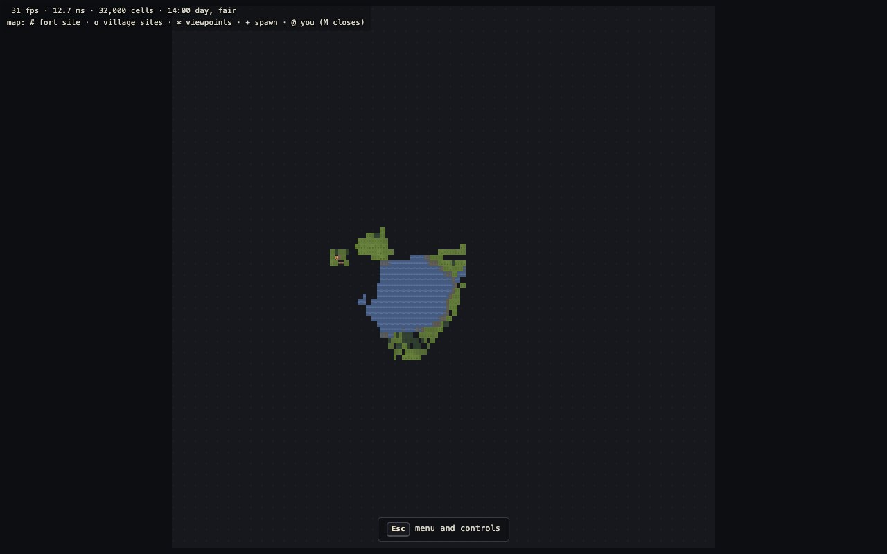

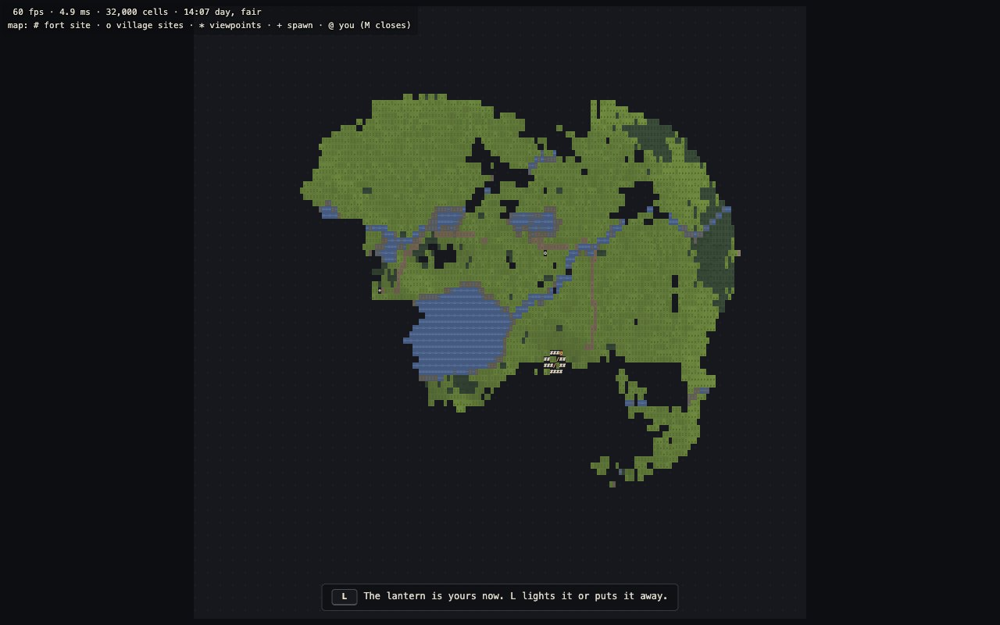

## 3. The journal

The journal is the menu's own panel. Its four pages:
- **Places:** every kind the land has, grouped, with found against total, and how much of the land you have seen.
- **People:** everyone greeted, their role and village, when last seen.
- **Sketches:** the notable views ticked, and every sketch.
- **Favours:** what you are on, what was asked, what is done.

The rail shows your standing and what you carry.

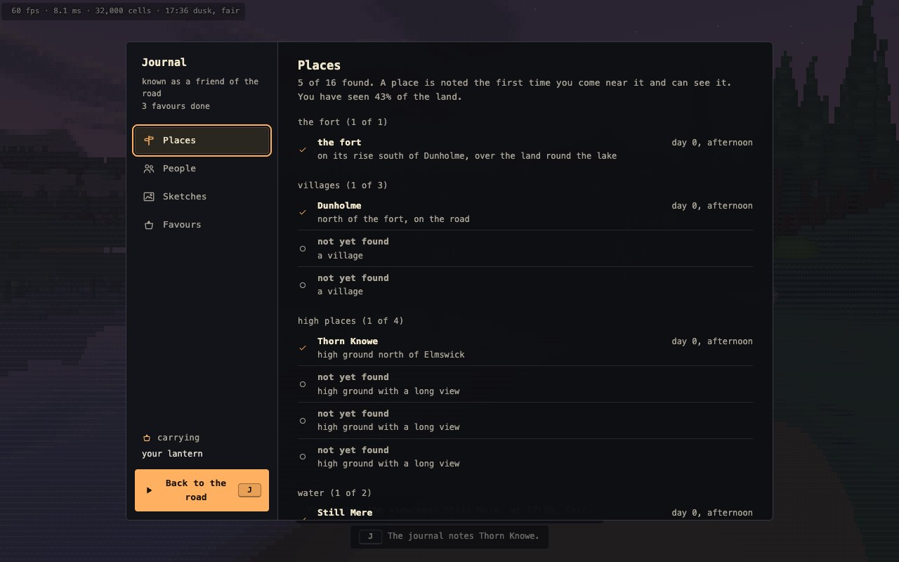

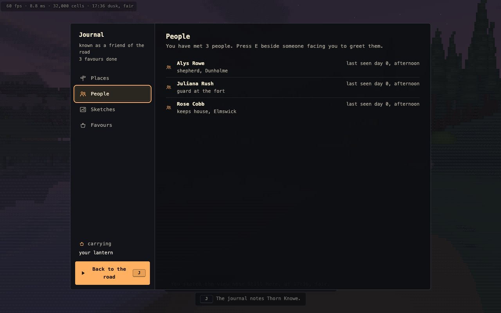

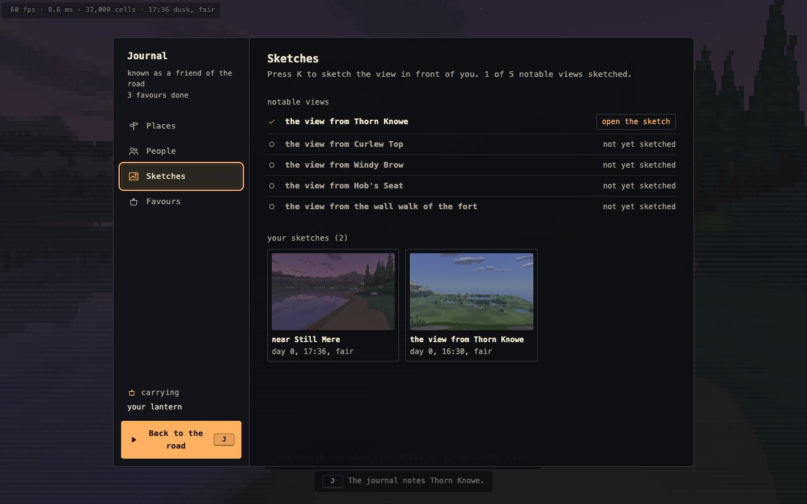

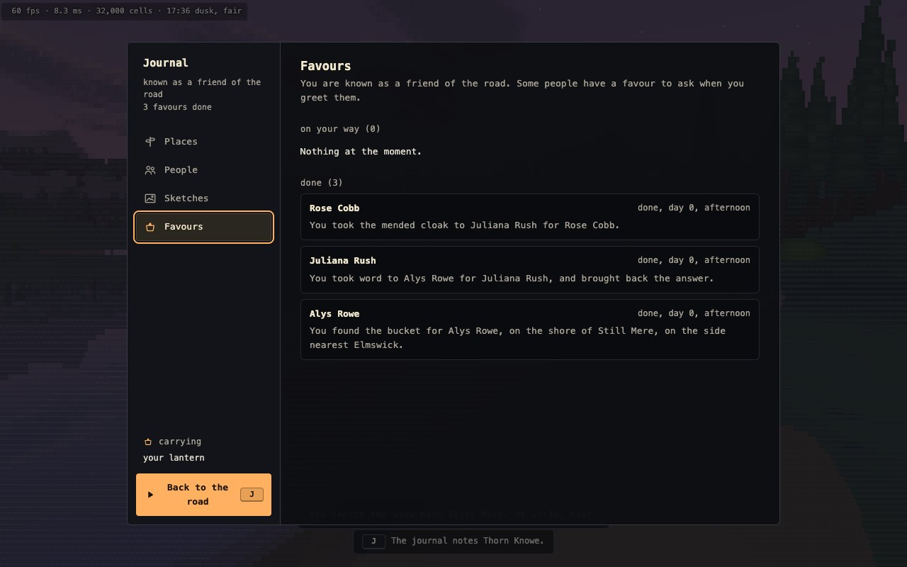

## 4. Sketches

K keeps the frame on screen, cell for cell, with the place, the hour and the weather. Opened, it fills the screen, drawn by the game's own glyph atlas, and pages through with the arrow keys. **Copy as text** gives plain monospace text: the sketch below is the view from a hill (a notable view, ticked in the journal), and its text form is `shots/phase5a/sketch.txt` (320 columns by 100 rows, as drawn at 1280 × 800).

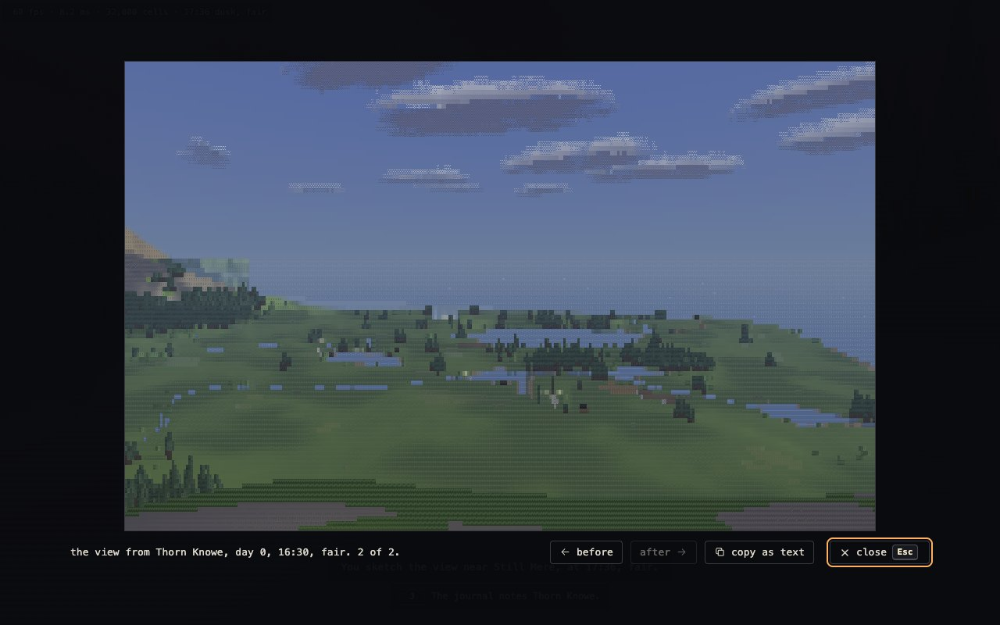

A few of its rows, from the middle (the far edge of the land below the hill, its copses and fields):

```
"+"++++++++II####*"""""""""""""""""+"+;::-:=********II*##III!I!!#I#*####****III&###%&#%+@@"-----------:;+****#
++*+*""""""""+I++++"+"+o""&"%:::::-=--------=----:--=-=-=-=-----;I#+*+===-=-====###%###=====---------------:-:
+***+***+***+***+*==-=o==+-=▓-------------------------:=**+*+*+#+*+*+****+"+****II!III!***======-=-=;*******
+:+=====*+*+*+*+*+*+*+*+*+*+*+*+*+*+*;-&%###;;*+;:---;;+*++++++I+"+"+"+"";#%"""""""""+*;;;*+@@*+&&===-=+*+*+*+
+++++++++*+***+***+***+***********+************+;:---;;+*&+++++I+"+"+"+*+*!!+*+***+=;=;=;=;=;;;=;;;=+*@@======
```

## 5. Favours, the lantern, standing

Favours are chosen once per world from its people. The words never give a marker; they name:
- the person, with their role and village;
- the village, and its direction from the giver's;
- the landmark, and when the person is usually there.

The scripted player in the world check proves the words are enough (section 7). A lost thing lies where the words say, drawn only while you are looking for it:

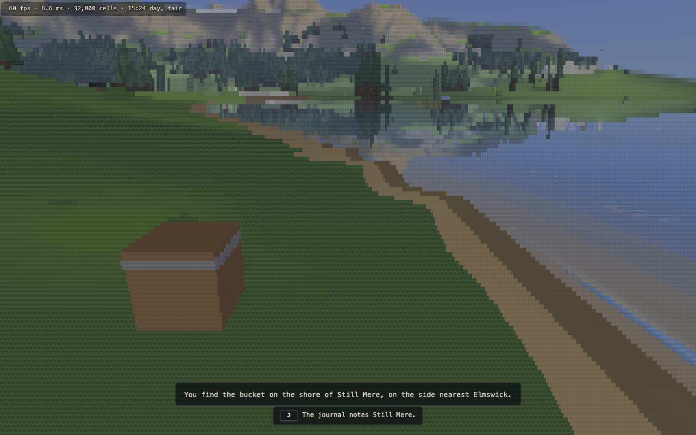

**The lantern** is the first favour's reward. It is the villagers' own lantern and light: a moving point light, mirrored in water, that never starts the shadow sweep. Here is the road to the fort at 22:36, without it and with it:

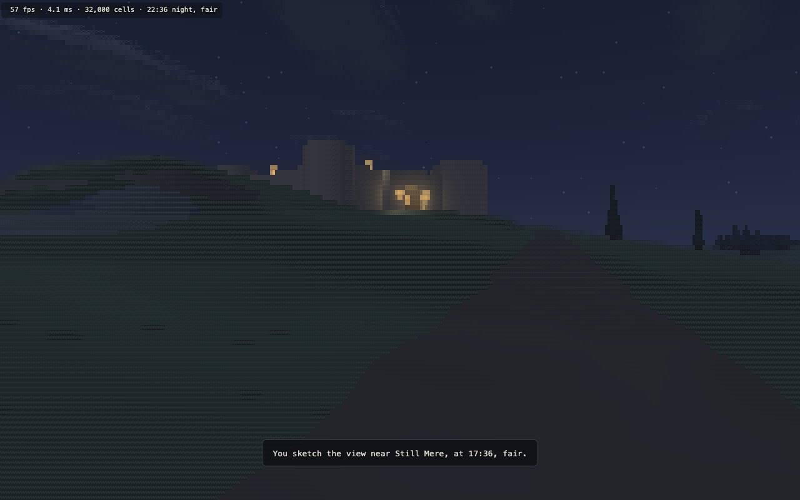

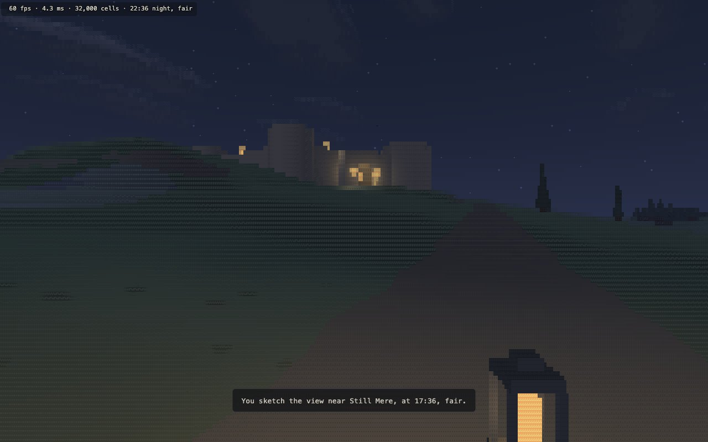

Wading in the lake at night, the lantern lit. Its reflection is there, as a villager's is, but from your own eye it falls below the foot of the view. What shows is its light on the shallow water round you.

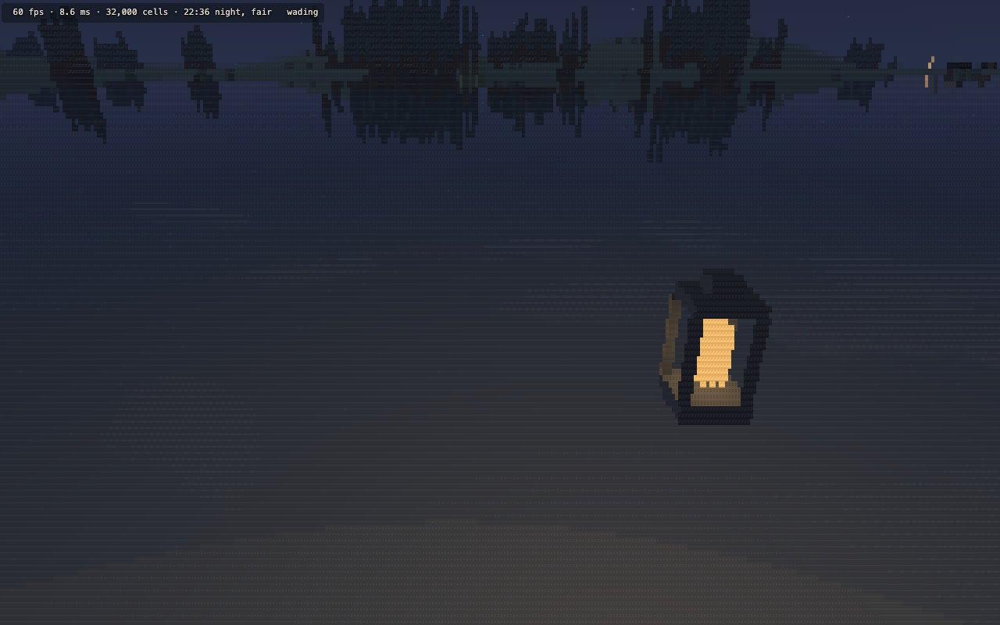

**Standing** grows with each favour done, from a stranger to a wayfarer (1), a friend of the road (3), a known face (5), a trusted hand (8) and a friend of the whole land (12). Every other usual greeting then begins with a hail for it. It unlocks nothing.

## 6. Memory

Progress is kept for each seed in local storage:
- **When it is written:** every change within four seconds; a favour, a sketch or the lantern at once; and what is left when the page is left.
- **When it is read:** on load.

The World section has:
- the save line;
- a backup to copy as text;
- a box to paste one back;
- clear progress, which asks first.

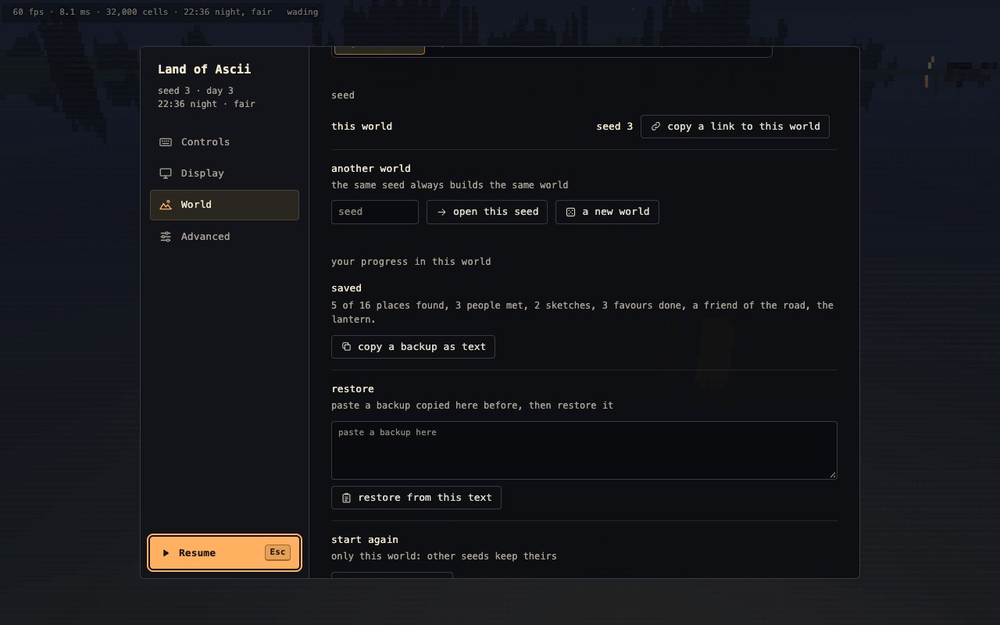

---

## 7. Measurements

### The world check (`tools/world-check.mjs`, seeds 3, 1, 2, 4, 5, and sweeps of 60 seeds)

**Every earlier check still passes on all five seeds**, unchanged:
- the same world twice;
- the sites reached;
- the roads and rivers;
- the sky test (medians 36.7% to 39.0%; views under 15% at most 8.4%);
- far readability;
- the fort, the villages, the people, the animals and the wild ground detail.

The world is phase 4b's: no file of the generator has changed, and the regression set (below) is identical.

**The new check (14, wayfaring)**, on each seed:
- **The people and things:** every favour's giver, the person it is for and the lost thing exist, and can be reached on foot from the giver by the people's ways, which are sampled every half metre by the player's own move rule.
- **Meeting people:** everyone a favour is for, and every giver one comes back to, can be met for at least two hours on each of 28 days.
- **Lost things:** none inside a shape, in water, or on a road or path.
- **Places:** every place the journal lists can be found by walking to it. That means a node reached from the spawn under the walking rules, within the place's distance, with a clear sight of it.
- **The first meeting:** the giver reaches the spawn's road within two game minutes of the start, by a way the move rule can walk, and stands at its edge (1.2 to 2.6 m off its middle), clear of the spawn.
- **The scripted player** (`tools/lib/reader.mjs`) is given only a favour's words. It goes to the villages it can see the stated way (learning each name on arriving), to the landmark of the stated kind, waits for the stated hours, and greets the person of that name, or looks for the lost thing within 25 m of the described place. It plays:
  - one favour of each kind, which must take four to twelve minutes' walking;
  - then every other favour (the words of each must be enough).

| seed | favours (carry, find, tell; following another) | places, findable | first meeting: who, after the start, way out, waits | least time to meet someone in a day | scripted player: carry, find, tell (min) | every favour from its words |
|---|---|---|---|---|---|---|
| 3 | 15 (4, 7, 4; 6) | 16, 16 | Rose Cobb, 1 min, 708 m, 110 min | 7.9 h | 5.0, 8.5, 5.9 | 15 of 15, 5.0 to 10.6 min |
| 1 | 15 (3, 8, 4; 6) | 16, 16 | Beatrix Shaw, 1 min, 1,087 m, 106 min | 4.3 h | 7.9, 6.9, 7.9 | 15 of 15, 6.0 to 9.2 min |
| 2 | 11 (3, 2, 6; 4) | 14, 14 | Rose Pike, 1 min, 498 m, 111 min | 4.5 h | 8.4, 5.1, 5.1 | 11 of 11, 5.1 to 10.6 min |
| 4 | 12 (2, 5, 5; 3) | 16, 16 | Hal Stone, 1 min, 614 m, 112 min | 4.1 h | 5.7, 5.0, 8.1 | 12 of 12, 5.0 to 8.7 min |
| 5 | 13 (4, 5, 4; 4) | 14, 14 | Elin Wood, 1 min, 528 m, 112 min | 4.5 h | 7.9, 6.5, 6.1 | 13 of 13, 4.9 to 9.5 min |

**The sweep of 60 random seeds** (`--way-only --sweep 60`) passes on all 60:
- 749 favours (184 carry, 347 find, 218 tell);
- 862 places, all findable;
- every first meeting a minute after the start;
- the least time anyone a favour concerns can be met in a day: 3.9 h;
- the scripted player did 180 of 180 favours (one of each kind on each seed) in 4.7 to 11.5 minutes, and every favour on every seed (749 of 749) in 4.6 to 11.5 minutes.

**The earlier checks were not swept again on 60 seeds.** A sweep with every check (`--fort-only --sweep 60`, wayfaring included) was started. Its first six seeds passed everything, and it was stopped there, since the whole run takes about four hours. Nothing those checks look at has changed: no file of the generator or the simulation has changed since phase 4b (`src/world` differs only by the new `things.js`), and the regression set is identical cell for cell. Phase 4b's sweep passed on all 60.

**The first sweeps failed, and each fault was fixed where it arose.** Nothing is patched by hand: the favours and their words are drawn again from data.
- **The scripted player's detours,** the words being wrong:
  - **Villages the same way.** "Sedgecombe lies south of Marnhull" sent it to another village south of Marnhull first. The words now say which ("the farther of the two villages that way"), and the plainer destinations are preferred.
  - **Places named by another village.** A lost thing "on the shore, on the side nearest Elmswick" was placed by the direction of the thing, not of Elmswick. The words now give the way to the village they name.
  - **Copses and hills.** "The copse north-west of Fennick" could be one of several. Only the nearest copse or hill in its compass point's wedge from its village is used now, and a bridge only if it is the nearest that way from home.
- **The scripted player's own faults:**
  - it took the fort for a village;
  - it measured directions from a field gate instead of the village's middle;
  - it joined two points 20 m apart through the road network (now it cuts across, as a player would);
  - it greeted the wrong person of a shared name.
- **A first favour under four minutes,** on seeds whose towns all lie near the spawn. When no one is far enough to carry to, the first favour is word to take there and back while the giver waits on the road.
- **A lost thing that could not be reached back:** both ways are now walked before a spot is used.

### The progress check (`tools/progress-check.mjs`, Chromium, Firefox, WebKit)

35 of 35 checks pass in each browser. The scripted session in a fresh profile:
1. the start card and the first meeting;
2. the first favour taken and done, the lantern given, and the next favour taken;
3. a lost thing picked up;
4. two sketches, one of a notable view;
5. places found and people met;
6. the lantern lit.

Then:
- **Loaded again:** the found places, people, favours, lantern, sketches (every cell), seen and walked squares came back byte for byte, with no start card and no first meeting.
- **The backup text** (82,724 characters for two sketches), pasted into the World section in a second fresh profile, restored all of it the same.
- **A damaged backup** is refused and changes nothing.
- **Clear progress** asks first ("keep it" keeps it) and empties only this world.
- **A new seed** starts fresh, and the first world is kept.
- **Storage that throws on every call:** the game runs, the journal works for the session, and the save line says so once.

The record was 981 characters after that session.

### The menu check (`tools/menu-check.mjs`)

56 of 56 checks pass, the 22 new ones at 1024 × 640:
- **An exchange:** two or three lines, two buttons with a pointer that change on hover; clicking "I will do it" takes the favour.
- **K** sketches.
- **The journal:**
  - J opens it with the focus inside, and it holds the clock;
  - the arrow keys move between its four pages;
  - Tab walks every control of each page and stays inside;
  - the focus is outlined;
  - every button shows a pointer, and the tabs change on hover;
  - every page fits with no sideways scrolling, its text at least 11 px;
  - no emoji anywhere.
- **A sketch:** it opens full screen, pages through with the arrow keys and copies as text, one line a row and one character a cell. Escape closes the sketch, and J the journal.
- **The World section:** Tab reaches the save line's four controls, the line says what is kept, it fits at 1024 × 640, and there are no emoji in the menu, the exchange or the start card.

The menu's panel is now up to 680 px tall (620 before), so the Controls, with the three new keys, fit without scrolling at 1280 × 720 and 1440 × 900.

### The regression set (`tools/lookbook.mjs --regress`)

The tools run with progress off (no map fog, nothing carried, no lantern, no first meeting, nothing tracked). Against the phase 4b set, 276 of 276 frames are identical cell for cell: the largest change is 0.00% of a frame. The set was not saved again.

### Identity (`tools/identity.mjs`, unchanged; 0, 1, 3, 5 and 8 workers, the clock frozen)

- **The world:**
  - 112 of 112 views identical in fair weather, and 116 of 116 in rain, served with shared memory and without;
  - the world built byte-identical on every page (`29b2a045`).
- **The building yard:** 61 of 61.

### Frame times (`tools/bench.mjs --scene world --threads 8 --density 3 --built`)

Every fixed camera at its own hour, with the journal closed and progress off, worker plus draw per frame (ms), the median of 240 frames.
- **Browsers:** Chromium and Firefox in visible windows on the 120 Hz display; WebKit headless.
- **Not running:** Ollama or any local model server, any other copy of the game, or the Claude app's browser pane.
- **Background load** before the runs: the window server (about 50%) and the Claude app (20 to 40%).

| browser | weather | 1 | 2 | 3 | 4 | 5 | 6 | 7 | 8 | 9 | 10 | 11 | 12 | 13 | 14 | 15 | 16 | 17 | 18 | 19 | 20 | 21 | 22 | 23 | 24 | 25 | 26 | 27 |
|---|---|---|---|---|---|---|---|---|---|---|---|---|---|---|---|---|---|---|---|---|---|---|---|---|---|---|---|---|
| Chromium | fair | 5.72 | 7.75 | 5 | 4.56 | 5.7 | 4.88 | 6.31 | 3.63 | 3.68 | 4 | 3.94 | 4 | 5.41 | 3.72 | 4.3 | 4.67 | 3.6 | 4.63 | 4.32 | 4.61 | 4.91 | 5.58 | 5.36 | 5.2 | 4.53 | 5.08 | 3.87 |
| Firefox | fair | 7.18 | 10.86 | 6.98 | 5.38 | 7.84 | 6.08 | 7.64 | 4.2 | 4.06 | 4.3 | 4.14 | 4.3 | 7.46 | 4.04 | 5.04 | 5.38 | 4.02 | 5.7 | 4.56 | 5.28 | 6.86 | 7.28 | 7.46 | 7.16 | 5.46 | 6.46 | 4.26 |
| WebKit | fair | 5.96 | 7.84 | 5.22 | 4.94 | 6.02 | 5.38 | 6.56 | 4.18 | 4.38 | 4.3 | 4.52 | 4.42 | 6.28 | 3.92 | 4.68 | 5.82 | 3.88 | 4.9 | 5.16 | 4.94 | 5.16 | 5.8 | 5.74 | 5.38 | 5.08 | 5.38 | 4.14 |
| Chromium | rain | 6.34 | 8.11 | 6.29 | 5.94 | 6.21 | 5.96 | 6.53 | 4.29 | 4.29 | 4.25 | 4.56 | 4.45 | 6.13 | 4.4 | 5.04 | 5.87 | 4.05 | 5.34 | 4.59 | 5.58 | 5.75 | 6.5 | 6.31 | 5.81 | 5.28 | 6.2 | 4.54 |
| Firefox | rain | 7.66 | 11.18 | 6.36 | 6.36 | 8.12 | 7.16 | 7.96 | 4.98 | 4.72 | 4.64 | 5.38 | 5.08 | 7.34 | 5.14 | 6.18 | 6.94 | 4.96 | 6.42 | 5.06 | 6.58 | 6.72 | 7.32 | 7.46 | 6.76 | 6.5 | 7.38 | 5.2 |
| WebKit | rain | 6.8 | 8.42 | 5.2 | 5.14 | 6.22 | 5.98 | 6.5 | 4.36 | 4.36 | 5.14 | 4.78 | 4.58 | 6.12 | 4.44 | 5 | 6.72 | 4.24 | 5.24 | 5.84 | 5.4 | 5.58 | 6.52 | 5.92 | 5.42 | 5.48 | 5.88 | 4.34 |

Camera numbers:
1. spawn
2. lake
3. stand
4. edge
5. river
6. coast
7. vista
8. road to the fort
9. fort from the road
10. gate passage
11. courtyard
12. wall walk
13. village 1's road in
14. its centre
15. village 2's road in
16. its centre
17. village 3's road in
18. its centre
19. inside a house
20. the stone bridge
21. the green at midday
22. the wall walk at night
23. a traveller
24. a pasture with its flock
25. deer at dawn
26. gulls on the coast
27. crows on the wall walk

- **Chromium:** at most 8.11 ms (the lake, in rain), against a limit of 10.
- **Firefox:** at most 11.18 ms (the lake, in rain), against a limit of 12.5.
- **WebKit (headless):** at most 8.42 ms.
- **World build:** 3.5 to 3.6 s in Chromium, 5.0 s in Firefox, 3.5 s in WebKit, as in phase 4b.

**The lantern's cost** (`--lantern`, at 22:36, the same cameras without and with it lit):

| browser | the stone bridge | the green | the wall walk at night |
|---|---|---|---|
| Chromium | 5.00 → 5.24 ms | 5.35 → 5.57 ms | 6.10 → 6.30 ms |
| Firefox | 6.00 → 5.98 ms | 6.34 → 6.44 ms | 6.76 → 6.68 ms |

About 0.2 ms in Chromium; within the run-to-run spread in Firefox. It costs what a villager's lantern costs: only the 16 m squares it reaches pay for it.

### The main thread (`tools/waycost.mjs --built`)

Wayfaring's own cost per frame, measured over 30 s:
- **What it does:** the rays over the squares, the places found, the lost things, who was last seen, what is carried, and saving.
- **The run:** walking a road in real time for 20 s, then walking and turning for 10 s, with the lantern lit, a thing carried, a lost thing waiting, and progress written to storage as in play.

| browser | frames | median | 95% of frames under | slowest frame | frames at 0.2 ms or more | saves in 30 s | a save | the record |
|---|---|---|---|---|---|---|---|---|
| Chromium | 1,803 | 0.015 ms | 0.025 ms | 0.30 ms | 1 | 7 | 0.11 ms | 446 characters |
| Firefox | 3,602 | 0.020 ms | 0.020 ms | 0.30 ms | 3 | 7 | 0.14 ms | 454 characters |
| WebKit | 1,798 | 0.020 ms | 0.040 ms | 1.16 ms | 6 | 7 | 0.20 ms | 454 characters |

- **The median and 95% are under the brief's 0.2 ms** in every browser, by five to ten times.
- **The few frames over it** are the frames that save (every four seconds while new land is seen), and in WebKit one of 1.16 ms.
- **At load,** setting up wayfaring takes once:
  - **The work:** the places, the favours and their ways, the tile heights.
  - **The time:** 294 ms in Chromium, 449 ms in Firefox, 357 ms in WebKit, before the first frame. The tools do not pay it.

### Size

`index.html` is 913 KB (822 KB in phase 4b): wayfaring adds about 91 KB.

### The video (kept out of git, `shots/walks/`)

**`world-first-session.webm`** (10 min, 249 MB, 59.9 frames a second presented, `tools/walk.mjs --only world-first-session`). A first session on seed 3, from the start card, with the clock at real speed:
1. a look up the road;
2. Rose Cobb arrives;
3. the favour is asked and taken, and a look in the journal;
4. the walk to the fort, 1,338 m, reached after six minutes;
5. Juliana Rush takes the cloak, gives the lantern and asks a favour of their own, which is taken;
6. a sketch of the view, and the journal again;
7. a slow look round to the ten minutes.

---

## 8. What looks wrong or thin

1. **The map fills quickly along the roads.** The low land is open, so the first favour's walk to the fort shows a good part of the middle of the land, and the edges of what is seen are 16 m squares with holes behind rises. Seeing was cut from 600 m to 480 m for this; the far range still comes later.
2. **The first meeting is the one place progress touches a person.** Rose Cobb's walk out to the road and back is a function of the clock, but only in a first session. If you have not met Rose Cobb by about four o'clock, they walk home, and the favour is asked wherever you next greet them. The words for a carry do not need the giver again; a tell from the road says the giver waits "until the middle of the afternoon".
3. **Time is real time.** A session starting at 14:00 has its afternoon, but most people go home at dusk. A favour taken late can mean waiting for the next morning: hours, unless you turn the clock on (1 to 4, or the menu). The words say when each person is usually out.
4. **The favours turn on a few roles.**
   - Givers and the people favours are for are:
     - farmers;
     - shepherds;
     - those who mind the green or keep the well;
     - keepers of the chapel;
     - fishers;
     - the guards at the gate.
   - Those who keep house, the carters and the travellers never ask a favour or receive one (but for the first meeting).
   - Farmers come up most often: three favours on seed 3 are for farmers in Fennick's north-west fields, each found by greeting the farmers there in turn.
5. **Two people can share a name** (60 people from 64 given names and 32 bynames). The words always add the role and village, and the scripted player greets whoever is at the landmark by name, so it never fails. A player might greet the wrong one first.
6. **A lost thing is small** (a bucket, a bag, a pair of shears: 0.2 to 0.5 m) and drawn only while you look for it. From 25 m it is a cell or two, and at night, unlit, it is very hard to see. It is picked up within 1.8 m, without a key.
7. **Things in the hand are boxes.** A bundle is a pale box at the foot of the view, a little under true size, swaying with the stride. It does not move when you hand it over; it is simply gone. The cloak, the boots and the bread are all the same bundle.
8. **The lantern's light is small,** by design the villagers' own. It lights the ground and walls within a few metres, so at night the road ahead is still dark beyond it. Lit by day it shows only its flame.
9. **The words of direction are a compass point from a village's middle** ("Corwen lies west of Ashby, by the road"). Where two villages lie the same way they say "the farther of the two villages that way", which is plain but stiff.
10. **The exchange's buttons need the mouse to be free.** While the mouse looks round (captured), the keys work (E, Escape), and clicking does not.
11. **Sketches are kept as deflated cells, about 40 KB each** in local storage, up to 60 a world. A backup with a few sketches is 80 KB or more of text to copy. When the browser's storage is full, a sketch is kept for the session only, and the save line says so.
12. **The journal stops the world, the exchange does not.** Someone walking past can carry on while you read their exchange; walking more than 4.5 m from them ends it (another time).
13. **Places are found by sight over the land, not through trees.** A bridge or a river's head can be "found" from across a forest you cannot see through.

## 9. What the brief asked for and where it is

| Asked | Where |
|---|---|
| The map starts unknown and fills in from what is walked and seen; a viewpoint shows a wide circle; walked roads drawn | `src/game/discovery.js`, `src/app/map.js`; section 2 |
| The journal (J), styled like the menu: places with found against total, people met with role, village and when last seen | `src/app/journal.js`, `src/game/places.js`; section 3 |
| Sketching (K): the view as it is, with the place, hour and weather; full screen with a page-through; notable views ticked; copy as text | `src/app/wayfaring.js` (sketch), `src/app/journal.js` (viewer, `sketchText`); section 4 |
| Favours: givers chosen by seed from fitting roles; two or three lines and a choice; carry, find, tell; destinations in a villager's words, no coordinates or marker; completion on greeting or reaching; the carried thing in the list and the hand; chains | `src/game/favours.js`, `src/game/words.js`, `src/app/talk.js`, `src/world/things.js`, `src/scene/cpu/figures.js`; sections 1, 5 |
| Standing titles that change greetings; the lantern on L, lit as the villagers'; the first meeting on the road; the start card's one line | `src/game/words.js` (`STANDING`, `HAILS`, `START_LINE`), `src/app/wayfaring.js`; sections 1, 5 |
| Saved per seed, written on change, read on load; the save line, copy as text, paste to restore, clear (asked first); a new seed starts fresh | `src/game/progress.js`, `src/app/menu.js` (`progressPart`); section 6 |
| The words as data in one file, ten or more favours of each kind | `src/game/words.js`: 12 carry, 12 find, 12 tell |
| The art bible's words and pages; `docs/design.md` | `docs/art-bible.md` (section 7), `docs/design.md` |
| `window.lab` progress control; the tools with the journal closed and progress cleared | `lab.progress` (`src/main.js`); tools run with progress off |
| World check, progress check, regression, identity, menu check, bench, the main thread's cost, the video | section 7 |
