# Phase 5b: sound and polish

Written 14 Oct 2026. Version 0.5.2. Phase 5b does two things:
- **It gives the land a voice made entirely in code:**
  - the wind and the rain;
  - the water's edges;
  - birds and beasts from where they are drawn;
  - your own footsteps on whatever is underfoot;
  - fires, wells, the chapel's bell and doors.
- **It clears the list of weak spots** left at the end of phases 4b and 5a, and three older ones.

There is no music, no voices, no third-person camera, no front page, no new content and no new favour kinds. The simulation of people and animals and the saved progress are as they were, except for what a fix needed (section 3). The generator's only change is that every fort tower is now furnished.

**Live:** https://land-of-ascii-v3.vercel.app/ (GitHub Pages runs the no-shared-memory fallback: https://oddslice.github.io/land-of-ascii-v3/). The menu says `version 0.5.2`.

| Key or option | Does |
|---|---|
| (first click or key) | starts the sound: the page is silent until then, as browsers require; the start card says so |
| N | the sound on or off, anywhere (a note says which) |
| Esc → Sound | on or off, the volume, and a share for each kind of sound: wind and rain; water; birds and beasts; your footsteps; fires, wells, bells and doors. Kept in this browser, as the Display choices are |
| E (an exchange) | the clock now stands still and the world dims under an exchange; the mouse is free for its buttons; every page waits to be read |
| everything else | as before |

A note on the research file: the brief says `reference/RESEARCH.md` records that Glyphmoor's developer makes all sound at runtime from code, and that the target footage has no music. The file says neither. It never mentions sound or music. This doesn't change the approach, which was the brief's own.

---

## 1. Sound

### How it is made

A small engine on the Web Audio API in `src/sound/`:
- **`palette.js`:** every level, filter, envelope, rate and distance, in one place, as `src/look.js` is for the picture.
- **`synth.js`:** the sounds themselves.
  - Three noise buffers (white, pink, brown) are made once from a seeded generator.
  - Beds loop them through filters: the wind, the rain, the lake, the river, the sea, the fires.
  - Events are a handful of oscillators and noise bursts with short envelopes, which end and drop themselves.
  - There are no audio files: the build is still one `index.html`.
- **`scene.js`:** where sounds come from, found once a world from its own records:
  - the water's edges (lake shores, river reaches with how fast each falls, the sea's edge);
  - the trees at the edges of stands and copses;
  - the torches and hearths, the wells, the chapels, the fort's gate passage.
- **`engine.js`:**
  - The buses: a master volume, the five groups, and a soft limiter at the end.
  - The fort gate passage's echo, a short delay.
  - Placing: every source is panned by its direction from the ear and faded by its distance, with a low-pass closing toward its reach (the far air dulls it as the picture's air fades things).
  - Scheduling: an event falls due by the game's clock, in slots with a chance each, and is played on the audio clock a quarter of a second ahead. Nothing depends on the frame rate.
  - The voice cap: at most 16 sounding, the loudest at the ear kept.
  - Fading: out when the tab is hidden; down under the menu or the journal (to 12%) and under an exchange (to 45%); never stopped dead.
  - When the clock stands still (the menu, the journal, an exchange) events stop, while the beds go on, fainter.

The rules, the palette's roles and a list of never-dos are in the art bible, section 10.

### The palette

| Group | Source | Bed or event | Rule | Level at its reference distance |
|---|---|---|---|---|
| Air | wind | bed | Pink noise, band-pass 320 to 950 Hz opening with the gusts (three slow waves of 0.071, 0.031 and 0.137 Hz, drifting over the land). Louder with the weather's wind and with height (up to +90% 200 m up), with a whistle at 1.9 kHz over ridges from 110 m. 45% in a forest, 12% indoors. | 0.036 + 0.014 per unit of wind |
| | rain | bed | White noise between 900 Hz and 6.5 kHz, by the weather's rain. 55% under a roof, 70% under trees. | 0.11 at full rain |
| | drips | event | Off leaves within 27 m while it rains or the ground is wet: a short falling tone, 1.8 to 3.4 kHz. | 0.05 |
| Water | lake | bed | Brown noise below 520 Hz, lapping on two slow waves (0.27 and 0.43 Hz), from the shore's nearest point within 90 m. | 0.07 at 6 m |
| | river | bed | Pink noise around 1.25 kHz, from the nearest reach within 80 m. Up to 2.2 times as loud where it falls fast, 1.8 times under a bridge. | 0.06 at 5 m |
| | sea | bed | Brown noise below 360 Hz, on a slower and deeper swell (0.083 and 0.051 Hz), from the sea's nearest edge within 220 m. Louder with the weather's swell. | 0.09 at 12 m |
| Life | songbirds | event | Phrases of 3 to 7 whistled notes, 2.6 to 5.8 kHz, each tree its own tune, from the six nearest edge trees within 75 m. Chorus at dawn (4.6 to 7.4) and dusk (18.2 to 20.6); a few by day; none at night; fewer in rain. | 0.035 at 8 m |
| | gulls, crows, small birds | event | Gull cries (950 to 1500 Hz), caws (620 Hz, two or three), chips (3.8 to 6.4 kHz), from the birds as drawn. | 0.03, 0.03, 0.022 |
| | sheep, cattle, hens, ducks | event | A baa (290 Hz, vibrato), a low (105 Hz), clucks (560 Hz), quacks (360 Hz), each from its animal now and then. | 0.035, 0.04, 0.022, 0.028 |
| | dog | event | One bark as you come within 14 m; again only after you have gone 25 m off. | 0.05 at 8 m |
| | deer | event | A rustle and hooves as they break cover. | 0.05 at 10 m |
| Player | footsteps | event | Two a stride (1.3 m walking, 1.7 m running), by the ground underfoot: meadow, road and yard, sand, stone, timber, water (with a splash), snow. 1.7 times as loud running. A creak on stairs and now and then on boards indoors; a thud landing a jump. An echo in the fort's gate passage. | 0.05 |
| Places | torches, hearths | bed and events | A low roar with pops, from the three nearest within 22 m. Torches by night; a hearth while someone is home, embers after. A quarter as loud through a wall. | 0.022 / 0.03 |
| | well | event | The rope's creak and the bucket, when someone stands at the well. | 0.04 at 5 m |
| | chapel bell | event | The hour's count, 2.4 s apart, from 6 to 21, as the clock runs into the hour (not when the time is set). Five inharmonic partials of 523 Hz, 3.2 s decay, heard to 900 m. | 0.09 at 25 m |
| | doors | event | A latch, a clack and a short creak as someone goes in or comes out. | 0.04 at 4 m |

### The sound check (`tools/sound-check.mjs`, Chromium)

A scripted walk past every kind of source on seed 3, each place found from the world's own records, with the sound on. Chromium allows the sound without a click for the tool. **30 of 30 stops heard what they should.** Levels are in dB at the ear: the loudest an event reached, or a bed's level.

| Stop | Heard (what the stop is for in bold) |
|---|---|
| a forest edge at dawn | **birdsong 8× −30 dB**, **meadow steps −26 dB**, wind −27 dB, the sea far off −35 dB |
| the same edge at noon | **birdsong 1× −29 dB** (few by day), wind −28 dB |
| the same edge as rain arrives | **rain bed −22 dB**, **drips 9× −40 dB**, wind −24 dB |
| the lake shore | **lake bed −23 dB**, the river −18 dB, wind −23 dB |
| a river at its fastest reach | **river bed −18 dB**, wind −15 dB (high ground) |
| the sea's edge | **sea bed −21 dB**, wind −21 dB |
| under a bridge | **river −19 dB**, lake −23 dB |
| walking the road (running) | **road steps 28× −21 dB** |
| sand / shallows / snow / a jetty | **sand −26 dB**; **water steps and splashes −26 and −24 dB**; **snow −26 dB**; **timber −26 dB** (and water beside the jetty) |
| the courtyard, and a jump | **yard steps −26 dB**, **a landing −22 dB** |
| the stone bridge | **stone steps 9× −26 dB** |
| a stair to the wall walk | **stone steps 15×**, **creaks 8× −30 dB** |
| the fort gate at night | **torch bed −36 dB** |
| the gate passage | **the echo** (wet −5 dB on the player's sounds), yard steps |
| inside a house, evening | **hearth bed −30 dB**, wind −38 dB indoors |
| 40 m from a chapel as ten strikes | **the bell 18× −25 dB** (both chapels in reach, at their distances) |
| by a well | **the well 7× −28 dB** |
| by a door as someone goes in | **the latch 2× −32 dB** |
| the flock / the herd / the hens / the ducks | **sheep 5× −35**, **cattle 4× −33**, **hens 7× −35**, **ducks 2× −36 dB** |
| the gulls / a crow / the finches | **gulls 5× −39**, **crow 2× −35**, **finches 85× −35 dB** |
| walking up to a dog | **one bark −30 dB** |
| walking up to deer at dawn | **breaking cover −32 dB** |

**Over the whole walk:**
- **The loudest sample:** 0.159 after the limiter and 0.097 before it (1.0 clips). Nothing clips, and the limiter barely works.
- **Voices:** at most 11 sounding at once, against the cap of 16. None was dropped for the cap.
- **The main thread:** the sound's own work per frame, over 22,376 frames, has a median of 0.060 ms; 95% are under 0.090 ms; the slowest is 0.93 ms.
  - 7 frames (0.03%) took 0.5 ms or more. They were the first frame, and moments when many sounds start at once: a stop's first calls, a bell's strikes.
  - A run before the last fixes had one frame of 9 ms, which did not come again. The fixes took the per-frame arrays and objects out of the update (the nearest fires and trees, the people's latch tracking).
- **The report:** `shots/phase5b/sound-check.json`.

---

## 2. The polish list

Each item is fixed where it arises, in the look, the words or the kit. The before frames are version 0.5.1's build, the after frames this one, from the same places (`tools/pictures5b.mjs`, `shots/phase5b/before-*.jpg` and `after-*.jpg`).

Flicker is measured by `tools/flicker.mjs`, in Node at 360 × 112, over 60 frames: glyph flips and colour flips on the cells of the thing in question. The bar is the fort courtyard's turn, 0.177% glyph and 0.097% colour, as measured in phase 3a.

### From phase 4b

**1. Reed beds read as olive mounds from 10 m.**
- **The fix** (`src/scene/cpu/wild.js`, `build.js`, `look.js`):
  - Each 0.6 m sector of a bed is a tuft with its own height and tone, taller tufts paler.
  - At the middle distance each tuft is level across its middle and eased to the next only near its sides, so the top is ragged, tuft by tuft. A first try with peaked tufts doubled the flicker, because a peak sweeps past a cell and back.
  - The reeds' glyphs are now strokes on every rung (`' | ! I`, darker on lit stems). Before, the lit rungs were dots (`. :`), so a bed in the sun read as a lump.

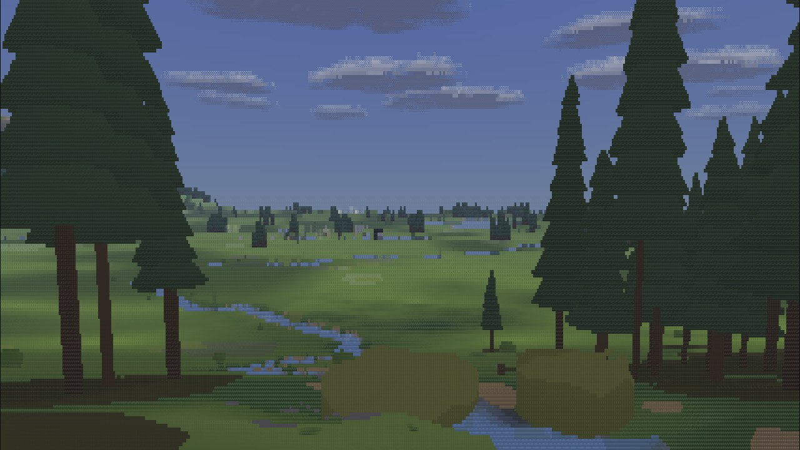

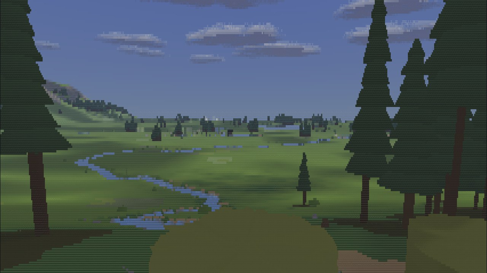
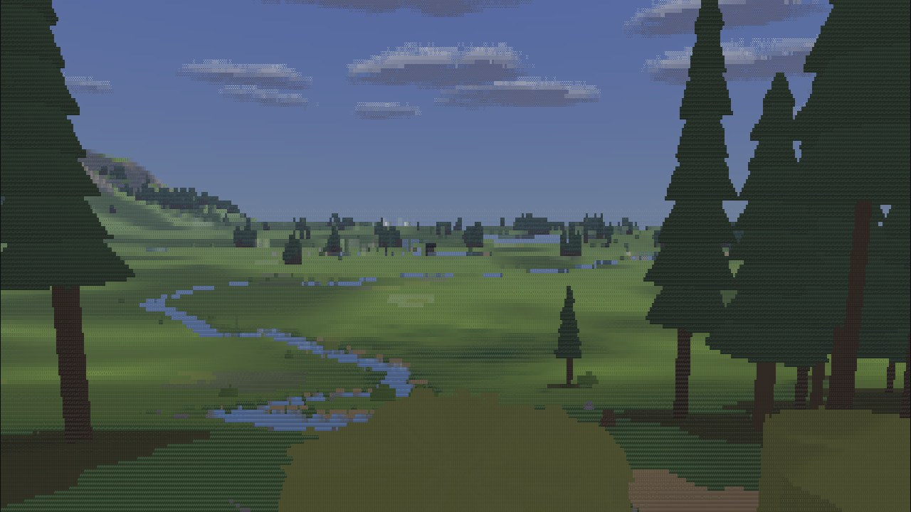

| Flicker on the wild detail's cells | Before (glyph / colour) | After |
|---|---|---|
| walking up to a reed bed from 9 m | 0.445% / 0.332% | **0.377% / 0.335%** |
| walking into a reed bed | 0.399% / 0.307% | **0.315% / 0.304%** |

Glyph flips fell, and colour flips are as before. **Both are still over the bar**, as they were in phase 4b. What is left is where the bed's top meets the water and the sky as the eye moves.

**2. Small birds and crows are too faint to notice.**
- **Far off, a bird's mark is darker** than its shaded colour, and darkens its cell a little (`marks.lift` −0.35, `weight` 0.22).
- **Crows and small birds grow** by up to 80% toward the middle distance (from 10 m to 40 m).
- **A perched one's body is held at two rows and two columns** past the near distance, as thin parts are.
- **Beyond 40 m it is faded less** than other animals.
- The crow on the wall is now a two-row perched shape where it was a dash a row high.

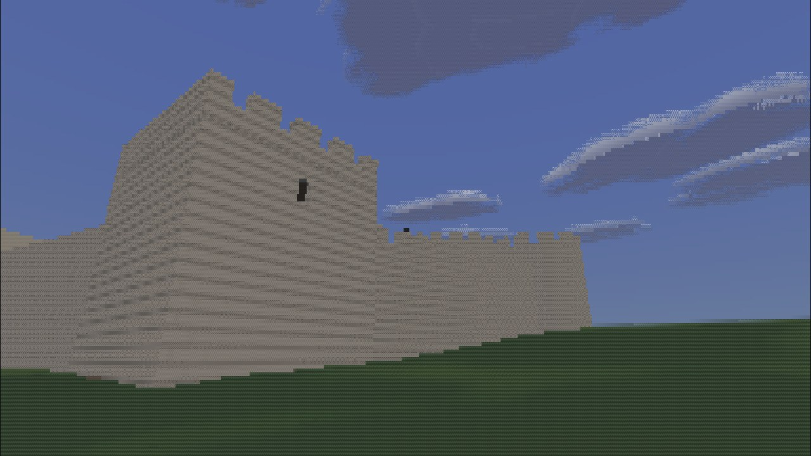
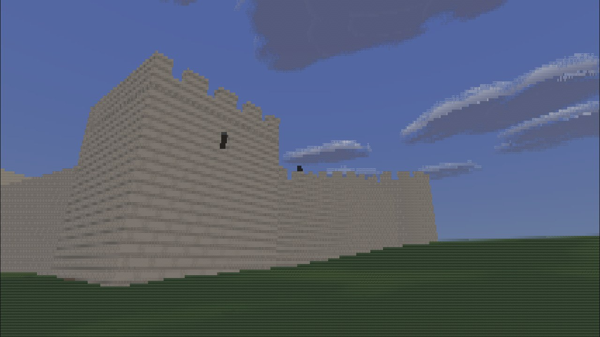

The flock and the crossing flock of small birds flicker exactly as before (0.303% / 0.175% beside the flock; nothing on the small birds).

**3. Deer that come back after you back off slide back facing away.**
- **The game now remembers how far each group ran** (`src/world/animals/state.js`, `memo`).
- **When you back off,** they walk home at a walk (1.1 m/s), facing home, instead of sliding back as your distance falls.
- **If you come near again,** they run again from where they are.
- **The tools pass no memory,** so a tool's frame is as before.

These frames are dawn, walking up to 14 m and then backing off to 34 m. They are taken 9, 25 and 41 seconds after reaching 14 m.
- **Before:** the deer are back in place, facing away, by the first frame.
- **After:** they stay in the trees, then come out walking toward their place.

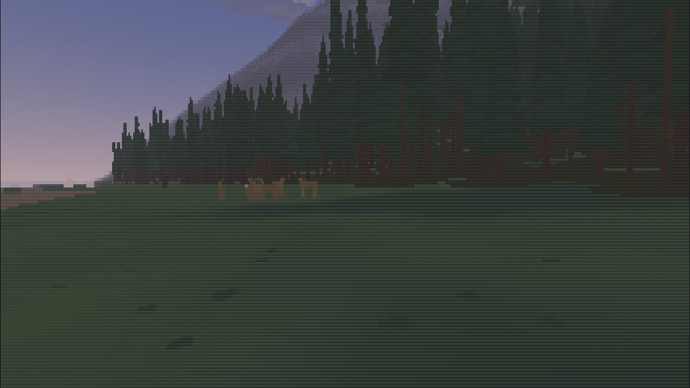

### From phase 5a

**4. Lost things are hard to see at night.**
- **A lost thing stands 3.5 cm proud of the ground, at 1.2 times its size,** and shines (`src/world/things.js`, `LOST`).
- **The shine:** it takes a share of light whatever its facing (0.45 of the way to full), three times a lantern's or torch's glow, and a lighter tone, so it catches the moon and your lantern.
- **It still reads only fairly near on a dim night** (section 5).

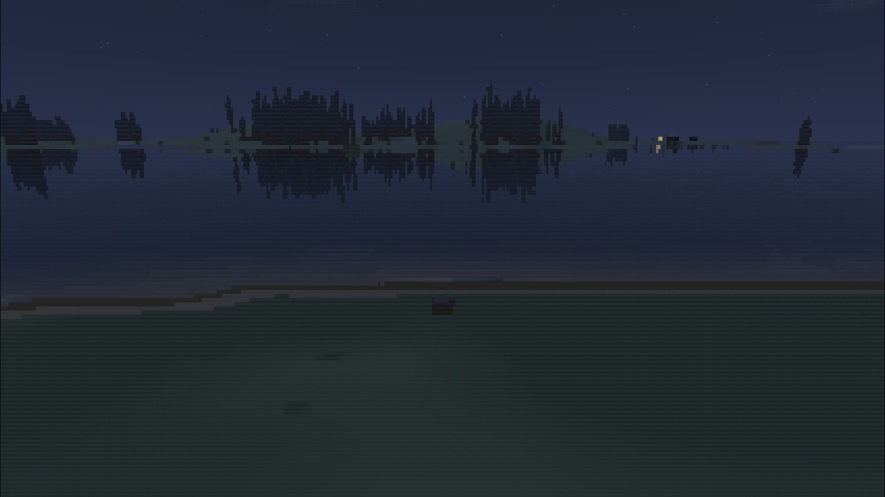

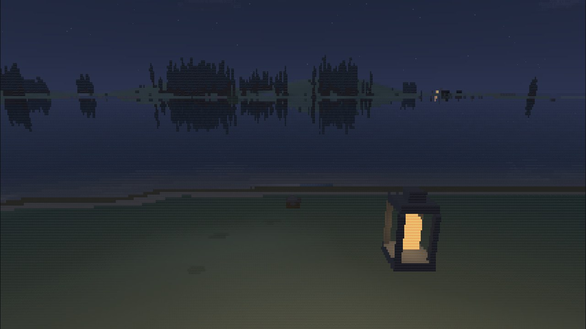
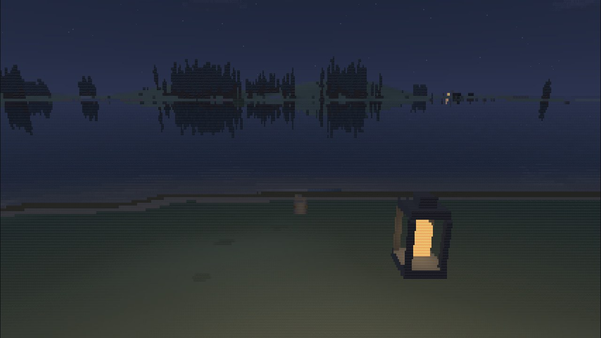

**5. The things in the hand are plain boxes.** They now use the kit's own shapes (ellipsoids and upright cylinders, as well as boxes):
- a draped cloak (a rolled fold over the arm and three pleats hanging, the hem darker): the cloak's favour now draws a cloak, not a bundle;
- a tied cloth bundle with its knot;
- shears with two blades on their grips;
- a cold lantern's iron cage round dark glass;
- jars, buckets, baskets and coils as cylinders, sacks and pouches as ellipsoids.

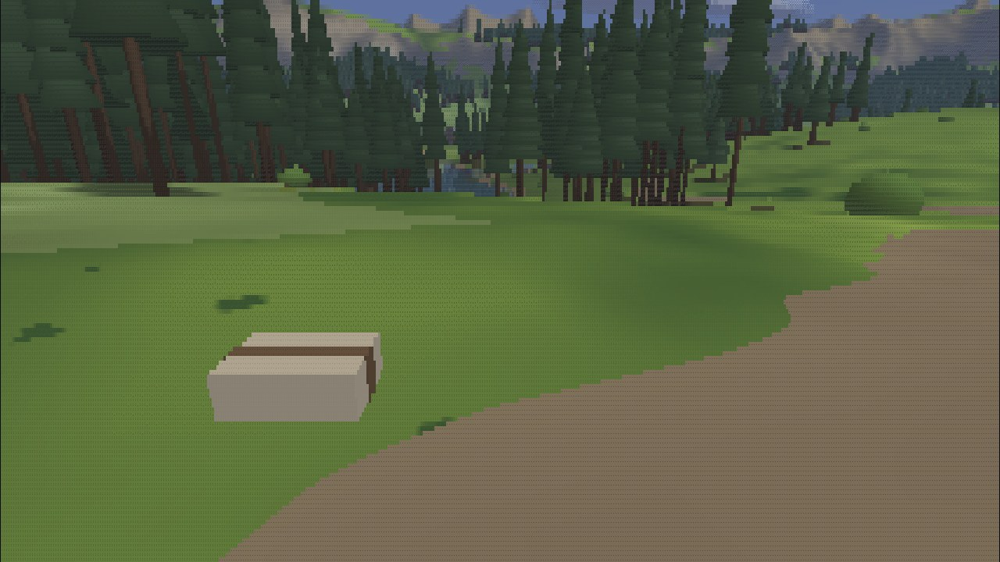
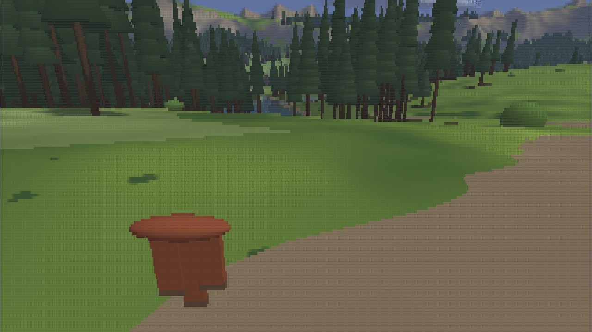

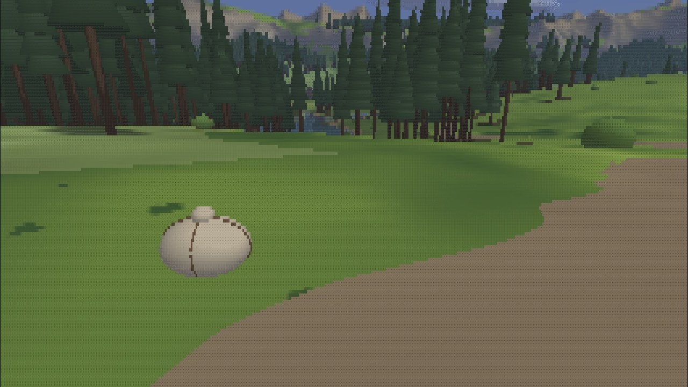
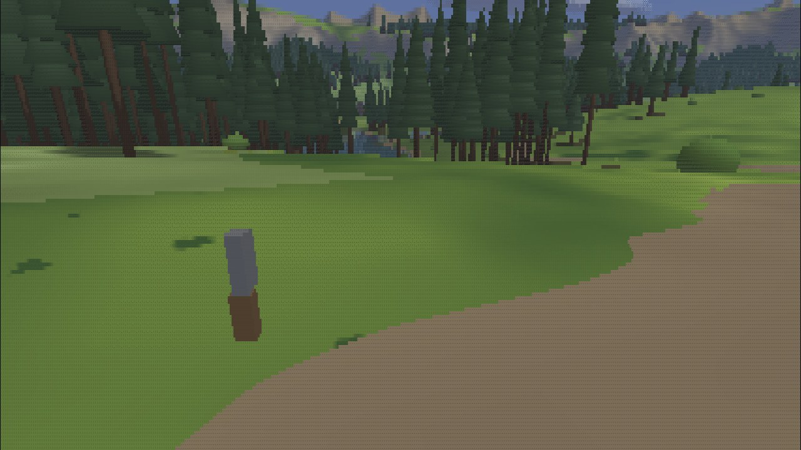

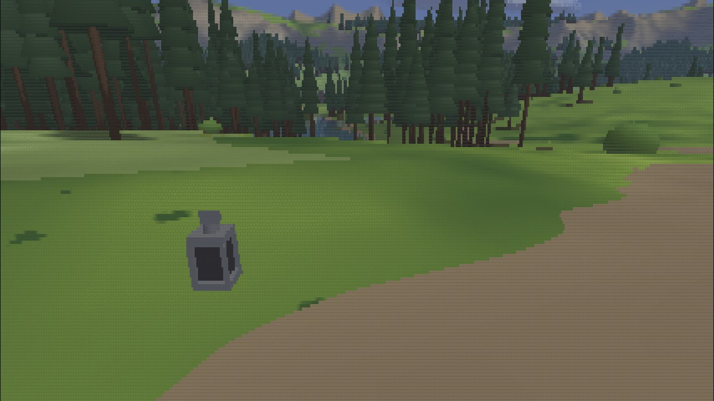

**6. The exchange does not pause the world, and its buttons can't be clicked while the mouse looks round.** While an exchange is open:
- **The clock stands still** (and so do the people), and the world dims under it.
- **The mouse is let go,** so the buttons can be clicked, and a click on the picture doesn't take it back.
- **Every page waits to be read** (there are no timers).
- **E or a button on the last page** closes it and takes the mouse back for looking. Escape leaves the mouse free.
- **Walking away no longer ends it,** as you can't walk.
- **The sound fades to 45%** but goes on.

The menu check tests all of this (section 4).

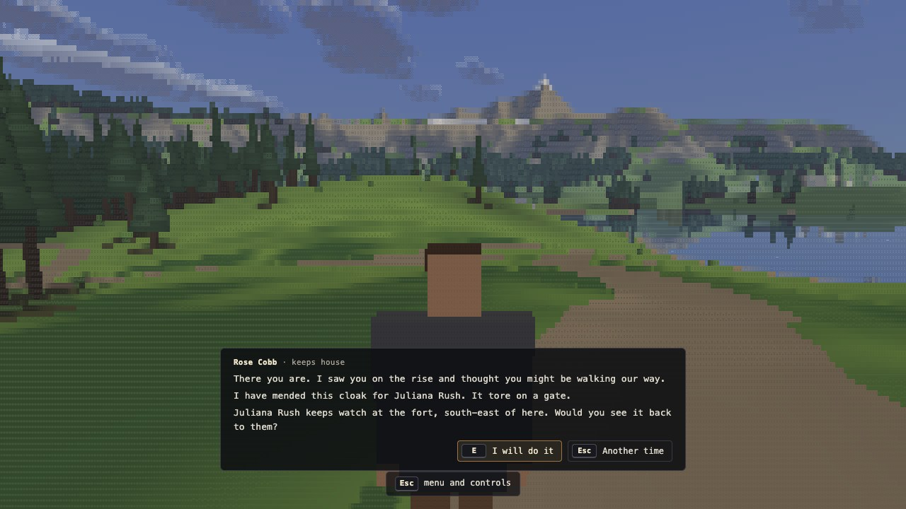

**7. "the farther of the two villages that way" is stiff.** The words now name the other village:
- "Dunholme lies north of the fort, this side of Elmswick, by the road."
- "Elmswick lies north of Fennick, this side of Dunholme, by the road."
- the forms "beyond Dunholme" and "between Ashby and Corwen" (`src/game/favours.js`, `whichOf`).

The scripted player reads them (`tools/lib/reader.mjs`) and still does every favour from its words alone: 749 of 749 on 60 seeds (section 4).

**8. Places can be found across a forest.**
- **What blocks sight now:** the trees' crowns (each a cone from where the crown starts to its tip) and the buildings, on a 2 m grid made once a world (`src/game/sight.js`). Before, sight to a place was tested over the land only.
- **How it's tested:** the line is checked every 2 m. A place's own shapes don't hide it (the fort's within 12 m of its keep, a bridge's within 5 m).
- **How much it blocks:** on seed 3, 39% of eye-level lines 150 m long now pass a crown or a building.
- **Every place is still found by walking to it:** 76 of 76 on the five seeds, and 862 of 862 on 60 (section 4).

**9. The map fills too fast along open roads.**
- **Forests and villages stand in the way** at their crowns' and roofs' height.
- **Past 160 m,** a square counts only if it stands out: a slope or a hill rising 12 m over its neighbours, water, or buildings (`src/game/discovery.js`).
- **Walking the whole road from the spawn to the fort** now shows 8.4% of the land, where it showed 20.7%. The other roads on seeds 3, 1 and 2 show 2.8% to 15.9%, where they showed 8.4% to 26.7%.

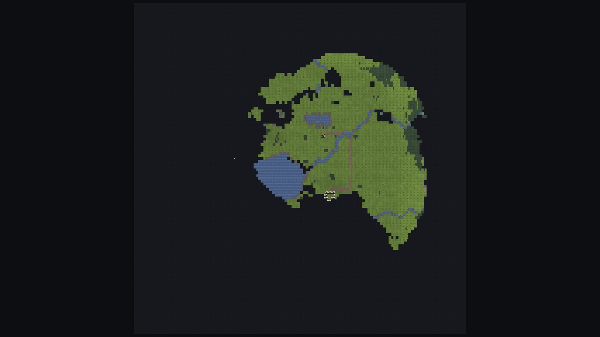
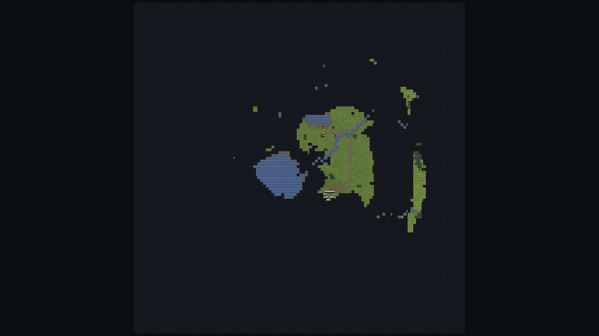

### Older

**10. The fort's vertical stone joints fade by 15 m.**
- **Near, they're drawn crisp,** as before.
- **From about 10 m,** they're drawn by how much of a cell they cover (phase 3b's coverage). Each is held 3.5 cells wide and darkened by its true share, on walls seen within about 45° of square on.
- **They now last to about 25 m,** fading out by 35 m.
- **What I tried first:** coverage with no limits, then a 2.5-cell hold. Both blinked: on the wall walk the joints sweep along the walls, and walking toward a wall carries a narrow joint past a cell within two frames. So the joints are faint, and stronger ones blink. At full darkness, held 4 cells wide, the road to the gate flickers at 0.221%.

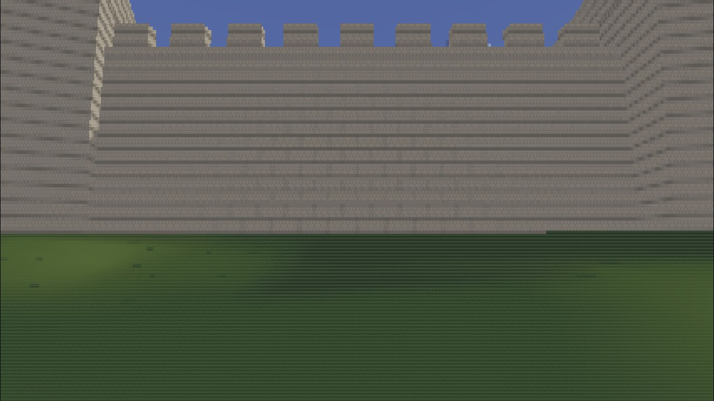

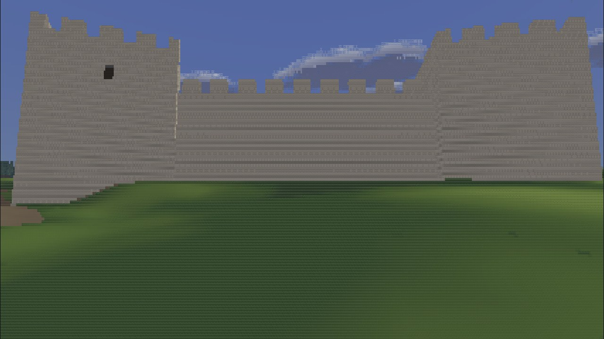
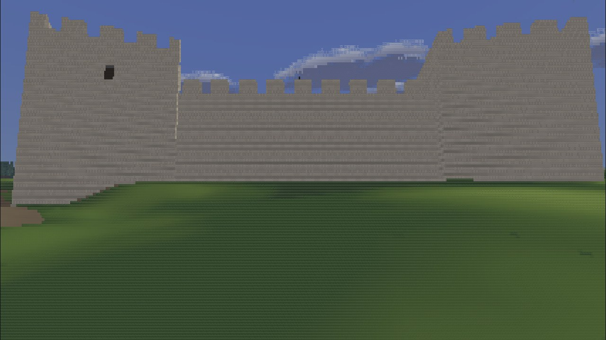

| Flicker on the buildings' cells (glyph / colour) | Without the new joints | With them |
|---|---|---|
| walking the road to the gate | 0.132% / 0.041% | **0.182% / 0.043%** |
| walking the wall walk | 0.326% / 0.215% | 0.345% / 0.216% |
| walking toward the wall from 25 m (new run) | 0.085% / 0.029% | 0.123% / 0.029% |
| walking along the wall 20 m out (new run) | 0.406% / 0.227% | 0.534% / 0.228% |
| turning in the courtyard (the bar) | 0.181% / 0.101% | 0.183% / 0.101% |

The courtyard was 0.177% / 0.097% in 0.5.1. Without the joints it's now 0.181% / 0.101%: the furnished towers' tables and shelves show through their doors. **The road to the gate is 0.005% over the bar.** Walking along the wall 20 m out was already over it without the joints.

**11. The keep's hall and the tower rooms are bare.**
- **Every tower is now furnished.** A square tower has a table on trestles and a shelf, clear of the way to its stair (before, only the first square tower). A round tower has a table toward its back, clear of its spiral.
- **The hall** gets a bench either side of its table. It already had a hearth, a table, a bed, a shelf and the guards' bunks.
- **What I tried and took out:**
  - A torch in each tower room, and a hall-sized hearth (wider and taller). Both changed a few cells in far views that can't see the fort, a side effect I couldn't trace (section 5). The tower rooms are as dark by night as before.
  - A first version put the new shapes among the old ones, which moved other shapes' seeds. They are now added after everything else.
- **No route is blocked:** the world check's walkers reach every place and come out again, and the guards' routes all walk (section 4).

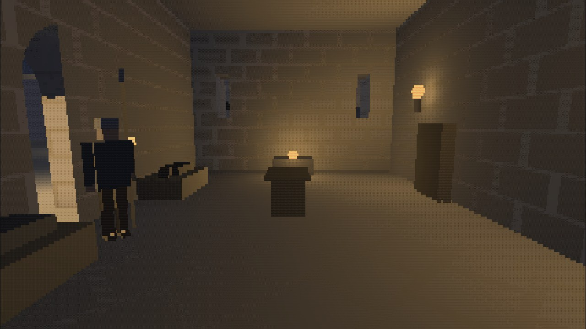
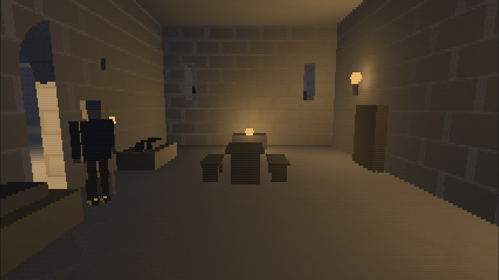
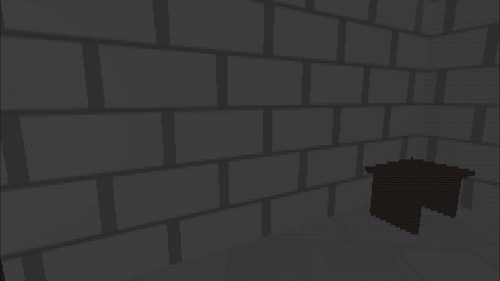

**12. Walking a street past people flickers at 0.269% (phase 4a).** These are fixed at the source (`src/world/people/figure.js`):
- **The neck.** The head now reaches down into the body. A 3 cm gap under the chin let the wall behind show through a row for a frame at a time, which the cells' frame by frame record showed.
- **Hair and hoods** come to 4 mm short of the face (3 cm and 1 cm before), so no strip of skin under a column blinks beside it.
- **An arm hanging still is one sleeve,** with no step of a few millimetres at the elbow.

| Flicker on the still figures' cells (glyph / colour) | Before | After |
|---|---|---|
| the street at 11:30, past 5 people (phase 4a's walk) | 0.298% / 0.158% | **0.178% / 0.142%** |
| the street at 15:30, past 7 people (the busiest, which the tool now picks) | 0.756% / 0.526% | 0.741% / 0.512% |
| turning on the green at midday | 0.127% / 0.066% | 0.125% / 0.065% |

- **At 11:30 the glyph flips are on the bar (0.001% over); the colour flips are still over** (0.142% against 0.097%).
- **At 15:30 the walk passes nearer people.** Most of what is left there is their outlines sweeping more than a column a frame past a wall and a door. The tool counts that as a flip whenever the cell's glyph happens to match two frames apart. I couldn't bring it down further at the source.
- **The figure in 4a's report** (0.269%) was measured at 11:30. The tool now finds 15:30 busier, so both are given.

---

## 3. What changed in the simulation and the saved progress

- **Deer** (`src/world/animals/state.js`): the game keeps how far each deer group ran, as a small memory in the app (`src/app/animals.js`).
  - When you back off, they walk home at a walk, facing home, instead of sliding back as your distance falls.
  - The tools pass no memory, and a frozen clock forgets it, so a tool's frame is a pure function of the clock as before.
  - Nothing else in the people's or animals' days changed: their positions are identical to 0.5.1's at every hour checked, in Node and in the browser.
- **The fort** (`src/world/gen/fort.js`): every tower is furnished (it was the first square tower only). The world's hash for seed 3 moves from `29b2a045` to `818f3d8e` for that alone.
  - The new shapes are added after all the others (`late`, `src/world/kit.js`), so no other shape's index, and so no unseeded shape's seed, moves.
- **The saved progress** is unchanged in form.
  - The discovery change alters which squares count as seen from now on. Squares already seen stay seen.
  - A cloak's favour now draws a cloak, which isn't saved.

---

## 4. Measurements

### The world check (`tools/world-check.mjs`)

**Five seeds (3, 1, 2, 4, 5): all pass**, with every earlier check:
- the same world twice;
- the sites reached, the roads, the rivers, the trees;
- the sky test (medians 36.7% to 39.0%; views under 15% at most 8.4%);
- far readability;
- the fort, the villages, the people, the animals, the wild ground detail and wayfaring.

Each seed's world hash moves from phase 4b's, because the fort's description now furnishes every tower. Everything else in the world is identical.

Wayfaring on the five seeds:
- 66 favours;
- every place findable: 76 of 76;
- the scripted player did one of each kind on each seed (15 of 15) in 5.0 to 8.5 minutes;
- every favour done from its words alone: 66 of 66, in 4.9 to 10.6 minutes.

**The discovery change, checked first.** Places are now hidden by trees and buildings, and the words name the other village. With those two changes in, the wayfaring sweep of 60 random seeds (`--way-only --sweep 60`) passes on all 60:
- 749 favours;
- every place findable by walking to it: 862 of 862;
- the scripted player 180 of 180, in 4.7 to 11.5 minutes;
- every favour from its words alone: 749 of 749, in 4.6 to 11.5 minutes;
- the least time anyone a favour concerns can be met in a day: 3.86 h.

**The sweep with every check** (`--fort-only --sweep 60`), with every change in: **60 of 60.**
- **The people:** 3,594, with 89,068 routes walked and none failing; a million positions with nothing out of place; no hour without a guard.
- **The animals:** 14,360, with six million positions and nothing out of place; the walker approached 1,565 of 1,565.
- **The villages:** 240 roads, 77 bridges and 754 footpaths walked, with none blocked.
- **The fort's walkers:** 2,788 of 2,788 places reached and left, with no walk through a wall. This was run with every tower furnished.

### The save check (`tools/progress-check.mjs`)

35 of 35 checks pass in Chromium, Firefox and WebKit, as in phase 5a. The exchange's pages now wait to be read, and the save check walks them as before.

### The menu check (`tools/menu-check.mjs`)

**69 of 69 checks pass.** The 13 new ones are at 1024 × 640.
- **The sections:**
  - the arrow keys move through five sections, Sound among them;
  - Tab reaches every Sound control;
  - the section fits with no sideways scrolling.
- **An exchange:**
  - while it is open the clock stands still, the world dims (the veil fully up) and the mouse is free;
  - a click on the picture doesn't take the mouse;
  - clicking "I will do it" takes the favour;
  - its last line waits to be read;
  - E closes it: the clock runs again and the world comes back.
- **The sound:**
  - the page starts silent and the start card says sound starts with the first click;
  - the first click starts it;
  - the Sound section has its switch and six sliders;
  - N turns it off and says so;
  - after a reload the volume and mute are back;
  - N turns it on again.

### Identity (`tools/identity.mjs`, unchanged; 0, 1, 3, 5 and 8 workers, the clock frozen)

- **The world:** 112 of 112 views identical in fair weather and 116 of 116 in rain.
- **The building yard:** 61 of 61.
  - Its first run, made while the 60-seed sweep was loading the machine, found one view (the deer, near) different with no workers. Run three more times on a quiet machine, it was identical each time.
  - Rendered directly with 0 and 8 workers, the same view is identical cell for cell.

### Flicker (`tools/flicker.mjs`)

The figures for the reed beds, the street walk and the fort (its courtyard the bar) are in section 2, items 1, 10 and 12, each before and after. In short:

| Run (glyph / colour flips on its own cells) | Before | After | The bar |
|---|---|---|---|
| walking up to a reed bed | 0.445% / 0.332% | 0.377% / 0.335% | 0.177% / 0.097% |
| walking into a reed bed | 0.399% / 0.307% | 0.315% / 0.304% | |
| the street at 11:30 (phase 4a's walk) | 0.298% / 0.158% | 0.178% / 0.142% | |
| the street at 15:30 (the tool's busiest) | 0.756% / 0.526% | 0.741% / 0.512% | |
| the fort courtyard, turning | 0.177% / 0.097% | 0.183% / 0.101% | |
| the road to the fort gate | 0.132% / 0.041% | 0.182% / 0.043% | |

**Over the bar:** the reed beds (as in phase 4b), the street at 15:30, the street's colour flips at 11:30, the courtyard by 0.006%, and the road to the gate by 0.005%.

### The regression set (`tools/lookbook.mjs --regress`)

Against phase 4b's set, **the Look Lab and the stress scene are identical**: 135 of 276 frames identical cell for cell in all, the largest change 14.13% of a frame (the building yard's gate, near). Every changed frame was examined with `tools/regress-why.mjs`. It renders the same camera on 0.5.1's build and this one, and marks and enlarges every changed cell (`shots/phase5b/why-world.png`, `why-yard.png`).

**The views that can see a changed thing:**
- **The fort and its walls** (world 8 to 12, 22, 27; yard 1 to 5, 8, 12, 14):
  - the head joints from 10 to 25 m;
  - the towers' furniture through their doors;
  - the crows on the walls.
- **People** (world 13 to 18, 21, 23; yard 30, 31, 34, 36): their necks, hair and sleeves.
- **Reed beds** (world 2, 5, 7, 20; yard 38, 39, the pond in yard 46 to 53): their tufts and stroke glyphs, far ones by a level or two of ink.
- **Birds** (world 2, 8, 24 to 26; yard 41, 42, 50 to 53): darker far marks, bigger crows and small birds.

**The views that cannot see the fort, people, reeds or birds** report no change at all. To check, I reverted the reeds, the birds and the furniture in turn:
- with the reeds reverted, the river valley and the vista lose their changes;
- with all three reverted, the spawn view, the river valley and the vista are identical at day, dusk and night.

**The one exception: the spawn view.** It changes by a few cells (4 at day, 2 to 4 at dusk and night) when the towers' furniture is added in the fort, 600 m away and out of view.
- I traced it as far as this: without the furniture there is no change.
- The kit is otherwise identical index for index (the new shapes are added after the rest).
- A Node render of the view is identical.
- So the path is in the browser's rendering, and I couldn't find it.
- A torch in each tower room, tried first, made a few more such cells in the river valley and the vista. That is why it was taken out.

**The set was then saved again deliberately** with every fix in (`--save`): 276 frames. Checked again, all 276 are identical cell for cell.

### Frame times (`tools/bench.mjs --scene world --threads 8 --density 3 --built`, sound off and on)

Every fixed camera at its own hour, density 3, 8 workers, 240 frames each: worker plus draw per frame, the median over the cameras and the slowest camera.
- **Chromium and Firefox** ran in visible windows on the 120 Hz display; **WebKit** headless.
- **Not running:** no model server, no other copy of the game, no Claude browser pane.
- **Background load:** the Claude app only.

| Browser | Weather | Sound | Median camera | Slowest camera (ms, camera) | The sound's main thread: median / slowest (ms) |
|---|---|---|---|---|---|
| Chromium | fair | off | 4.58 | 7.74 (2, the lake shore) | - |
| Chromium | fair | on | 4.76 | 7.88 (2) | 0.03 / 0.09 |
| Chromium | rain | off | 5.36 | 8.42 (2) | - |
| Chromium | rain | on | 5.73 | 8.74 (2) | 0.04 / 0.12 |
| Firefox | fair | off | 5.88 | 10.86 (2) | - |
| Firefox | fair | on | 6.60 | 11.42 (2) | 0.04 / 0.70 |
| Firefox | rain | off | 6.52 | 10.98 (2) | - |
| Firefox | rain | on | 6.80 | 11.50 (2) | 0.04 / 0.52 |
| WebKit | fair | off | 5.66 | 9.18 (2) | - |
| WebKit | fair | on | 6.02 | 9.66 (2) | 0.04 / 0.14 |
| WebKit | rain | off | 5.92 | 10.50 (2) | - |
| WebKit | rain | on | 6.38 | 11.16 (2) | 0.04 / 0.14 |

- **Chromium is at most 8.74 ms** (limit 10) and **Firefox at most 11.50 ms** (limit 12.5), sound on or off.
- **What the sound costs:**
  - On the main thread it is about 0.04 ms a frame while standing still.
  - The frame time rises by 0.2 to 0.7 ms at the median camera with the sound on, because the browser renders the audio on a thread of its own, beside the workers.
- **Two runs were done twice:**
  - Chromium in rain with the sound off first gave 12.18 ms on the lake shore (a stall): 8.42 ms on the second run, which is the one in the table.
  - WebKit in fair weather with the sound off gave 10.18 ms, then 9.18 ms.
- **WebKit is slower than in phase 5a** on the lake shore (7.84 ms then). The reed beds there are the likeliest cost. It has no limit.
- **Chromium and Firefox in fair weather are as in 5a,** 7.74 and 10.86 ms against 7.75 and 10.86.

### The main thread

**The sound** (`tools/sound-check.mjs`, Chromium, the whole scripted walk with events playing):
- **Per frame:** a median of 0.060 ms; 95% of frames under 0.090 ms; the slowest 0.93 ms.
- **Over 0.5 ms:** 7 frames of 22,376 (0.03%), where many sounds start together.
- **Standing still in the benchmark:** 0.03 to 0.04 ms.
- **The brief's 0.5 ms** holds for all but those 7 frames.

**Wayfaring** (`tools/waycost.mjs`, as in phase 5a, with discovery's new rules). The control is a dummy task of the same size, timed in the same frames.

| Browser | Median | 95% under | Slowest | Frames at 0.2 ms or more | The control: frames at 0.2 ms or more |
|---|---|---|---|---|---|
| Chromium | 0.015 ms | 0.020 ms | 0.105 ms | 0 | 0 |
| Firefox | 0.020 ms | 0.040 ms | 2.76 ms | 3 | 3 |
| WebKit | 0.020 ms | 0.060 ms | 1.22 ms | 6 | 2 |

The control stalls as often in Firefox. In WebKit, wayfaring had 4 frames more than the control: those are its own.

### Size

`index.html` is 955 KB (914 KB in 0.5.1). The sound engine and the polish add about 41 KB, nearly all of it sound.

### The video (kept out of git, `shots/walks/`)

**`world-5b-dawn-to-dusk-with-sound.webm`**: 6 minutes (359.9 s), 257 MB, 1280 × 720, VP9 with Opus sound (`tools/walk-sound.mjs`).
- **How it was recorded:** in the page itself, the canvas and the sound's own output in one stream, since a browser tool's video carries no sound.
- **The walk:**
  1. it starts on village 2's green at dawn (5:36), and pauses there to listen;
  2. it takes the people's own way over the stone bridge;
  3. it turns along the lake shore where the way passes nearest;
  4. it goes up the road to the fort's gate, reaching it at dusk (18:40). Rain arrives at 4:48.
- **The clock** runs from dawn to dusk over the six minutes.
- **The sound, measured off the file** in 30 s windows: about −42 dB RMS while walking in fair weather (peaks under 0.06, footsteps and birds over the wind), rising to −27 dB as the rain comes in. The loudest sample is 0.19.

---

## 5. What still looks or sounds wrong

1. **I could not listen to the sound.** Every level here is a number, checked against the others. Nothing clips, the beds sit under the events, and the bell and the water are the loudest. But whether it is harsh, thin or pleasant needs headphones. If anything grates, its numbers are all in `src/sound/palette.js`.
2. **The sound is a sketch of each thing, not a recording.**
   - A cow's low or a sheep's baa is a filtered sawtooth with a little vibrato.
   - A songbird is a few whistled sine notes.
   - They read as what they are from a distance and in the bed of wind, but up close they are plainly made.
3. **Every stair is stone, and every stair creaks** (the brief asked for a creak on stairs). A creak suits timber better. On stone it reads more as a scuff.
4. **The reed beds still flicker over the bar,** 0.377% and 0.315% glyph flips against 0.177%, as they did in phase 4b (0.445% and 0.399%). It is where their tops meet the water and the sky.
5. **The street walk at 15:30 flickers at 0.741%** on the people's cells. At 11:30 (phase 4a's walk) it is at the bar for glyphs (0.178%), but its colour flips are over (0.142% against 0.097%). What is left is near people's outlines moving past walls faster than a column a frame.
6. **The fort's head joints are faint at 15 to 25 m.** Drawn darker or narrower, they blink: the road to the gate goes to 0.221% at full darkness. As they are, that walk is 0.182%, 0.005% over the bar.
7. **The tower rooms are as dark at night as before.** A torch in each lit them, but it changed a few cells in far views that cannot see the fort.
   - Adding the furniture alone still changes one cell of the spawn view (1 of 40,320) 600 m away, which goes when the furniture does.
   - The kit is otherwise identical, index for index, and a Node render of that view is identical.
   - So the coupling is in the browser's rendering path. I could not find it.
8. **A lost thing at night still reads only within a few metres** under a dim moon. It is a little bigger, raised and brighter, but the night is dark.
9. **The deer remember how far they ran.** This is the one new piece of state in the animals: a small memory in the app, which the tools never use. It is forgotten when the clock is frozen.
10. **An exchange now stops the clock.** People in view stand still mid-step under the dimmed world until you answer.
11. **The bell can sound at the wrong count if the clock is fast.** At "an hour in 4 s", the strikes (2.4 s apart) overlap the next hour's.
12. **The scripted walk in the video moves the eye directly** rather than through the walking keys. Its steps keep the stride, but there is no head bob, so the walk looks slightly smoother than play.
13. **The research file** does not say what the brief says it does about Glyphmoor's sound (see the top).
14. **The overall level is low by design.** Walking in fair weather the video sits about −42 dB RMS, the rain at −27. With the volume at its default 80%, some speakers will need turning up (the menu's volume, or the system's).
15. **WebKit is slower on the lake shore than in phase 5a,** 9.2 to 10.2 ms with the sound off against 7.8 ms then. That is most likely the reed beds' new shading there. Chromium and Firefox are unchanged there.
16. **The sound check runs in Chromium only.** The sound was started in Firefox and WebKit for the benchmark (their main-thread cost is in the table, 0.04 ms), but the stop-by-stop check was not run there.

---

## 6. What the brief asked for and where it is

| Asked | Where |
|---|---|
| A sound engine on the Web Audio API, in its own module, everything made from oscillators, filtered noise and envelopes, no audio files | `src/sound/engine.js`, `synth.js`, `scene.js`; the build is still one file |
| Every level, filter and envelope in one data file | `src/sound/palette.js` |
| Placed in the world: panned by direction, faded by distance as the renderer fades things | `engine.js` (`place`, `aim`); art bible section 10 |
| Air: wind by altitude, exposure and the weather's wind, gusting as a function of position and time; rain by the weather, drips under trees | section 1 |
| Water: lake lapping, rivers flowing, louder at rapids and under bridges, the sea's slower deeper swell | section 1 |
| Life: birdsong by habitat and hour with dawn and dusk choruses, gulls, crows, the farm and wild animals' own calls on the animals, a dog barking once, deer breaking cover | section 1 |
| The player: footsteps by the stride and the material (meadow, road, sand, stone, timber, water, snow), a splash wading, a creak on stairs, a thud landing; quieter walking, louder running | section 1 |
| Places: torches and hearths crackling, a well drawn from, the bell striking the hour's count, door latches, the gate passage's echo | section 1 |
| A pure function of the clock, position, weather and what is near; nothing by the frame rate; events from game time, played on the audio clock | `engine.js` (`due`) |
| Silent until the first click, the start card saying so | `src/main.js`, `src/index.html` (`#card .snd`) |
| A Sound section: master volume, five sliders, a mute key next to M (N), kept like the Display choices | `src/app/menu.js`, `src/app/input.js`, `engine.js` (`loadSoundSettings`) |
| Under 0.5 ms a frame on the main thread; at most 16 voices by loudness at the ear | sections 1 and 4 |
| Every tool with sound off | `lab.sound` (on only when a tool asks) |
| The art bible's sound section: rules, palette roles, never-do list | `docs/art-bible.md`, section 10 |
| `tools/sound-check.mjs` | section 1 |
| The twelve polish items | section 2 |
| Version 0.5.2 | `package.json`; the menu |
| The checks and the measurements | section 4 |
| A six-minute video with sound | `tools/walk-sound.mjs`; section 4 |

## 7. After 5b: 0.5.3

Two changes asked for after 5b (music was out of 5b's brief):

- **Footsteps sound every other step** (`SOUND.steps.every` 2). A stair still creaks on each step heard.
- **Music.** Slow, quiet pieces written in code as they start, to the hour and the weather, with 50 to 120 seconds of quiet between them (`src/sound/music.js`; the rules are in `docs/art-bible.md`, section 10). The menu's Sound section has a music slider (70% to start).

`tools/music-check.mjs` renders whole pieces offline through the game's chain at the default settings, to WAV files in `shots/music/` (kept out of git):

| Hour | Mode | Tempo | Tune on | Length | Peak | Loudness |
|---|---|---|---|---|---|---|
| dawn | Lydian | 65 bpm | flute | 104 s | 0.102 | −35.2 dB |
| midday | Lydian | 58 bpm | piano | 115 s | 0.125 | −35.6 dB |
| dusk | Dorian | 62 bpm | piano | 110 s | 0.143 | −35.2 dB |
| night | Aeolian | 50 bpm | piano | 95 s | 0.130 | −36.3 dB |
| rain by day | Dorian | 64 bpm | piano | 106 s | 0.140 | −34.9 dB |

The land alone is about −42 dB on a fair day and −27 dB in rain, so the music sits a little over the land and under the rain.

The sound check with the music playing: 30 of 30 stops, loudest sample 0.171 after the limiter (0.104 before), at most 10 voices (the music is outside the cap), and the sound's main-thread work a median 0.060 ms a frame, 95% under 0.100 ms. 9 frames of 22,379 took 0.5 ms or more, the slowest 1.19 ms (7 and 0.93 ms in 0.5.2): a frame that starts a chord's pad makes its eight oscillators at once. The menu check (70 of 70) checks that the music starts a few seconds after the sound and that the slider is reached by Tab and kept.

I couldn't listen to it. The levels and balance are measured; whether it is pleasant needs your ears.
