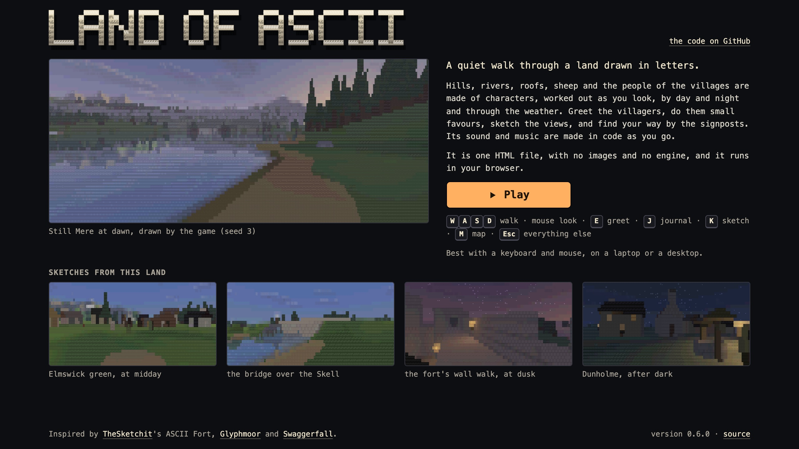
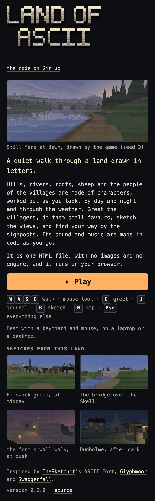
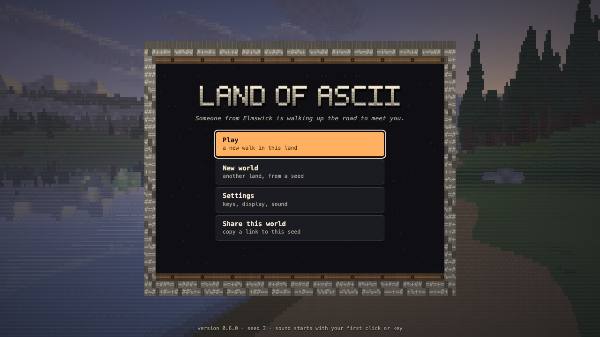
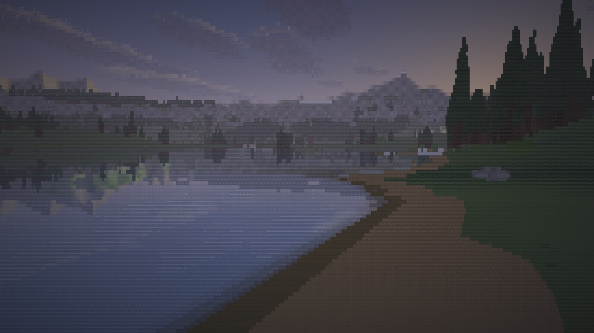
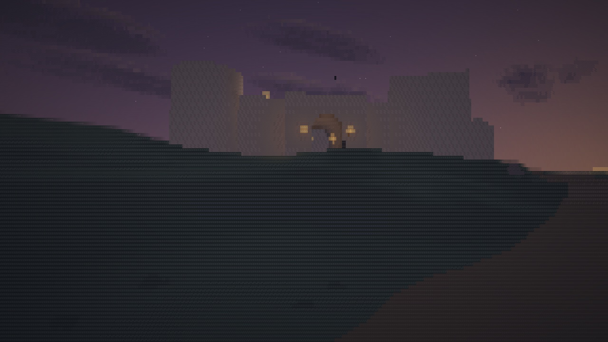
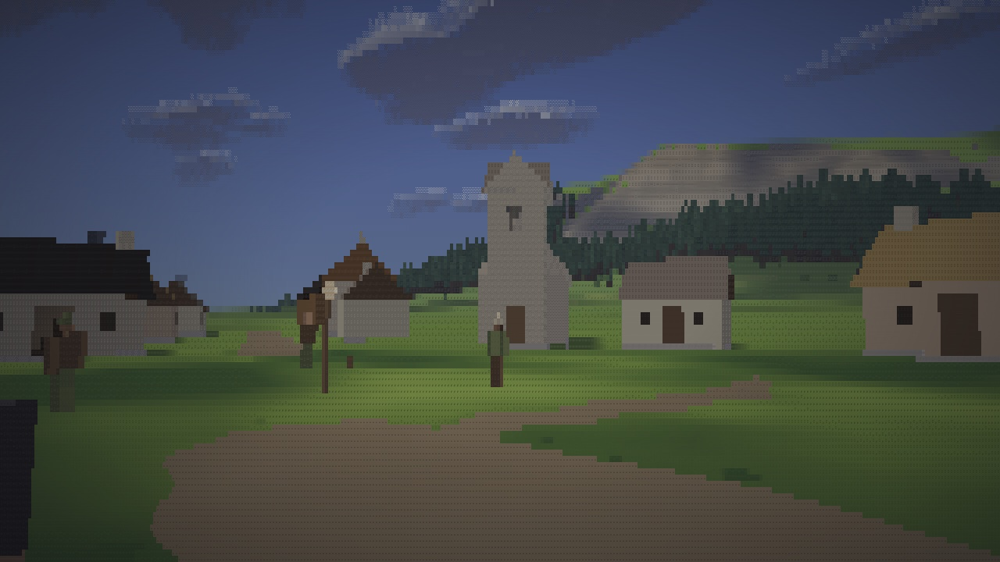
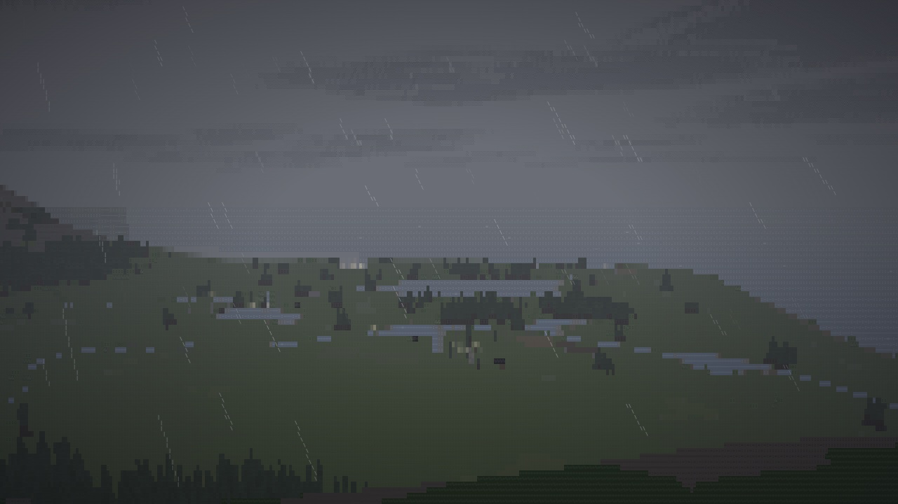
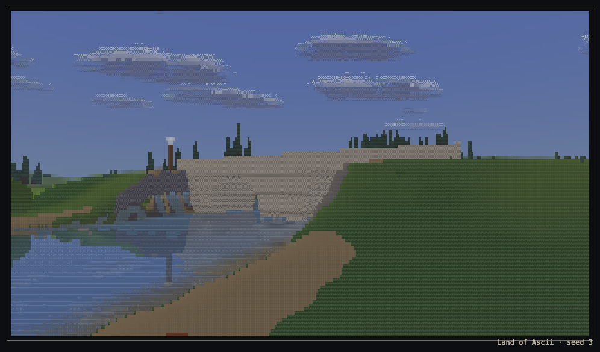

# Phase 6: a game to send to people

Written 14 Oct 2026. Version 0.6.0. Phase 6 makes Land of Ascii something you can send as one link:
- **A front page** at the site's root, saying what this is, with a Play button.
- **A title screen** over the drifting world: Play or Continue, New world, Settings, Share this world.
- **A first visit that sets itself up:** the detail level measured once, and the first minutes made clear by words, timing and hints that fade, with no tutorial.
- **Sharing:** a link to the world (and to a place and an hour in it), and a sketch as an image.
- **Comfort:** keys that can be changed, larger text, reduced motion, a frame-rate cap, full screen, a pause when the window is left, and a plain message where a browser cannot run the game.

Nothing in the land, the simulation or the generator changed. The name is Land of Ascii everywhere a player looks ("v3" is only in the repository's and the site's names).

**Live:** https://land-of-ascii-v3.vercel.app/ (the front page), and `/play.html` (the game). GitHub Pages: https://oddslice.github.io/land-of-ascii-v3/. An old link with options (`/?seed=48211`) goes on to `/play.html?seed=48211`.

---

## 1. The move to play.html

- **What moved:**
  - The build writes the game to `play.html` and the front page to `index.html` (`tools/build.mjs`).
  - Every tool that opened `index.html` opens `play.html` (`tools/lib/serve.mjs` and the rest). The tools' server falls back to `index.html` for an older build's copy, so `tools/regress-why.mjs --old` still works.
- **Old links:**
  - Vercel redirects `/` with any of the game's options (`seed`, `at`, `hour`, `day`, `threads`, `density`, `lab`, `stress`, `yard`, `quiet`, `wild`, `animals`, `people`, `autodetail`) to `/play.html`, keeping the query (`vercel.json`).
  - The front page does the same in its first line of script, for GitHub Pages and for any option not listed.
- **Saved progress is not lost.** A browser keeps it by site, not by page, so `play.html` reads what the old address wrote. The same is true on both hosts.

## 2. The front page

- **What it shows:**
  - The name in the game's lettering (section 3).
  - The main picture: the lake at dawn.
  - Three short paragraphs and Play in the accent.
  - The keys that matter, and four sketches from the default seed.
  - The inspiration as the research file records it: TheSketchit's ASCII Fort, Glyphmoor and Swaggerfall, each linked.
  - The source. Play becomes Continue where this browser has a walk in progress.
- **The pictures are the game's own frames.** `tools/front.mjs` asks the game for a frame's cells (colour, glyph, ink) at a fixed camera. Colours are rounded to 5 bits a channel, and the result is deflated into `src/front/data.json` (23 KB for all five). The page draws them once, a picture a frame, cell by cell, as the game draws a cell. A live render would mean loading the renderer, its workers and the world (about 1 MB and seconds of work), so the page uses the game's own frames, saved.
- **Its cost:**
  - One request: the page itself, 36.5 KB.
  - Idle, its main thread is busy 3 ms in 10 s: 0.03% of a core at 1280 × 720, and 0.008% on a phone (`tools/front-check.mjs`).
- **Audits** (Lighthouse 12, local; Vercel also compresses):

| | Performance | Accessibility | Best practices | SEO | Largest paint | Blocking time | Layout shift |
|---|---|---|---|---|---|---|---|
| desktop | 100 | 100 | 100 | 100 | 0.2 s | 0 ms | 0.034 |
| mobile | 100 | 100 | 100 | 100 | 0.8 s | 0 ms | 0.012 |

- **The rules:**
  - Contrast is real: the quiet text is 7.9 : 1 on the page.
  - Every link and the Play button has a visible focus, a pointer and a hover.
  - There is no emoji, and no sideways scroll at 375 px.
  - It is one screen at 1280 × 720 and 1440 × 900.
  - Its words claim only what the game does.
- **A shared link unfurls** with the title, the description and a 1200 × 630 image (`og.png`, drawn by the front page itself from the same data: `node tools/front.mjs --og`). See section 9.

## 3. The title screen

- **The panel:**
  - It is the kit's stone and timber drawn in glyphs: a border of dressed stone in courses, lit from above and the left, with its joints, and a timber rail pegged under the top and over the foot.
  - It holds the name in the game's lettering. That is block letters of glyph cells in the masonry's cream, shaded toward the foot, with a shadow. Nothing else decorates it.
- **A welcome line** changes each visit, from six in the quiet voice. On a first visit it is the first meeting's truth: "Someone from Elmswick is walking up the road to meet you."
- **The choices:**
  - **Play,** or **Continue** with your standing and the place you were last near ("a wayfarer, last near the fort"). Continue stands you where you left off; a shared link's place wins.
  - **New world:** a seed field and random.
  - **Settings:** the menu, over the title.
  - **Share this world.**
- **Keyboard:** the first choice is focused, and the arrow keys move between the choices. A click beside the panel keeps the keyboard on them. A key or click while the panel fades in brings it forward at once. Escape opens nothing.
- **The foot:** the version and the seed, and that sound starts with the first click or key. Browsers allow no sound before that, so the flyover is silent until then.
- **What it keeps:** `progress.at` is new. It is where you stood, saved with the progress, so Continue can put you back. Older records load as before, without it.

### The flyover

It uses the world's own fixed cameras (`world.cameras`), chosen by name with fallbacks, so every seed gets four distinct spots. Each is held 20 s, turning slowly through 9 degrees, and cross-fades over 1.5 s into the next. The clock, the weather and the people stay alive.

| Spot | Wanted | Else | Hour | Weather |
|---|---|---|---|---|
| 1 | the main lake shore | the coast, a river valley, a bridge from its bank | dawn | fair |
| 2 | the fort from the road | the road to the fort, the wall walk | dusk | fair |
| 3 | a village green | any village centre, a village road | 12:30 | fair |
| 4 | the ridge-top vista | a forest edge, the spawn view, a village road | 14:00 | rain |

The weather is held for the spot, so a seed whose forecast has no rain still gets the rain spot.

**It touches nothing that is kept.** While the title is up:
- discovery and the journal do not run, so nothing is found or seen;
- the clock, the weather and where you stand are put back exactly when you choose.

The menu check waits through a spot change and confirms nothing was found and Play stands you at the spawn with the forecast's weather.

**Its cost** is the game's at the same views. Workers and draw, median and 95th percentile, at density 3 with 8 workers (`tools/title-bench.mjs`):

| Spot | Chromium | Firefox | WebKit |
|---|---|---|---|
| lake at dawn | 8.49 / 12.12 ms | 10.76 / 13.32 ms | 8.16 / 11.90 ms |
| fort at dusk | 4.69 / 5.48 ms | 5.12 / 6.76 ms | 5.36 / 8.30 ms |
| green at midday | 5.47 / 6.51 ms | 5.92 / 7.32 ms | 5.10 / 7.14 ms |
| ridge in rain | 7.37 / 8.52 ms | 8.74 / 12.26 ms | 6.90 / 10.32 ms |

The lake at dawn is the heaviest, as the lake shore is the heaviest fixed camera (section 8).

## 4. The detail level on a first visit

- **When it runs:** on a truly first visit, with no Display choices kept from before.
- **How it measures:** behind the title (the backdrop dimmed while it measures), after the world's first second, each level from medium up for 1.3 s. The measure is the frames' worker time and draw, as the benchmark judges a frame.
- **What it picks:** the highest level whose frames take at most 10.5 ms nine times in ten. That is sixty frames a second with a third to spare, because a level that stutters is worse than one a step lower.
- **It says so in one line,** for example "Detail set to fine: it keeps sixty frames a second on this machine. Settings, then Display, changes it." It keeps the choice.
- **Who it skips:** a player who already chose keeps their choice; a tool's browser is left alone unless it asks (`?autodetail=1`).

I could reach one machine (an Apple Silicon Mac), so the other "machines" are Chromium slowed by the DevTools CPU throttle and with fewer workers (`tools/detail-check.mjs`). The throttle slows the page more than its workers, so the two-worker run is the nearest to a weak laptop.

| Machine | Chose | Measured (workers and draw, 90%) |
|---|---|---|
| this Mac, 8 workers | fine | medium 8.11, fine 8.25, finest 13.3 ms |
| CPU 2× slower | fine | medium 8.73, fine 9.62, finest 13.8 ms |
| CPU 4× slower | fine | medium 9.63, fine 9.75, finest 13.86 ms |
| CPU 6× slower | medium | medium 9.14, fine 10.62 ms |
| this Mac, 2 workers | coarse | medium 18.2 ms |

A first try measured each frame's whole round trip (37 ms where the work was 8) and chose coarse everywhere. A second try, at a 12 ms bar, chose finest at 11.75 ms on this Mac, which is too close to the line. The bar is now 10.5 ms, with a second's warm-up first.

## 5. Sharing

- **Share this world** (the World section, and the title screen) copies `play.html?seed=N`. With "with where I stand and the hour" ticked, it also copies `&at=x,z,yaw&hour=h`. A link with a place opens there after the title screen; a place off the land is ignored.
- **A sketch as an image:** the journal's sketch viewer has **share** and **save image**. Share puts the image on the clipboard where the browser allows it, and saves it otherwise. The card is the sketch as the game draws it, in a thin cream frame, with "Land of Ascii · seed 3" small in the corner in the game's monospace. The file is named after the seed and the place.

## 6. Comfort

- **Keys** (Controls, at the top): each of the thirteen actions a player uses has its key and a change button. The next key pressed takes it; Escape leaves it. A key already used, or one the game keeps, is refused, and the reason is given ("Not changed: E is already greet someone."). A reset button puts them all back.
  - The game and the tools still speak the default keys' names: Input turns a pressed key into the default key of its action, and a moved default key into nothing.
  - The start hint, the favour note and the menu all show the player's own keys.
- **Text size:** regular, large, larger. It applies to the menu's and the journal's pages, what people say, the prompts, the signpost and the exchange. At "larger" every section still fits 1024 × 640 with no sideways scroll.
- **Motion:** as the device asks, reduced, or full. Reduced stills every transition and animation of the menu, the map's pulse and the hint, stops what you carry from swaying with your stride (the game has no camera bob), and holds the title's view still.
- **Frame rate:** as fast as it goes, 60 at most, or 30 at most. The note says 30 lets a laptop's battery last longer. The pacer never asks for frames closer than the cap allows.
- **Full screen:** F11 (the game takes the key from the browser) or the Display section's button.
  - Tested against the mouse lock in a visible Firefox: F11 keeps the lock; Escape leaves both and opens the menu in one press; F11 again goes back with the mouse taken; F11 to leave keeps the mouse and does not open the menu.
  - Chromium under automation never grants the mouse lock, so its half of this was checked only without it.
- **Away:** when the window loses focus or the tab is hidden, the game pauses under "Paused while the window is elsewhere"; a click or Enter goes on. Not under the menu, the journal or an exchange, which pause already.
- **A browser that cannot run it** is told "Land of Ascii cannot run in this browser", with what it lacks (WebGL 2, workers, module workers), before anything is built.

## 7. The first ten minutes, as a stranger

I played a new world from the front page with no knowledge beyond what the screens said (`tools/first-video.mjs` records it, about two minutes, in `shots/walks/`, kept out of git), and noted every moment of doubt:

| Moment | What a stranger saw | Changed |
|---|---|---|
| Play on the title | Only "Esc menu and controls". No word of walking or looking, now that the old start card's list of keys is gone. | On a first walk the hint names the keys that matter (WASD walk, click the picture to look round, E greet, Esc menu), in the player's own keys, for ten seconds. |
| The title's line | "Someone is waiting for you on the road", but nobody is there for a minute. | "Someone from Elmswick is walking up the road to meet you." (They arrive about a minute in, 26 m down the road.) |
| The greeting prompt | Beside Rose Cobb, the prompt was hidden because the start hint still held its place. | The prompt takes the place: someone to greet matters more, and the hint gives way. |
| The first favour's directions | "Juliana Rush keeps watch at the fort, south-east of here", but which way is south-east? | Once the exchange closes, a note: "Your journal (J) keeps the favour. The map (M) shows north, south, east and west." Once only. |
| The journal's first opening | A long list of places not yet found. | The first time, it opens on the favour you are doing, with its directions. |
| The map's first opening | Mostly unknown, but the legend says "not yet seen" and "0 of 16 places found", and the compass is there. Under it, the statistics line still listed the old one-glyph marks ("# fort site · o village sites…"), over the legend. | The old line is gone where the map's drawn layer is. |
| The title's backdrop | A click on it took the keyboard off the choices, so Enter did nothing. | A click beside the panel keeps the choices focused; Enter with nothing focused plays. |

No tutorial was added. Everything else (the exchange's words and buttons, the signpost by the spawn, the meeting itself) read clearly.

## 8. The listening pass

I cannot hear. In place of headphones I measured what a listener would notice:
- clicks and harsh highs, in the rendered loop;
- notes that clash with the chord under them, in the composer itself (`tools/music-listen.mjs`, written to `shots/phase6/music-listen.txt`).

| | Before | After |
|---|---|---|
| chords with two notes a semitone apart (a seventh voiced just under its root: a sour cluster) | 5, 4 and 3 in the three tracks | 0 |
| notes a semitone (or a semitone and an octave) from a note the pad holds | 8, 11 and 9 | 0 |
| clicks in the rendered loop (a jump far over the moment's loudness) | 0 of 7,019 blocks | 0 |
| sound above about 4 kHz | 0.57% | 0.59% |
| loudest sample, loudness (the loop at the default settings) | 0.173, −34 dB | 0.173, −34 dB |

**What changed** (`src/sound/music.js`):
- A chord's colour note (its seventh or ninth) is never voiced a semitone from another of its notes; it goes up an octave, where it opens out.
- Any note that would land a semitone from what the pad holds moves to the nearest note of the mode clear of it.

The tunes keep their shapes; a few notes moved by a step (the flute's tune in "still water" lost three F-against-E rubs). Nothing else was touched: the tempi, the instruments, the levels and the loop are as in 0.5.4. It still needs your ears.

**The tunes are original.** Every one is made by the composer from a seed:
- a random walk on the mode's five-note core;
- a motif's shape kept and fitted to each chord;
- rhythms and chord orders from small lists of generic patterns.

No melody, from any game or anywhere else, was an input. Here is each tune as it plays, so it can be checked by ear against anything it might resemble:
- **morning field** (C major, piano): C4 C4 A4 F4 E4 G4 D4 E4 C4 C4 C4 D4 D4 C4 C4 C4 C4 D4 C4 G4 A4 F4 A4 D5 D5 C5 A4 E4 C4 A4 G4 C4 C4 G4 A4 F4 G4 G4 C4 E4
- **still water** (F Lydian, flute): C5 G4 C5 C5 E5 G5 D5 G5 G5 G5 E5 E5 C5 C5 A4 B4 G4 A4 A4 C5 D5 D5 G5 E5 C5 A4 G4 G4
- **long road** (G Mixolydian, piano): A4 G4 E5 C5 B4 G4 B4 E5 A5 B4 B5 G4 A5 A5 A5 A4 A5 G4 G5 G4 D5 A4 E5 G4 C5 G4 B4 B4 A4 B4 A5 B4 G4 A5 A5 E6 G4 D5 E5 C5 G4 B4 G4 B4

## 9. Measurements and checks

| Check | Result |
|---|---|
| Menu check, extended to the title screen (Play, the fade, the arrow keys, Escape; Settings over it; Share; New world's seed field), the keys (a change, a refusal, kept after a reload, reset), text size, reduced motion, the cap, sharing with a place, the pause, full screen, and a browser without WebGL 2 | 99 of 99 |
| Save check, extended to the title (Play; Continue with the standing and the place; Continue standing you where you left off) and to a shared link with a place and an hour opening there | 39 of 39 in Chromium, Firefox and WebKit |
| World check, five seeds | 5 of 5 pass, unchanged |
| Identity (every worker count draws the same) | world 112 of 112, yard 61 of 61, lab and stress 21 of 21 |
| Regression lookbook | 276 of 276 frames identical cell for cell: nothing this phase draws is in the tools' pictures |
| Bench, every fixed camera, the cap off, density 3, 8 workers, fair (slowest: the lake shore) | Chromium 8.30, Firefox 11.04, WebKit 8.00 ms |
| the same in rain | Chromium 8.68, Firefox 10.96, WebKit 9.92 ms |
| the title screen's own frames | section 3 |
| the front page | Lighthouse 100 / 100 / 100 / 100 on desktop and mobile; idle 0.03% of a core; one request |
| Sizes | `play.html` 1018.5 KB, `index.html` 36.5 KB, `og.png` 196 KB |

**The unfurl** of the live link: see the note in section 10.

## 10. What is still wrong, or not done

- **The music has not been heard.** The pass above is measurement, not listening.
- **Three machines were not reached.** The detail choice was tried on one Mac, a throttled Chromium and a two-worker run.
- **Chromium's mouse lock with full screen** was not tested (automation refuses the lock). Firefox's was.
- **No sound before the first click or key.** Browsers forbid it, so the title's flyover is silent until then. The foot says so.
- **The title screen's lake spot at dawn** reaches 12–13 ms at the 95th percentile in Chromium and Firefox. That is the same cost as the game's own heaviest camera at that hour.
- **Page views:** neither Vercel's free plan nor GitHub Pages counts them without adding analytics, so none were added.
